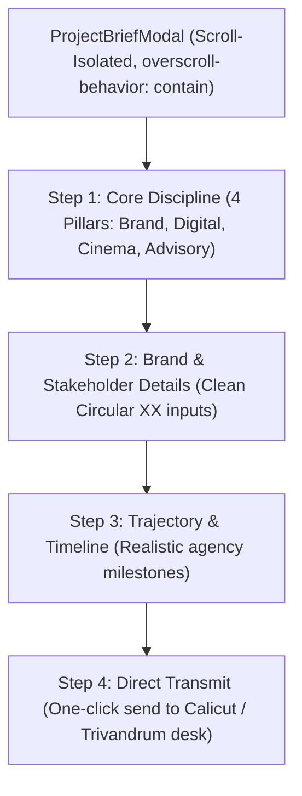

# Master Architectural Plan: Ground-Up Brief Modal Overhaul & Scroll Isolation

## 1. Root Cause Breakdown from User Feedback & Screenshots

### A. Screenshot 192735.png: AI-Slop Tag Elimination
- **Issue**: The red Monospace kicker `COMMERCIAL DESK / Start a Project Brief` and `// PHASE 01: SCOPE IDENTIFIER` feels like synthetic AI metadata tags.
- **Fix**: Remove artificial meta labels and replace with authentic 160over90 minimalist typography:
  - Clean title: **"Start a Project"** in genuine Circular XX font.
  - Subtitle: A simple, natural human sentence: *"Tell us about your brand, scope, and timeline. Our partners in Calicut & Trivandrum will review and respond promptly."*
  - Eradicate `// PHASE 01: SCOPE IDENTIFIER`, `[01 // 04]`, and all fake robotic slash codes.

### B. Screenshot 192743.png: Old Design Paradigm Residuals
- **Issue**: The user noted: *"this is still follwing the old diesn aestheritic jstu you cahgnes coros and some stuff thats all reset thedisng is smae man i itldyo uto fulyredohe diseng right"*.
- **Root Cause**: The 8 generic category tabs (`"Logo & identity"`, `"Web & app design"`, etc.) and the 30 tiny icon cards (`"Logo design"`, `"Business card"`, etc.) came straight from a generic Fiverr/freelance-style multi-choice questionnaire, completely out of sync with Marca Ubi's authentic agency services:
  - Marca Ubi does **NOT** sell cheap piecemeal items like "T-shirt", "Mug", "Beer label", or "Facebook cover".
  - Marca Ubi is a high-end agency providing:
    - **Brand Engineering & Strategy**
    - **Digital Infrastructure & Web Platforms**
    - **Art Direction & Motion Cinema**
    - **Cultural Campaigns & GTM Advisory**
- **Fix (Complete Form Redesign)**:
  - **Ditch the 100 tiny freelance checkboxes.**
  - Re-anchor the form to our **authentic agency pillars** matching [`ServicesAccordion`](file:///F:/Fenar/Marca%20Ubi/Web_Works/marca_ubi_web_hosting/src/app/components/Sections/ServicesAccordion/types.ts):
    - **01. Brand & Identity Systems**
    - **02. Digital Architecture & Web Platforms**
    - **03. Creative Direction & Motion Cinema**
    - **04. Enterprise Strategy & Full-Suite Advisory**
  - Elegant large interactive cards (with subtle hover glazes, high typographic contrast, and pure minimalism).
  - Clean step flow:
    - **Step 1: Focus Area (Pillars)**
    - **Step 2: About You & The Brand** (Name, Email, Phone, Company, Project Goal)
    - **Step 3: Timeline & Scale** (Target launch date, estimated budget bracket, links/deck)
    - **Step 4: Transmit Brief** (Clean human summary with direct studio phone/email)

### C. Critical Bug: Scroll Propagation / Background Page Scroll Leak
- **Issue**: *"if scroll nothing isdie this scorlls aony the bkaournd our webite scorlls"*
- **Root Cause in `ProjectBriefModal.module.scss` & `ProjectBriefModal.tsx`**:
  - In `ProjectBriefModal.tsx`, `document.body.style.overflow = "hidden"` was set, but on desktop/mobile without `touch-action: none; overscroll-behavior: contain; position: fixed`, the outer wheel events propagate down to `window`.
  - In `ProjectBriefModal.module.scss`, `.backdropOverlay` was missing `overscroll-behavior: contain;`.
  - `.modalContainer` had `max-height: 92vh; display: flex; flex-direction: column; overflow: hidden;` but `.modalBody` had `overflow-y: auto;` without explicit height or `overscroll-behavior: contain;`, causing mousewheel events inside the modal to scroll the background website instead of the modal content!
- **Fix**:
  1. Add `overscroll-behavior: contain;` and `touch-action: pan-y;` to `.backdropOverlay`, `.modalContainer`, and `.modalBody`.
  2. Implement an active wheel event trap on `.modalBody`:
     ```ts
     const handleWheel = (e: React.WheelEvent<HTMLDivElement>) => {
       e.stopPropagation();
     };
     ```
  3. Ensure `.modalBody` is explicitly scrollable with `flex: 1 1 auto; min-height: 0; overflow-y: auto; -webkit-overflow-scrolling: touch;`.

---

## 2. Master Architectural & Visual Blueprint



### Aesthetic Rules:
1. **Zero AI Slop Headers**: Eradicate `// PHASE 01`, `COMMERCIAL DESK`, robotic indexing, or repetitive brackets.
2. **Typography**: Large, confident Circular XX (`$font-circular`) headings with natural editorial descriptions.
3. **Agency Realism**: Discard freelance commodity tags (mugs, t-shirts, beer labels); represent authentic agency scopes.
4. **Smooth Scroll Isolation**: Perfect internal scroll container with zero background bleed-through.

---

## 3. Step-by-Step Implementation Strategy

1. **Scroll Isolation Engine**:
   - Update `ProjectBriefModal.module.scss`:
     - `.backdropOverlay { position: fixed; inset: 0; z-index: 1000; overscroll-behavior: contain; }`
     - `.modalContainer { max-height: min(90vh, 840px); display: flex; flex-direction: column; }`
     - `.modalBody { flex: 1 1 auto; min-height: 0; overflow-y: auto; overscroll-behavior: contain; }`
   - In `ProjectBriefModal.tsx`, ensure `wheel` events don't bubble to the page.
2. **Header Redesign**:
   - Clean, minimalist header:
     - Left: **Marca Ubi Project Brief** (Pure typography, no red monospace `COMMERCIAL DESK`).
     - Right: Crisp minimal close `✕` button.
3. **Pillar-Based Scope Selection (Step 1)**:
   - 4 Monumental Agency Pillar cards:
     1. **Brand Strategy & Visual Identity**
     2. **Digital Infrastructure & Web Platforms**
     3. **Creative Direction & Motion Cinema**
     4. **Full-Suite Growth & Advisory**
   - Clean selection indicators with red borders and subtle dark glassmorphism.
4. **Streamlined Steps 2, 3 & 4**:
   - Step 2: Clean form with Name, Email, Phone, Company, and Project Vision.
   - Step 3: Target timeframe and optional budget bracket.
   - Step 4: Executive transmission card with direct contact details.

---

## 4. Quality & Safety
- Full pass on `client_160over90_platform.test.ts`.
- Zero type errors on `tsc`.
- All commits authored as `Fenar7 <86710532+Fenar7@users.noreply.github.com>`.
- PR #88 updated and kept OPEN.
