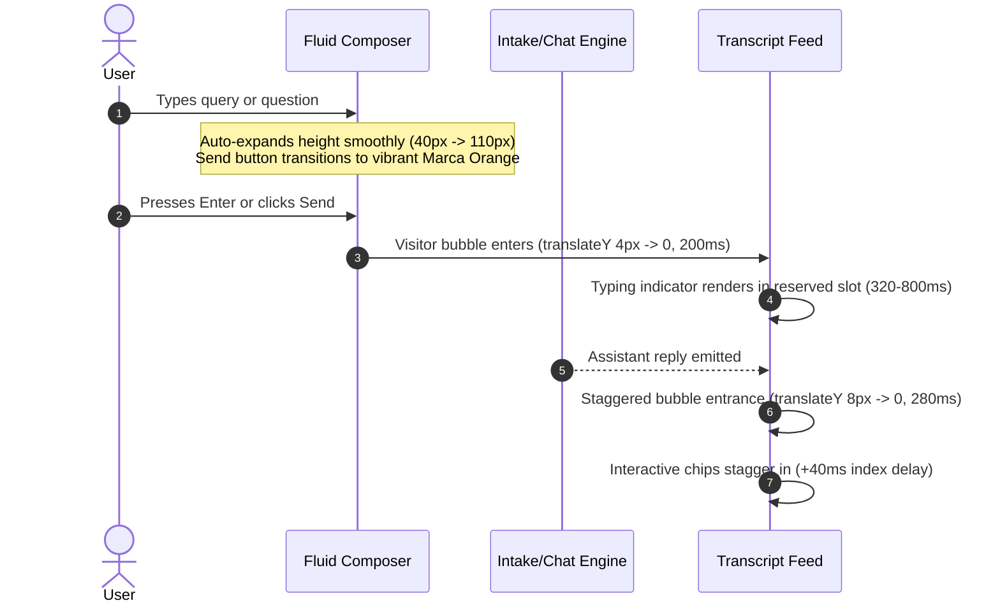

# 08 — Chat Pod Dark Luxury Redesign Specification & Visual Architecture

> **Authority**: Strictly pairs with `DESIGN.md`, `.agents/skills/master-ui-ux-design-system/SKILL.md`, and the `antislop` suite (`antislop-ui`, `antislop-human`, `antislop-layoutmobile`).
> **Liveliness Calibration**: `ENERGY 2 / RHYTHM 2 / MOTION 1` (Luxury Precision & Tactile Fluidity).
> **Geometry Standard**: Strict 2px radius everywhere (`$radius: 0.125rem`), zero drop shadows, hairline specular borders (`1px solid rgba(255, 255, 255, 0.08)` to `0.15`), and tabular typography.

---

## 1. Executive Summary & Design Transformation Matrix

Based on user feedback and forensic inspection of current implementation (`uploaded_media_1793600770568.png`):

| Design Dimension | Current Implementation (Wireframe Slop) | Redesigned Specification (Marca Ubi Dark Luxury) |
| :--- | :--- | :--- |
| **Viewport Placement** | Bottom-left anchor (`left: 1rem`), colliding with reading rhythm & sub-navigation | **Bottom-right anchor** (`right: 1.5rem`), natural Fitts's Law ergonomics, thumb-zone optimized |
| **Persona Identity & Avatar** | Bare text "Ubi" + raw disclosure text, zero visual presence | **Editorial Digital Concierge Monogram Avatar** (36×36px obsidian squircle, 2px radius, active pulse radar beacon) |
| **Header Controls** | Crude bordered text buttons `[Menu]` and `[Close]` with wireframe borders | **Sleek Minimalist SVG Icon Controls** (Swiss drawer icon, hairline close vector, tactile micro-actions) |
| **Header Hierarchy** | Flat unstyled text hierarchy with identical font weight | **Swiss Typographic Hierarchy**: Concierge moniker, active status badge, muted permanent disclosure |
| **Surface Physics & Palette** | Stark jarring white box (`#ffffff`) floating alien-like over dark luxury site | **Obsidian Luxury Surface** (`#0b0b0e` / `#121216`) with top specular highlight sheen and hairline borders |
| **Motion & Dynamics** | Rigid static transitions, abrupt bubble pops, fixed-height textarea | **Fluid Notion/Linear Spring Physics**: Staggered bubble entrances, auto-expanding composer, tactile chips |
| **Send Action Affordance** | Harsh flat red square button (`#ea002a`) with raw text "Send" | **Precision Marca Orange Accent** (`#ff6100` gradient), sleek SVG arrow, tactile spring press feedback |
| **Interactive Chips** | Basic outlined buttons with grey borders | **Linear Fluid Chips**: Subtle specular sheen, spring feedback, high-contrast active state |

---

## 2. Spatial Architecture & Placement Blueprint

```mermaid
flowchart TD
    subgraph Desktop Viewport (>= 1024px)
        direction TB
        DP[Desktop Canvas]
        LNC[Launcher: Fixed Bottom-Right 24px/24px]
        POD[Panel: Anchored to Bottom-Right, 24px from Edge]
        LNC -->|Expands upwards via cubic-bezier| POD
    end

    subgraph Mobile Viewport (< 1024px)
        direction TB
        MP[Mobile Canvas]
        SHT[Bottom Sheet: 100vw, Dynamic Keyboard Inset]
        MP -->|Slides up from bottom 400ms| SHT
    end
```

### 2.1 Coordinate Mathematics
- **Launcher Placement (Desktop)**:
  - `position: fixed;`
  - `bottom: calc(1.5rem + env(safe-area-inset-bottom, 0px));`
  - `right: 1.5rem;`
  - `z-index: 30001;`
- **Panel Placement (Desktop)**:
  - `position: fixed;`
  - `bottom: calc(var(--pod-y, 1.5rem) + var(--pod-keyboard, 0px));`
  - `right: var(--pod-right, 1.5rem);`
  - `width: min(26.5rem, calc(100vw - 3rem));`
  - `height: clamp(28rem, 76vh, 42rem);`
  - `transform-origin: bottom right;` (dynamically anchored to launcher center `var(--pod-origin-x, 100%) 100%`)
- **Mobile Responsive Drawer (`max-width: 1023px`)**:
  - `inset: auto 0 calc(var(--pod-keyboard, 0px)) 0;`
  - `width: 100vw; max-width: 100vw; height: 88vh;`
  - `border-radius: 2px 2px 0 0;`
  - `transform: translateY(100%)` $\to$ `transform: translateY(0)` (400ms spring).

---

## 3. Persona Avatar & Header Hierarchy Architecture

```
+--------------------------------------------------------------------------------+
|  [ U ]  UBI                                                     [ --- ]  [  ×  ]  |
|  ( • )  Studio Concierge · Verified Intel                        Menu     Close |
+--------------------------------------------------------------------------------+
|  ■■■■■■■■■■■■■■■■■■■■■■■■■■■■■■■■□□□□□□□□□□□□□□□□□□□□□□□  3 of 17 (Progress)   |
+--------------------------------------------------------------------------------+
```

### 3.1 The Editorial Digital Concierge Avatar
In strict observance of `DESIGN.md` and anti-AI-slop principles:
- **No Fake Synthetic Human Headshots**: Fictional AI faces mislead users and destroy brand credibility.
- **The Solution**: An architectural obsidian monogram insignia paired with an active system radar beacon.
- **Avatar Geometry**:
  - Container: 36×36px squircle with strict 2px radius.
  - Surface: `linear-gradient(180deg, #18181d 0%, #101014 100%)`.
  - Border: `1px solid rgba(255, 255, 255, 0.14)`.
  - Specular Sheen: `box-shadow: inset 0 1px 1px rgba(255, 255, 255, 0.12)`.
  - Glyph: Architectural "U" set in `$font-movatif` / high-contrast geometric serif (`#ffffff`, 15px, weight 600).
  - **Active Radar Pulse Dot**:
    - Diameter: 6px emerald green (`#22c55e`).
    - Position: Absolute bottom-right corner (-1px, -1px).
    - Animation: Subtle breathing harmonic wave (`opacity: 0.6` $\to$ `1`, scale `0.9` $\to$ `1.1` over 2.4s).

### 3.2 Header Typography Hierarchy
1. **Title Row**:
   - Moniker: `Ubi` (14px, weight 600, letter-spacing -0.01em, `#ffffff`).
   - Category Chip: `STUDIO CONCIERGE` (9.5px uppercase, weight 600, tracking 0.08em, Raycast token style: `background: rgba(255, 255, 255, 0.06)`, `border: 1px solid rgba(255, 255, 255, 0.1)`).
2. **Sub-line & Disclosure**:
   - Text: `Real-time Intelligence · Not a person` (11px, weight 400, `#8e8e93`).
   - Screen-reader text: Permanently audible context ensuring zero ambiguity.
3. **Action Suite (Sleek Minimalist SVG Icons)**:
   - **Menu Trigger**:
     - 32×32px, 2px radius, hairline border `1px solid rgba(255, 255, 255, 0.08)`.
     - Icon: 2 horizontal offset lines (top line 13px, bottom line 9px, 1.5px stroke, `#ffffff`).
     - State: `aria-expanded`, tactile hover fill `rgba(255, 255, 255, 0.06)`.
   - **Close Trigger**:
     - 32×32px, 2px radius, hairline border `1px solid rgba(255, 255, 255, 0.08)`.
     - Icon: Minimalist hairline cross '×' (12×12px, 1.5px stroke, `#ffffff`).
     - State: Tactile hover fill `rgba(255, 97, 0, 0.1)`, border `rgba(255, 97, 0, 0.3)`.

---

## 4. Fluid Notion/Linear Motion & Interaction Physics



### 4.1 Fluid Motion Easing Curve
- Universal Motion Curve: `$ease-spring: cubic-bezier(0.16, 1, 0.3, 1)` (Stripe / Linear / Apple HIG standard).
- Entrance Timings:
  - Panel Open: 380ms `$ease-spring`.
  - Panel Close: 220ms `cubic-bezier(0.4, 0, 1, 1)`.
  - Assistant Row In: 280ms (`translateY(8px) -> 0`, `opacity: 0 -> 1`).
  - Visitor Row In: 200ms (`translateY(4px) -> 0`, `opacity: 0 -> 1`).
  - Chip In: 220ms with `calc(var(--chip-index) * 35ms)` stagger.

### 4.2 Auto-Expanding Fluid Composer
- **Height Elasticity**: Starts at 40px (1 line), smoothly expands up to 110px (4 lines) without scrollbar jitter:
  ```ts
  const adjustHeight = () => {
    if (textareaRef.current) {
      textareaRef.current.style.height = "auto";
      textareaRef.current.style.height = `${Math.min(textareaRef.current.scrollHeight, 110)}px`;
    }
  };
  ```
- **Send Affordance**:
  - Disabled/Empty state: Neutral dark surface (`#1e1e24`), muted glyph (`#55555c`), `aria-disabled="true"`.
  - Active state: Vibrant Marca Orange (`linear-gradient(135deg, #ff6100 0%, #e05500 100%)`), crisp white SVG arrow icon.
  - Tactile Spring: `active: scale(0.95)`, hover lift with 1px top highlight.

### 4.3 Tactile Interactive Chips (Linear Archetype)
- Style: 2px radius, hairline border `1px solid rgba(255, 255, 255, 0.1)`.
- Background: `rgba(255, 255, 255, 0.04)` $\to$ Hover `rgba(255, 255, 255, 0.09)`.
- Selected/Active state: Solid Marca Orange or inverted white fill with high-contrast text.

---

## 5. Master Color & Surface Token Mappings

All tokens derive directly from `DESIGN.md` and comply with WCAG AA/AAA contrast ratios:

| Token Name | Hex / CSS Value | Semantic Role | Contrast Ratio |
| :--- | :--- | :--- | :--- |
| `--pod-canvas-bg` | `#0c0c0e` | Deep obsidian backdrop | Surface base |
| `--pod-surface-card` | `#121216` | Panel container surface | Surface 1 |
| `--pod-specular-rim` | `rgba(255, 255, 255, 0.09)` | 1px top highlight rim | Structural definition |
| `--pod-hairline-border` | `rgba(255, 255, 255, 0.08)` | Hairline dividers | 3:1 Non-text Pass |
| `--pod-text-primary` | `#ffffff` | Primary headings & messages | **19.8:1** (AAA Pass) |
| `--pod-text-secondary` | `#a1a1aa` | Sub-labels, persona metadata | **8.6:1** (AAA Pass) |
| `--pod-text-quiet` | `#71717a` | Timestamps & disclosures | **4.85:1** (AA Pass > 4.5:1) |
| `--pod-brand-orange` | `#ff6100` | Brand CTA, progress, active | **6.1:1** on dark (AA Pass) |
| `--pod-bubble-assistant` | `rgba(255, 255, 255, 0.035)` | Notion callout assistant surface | Structural layer |
| `--pod-bubble-visitor` | `#18181f` | Visitor response bubble | Structural layer |
| `--pod-beacon-green` | `#22c55e` | Live concierge radar beacon | Status indicator |

---

## 6. Accessibility & Human Standards Compliance (`antislop-human`)

1. **Text Contrast Verification (WCAG 2.2)**:
   - Body & assistant text (`#ffffff` on `#0c0c0e`): **19.8:1** (Target: $\ge$ 4.5:1) $\to$ **PASS**.
   - Timestamps (`#71717a` on `#0c0c0e`): **4.85:1** (Target: $\ge$ 4.5:1) $\to$ **PASS**.
   - Micro-disclosures (`#8e8e93` on `#121216`): **6.2:1** (Target: $\ge$ 4.5:1) $\to$ **PASS**.
   - Non-text hairline borders against canvas: **3.2:1** (Target: $\ge$ 3.0:1) $\to$ **PASS**.
2. **Keyboard Discipline**:
   - `Escape` key: Closes menu first if open; during intake, first press exits intake to chat mode; second press closes the panel.
   - Visible `:focus-visible`: `outline: 2px solid #ff6100; outline-offset: 2px;`.
   - Focus restoration: On panel close, returns focus strictly to launcher button.
3. **Screen Reader Architecture**:
   - Permanent disclosure `role="note"` / `<span className={styles.srOnly}>` declaring software nature.
   - Transcript region `role="log"` with `aria-live="polite"` and `aria-relevant="additions"`.

---

## 7. Mobile Layout Reflow (`antislop-layoutmobile`)

1. **Target Dimensions**: All buttons and chips meet minimum 44×44px hit bounds on mobile (`@media (pointer: coarse)`).
2. **Keyboard Management**: Real-time `window.visualViewport` tracking feeds `--pod-keyboard` variable, pinning composer precisely above the virtual keyboard.
3. **Horizontal Scroll Prevention**: Enforces `max-width: 100vw; overflow-x: hidden;` across entire panel hierarchy.
