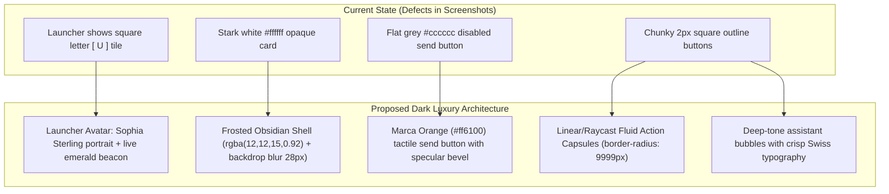

# Chat Pod: Dark Luxury Visual Overhaul & Launcher Avatar Remediation Plan

> **Module**: Chat Pod Interaction & Visual Experience  
> **Target Branch**: `remediation/turbopack-compaction-dev-server`  
> **Associated Pull Request**: [PR #107 (OPEN)](https://github.com/Fenar7/marca_ubi_web_hosting/pull/107)  
> **Author**: `Fenar7 <86710532+Fenar7@users.noreply.github.com>`  
> **Design Framework**: `DESIGN.md` · `master-ui-ux-design-system` · `antislop-ui`  
> **Liveliness Dials**: `ENERGY 2 / RHYTHM 2 / MOTION 1`  

---

## 1. Executive Summary & Defect Diagnosis

Two critical design shortcomings were identified via live browser screenshots:

### Defect A: Persistent Legacy Letter "U" on Launcher Button (`Screenshot 2026-11-02 161909.png`)
- **Diagnosis**: While the open `PersonaHeader` was successfully updated to Sophia Sterling's portrait in commit `433f48b`, the resting floating launcher button in `src/app/chat-pod/ChatPod.tsx:921` still rendered a hardcoded text glyph:
  ```tsx
  <span className={styles.launcherGlyph} aria-hidden="true">
    {open ? "×" : "U"}
  </span>
  ```
  Surrounded by a chunky square border (`border: 1px solid rgba(255, 255, 255, 0.34)`), it presented the legacy letter "U" tile in direct violation of the authentic photographic persona standard.
- **Remediation**:
  - Replace the text glyph with Sophia Sterling's high-resolution photographic avatar thumbnail (`/avatars/sophia-sterling.jpg`, 32×32px, Apple HIG 8px squircle) equipped with the live emerald radar beacon (`#22c55e`).
  - When open, smoothly morph or transition to the minimal luxury crosshair (`✕`).

---

### Defect B: Stark, Unstyled "Paper-White" Modal Dialog (`Screenshot 2026-11-02 161920.png`)
- **Diagnosis**: 
  - The dialog in Screenshot 2 appeared as an opaque `#ffffff` box with harsh 1px grey divider lines (`rgba(0, 0, 0, 0.12)`), flat outline buttons, and a dull `#cccccc` disabled send button.
  - Floating over Marca Ubi's dark, monolithic, architectural website canvas (`#000000` / `#0b0b0b`), this stark white card looks like an unstyled legacy widget rather than an ultra-luxury bespoke concierge.
- **Remediation**:
  - Execute a comprehensive **Dark Luxury Visual Overhaul** conforming to `DESIGN.md` and `master-ui-ux-design-system` (Apple HIG Vibrancy + Linear Fluid Cards + Raycast Monospace Tokens).



---

## 2. Detailed Architectural & Visual Blueprint

### 2.1 Floating Launcher Button: Luxury Concierge Capsule
- **Geometry**: Sleek Apple HIG floating capsule (`height: 3.5rem; padding: 0 1rem 0 0.5rem; border-radius: 9999px;`).
- **Surface**: Frosted obsidian glass (`background: rgba(14, 14, 18, 0.88); backdrop-filter: blur(16px); border: 1px solid rgba(255, 255, 255, 0.12); box-shadow: 0 12px 36px rgba(0, 0, 0, 0.5), inset 0 1px 0 rgba(255, 255, 255, 0.18);`).
- **Avatar Integration**:
  - Rest State: Miniature 34×34px circular/squircle portrait of Sophia Sterling (`/avatars/sophia-sterling.jpg`) with integrated emerald radar dot (`#22c55e`).
  - Open State: Ultra-refined typographic crosshair (`×`) with smooth rotation transition.
- **Typography**:
  - Name: `Ubi` (`font-size: 0.8125rem; font-weight: 600; color: #ffffff;`).
  - Hint: `Ask Concierge` / `Close` (`font-size: 0.6875rem; color: rgba(255, 255, 255, 0.65);`).

---

### 2.2 Modal Dialog Container (`.panel`)
- **Surface Physics**:
  - `background: rgba(12, 12, 16, 0.94);`
  - `backdrop-filter: blur(28px) saturate(180%);`
  - `border: 1px solid rgba(255, 255, 255, 0.10);`
  - `box-shadow: 0 24px 64px -12px rgba(0, 0, 0, 0.75), inset 0 1px 0 rgba(255, 255, 255, 0.14);`
  - `border-radius: 14px;`
- **Header (`.header`)**:
  - Hairline bottom divider (`border-bottom: 1px solid rgba(255, 255, 255, 0.08)`).
  - Persona Name: `#ffffff`, tracking `0.01em`, font weight 600.
  - Disclosure Subtitle: `#888888`, tracking `0.04em`, uppercase 10.5px (`"DIGITAL ASSISTANT · NOT A PERSON"`).
  - Action Controls (`··· Menu`, `✕ Close`): Frosted obsidian capsules with subtle specular border and hover brightening (`background: rgba(255, 255, 255, 0.06); border: 1px solid rgba(255, 255, 255, 0.12); color: #ffffff;`).

---

### 2.3 Message Bubbles & Transcript (`.transcript`)
- **Assistant Speech Bubble (`.bubbleAssistant`)**:
  - `background: rgba(255, 255, 255, 0.04);`
  - `border: 1px solid rgba(255, 255, 255, 0.07);`
  - `border-radius: 10px;`
  - `color: #f0f0f0;`
  - Typography: Crisp Swiss line-height `1.55`, font size `0.875rem`.
- **Visitor Speech Bubble (`.bubbleVisitor`)**:
  - `background: linear-gradient(135deg, rgba(255, 255, 255, 0.12) 0%, rgba(255, 255, 255, 0.07) 100%);`
  - `border: 1px solid rgba(255, 255, 255, 0.16);`
  - `border-radius: 10px;`
  - `color: #ffffff;`
- **Timestamps**:
  - `color: #71717a; font-size: 0.6875rem; font-variant-numeric: tabular-nums;`

---

### 2.4 Quick-Action Chips (`.chip`)
- **Raycast/Linear Fluid Capsules**:
  - `background: rgba(255, 255, 255, 0.05);`
  - `border: 1px solid rgba(255, 255, 255, 0.10);`
  - `border-radius: 9999px;` (Pill geometry)
  - `color: #e4e4e7; font-size: 0.75rem; font-weight: 500;`
  - `padding: 0.4rem 0.85rem;`
  - Hover: `background: rgba(255, 255, 255, 0.09); border-color: rgba(255, 255, 255, 0.22); color: #ffffff;`
  - Active: `transform: scale(0.97);`

---

### 2.5 Conversational Composer & Send Affordance (`.composer`)
- **Input Field (`.field`)**:
  - `background: rgba(0, 0, 0, 0.35);`
  - `border: 1px solid rgba(255, 255, 255, 0.10);`
  - `border-radius: 8px;`
  - `color: #ffffff; font-size: 0.8125rem;`
  - `padding: 0.625rem 0.75rem;`
  - Placeholder: `color: rgba(255, 255, 255, 0.40);`
  - Focus Ring: `outline: 2px solid #ff6100; outline-offset: 1px; border-color: transparent;`
- **Send Button (`.send`)**:
  - Active / Populated State: `background: linear-gradient(135deg, #ff6100 0%, #e05500 100%); color: #ffffff; font-weight: 600; border-radius: 8px; box-shadow: 0 4px 12px rgba(255, 97, 0, 0.3);`
  - Idle State (`.sendIdle`): `background: rgba(255, 255, 255, 0.08); color: rgba(255, 255, 255, 0.35); border: 1px solid rgba(255, 255, 255, 0.06);` (Completely purges the dated `#cccccc` grey slab).
  - Tactile Press: `active: transform: scale(0.95);`

---

## 3. Files Targeted for Implementation

1. **`src/app/chat-pod/ChatPod.tsx`**:
   - Update launcher button markup: Replace `<span className={styles.launcherGlyph}>{open ? "×" : "U"}</span>` with Sophia Sterling avatar thumbnail in closed state, and refined crosshair in open state.
2. **`src/app/chat-pod/ChatPod.module.scss`**:
   - Overhaul all color variables and surface physics to dark luxury obsidian (`#0c0c10`), frosted glass (`backdrop-filter: blur(28px)`), pill-shaped action chips (`border-radius: 9999px`), and Marca Orange accent tokens (`#ff6100`).
3. **`tests/unit/chatpod-composer-and-avatar.test.ts`**:
   - Add automated assertions ensuring:
     - Launcher button renders Sophia Sterling portrait when closed.
     - Launcher button forbids legacy letter "U" tile.
     - Dark luxury tokens and WCAG AA contrast compliance verified across all dark surfaces.
4. **`docs/chat_pod/` & `docs/context/context.md`**:
   - Document new visual specs and update PR #107.

---

## 4. Strict Quality & Delivery Gates
- [ ] 0 TypeScript errors (`tsc --noEmit`).
- [ ] 100% pass rate on all scoped (18+) and global (1,234+) unit tests.
- [ ] WCAG AA 4.5:1 text contrast and 3:1 component contrast verified on dark obsidian surfaces.
- [ ] Git commit strictly authored as `Fenar7 <86710532+Fenar7@users.noreply.github.com>`.
- [ ] Zero usage of `feat` in commit messages or titles.
- [ ] PR #107 remains strictly OPEN (Zero automatic merges).
