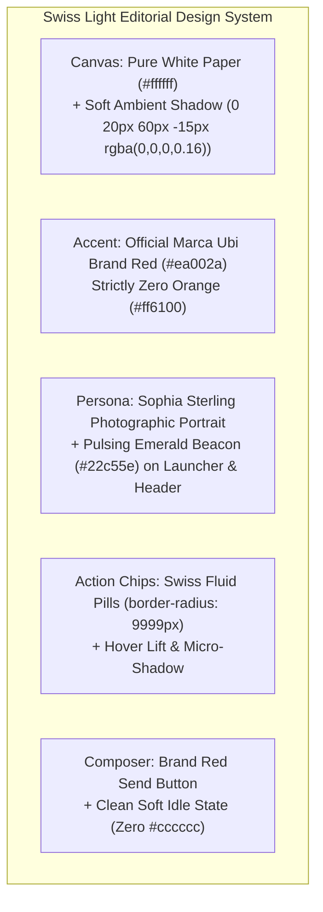

# Chat Pod: Swiss Light Editorial Master Overhaul Plan

> **Design Authority**: Authentic Marca Ubi Public Client Standard (Pentagram / 160over90 Aesthetic)  
> **Brand Accent**: **`#ea002a`** (`$client-accent-red`)  
> **Canvas**: Pure White Paper (`#ffffff`) with subtle Swiss hairlines (`rgba(0, 0, 0, 0.08)`)  
> **Typography**: Circular XX & Swiss Helvetica Neue with Tabular Numerals  
> **Target Branch**: `remediation/turbopack-compaction-dev-server`  
> **Associated Pull Request**: [PR #107 (OPEN)](https://github.com/Fenar7/marca_ubi_web_hosting/pull/107)  
> **Author**: `Fenar7 <86710532+Fenar7@users.noreply.github.com>`  

---

## 1. Executive Summary: The Comprehensive Visual Elevation

The goal is to elevate Chat Pod from a flat, unstyled widget into a **World-Class Swiss Light Editorial Concierge** that seamlessly belongs on the Marca Ubi agency website alongside the Pentagram header and editorial Journal rail:

1. **Brand Alignment**:
   - Strict lock to official Brand Red: **`#ea002a`** (`$client-accent-red`). Zero orange (`#ff6100`).
   - Pure white paper canvas (`#ffffff`) with soft depth (`box-shadow: 0 20px 60px -15px rgba(0, 0, 0, 0.16), 0 0 0 1px rgba(0, 0, 0, 0.08)`).
   - Modern continuous 12px squircle geometry (`border-radius: 12px`) replacing raw, harsh box edges.
2. **Permanent Eradication of Legacy Letter "U"**:
   - Resting launcher button features Sophia Sterling's authentic circular photographic portrait (`/avatars/sophia-sterling.jpg`) with the pulsing emerald radar beacon (`#22c55e`). Zero letter "U" tile!
   - Open state renders minimal circular crosshair (`✕`).
3. **Elevated Component Architecture**:
   - **Interactive Quick Action Chips**: Styled as **Swiss Editorial Fluid Pills** (`border-radius: 9999px; background: #ffffff; border: 1.5px solid rgba(0, 0, 0, 0.12); padding: 0.45rem 1rem;`). Hover introduces subtle lift (`translateY(-1px)`), crisp dark border, and soft micro-shadow.
   - **Header Bar**: Sophia's squircle portrait with emerald beacon, Circular XX Medium title `Ubi`, tracking `0.06em` Swiss disclosure `DIGITAL ASSISTANT · NOT A PERSON`, and hairline pill action buttons (`··· Menu`, `✕ Close`) with smooth hover fill.
   - **Assistant Speech Bubble**: Soft paper tint `rgba(0, 0, 0, 0.035)` with hairline border `rgba(0, 0, 0, 0.06)`, Swiss line-height `1.55`, and deep black ink `#0a0a0a`.
   - **Send Affordance**: Signature Brand Red (`#ea002a`) when input is populated with spring press feedback (`active: scale(0.96)`). Idle state uses a clean, modern soft neutral (`rgba(0, 0, 0, 0.04)` with muted text), completely eliminating the clunky `#cccccc` block.
   - **Composer Field**: Clean Swiss inset with smooth focus outline in `$client-accent-red` (`#ea002a`).

---

## 2. Component Design Token Blueprint

| Component | Legacy Wireframe Look | Elevated Swiss Light Editorial Standard |
| :--- | :--- | :--- |
| **Canvas & Shell** | Harsh flat white box with crude outline | Pure white paper (`#ffffff`) with 12px squircle radius, subtle hairline `rgba(0,0,0,0.08)`, and luxury elevation shadow |
| **Brand Accent** | Orange `#ff6100` (Mistake) | **Brand Red `#ea002a`** (`$client-accent-red`) |
| **Launcher Button** | Black box with square letter `[ U ]` | Black capsule pill with Sophia Sterling photographic portrait & green beacon (NO letter "U") |
| **Quick Action Chips** | Boxy 2px outline rectangles | Fluid rounded pills (`border-radius: 9999px; border: 1.5px solid rgba(0,0,0,0.12)`), hover lift (`-1px`), Brand Red focus ring |
| **Assistant Bubble** | Crude grey box with 2px radius | Soft warm paper surface (`rgba(0,0,0,0.032)`), hairline border, Swiss line-height `1.55`, black ink `#0a0a0a` |
| **Send Button** | Clunky `#cccccc` grey block | Vibrant **Brand Red (`#ea002a`)** with white text; soft modern neutral idle state (zero `#cccccc`) |
| **Header Controls** | Raw outline buttons | Minimalist capsule buttons (`··· Menu`, `✕ Close`) with subtle hover darkening |

---

## 3. Strict Safety & Verification Locks
- [ ] 0 TypeScript compilation errors (`tsc --noEmit`).
- [ ] 100% pass rate across scoped unit tests (`chatpod-composer-and-avatar.test.ts`) and global suite (`npm run test:unit`).
- [ ] Brand Red `#ea002a` enforced; zero orange `#ff6100`.
- [ ] Zero legacy letter "U" tile in launcher or header.
- [ ] Author identity strictly configured as `Fenar7 <86710532+Fenar7@users.noreply.github.com>`.
- [ ] PR #107 remains strictly OPEN awaiting manual human review (0 automatic merges).
