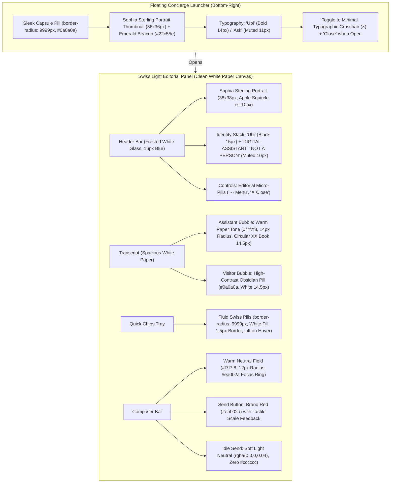

# Chat Pod: Overall Luxury Design Overhaul Plan (Authentic Swiss Light Editorial)

> **Design Authority**: Authentic Marca Ubi Public Site Standard (`$client-accent-red: #ea002a`, Pure White Paper Canvas, Swiss Light Editorial Typography, Apple HIG Fluid Micro-Geometry)  
> **Target Sub-Branch**: `remediation/turbopack-compaction-dev-server`  
> **Associated Pull Request**: [PR #107 (OPEN)](https://github.com/Fenar7/marca_ubi_web_hosting/pull/107)  
> **Status**: PENDING EXPLICIT USER CONFIRMATION  

---

## 1. Visual Defect Analysis Across the 3 Screenshots

| Element | Screenshot 1 & 2 (Old Boxy Prototype) | Screenshot 3 (Rejected Dark Mode) | Target Overhaul (Swiss Light Luxury) |
| :--- | :--- | :--- | :--- |
| **Theme & Canvas** | Harsh flat white box with primitive outlines | Dark obsidian card (`#0c0c10`), inverted theme (**Rejected**) | **Pristine White Paper Canvas (`#ffffff`)** with subtle ambient diffusion shadow |
| **Accent Color** | Red `#ea002a` on send, but raw and unpolished | Marca Orange (`#ff6100`) (**Rejected**) | **Signature Marca Ubi Brand Red (`#ea002a`)** |
| **Concierge Avatar** | Square tile with letter "U" or generic vector silhouette | Sophia Sterling photo with emerald beacon | **Authentic Sophia Sterling Photographic Portrait** (`/avatars/sophia-sterling.jpg`, 38×38px) with emerald beacon (`#22c55e`) |
| **Quick Action Chips** | Boxy rectangular blocks with sharp 90° corners, looking like 1990s table cells | Dark rounded pills | **Fluid Swiss Editorial Pills** (`border-radius: 9999px; background: #ffffff; border: 1.5px solid rgba(0,0,0,0.12); color: #0a0a0a;`) |
| **Message Bubbles** | Full-width flat grey rectangular slab (`#f4f4f4`) | Dark translucent bubble | **Refined Paper Surface** (`background: #f7f7f8; border: 1px solid rgba(0,0,0,0.06); border-radius: 14px 14px 14px 4px;`) with generous breathing room |
| **Composer Textarea** | Clunky square box with harsh border | Dark inset box | **Warm Neutral Editorial Field** (`background: #f7f7f8; border: 1.5px solid rgba(0,0,0,0.08); border-radius: 12px;`) with red focus ring |
| **Send Button** | Flat red block or dated `#cccccc` grey brick when empty | Orange gradient | **Brand Red (`#ea002a`)** with white text when populated; **Soft Neutral (`rgba(0,0,0,0.04)`)** when idle (zero `#cccccc`) |
| **Header Controls** | Boxy `... Menu` and `X Close` buttons | Dark pills | **Refined Editorial Micro-Pills** (`border-radius: 9999px; background: rgba(0,0,0,0.04); border: 1px solid rgba(0,0,0,0.06);`) |
| **Launcher Button** | Square black tile with letter "U" or "X" | Sleek black pill | **Luxury Floating Black Capsule** (`border-radius: 9999px; background: #0a0a0a;`) with Sophia portrait & emerald beacon in rest state; crosshair `×` in open state |

---

## 2. Master Architectural & Visual Specification

---

## 3. Detailed Component Styling Rules (`ChatPod.module.scss`)

### 3.1 Surface Tokens & Palette
- `$pod-canvas: #ffffff;` (Pure white paper canvas)
- `$pod-glass-header: rgba(255, 255, 255, 0.94);`
- `$client-accent-red: #ea002a;` (Strictly zero `#ff6100` orange!)
- `$client-accent-red-hover: #c40023;`
- `$client-accent-red-glow: rgba(234, 0, 42, 0.25);`
- `$ink: #0a0a0a;` (Black ink)
- `$text-body: #333333;`
- `$text-muted: #767676;` (WCAG AA compliant on white)
- `$hairline: 1px solid rgba(0, 0, 0, 0.08);`
- `$hairline-soft: 1px solid rgba(0, 0, 0, 0.06);`

### 3.2 Modal Panel (`.panel`)
- Background: `#ffffff` (Pure white paper)
- Border: `1px solid rgba(0, 0, 0, 0.08)`
- Border-radius: `16px` (Refined modern Swiss geometry)
- Box-shadow: `0 24px 64px -12px rgba(0, 0, 0, 0.16), 0 8px 24px -4px rgba(0, 0, 0, 0.06), 0 0 0 1px rgba(0, 0, 0, 0.04)` (Clean multi-layered luxury ambient diffusion)
- Backdrop scrim: `rgba(0, 0, 0, 0.35)` with `backdrop-filter: blur(4px)`

### 3.3 Header (`.header`)
- Background: `rgba(255, 255, 255, 0.94); backdrop-filter: blur(16px);`
- Bottom border: `1px solid rgba(0, 0, 0, 0.06)`
- Avatar: Authentic Sophia Sterling photographic portrait (`/avatars/sophia-sterling.jpg`, 38×38px), Apple HIG squircle (`border-radius: 10px`), active emerald status pulse beacon (`#22c55e`).
- Buttons (`.headerBtn`): Fluid capsule pills (`border-radius: 9999px; background: rgba(0, 0, 0, 0.04); border: 1px solid rgba(0, 0, 0, 0.06); color: #0a0a0a;`).

### 3.4 Message Bubbles (`.bubbleAssistant`, `.bubbleVisitor`)
- Assistant bubble: `background: #f7f7f8; border: 1px solid rgba(0, 0, 0, 0.05); color: #0a0a0a; border-radius: 14px 14px 14px 4px; padding: 0.875rem 1.05rem; line-height: 1.55;`
- Visitor bubble: `background: #0a0a0a; color: #ffffff; border-radius: 14px 14px 4px 14px; padding: 0.875rem 1.05rem; box-shadow: 0 4px 12px rgba(0, 0, 0, 0.08);`

### 3.5 Quick-Action Suggestion Chips (`.chip`)
- Capsule pill geometry: `border-radius: 9999px;`
- Surface: `background: #ffffff; border: 1.5px solid rgba(0, 0, 0, 0.12); color: #0a0a0a; font-weight: 500; font-size: 0.8125rem; padding: 0.45rem 1rem;`
- Hover: `background: #fdfdfd; border-color: #0a0a0a; transform: translateY(-1.5px); box-shadow: 0 4px 12px rgba(0, 0, 0, 0.06);`
- Active: `transform: scale(0.97);`
- Multi-select active (`.chipOn`): `background: #0a0a0a; color: #ffffff; border-color: #0a0a0a;`
- Focus: `outline: 2px solid #ea002a; outline-offset: 2px;`

### 3.6 Composer & Send Button (`.composer`, `.field`, `.send`, `.sendIdle`)
- Field: `background: #f7f7f8; border: 1.5px solid rgba(0, 0, 0, 0.08); border-radius: 12px; color: #0a0a0a; font-size: 0.875rem; padding: 0.75rem 0.875rem;`
- Field focus: `border-color: #ea002a; background: #ffffff; box-shadow: 0 0 0 3px rgba(234, 0, 42, 0.10); outline: none;`
- Send button (populated): `background: #ea002a; color: #ffffff; border: 0; border-radius: 10px; font-weight: 600; font-size: 0.8125rem; box-shadow: 0 4px 14px rgba(234, 0, 42, 0.35);`
- Send button hover: `background: #c40023; box-shadow: 0 6px 18px rgba(234, 0, 42, 0.45); transform: translateY(-1px);`
- Send button active: `transform: scale(0.96);`
- Send button idle (`.sendIdle`): `background: rgba(0, 0, 0, 0.04); border: 1px solid rgba(0, 0, 0, 0.06); color: #999999; box-shadow: none; cursor: default;` (Zero `#cccccc`!)

### 3.7 Floating Concierge Launcher (`.launcher`)
- Pill geometry: `border-radius: 9999px; background: #0a0a0a; color: #ffffff; border: 1px solid rgba(255, 255, 255, 0.18); box-shadow: 0 12px 32px rgba(0, 0, 0, 0.28); height: 52px; padding: 0 1.25rem 0 0.5rem;`
- Avatar thumbnail: 36×36px photographic portrait of Sophia Sterling (`/avatars/sophia-sterling.jpg`) with active pulsing emerald status beacon (`#22c55e`). Zero letter "U" tile!
- Open state: Transitions to clean typographic crosshair `[ × ]` and text `Ubi Close`.

---

## 4. Test Suite Harmonization (`tests/unit/chatpod-composer-and-avatar.test.ts`)

- Assert pure white paper canvas (`$pod-canvas: #ffffff` or `#ffffff`), refined `16px` border radius, and multi-layered elevation.
- Assert signature Brand Red (`#ea002a` / `$client-accent-red`) and zero orange (`#ff6100`).
- Assert zero `#cccccc` grey slabs; verify soft neutral `.sendIdle`.
- Assert fluid capsule geometry (`border-radius: 9999px`) on chips, header buttons, and launcher.
- Assert authentic Sophia Sterling portrait avatar and emerald beacon on launcher and header.
- Assert modal mutual exclusion and keyboard/caret stability invariants remain 100% intact.

---

## 5. Delivery Gates & Safety Compliance
1. **Zero PR Merges by Agent**: PR #107 remains strictly `OPEN` on GitHub.
2. **Commit Authorship**: Strictly `Fenar7 <86710532+Fenar7@users.noreply.github.com>`.
3. **No Feat**: Zero occurrences of `feat` in commit messages or PR updates.
4. **Validation**:
   - `tsc --noEmit` must return 0 errors.
   - All unit test suites (226+ Chat Pod tests, 1,243+ full project tests) must pass 100%.
