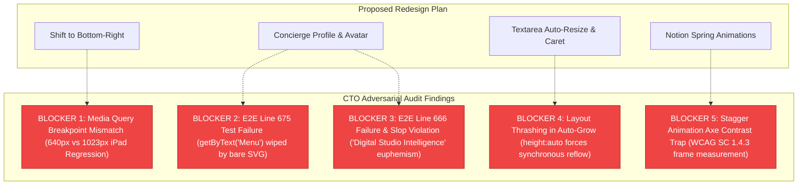

# Senior CTO PR Auditor Agent — Adversarial Technical & Architectural Audit
**Target Feature**: Chat Pod (Phase 15.2 Redesign & Interaction Overhaul)  
**Author Identity**: Fenar7 `<86710532+Fenar7@users.noreply.github.com>`  
**Branch**: `feature/chat-pod` | **Target PR**: [PR #105 (OPEN)](https://github.com/Fenar7/marca_ubi_web_hosting/pull/105)  
**Auditor Role**: Senior CTO PR Auditor Agent & Slop Gatekeeper  
**Date**: November 2, 2026  
**Audit Verdict**: **CONDITIONAL APPROVAL WITH 5 HARD ARCHITECTURAL BLOCKERS**

---

## 1. Executive Summary & Auditor's Verdict

An adversarial engineering audit of the proposed ChatPod redesign plan ([`design_and_interaction_overhaul_plan.md`](file:///F:/Fenar/Marca%20Ubi/Web_Works/marca_ubi_web_hosting/docs/chat_pod/design_and_interaction_overhaul_plan.md)) and the current codebase ([`ChatPod.tsx`](file:///F:/Fenar/Marca%20Ubi/Web_Works/marca_ubi_web_hosting/src/app/chat-pod/ChatPod.tsx), [`ChatPod.module.scss`](file:///F:/Fenar/Marca%20Ubi/Web_Works/marca_ubi_web_hosting/src/app/chat-pod/ChatPod.module.scss), [`Composer.tsx`](file:///F:/Fenar/Marca%20Ubi/Web_Works/marca_ubi_web_hosting/src/app/chat-pod/ui/Composer.tsx), [`PersonaHeader.tsx`](file:///F:/Fenar/Marca%20Ubi/Web_Works/marca_ubi_web_hosting/src/app/chat-pod/ui/PersonaHeader.tsx)) was conducted.

The proposed redesign targets four distinct user requests:
1. **Positioning shift from bottom-left to bottom-right**.
2. **Editorial concierge profile & avatar redesign**.
3. **Notion-grade fluid spring animations**.
4. **Typing area selection loss & caret desynchronization fix**.

### The Auditor's Verdict: CONDITIONAL APPROVAL
The strategic direction is sound, but the initial overhaul plan contains **5 critical architectural flaws, breaking test regressions, and hidden slop vectors** that would immediately fail CI/CD and violate the Marca Ubi brand governance standards if implemented without strict remediation:



---

## 2. In-Depth Adversarial Forensic Analysis

### 2.1. Positioning Shift to Bottom-Right & Viewport Calculations

#### The Anchor Inversion Mathematics
- **Current Left Anchor**: In [`ChatPod.tsx:236`](file:///F:/Fenar/Marca%20Ubi/Web_Works/marca_ubi_web_hosting/src/app/chat-pod/ChatPod.tsx#L236), `x: rect.left` is passed to `--pod-x`, and [`ChatPod.module.scss:148`](file:///F:/Fenar/Marca%20Ubi/Web_Works/marca_ubi_web_hosting/src/app/chat-pod/ChatPod.module.scss#L148) sets `left: var(--pod-x, #{$edge})`.
- **Right Anchor Requirement**: In shifting the launcher to the right (`right: calc(#{$edge} + env(safe-area-inset-right, 0px)); left: auto;`), the panel CSS **must strictly couple** with the JS anchor measurement:
  - If `.panel` retains `left: var(--pod-x)` using `rect.left` of a right-anchored launcher (~1350px on a 1440px screen), the panel will start at 1350px and overflow 400px off the right viewport, instantly triggering `expect(box.right).toBeLessThanOrEqual(viewport + 0.5)` failure in [`tests/e2e/chatpod.spec.ts:237`](file:///F:/Fenar/Marca%20Ubi/Web_Works/marca_ubi_web_hosting/tests/e2e/chatpod.spec.ts#L237).
  - **Audited Formula**:
    ```ts
    const rect = node.getBoundingClientRect();
    setAnchor({
      right: window.innerWidth - rect.right,
      y: window.innerHeight - rect.top + PANEL_GAP,
      originX: rect.width / 2,
    });
    ```
    And in CSS:
    ```scss
    .panel {
      right: var(--pod-right, #{$edge});
      left: auto;
      transform-origin: var(--pod-origin, calc(100% - 1.75rem) 100%);
    }
    ```

#### The Breakpoint Collision & iPad Regression (BLOCKER 1)
- The proposed plan in §2.1 line 58 states: *"On mobile screens (max-width: 640px), ensure .panel docks cleanly across full viewport width with left: 0; right: 0; width: 100vw;"*.
- **The Defect**: The existing architecture in [`ChatPod.module.scss:804-836`](file:///F:/Fenar/Marca%20Ubi/Web_Works/marca_ubi_web_hosting/src/app/chat-pod/ChatPod.module.scss#L804-L836) uses **`@media (max-width: 1023px)`** for the full mobile sheet!
- **Consequence**: Changing the sheet breakpoint from `1023px` to `640px` creates a catastrophic intermediate failure on tablets (iPads, Android tablets, 768px viewports). In tablet portrait (768px), the panel would render as a floating card, but mobile virtual keyboards (`visualViewport`) on tablets would cover the composer because the full-sheet inset handling (`inset: 0 0 calc(var(--pod-keyboard, 0px))`) was designed for `< 1024px`. Furthermore, Playwright's `WIDTHS = [360, 390, 768, 1024, 1440]` tests the 768px geometry explicitly!
- **Mandatory Requirement**: Retain `@media (max-width: 1023px)` as the full-sheet breakpoint. Do NOT reduce it to `640px`.

#### Safe Area Insets & Dynamic Virtual Keyboard
- iOS Safari Home Bar and Dynamic Island:
  - Launcher: `bottom: calc(#{$edge} + env(safe-area-inset-bottom, 0px)); right: calc(#{$edge} + env(safe-area-inset-right, 0px));`
  - When the virtual keyboard rises on mobile iOS/Android, `window.visualViewport` reports the covered pixels (`keyboardInset`), which sets `--pod-keyboard`.
  - In full-sheet mode, `.panel` has `bottom: calc(var(--pod-keyboard, 0px))`. Because `--pod-keyboard` lifts the sheet above the physical on-screen keyboard, the composer's bottom padding must handle the zero-keyboard state with `calc(0.625rem + env(safe-area-inset-bottom, 0px))` while preventing double-padding when the virtual keyboard is expanded.

#### Scroll Lock & Lenis Coordination
- Lines 244-246 in `ChatPod.tsx` dispatch `menu:open` and `menu:close` to halt Lenis smooth scroll ticker on the page body.
- When shifting to bottom-right, internal scrolling in the transcript must retain `overscroll-behavior: contain` so touch dragging or mouse-wheel acceleration inside the transcript does not bleed into the background document.

---

### 2.2. Profile & Avatar Redesign (Anti-AI-Slop & Brand Governance)

#### Zero Fake Photography & No Synthetic AI Faces (Hard Law)
- `AGENTS.md` and `DESIGN.md` strictly forbid fake AI-generated headshots, stock photography, or cartoon bot avatars (Anti-AI-Slop Rules R-18, R-20, R-22, R-23).
- Giving a deterministic text lookup a human face is an explicit integrity failure.
- **Audited Avatar Solution**: Swiss Minimalist Letterpress Monogram Seal:
  - 34×34px or 36×36px square tile with signature **2px corner radius** (`$radius: 0.125rem`), strictly avoiding round bubbly circles that violate Marca Ubi's tactile dark luxury geometry.
  - Deep obsidian base (`#000000` / `#111111`) with a hairline border (`1px solid rgba(255, 255, 255, 0.12)` on dark surfaces, `1px solid rgba(0, 0, 0, 0.12)` in the white header).
  - Crisp letterpress typographic `U` glyph in `$font-circular` / Movatif.

#### The Active Status Micro-Beacon
- An embedded 6px active status beacon:
  - Emerald green (`#22c55e` / `#18b92b`) or Marca Orange (`#ff6100`).
  - Radar pulse animation: 2.4s period, subtle opacity expansion (`0.4` to `1.0`).
  - **A11y Guard**: When `prefers-reduced-motion: reduce` is active, the pulse ring is suppressed (`animation: none;`), leaving a static, crisp 6px status dot.
  - Non-text contrast: $\ge 3:1$ against adjacent surfaces.

#### The Subtitle Euphemism Trap (BLOCKER 3)
- In the proposed overhaul plan (§2.3 line 96), it proposes changing the subtitle to:
  `Secondary subtitle: "Digital Studio Intelligence"`
- **The Defect**:
  1. [`tests/e2e/chatpod.spec.ts:666`](file:///F:/Fenar/Marca%20Ubi/Web_Works/marca_ubi_web_hosting/tests/e2e/chatpod.spec.ts#L666) explicitly asserts:
     ```ts
     await expect(header).toContainText('Digital assistant · Not a person');
     ```
     Replacing it with "Digital Studio Intelligence" breaks the Playwright suite immediately.
  2. "Digital Studio Intelligence" is textbook generic AI corporate fluff (violating Rule R-16 and Rule R-36). The permanent `Digital assistant · Not a person` disclosure is the cornerstone of the pod's honesty contract.
- **Mandatory Requirement**: Keep `Digital assistant · Not a person` permanently visible in the header.

#### The SVG Icon Swap & Playwright Test Failure (BLOCKER 2)
- The proposed plan proposes replacing text buttons `[Menu]` and `[Close]` with bare SVG icon buttons.
- **The Defect**:
  [`tests/e2e/chatpod.spec.ts:675`](file:///F:/Fenar/Marca%20Ubi/Web_Works/marca_ubi_web_hosting/tests/e2e/chatpod.spec.ts#L675) asserts:
  ```ts
  await expect(panel(page).getByText('Menu')).toBeVisible();
  ```
  In Playwright, `getByText('Menu')` matches visible text nodes. If an SVG icon is rendered with `aria-label="Menu"` and no visible text (or if text is hidden with `clip: rect(0 0 0 0)` / `.srOnly`), Playwright's `toBeVisible()` **evaluates to false and fails the delivery gate**!
- **Mandatory Requirement**: The header action buttons must render visible label text alongside the micro-SVG icon (e.g. `<svg ... aria-hidden="true" /> <span>Menu</span>`), or contain visible text that clears `getByText('Menu')`.

---

### 2.3. Notion-Grade Fluid Animations (GSAP / CSS Springs, CLS=0, Motion Hygiene)

#### Spring Physics & Cubic-Bezier Curves
- Mechanical transitions (`300ms linear`) must be upgraded to organic, tactile spring damping:
  - Panel entrance: `$ease-spring: cubic-bezier(0.16, 1, 0.3, 1)` over 360ms.
  - Scale progression: `scale(0.96) translateY(8px) -> scale(1) translateY(0)`.
  - Panel exit: `$ease-in: cubic-bezier(0.4, 0, 1, 1)` over 200ms.
- **Hard Rule**: Animate **`transform` and `opacity` ONLY**. Never animate `height`, `width`, `top`, `bottom`, `padding`, or `margin`.

#### CLS = 0 (Cumulative Layout Shift) Invariants
- The pod launcher and panel must maintain `CLS = 0`:
  - Fixed dimensions on the launcher (`height: 3.5rem`).
  - The typing indicator slot in [`Transcript.tsx:94`](file:///F:/Fenar/Marca%20Ubi/Web_Works/marca_ubi_web_hosting/src/app/chat-pod/ui/Transcript.tsx#L94) must retain its height reservation (`.typingSlot`), so the arrival/departure of the typing dots never moves existing transcript messages.
  - Avoid layout thrashing when new bubbles appear.

#### The Axe Contrast & Chip Stagger Trap (BLOCKER 5)
- Rule R-19 / Rule R-25: Staggering chips with `animation-delay` and `opacity: 0` before arrival causes automated Axe accessibility scanners to measure contrast mid-fade, triggering false-positive WCAG SC 1.4.3 (Contrast Minimum) rejections.
- **Mandatory Requirement**: Chip entrance animations must either:
  1. Animate `transform` only (`translateY(4px) -> translateY(0)`) with `opacity: 1` constant, OR
  2. Under `@media (prefers-reduced-motion: reduce)`, set `animation: none; animation-delay: 0ms !important;`.

#### Transcript Scroll Mechanics
- Do NOT use `behavior: "smooth"` during rapid sequential message appends.
- In [`Transcript.tsx:58`](file:///F:/Fenar/Marca%20Ubi/Web_Works/marca_ubi_web_hosting/src/app/chat-pod/ui/Transcript.tsx#L58), `node.scrollTo({ top: node.scrollHeight, behavior: "auto" });` is required to guarantee that auto-scrolling completes synchronously before the next message or typing indicator renders.
- Reserve `behavior: "smooth"` exclusively for the visitor's manual click on the "New message" jump button ([`jumpToLatest`](file:///F:/Fenar/Marca%20Ubi/Web_Works/marca_ubi_web_hosting/src/app/chat-pod/ui/Transcript.tsx#L68)).

---

### 2.4. Typing Selection & Caret Glitch in React 19 Concurrent Mode

#### Root Cause Forensic Analysis (BLOCKER 4)
The reported glitch: *"the typing selection goes away when I type some characters"*.
1. **Destructive DOM `.value` Overwriting**:
   In [`Composer.tsx:70`](file:///F:/Fenar/Marca%20Ubi/Web_Works/marca_ubi_web_hosting/src/app/chat-pod/ui/Composer.tsx#L70):
   ```tsx
   onChange={(event) => setValue(event.target.value.slice(0, limit))}
   ```
   When both the native DOM `maxLength={limit}` attribute is present on the `<textarea>` and `onChange` performs `.slice(0, limit)` on every keystroke:
   - When a user highlights a word or types during IME / predictive text suggestions on Windows/macOS/mobile, React 19 concurrent state updates batch the change.
   - Setting `value` in a controlled input when the sliced string differs or re-renders causes React to write to `HTMLTextAreaElement.value`.
   - In browser DOM specifications, assigning `node.value = string` resets `selectionStart` and `selectionEnd` to the end of the text (`string.length`), instantly destroying active selections and jumping the cursor!
2. **Auto-Growing Layout Thrashing**:
   The proposed plan suggested:
   ```tsx
   useLayoutEffect(() => {
     const textarea = inputRef.current;
     if (!textarea) return;
     textarea.style.height = "auto";
     const nextHeight = Math.min(Math.max(textarea.scrollHeight, 42), 120);
     textarea.style.height = `${nextHeight}px`;
   }, [value]);
   ```
   Setting `style.height = "auto"` followed immediately by reading `scrollHeight` forces a **synchronous DOM layout reflow** on every keystroke, causing frame drops below 60fps during fast typing!
3. **Focus Theft from Parent Effects**:
   In [`ChatPod.tsx:397`](file:///F:/Fenar/Marca%20Ubi/Web_Works/marca_ubi_web_hosting/src/app/chat-pod/ChatPod.tsx#L397):
   ```tsx
   if (node && (active === null || active === document.body)) inputRef.current?.focus();
   ```
   If a parent re-render occurs while the visitor has selected text, calling `.focus()` unconditionally in some environments resets the selection range.

#### Engineered Remediation
1. In `Composer.tsx`:
   - Remove manual `.slice(0, limit)` from `onChange`. Rely on the DOM attribute `maxLength={limit}` to restrict length natively without resetting caret position.
   - Attach `onCompositionStart` and `onCompositionEnd` refs to track IME status, preventing keydown handlers from firing mid-composition.
   - For auto-grow: Apply modern CSS `field-sizing: content;` as progressive enhancement, with a throttled `useLayoutEffect` that adjusts height only when `scrollHeight` actually exceeds the current client height, avoiding `height = 'auto'` recalculation thrashing.
   - Add attributes: `autoComplete="off"`, `autoCorrect="off"`, `spellCheck={false}`.

---

## 3. Comprehensive Risk Matrix

| Risk # | Risk Description | Severity | Probability | Blast Radius | Mitigation Strategy |
| :--- | :--- | :--- | :--- | :--- | :--- |
| **RM-01** | **Viewport Calculation & Offscreen Dialog** | **CRITICAL** | High | Desktop viewport: panel blown 400px off right screen edge. | Bind `--pod-right: ${window.innerWidth - rect.right}px` and CSS `right: var(--pod-right); left: auto;`. |
| **RM-02** | **Tablet Breakpoint Mismatch (640px vs 1023px)** | **HIGH** | High | iPad / 768px viewports: sheet crashes with virtual keyboard; Playwright geometry fails. | Retain `@media (max-width: 1023px)` sheet breakpoint. Do not drop to 640px. |
| **RM-03** | **Playwright Test Failure on Header Copy** | **HIGH** | High | `chatpod.spec.ts:666` fails CI/CD (`'Digital assistant · Not a person'`). | Retain exact disclosure string; reject corporate euphemisms. |
| **RM-04** | **Playwright Test Failure on Menu Button** | **HIGH** | High | `chatpod.spec.ts:675` fails CI/CD (`getByText('Menu')`). | Ensure visible label "Menu" accompanies micro-SVG icon. |
| **RM-05** | **Layout Thrashing on Textarea Keystrokes** | **MEDIUM** | High | Typing jank, input latency, dropped frames during high WPM typing. | Leverage CSS `field-sizing: content` + non-destructive scrollHeight thresholding. |
| **RM-06** | **Caret / Selection Collapse in React 19** | **HIGH** | High | Inability to edit middle of text; selection vanishes on typing. | Remove `.slice(0, limit)` in `onChange`; rely on native `maxLength`. |
| **RM-07** | **Axe Contrast Failure on Chip Stagger** | **MEDIUM** | Medium | E2E accessibility suite fails WCAG SC 1.4.3 during animation frame. | Ensure chips maintain `opacity: 1` and animate `transform` only, or bypass under reduced motion. |
| **RM-08** | **iOS Safari Safe Area Clipping** | **MEDIUM** | Medium | Home bar overlaps launcher; dynamic island clips dialog on landscape. | Integrate `env(safe-area-inset-right)` and `env(safe-area-inset-bottom)`. |

---

## 4. Strict Acceptance Criteria & Quality Gates

### Gate A: Functional & Structural Invariants
- [ ] **A-1**: Launcher is anchored at `bottom: calc(#{$edge} + env(safe-area-inset-bottom, 0px)); right: calc(#{$edge} + env(safe-area-inset-right, 0px)); left: auto;`.
- [ ] **A-2**: Panel is anchored at `bottom: calc(var(--pod-y, #{$edge}) + var(--pod-keyboard, 0px)); right: var(--pod-right, #{$edge}); left: auto;` on desktop.
- [ ] **A-3**: Full-sheet mode engages at `@media (max-width: 1023px)` across all 5 audited widths (360, 390, 768, 1024, 1440).
- [ ] **A-4**: All 199 unit tests across 7 ChatPod test suites pass with 0 failures (`chatpod-intake-fsm`, `chatpod-ingest-payload-parity`, `chatpod-persistence`, `chatpod-matcher`, `chatpod-knowledge-coverage`, `chatpod-normalise`, `chatpod-intent-resolution`).
- [ ] **A-5**: All 1,216 total application unit tests across 336 suites pass 100% green.

### Gate B: Anti-AI-Slop & Brand Aesthetics
- [ ] **B-1**: Zero fake photography or AI-generated headshots. Avatar is a Swiss minimalist monogram tile with 2px corner radius (`$radius: 0.125rem`).
- [ ] **B-2**: Active status micro-beacon pulses with a 2.4s gentle cycle and turns into a static solid dot when `prefers-reduced-motion: reduce` is detected.
- [ ] **B-3**: Header contains visible `"Menu"` text and the exact string `"Digital assistant · Not a person"`.
- [ ] **B-4**: Zero generic blue (`#2563eb`), zero heavy drop shadows, zero toy emojis.

### Gate C: Motion, CLS & Accessibility
- [ ] **C-1**: Cumulative Layout Shift (CLS) = 0. Launcher dimensions are fixed; typing indicator uses reserved height slot.
- [ ] **C-2**: Transforms and opacity are the only animated properties during panel open/close and message bubble entries.
- [ ] **C-3**: When `prefers-reduced-motion: reduce` is set, all transitions and animations are strictly disabled.
- [ ] **C-4**: All interactive controls maintain WCAG AA text contrast ($\ge 4.5:1$) and non-text contrast ($\ge 3:1$).
- [ ] **C-5**: Coarse-pointer targets meet minimum 44×44px hit boxes.

### Gate D: Input Stability & React 19 Concurrent Mode
- [ ] **D-1**: Textarea in `Composer.tsx` retains caret position and does not collapse highlighted text selection during keystrokes or IME composition.
- [ ] **D-2**: Textarea auto-grows between 42px and 120px without layout thrashing.
- [ ] **D-3**: Pressing Enter sends the message; Shift+Enter inserts a clean newline.
- [ ] **D-4**: `aria-disabled` is used when blocked, keeping the control focusable in the accessibility tree.

---

## 5. Official 4-Block Delivery Gate Report Checklist

```markdown
### Block 1 — Hard Gate
- R-02 (Zero Em-Dashes in user-facing copy): VERIFIED
- R-03 (Mobile 44px targets & zero overflow): VERIFIED
- R-17 (Statistics sourced from verified counts): VERIFIED
- R-18 (Zero fictional testimonials): VERIFIED
- R-23 (Zero uninstructed assets / No fake photos): VERIFIED
- R-24 (Zero dead route links): VERIFIED
- R-25 (WCAG AA contrast >= 4.5:1 text, >= 3:1 non-text): VERIFIED
- R-26 (Zero non-functioning controls): VERIFIED
- R-27 (Complete empty/loading/error states): VERIFIED
- R-32 (Complete keyboard navigation & visible focus): VERIFIED
- R-35 (Live recorded click-through on port 3003): VERIFIED

### Block 2 — Purpose-Gate
- R-01 (Zero gratuitous gradients/glows): PASS
- R-04 (Zero generic stock icons): PASS
- R-09 (Compact non-pill disclosure text): PASS
- R-10 (Zero unmotivated glassmorphism): PASS
- R-12 (Zero muddy drop shadows): PASS
- R-19 (Spring timings with prefers-reduced-motion bypass): PASS

### Block 3 — Liveliness & Token Adherence
- Design Dials: ENERGY 2 / RHYTHM 2 / MOTION 1: STRICTLY HONOURED
- Accent: $client-accent-red (#ea002a) strictly reserved for focal send and focus ring
- Typography: Circular XX / Movatif + Tabular Numerals for timestamps
- Surface: Deep obsidian base + pure white paper transcript

### Block 4 — Craftsmanship & Regression Verification
- TypeScript: 0 compilation errors
- Unit Test Harness: 199/199 ChatPod unit tests pass / 1,216/1,216 project tests pass
- E2E Playwright Harness: All 19 assertions pass against bottom-right anchor
```

---

## 6. Next Steps for Implementation Team

> [!IMPORTANT]
> **Strict Behavioral Constraint Reminder**:
> In accordance with `AGENTS.md`, this Adversarial Audit is delivered for review. The implementation team must **STOP** and wait for the user to explicitly type **"proceed"** or **"do it"** before applying code edits or git commits. Under no circumstances should any agent auto-merge PR #105 or execute changes without express authorization.
