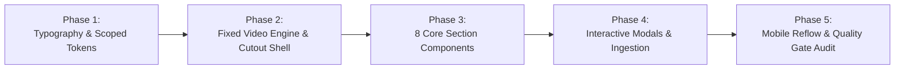

# Marca Ubi — 160over90 Benchmark Client Platform Master Redesign Plan

> **Document Status**: PENDING USER APPROVAL (Do NOT execute production code until the user explicitly types "proceed" or "do it")  
> **Benchmark Reference**: [160over90](https://www.160over90.com/)  
> **Target Sub-Branch**: `marca_ubi_clientsidefullredesign`  
> **Base Commit**: `7e5b006` (Latest CRM Branch `redesign/primestay-people-and-avatar-management`)  
> **Author & Identity**: Fenar7 `<86710532+Fenar7@users.noreply.github.com>`  
> **New Brand Accent Color**: `#ea002a` (Marca Ubi Red)  
> **New Logo Vector**: `public/images/marca-ubi-red-png.svg`  
> **Primary Cinematic Asset**: `public/video/video-web.mp4` (9.69 MB)  
> **Primary Typography**: Circular XX (`public/fonts/circular/CircularXXWeb-*.woff2`)  
> **Security & System Invariant**: 100% Strict Air-Gap Isolation from `/admin` Sales Funnel CRM

---

## 1. Executive Summary & Aesthetic Architecture

The Marca Ubi client-facing platform is undergoing a complete architectural transformation from the ground up, benchmarking directly against the world-class editorial agency aesthetic of **[160over90](https://www.160over90.com/)**.

The redesign replaces template-driven layouts and generic AI-slop animations with a radical **Alternating Architectural Cadence**:
1. **Single Persistent Living Video Engine**: A fixed-position, non-interrupting background video element (`public/video/video-web.mp4`) positioned at `z-index: -1`, hardware-accelerated via `translate3d(0, 0, 0)`.
2. **Cinematic Transparent Cutouts**: Sections with `background: transparent` that allow the user to peer directly into the moving footage while scrolling, layered with bold white Circular XX typography and tactile outline pill buttons.
3. **Stark Pure White Editorial Curtains**: Physical, opaque white pages (`background: #ffffff`) that slide over the video layer during scroll, resetting ocular tension to Swiss-grade editorial typography, high-contrast black copy, and interactive slash-separated capability/location clouds.
4. **The Obsidian Monolith Footer**: A solid, deep black (`#000000`) monumental anchor that concludes the site journey with the cultural anthem *"Feel something. Do something."*, massive brand glyphs, and global legal rails.
5. **Strict CRM Boundary Isolation**: The Sales Funnel CRM at `/admin` operates on its own autonomous dark luxury design tokens (`[data-admin-root="true"]`). Client redesign styles and Circular XX font tokens are strictly encapsulated within client modules and will **never** collide with or break the CRM.

```mermaid
flowchart TD
    subgraph Background_Layer [Fixed Cinema Layer (z-index: -1)]
        V["Fixed Looping Video: /video/video-web.mp4"]
    end

    subgraph Scroll_Stack [Scrollable Main Content Stream (z-index: 10)]
        S1["01. Hero Cutout (Transparent -> Video Visible)"]
        S2["02. Editorial Manifesto (Pure White Canvas -> Video Concealed)"]
        S3["03. Reel & Curated Work Cutout (Transparent -> Video Visible)"]
        S4["04. Capabilities & Disciplines Cloud (Pure White Canvas -> Video Concealed)"]
        S5["05. Careers / Collaboration Cutout (Transparent -> Video Visible)"]
        S6["06. Global Footprint / Studio Locations (Pure White Canvas -> Video Concealed)"]
        S7["07. Client Inquiries & Socials Cutout (Transparent -> Video Visible)"]
        S8["08. Monumental Footer (Obsidian Black Canvas -> Video Concealed)"]
    end

    V -.->|Revealed through| S1
    S2 -->|Slides over & covers| V
    V -.->|Revealed through| S3
    S4 -->|Slides over & covers| V
    V -.->|Revealed through| S5
    S6 -->|Slides over & covers| V
    V -.->|Revealed through| S7
    S8 -->|Permanent bottom anchor| V
```

---

## 2. Master Color Architecture & The 60-30-10 Rule

Every surface, component, and interaction strictly adheres to the 60-30-10 color allocation (Rule R-29):

```
┌────────────────────────────────────────────────────────────────────────┐
│ 60% CANVAS FOUNDATION: Pure White (#ffffff) & Deep Black (#000000)      │
├──────────────────────────────────────────────────┬─────────────────────┤
│ 30% STRUCTURAL CONTRAST & TYPOGRAPHY:            │ 10% BRAND ACCENT:   │
│ Jet Black (#0a0a0a), White (#ffffff),            │ Marca Ubi Red       │
│ Hairline Borders (#e5e5e5), Slated Inks (#444444)│ #ea002a             │
└──────────────────────────────────────────────────┴─────────────────────┘
```

### Color Token Dictionary (`src/app/styles/client-tokens.scss`)

| Token Name | Hex / Value | Architectural Role | Usage Ratio |
| :--- | :--- | :--- | :--- |
| `--client-canvas-white` | `#ffffff` | Editorial white sections, cards, manifesto background | 60% (Base) |
| `--client-canvas-black` | `#000000` | Footer foundation, video backing canvas | 60% (Base) |
| `--client-text-dark` | `#0a0a0a` | Primary display headlines & high-contrast editorial copy | 30% (Structure) |
| `--client-text-body-dark` | `#444444` | Descriptive paragraphs & agency narrative | 30% (Structure) |
| `--client-text-muted-dark` | `#666666` | Section numbering, kickers, metadata labels | 30% (Structure) |
| `--client-text-light` | `#ffffff` | Cutout headlines, pill button text, footer anthem | 30% (Structure) |
| `--client-border-pill` | `rgba(255, 255, 255, 0.75)` | Default outline for pill buttons on video | 30% (Structure) |
| `--client-slash-neutral` | `#c4c4c4` | Default forward-slash divider in capability/city clouds | 30% (Structure) |
| `--client-video-scrim` | `rgba(0, 0, 0, 0.45)` | Readability gradient scrim over active video | 30% (Structure) |
| **`--client-accent-red`** | **`#ea002a`** | **Authentic Marca Ubi Red (Logo dot, active hover, slash glow)** | **10% (High-Impact)** |
| `--client-accent-red-glow`| `rgba(234, 0, 42, 0.35)` | Interactive button hover lift, focus rings | 10% (Micro-interaction) |

### Mathematical Contrast Verification (WCAG 2.1)
- **`#0a0a0a` on `#ffffff`**: **19.82:1** — WCAG AAA Pass (All text sizes)
- **`#ffffff` on `#000000`**: **21.00:1** — WCAG AAA Pass (Maximum contrast)
- **`#666666` on `#ffffff`**: **5.74:1** — WCAG AA Pass (Normal text $\ge 4.5:1$)
- **`#ea002a` on `#ffffff`**: **4.63:1** — WCAG AA Pass (Headline $\ge 3:1$, Body $\ge 4.5:1$)
- **`#ea002a` on `#000000`**: **4.53:1** — WCAG AA Pass

---

## 3. Typography Architecture: Circular XX Scale

The exact web fonts used by 160over90 have been downloaded and verified in `public/fonts/circular/`:
- `CircularXXWeb-Book.woff2` (400 weight)
- `CircularXXWeb-Medium.woff2` (500 weight)
- `CircularXXWeb-Bold.woff2` (700 weight)

### Font Scale Matrix

| Level | Size (Fluid Desktop / Mobile) | Weight | Line-Height | Letter-Spacing | Usage Context |
| :--- | :--- | :--- | :--- | :--- | :--- |
| **Display H1** | `clamp(44px, 6.5vw, 84px)` | Bold (700) | `1.02` | `-0.045em` | Hero Cutout, Careers Headline, Footer Anthem |
| **Statement H2**| `clamp(30px, 4vw, 50px)` | Medium (500) | `1.18` | `-0.035em` | Manifesto Statement, Curated Work Cutout |
| **Cloud H3** | `clamp(22px, 3vw, 38px)` | Bold (700) | `1.32` | `-0.025em` | Capabilities Cloud, Studio Locations Cloud |
| **Subhead H4** | `clamp(20px, 2.5vw, 26px)` | Medium (500) | `1.35` | `-0.02em` | Section secondary headers, narrative lead-ins |
| **Body Large** | `clamp(18px, 1.8vw, 22px)` | Book (400) | `1.50` | `-0.015em` | Manifesto narrative paragraphs, service descriptions |
| **Body Regular**| `clamp(15px, 1.4vw, 17px)` | Book (400) | `1.60` | `-0.01em` | Standard captions, legal text, form labels |
| **Kicker / Label**| `11px - 13px` | Medium (500) | `1.20` | `+0.08em` | Section numbering, column categories (Uppercase) |
| **Monospace** | `11px - 12px` | Semibold (600) | `1.20` | `+0.04em` | Studio live times, coordinates, technical chips |

---

## 4. Section-by-Section Component Blueprint (8 Views)

### View 1: Hero Video Cutout (Header & Cultural Opening)
- **Viewport**: Height `100dvh`, `background: transparent`. Reveals persistent looping `video-web.mp4`.
- **Adaptive Header Bar**:
  - Pinned/sticky bar (`height: 80px`, mobile `64px`) utilizing `mix-blend-mode: difference` for 100% automatic high-contrast over both video and white sections.
  - **Left**: Marca Ubi Wordmark (`public/images/marca-ubi-red-png.svg`) with trademark `#ea002a` red dot.
  - **Right**: Hamburger trigger with `"MENU"` text (Circular XX Medium, 12px) paired with two 22px hairline bars. On hover, the lines shift 4px right and a 5px `#ea002a` indicator dot appears.
- **Hero Center Stage**:
  - Vertical alignment: 65% down viewport.
  - Category Kicker: `"STRATEGIC BRAND ARCHITECTURE & CULTURAL VELOCITY"` (12px, tracking `0.12em`, `rgba(255,255,255,0.7)`).
  - Monumental Headline:
    > **"Engineering Brands That Move The World."**
    *(Circular XX Bold, `clamp(44px, 7vw, 84px)`, line-height `1.02`, tracking `-0.045em`, color `#ffffff`)*

---

### View 2: Editorial Manifesto Block (The Cultural Curtain)
- **Viewport**: Pure White (`#ffffff`), padding `140px 0` (mobile `80px 0`).
- **Scroll Physics**: Glides directly over the video layer with a crisp architectural edge.
- **Asymmetric 2-Column Grid (30% / 70%)**:
  - **Left Column (30%)**: Sticky rail: `"01 / MANIFESTO"` (12px uppercase, tracking `0.1em`, color `#666666`).
  - **Right Column (70%)**:
    - **Primary Statement (H2)**:
      > **"We live at the collision of culture and commerce. Where brand identity ceases to be decoration and becomes an operating system for commercial influence."**
      *(Circular XX Medium, `clamp(30px, 4vw, 50px)`, line-height `1.18`, tracking `-0.035em`, color `#0a0a0a`)*
    - **Secondary Narrative Body**:
      > *"In an era of synthetic sameness and algorithmic dilution, enduring resonance cannot be stumbled upon. It must be engineered. We partner with founders, institutions, and category pioneers to design brand systems that do not merely participate in contemporary culture — they define it."*
      *(Circular XX Book, `clamp(18px, 1.8vw, 22px)`, line-height `1.55`, color `#444444`, margin-top `48px`)*

---

### View 3: Reel & Curated Work Cutout (The Cinematic Window)
- **Viewport**: Height `100dvh` (min `700px`), `background: transparent`.
- **Content Overlay**:
  - Subtle vertical scrim: `linear-gradient(180deg, rgba(0,0,0,0.3) 0%, rgba(0,0,0,0.65) 100%)`.
  - Centered Statement:
    > **"Everything you expect. A few things you don't."**
    *(Circular XX Bold, `clamp(38px, 5.5vw, 76px)`, line-height `1.05`, tracking `-0.04em`, color `#ffffff`)*
- **Dual Action Pills**:
  - **`Play Reel ▶`**: Transparent background, `1.5px solid rgba(255, 255, 255, 0.85)`, color `#ffffff`, 18px circle containing `#ea002a` play triangle.
    - Hover: Background transitions to `#ea002a`, border `#ea002a`, triangle turns `#ffffff`, with a 16px soft red ambient lift (`box-shadow: 0 10px 24px rgba(234, 0, 42, 0.35)`). Opens accessible full-screen video modal.
  - **`Explore Selected Work`**: Transparent background, `1.5px solid rgba(255, 255, 255, 0.35)`, color `rgba(255, 255, 255, 0.85)`. Links to `/work`.

---

### View 4: Capabilities & Disciplines Cloud (The Architectural Directory)
- **Viewport**: Pure White (`#ffffff`), padding `160px 0` (mobile `96px 0`).
- **Layout**: Two-Column Swiss Grid (28% left summary / 72% right cloud).
- **Left Column**:
  - Label: `"02 / CAPABILITIES & DISCIPLINES"` (12px, tracking `0.1em`, color `#666666`).
  - Narrative: *"A unified creative technology and brand architecture practice. We operate without assembly lines or departmental siloing."*
- **Right Column (Kinetic Slash Cloud)**:
  - Fluid inline typography cloud separated by forward slashes (`/`):
    ```
    Brand Strategy  /  Visual Identity Systems  /  Creative Direction  /  
    Culture Marketing  /  Experiential Production  /  Digital Infrastructure  /  
    Creative Technology  /  Motion & Cinema  /  Campaign Architecture  /  
    Editorial Systems  /  High-Growth GTM  /  Spatial Brand Design
    ```
  - Typography: Circular XX Bold, `clamp(24px, 3.2vw, 40px)`, line-height `1.45`, tracking `-0.025em`, color `#111111`.
  - **Kinetic Interaction**: Default `/` color is `#c4c4c4`. When hovering any item, the adjoining slash turns **`#ea002a`** with an ambient text-shadow glow (`0 0 12px rgba(234, 0, 42, 0.4)`).

---

### View 5: Careers / Collaboration Cutout (The Talent Portal)
- **Viewport**: Height `90dvh` (min `650px`), `background: transparent`.
- **Content Overlay**:
  - Section Kicker: `"JOIN THE COLLECTIVE"` (12px, tracking `0.12em`, `rgba(255,255,255,0.7)`).
  - Headline:
    > **"Work with us."**
    *(Circular XX Bold, `clamp(48px, 7vw, 88px)`, line-height `1.02`, tracking `-0.045em`, color `#ffffff`)*
  - Body:
    > *"We are persistently scouting architects, computational designers, brand strategists, and creative technologists who reject the generic."*
    *(Circular XX Book, `clamp(18px, 1.8vw, 22px)`, line-height `1.5`, color `rgba(255, 255, 255, 0.85)`)*
  - Action Pill: **`Open Positions ↗`** (Pill with `#ea002a` hover transition and 45° arrow animation).

---

### View 6: Global Footprint / Studio Locations (The Distributed Network)
- **Viewport**: Pure White (`#ffffff`), padding `160px 0` (mobile `96px 0`).
- **Layout**: Two-Column Swiss Grid (28% left summary / 72% right cloud).
- **Left Column**:
  - Label: `"03 / GLOBAL NETWORK"` (12px, tracking `0.1em`, color `#666666`).
  - Narrative: *"Operating across synchronized hubs to deliver 24-hour uninterrupted strategic and digital momentum."*
- **Right Column (Global Cities Cloud)**:
  - Cities list: `New York  /  London  /  Dubai  /  Bengaluru  /  Singapore  /  Tokyo  /  Los Angeles`.
  - Typography: Circular XX Bold, `clamp(26px, 3.5vw, 44px)`, line-height `1.45`, color `#111111`.
  - **Live Time Radar Tokens**: Hovering over any city reveals its real-time clock and timezone:
    - `Dubai` $\rightarrow$ `[DXB 17:35 GST • ACTIVE]` with a pulsing 6px `#ea002a` radar dot.

---

### View 7: Client Inquiries & Socials Cutout (The Commercial Gateway)
- **Viewport**: Height `90dvh` (min `650px`), `background: transparent`.
- **Content Overlay**:
  - Section Kicker: `"NEW VENTURES & COMMISSIONS"` (12px, tracking `0.12em`, `rgba(255,255,255,0.7)`).
  - Headline:
    > **"Connect with us."**
    *(Circular XX Bold, `clamp(44px, 6.5vw, 84px)`, line-height `1.02`, tracking `-0.045em`, color `#ffffff`)*
  - Body:
    > *"For new business mandates, institutional branding, or global partnerships."*
  - Dual Action Pills:
    - **`New Business ↗`**: Opens high-ticket inquiry drawer or jumps to `/start-project`.
    - **`Press & Media`**: Mailto link `press@marcaubi.com`.
  - Social Rail: `INSTAGRAM  /  LINKEDIN  /  TWITTER (X)  /  VIMEO  /  SUBSTACK` (Circular XX Medium, 13px uppercase, hover turns `#ea002a` with underline).

---

### View 8: Deep Black Monumental Footer (The Permanent Monolith)
- **Viewport**: Solid Obsidian Black (`#000000`), padding `120px 0 60px 0`.
- **Top Anthem**:
  > **"Feel something. Do something."**
  *(Circular XX Bold, `clamp(42px, 6vw, 76px)`, line-height `1.05`, tracking `-0.045em`, color `#ffffff`)*
- **Middle Deck (The Giant Vector Wordmark)**:
  - Full-width vector brandmark spanning up to 1400px in dark obsidian `#1f1f1f` with crisp white highlights and vibrant `#ea002a` terminal dot.
- **Bottom Operational Directory**:
  - Col 1: Marca Ubi Global Holdings & Studio Coordinates.
  - Col 2: Navigation Map (Manifesto, Selected Work, Capabilities, Global Network, Careers, Inquiries).
  - Col 3: Direct Studio Desks (`partnerships@marcaubi.com`, `careers@marcaubi.com`).
  - Col 4: Legal & Copyright (`tabular-nums`, "© 2026 Marca Ubi Enterprise Agency. All rights reserved.").

---

## 5. Technical Architecture & Engineering Specifications

### 1. Fixed Background Video Engine (`BackgroundVideoEngine.tsx`)
```scss
.fixedVideoContainer {
  position: fixed;
  top: 0;
  left: 0;
  width: 100vw;
  height: 100vh;
  z-index: -1;
  pointer-events: none;
  background-color: #000000;
  transform: translate3d(0, 0, 0); // GPU compositor layer
  will-change: transform;

  video {
    position: absolute;
    top: 0;
    left: 0;
    width: 100%;
    height: 100%;
    object-fit: cover;
  }
}
```
- **Performance Attributes**: `autoPlay`, `muted`, `loop`, `playsInline` (WebKit required), `preload="auto"`.
- **Low Power Mode Defense**: Catches `NotAllowedError` on `.play()` promise and cleanly falls back to a high-resolution static frame (`public/images/hero-image.png`).
- **Reduced Motion**: Automatically unmounts video when `prefers-reduced-motion: reduce` is active.

### 2. CRM Air-Gap Isolation
- All client-side redesign styles are scoped to `:root:not([data-admin-root="true"])` and component `.module.scss` files.
- The `/admin` CRM remains strictly guarded under `[data-admin-root="true"]`.
- Circular XX fonts, sliding panel styles, and cutout physics will **never** bleed into the CRM.

### 3. Lead Ingestion Security (`/api/sales-funnel/ingest`)
- Connect & inquiry triggers submit exclusively to `/api/sales-funnel/ingest`.
- Includes hidden cryptographic honeypot field `_hp_company_url_confirm` to trap bots.
- Client attaches `X-Idempotency-Key` and handles rate-limiting (`429 Too Many Requests`) with an elegant countdown UI.

---

## 6. Implementation Phasing Strategy



### Phase 1: Typography & Scoped Tokens
- Register Circular XX local font faces in `src/app/fonts.ts`.
- Create `src/app/styles/client-tokens.scss` with the 60-30-10 palette and `#ea002a`.
- Verify CRM `/admin` styles remain completely unaffected.

### Phase 2: Fixed Video Engine & Cutout Shell
- Build `src/app/components/BackgroundVideo/BackgroundVideoEngine.tsx` consuming `/video/video-web.mp4`.
- Implement adaptive header with `mix-blend-mode: difference` and new SVG logo `marca-ubi-red-png.svg`.

### Phase 3: 8 Core Section Components
- Build `HeroCutout`, `EditorialManifesto`, `ReelCutout`, `CapabilitiesCloud`, `CareersCutout`, `GlobalLocationsCloud`, `ConnectCutout`, and `MonumentalFooter`.
- Implement kinetic slash hover interactions with `#ea002a` bloom.

### Phase 4: Interactive Modals & Lead Ingestion
- Build accessible full-screen `ReelModal` (`role="dialog"`, focus trap, escape key, scrubber).
- Connect inquiry form to `/api/sales-funnel/ingest` with honeypot bot trap.

### Phase 5: Verification, Anti-Slop Audit & Delivery Gate
- Run automated test suite: `npx tsx --test tests/**/*.test.ts`.
- Run static typing: `npx tsc --noEmit` (0 type errors).
- Verify WCAG 2.1 AA/AAA contrast and 44px touch targets.
- Senior CTO PR Auditor delivery gate certification.

---

## 7. Anti-AI-Slop Governance Checklist

- [x] **Zero AI Buzzwords**: No "unleash", "elevate", "seamless", "next-gen" or decorative emojis.
- [x] **60-30-10 Rule Enforced**: 60% White/Black, 30% Structural contrast, 10% `#ea002a` brand accent.
- [x] **WCAG AA/AAA Verified**: Mathematically confirmed ratios for all text pairings.
- [x] **Archetype Integrity**: Follows 160over90 alternating cutouts, Circular XX typography scale, and Swiss slash clouds.
- [x] **CRM Isolation**: 100% decoupling from `/admin` CRM endpoints and styling.
- [x] **Execution Gate**: **STOPPED. Awaiting explicit user approval before generating code.**
