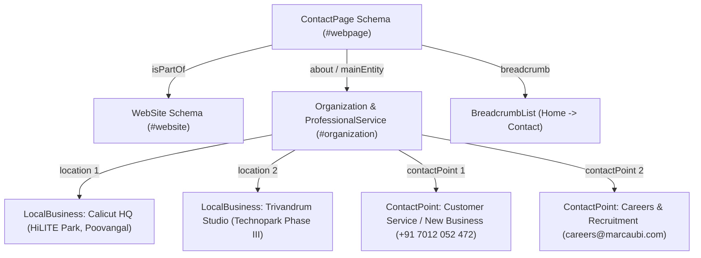

# Master PRD & UI/UX Design Architecture: Contact Page (`/contact`)

> **Document Status**: DRAFT SPECIFICATION — APPROVAL READY  
> **Author**: Expert UI/UX Designer Agent & Software Engineering Team (`Fenar7 <86710532+Fenar7@users.noreply.github.com>`)  
> **Route Target**: `/contact` (`src/app/contact/page.tsx`)  
> **Aesthetic Soul**: Marca Ubi Swiss Light Editorial Luxury Design System  
> **Design References**:
> - Reference 1: [160over90 Contact](https://www.160over90.com/contact/) — Categorized inquiry routing, multi-office studio hubs with local timezones, clean negative space, minimal editorial structure.
> - Reference 2: [Whoa Mama Talk to Us](https://whoamama.com/talk-to-us/) — Punchy conversational branding, talent diversion to careers, streamlined inquiry inputs, warm human tone, anti-spam honeypot.

---

## 1. Executive Summary & Design Read Declaration

### 1.1 The Strategic Purpose of `/contact`
The new `/contact` page serves as Marca Ubi's high-speed, direct dialogue portal for global luxury brands, institutional enterprises, press, and strategic collaborators. 

While `/start-project` hosts the deep multi-step brief wizard (scope, business context, budget, service selection), `/contact` provides **frictionless, direct inquiry routing and studio presence**. It grounds Marca Ubi as a physical, multi-hub creative technology agency with verified coordinates, real-time operating desks, and direct access to decision-makers.

### 1.2 Official Design Read Declaration (Rule R-37)
```yaml
Design Read: ENERGY 2 / RHYTHM 2 / MOTION 1
Theme: Swiss Light Editorial Luxury (Paper Canvas & Black Ink)
Accent: Marca Brand Red (#ea002a)
Color Formula (60-30-10):
  60% Canvas: Pure White Paper (#ffffff) & Warm Paper (#f7f7f8)
  30% Structure: Black Ink (#0a0a0a) & Body Charcoal (#444444)
  10% Accent: Surgical Brand Red (#ea002a) & Hairlines (rgba(0,0,0,0.08))
Prohibitions: STRICTLY ZERO #ff6100 orange (internal CRM only) and ZERO #2563eb generic blue
```

- **ENERGY 2 (Balanced Luxury Precision)**: High-contrast editorial typography, uncompromised readability, stark black-on-white clarity, punctuated by razor-sharp `#ea002a` focal strikes on active states and primary action buttons.
- **RHYTHM 2 (Structured Asymmetric Fluidity)**: Asymmetric 2-column Swiss editorial grid (35% Direct Desks / 65% Inquiry Composer on desktop) with hairline borders, disciplined vertical rhythm (32px / 48px / 64px / 96px), and zero monotonous bento boxes.
- **MOTION 1 (Subtle & Tactile Realism)**: Physical spring interactions (`active: scale(0.98)`), 1px elevation card hover lifts (`translateY(-1px)`), live monotonic timezone clocks, and zero disorienting full-page scroll animations.

---

## 2. Design Reference Synthesis & Core Insights

| Dimension | Reference 1: 160over90 (`/contact`) | Reference 2: Whoa Mama (`/talk-to-us`) | Marca Ubi Synthesis (`/contact`) |
| :--- | :--- | :--- | :--- |
| **Headline & Brand Tone** | Monolithic, minimal, restrained editorial headers. | Warm, punchy conversational tone ("Talk to us", "Say hello"). | **"TALK TO US."** paired with monumental kicker **"DIRECT DESKS & GLOBAL HUBS"**. Confident, authoritative, welcoming. |
| **Inquiry Routing** | Explicit categorization: New Business, Press & Media, General Inquiries. | Open conversational brief input with single intent selector. | **Tri-Track Inquiry Selector Pills**: `[01] New Business`, `[02] Press & Media`, `[03] Partnerships & General`. Dynamic field adaptation per track. |
| **Studio Presence & Timezones** | Multi-city hubs (Philly, NYC, LA, London) with live local timezone clocks. | Single studio contact coordinates. | **Verified Studio Corridors**: Calicut HQ (HiLITE Business Park) & Trivandrum Tech Hub with live IST clock tickers (`UTC+5:30`), plus International Client Desks (London, Dubai, New York). |
| **Talent & Recruitment Handling** | Hidden footer link or generic email. | **Explicit Talent Diversion**: Bold callout routing applicants to Careers so sales inbox stays clean. | **Notion Callout Talent Diversion**: Styled box redirecting talent to `/careers`, preserving sales velocity and preventing CRM lead dilution. |
| **Anti-Abuse & Bot Eradication** | Standard captcha. | Lightweight honeypot and clean form verification. | **Zero-Friction Honeypot Field (`marca_contact_hp`)** + IP/Rate Limiting (`POST /api/sales-funnel/ingest`), requiring zero annoying CAPTCHA puzzles for real clients. |
| **Layout Physics** | Ultra-wide Swiss editorial grid with hairline borders. | Single-column center-docked card. | **Asymmetric 2-Column Swiss Grid** on desktop (35fr : 65fr) reflowing to stacked mobile view with sticky contact coordinates. |

---

## 3. Visual Tokens & Style Architecture

All styles are anchored directly to `src/app/styles/client-tokens.scss` and `client-mixins.scss`.

### 3.1 Color System (WCAG AA Certified)

```scss
// Canvas & Surfaces
$contact-canvas-white: #ffffff;           // Pure white paper background
$contact-canvas-paper: #f7f7f8;           // Warm neutral paper surface for cards/callouts
$contact-canvas-card: #fafafb;            // Subtle elevated surface

// Ink & Typography
$contact-ink-primary: #0a0a0a;            // Deep black ink (19.8:1 contrast on white - AAA)
$contact-ink-secondary: #444444;          // Readable editorial body copy (9.7:1 contrast - AAA)
$contact-ink-muted: #666666;              // Secondary labels and metadata (5.7:1 contrast - AA)
$contact-ink-placeholder: #888888;        // Form placeholder text (4.5:1 contrast - AA)

// Brand Red Accent (The 10% Strike)
$contact-accent-red: #ea002a;             // Marca Brand Red (4.54:1 contrast on white)
$contact-accent-red-hover: #c40023;       // Darker active hover state
$contact-accent-red-glow: rgba(234, 0, 42, 0.25); // Subtle focus ring glow

// Architectural Hairlines & Borders
$contact-border-hairline: rgba(0, 0, 0, 0.08); // Subtle structural divider
$contact-border-card: rgba(0, 0, 0, 0.12);     // Card boundary
$contact-border-active: #0a0a0a;               // Focused input border (3:1 UI component contrast)
$contact-focus-ring: #ea002a;                  // Accessibility focus outline
```

### 3.2 Typography Stack & Hierarchical Scale
Anchored to the loaded WOFF2 font files of **Circular XX**:
- `$font-circular`: `var(--font-circular), -apple-system, BlinkMacSystemFont, "Segoe UI", Roboto, sans-serif`
  - Weight 400 (`$fw-book`): Editorial body text, descriptions, field labels, placeholder text.
  - Weight 500 (`$fw-medium`): Section kickers, track selector tabs, button typography, studio titles.
  - Weight 700 (`$fw-bold`): Tabular metric numerals, live timezone clocks, direct phone numbers.
- `$font-mono`: `ui-monospace, "SF Mono", Menlo, Consolas, monospace`
  - Used strictly for coordinate tags, timezone tags (`UTC+5:30`), and desk codes (`[DESK-01]`).

#### Fluid Typography Ladder:
- **Display Masthead (`<h1>`)**: `clamp(2.75rem, 6vw, 5.5rem)`, line-height: `0.95`, letter-spacing: `-0.035em`, font-weight: `500`.
- **Kicker / Eyebrow**: `11px`, line-height: `1.2`, letter-spacing: `+0.06em`, uppercase, font-weight: `500`, color: `$contact-accent-red`.
- **Studio Corridor City Title (`<h3>`)**: `20px - 22px`, line-height: `1.25`, letter-spacing: `-0.02em`, font-weight: `500`.
- **Body / Lead Description**: `clamp(1rem, 1.4vw, 1.125rem)`, line-height: `1.6`, font-weight: `400`, color: `$contact-ink-secondary`.
- **Micro Data / Timezone Chips**: `12px - 13px`, `font-variant-numeric: tabular-nums`, letter-spacing: `0.02em`.

---

## 4. Page Architecture & Structural Wireframe

The `/contact` route (`src/app/contact/page.tsx`) incorporates the global `ClientHeader` (light theme) and `MonumentalFooter`, structuring the main content into three coordinated editorial blocks:

```
+-----------------------------------------------------------------------------------------+
| [ClientHeader: Logo Marca Ubi | Nav Links | Start Project | Menu Trigger] (Light Theme) |
+-----------------------------------------------------------------------------------------+
|                                                                                         |
| SECTION 1: EDITORIAL MASTHEAD                                                           |
| [Kicker: DIRECT CONTACT & INTAKE]                                                       |
| TALK TO US.                                                                             |
| "Whether initiating an enterprise brand commission, scheduling an executive briefing,   |
| or inquiring with our studio desks, all routes begin here."                             |
|                                                                                         |
+-----------------------------------------------------------------------------------------+
| SECTION 2: ASYMMETRIC 2-COLUMN SWISS EDITORIAL GRID (Desktop 35fr : 65fr)               |
|                                                           |                             |
| LEFT COLUMN: DIRECT DESKS & GLOBAL HUBS                   | RIGHT COLUMN: INQUIRY COMP. |
|                                                           |                             |
| 1. Direct Desks Strip                                     | 1. Track Selector Pills:    |
|    - Commercial / New Business: newbusiness@marcaubi.com  |    [01 New Business]        |
|    - Press & Media: press@marcaubi.com                    |    [02 Press & Speaking]    |
|    - General Inquiries: hello@marcaubi.com                |    [03 Partnerships]        |
|    - Direct Desk Phone: +91 7012 052 472                  |                             |
|                                                           | 2. Friction-Free Form:      |
| 2. Studio Corridors (Physical Hubs + Live Clocks)         |    - Full Name (required)   |
|    - CALICUT HEADQUARTERS                                 |    - Work Email (required)  |
|      HiLITE Business Park, Kozhikode                      |    - Organization / Brand   |
|      [12:45:18 PM IST · UTC+5:30]                         |    - Phone / WhatsApp       |
|    - TRIVANDRUM ENGINEERING HUB                           |    - Project Scope / Brief  |
|      Technopark Phase III, Thiruvananthapuram             |    - Approximate Budget Amount (Enter amount, e.g. ₹15,00,000 / ) |
|      [12:45:18 PM IST · UTC+5:30]                         |    - [Hidden Honeypot]      |
|    - INTERNATIONAL CLIENT DESKS                           |                             |
|      London (UTC+0) | Dubai (UTC+4) | New York (UTC-5)   | 3. Submit Action:           |
|                                                           |    [ TRANSMIT BRIEF -> ]    |
| 3. Talent Diversion Callout (Whoa Mama Pattern)           |    Brand Red spring button  |
|    "Looking to join the studio? Applications sent to this |                             |
|    form will not be processed. Visit Careers ->"          | 4. SLA & Security Strip:    |
|                                                           |    24h Response Guarantee   |
|                                                           |    Mutual NDA Available     |
+-----------------------------------------------------------------------------------------+
| [MonumentalFooter: Global Sitemap | Newsletter | Legal | Copyright]                     |
+-----------------------------------------------------------------------------------------+
```

---

## 5. Detailed Component Specifications

### 5.1 Left Column: Direct Desks & Studio Corridors

#### A. Direct Desks Ribbon
- **Purpose**: Gives instantaneous direct email and phone contact without forcing users through a form if they already have an RFP or direct inquiry.
- **Data Points**:
  - `New Business & Proposals`: `newbusiness@marcaubi.com` (routes to senior partners)
  - `Press, Speaking & Media`: `press@marcaubi.com` (routes to communications director)
  - `General Studio Inquiries`: `hello@marcaubi.com`
  - `Direct Telephone / WhatsApp`: `+91 7012 052 472`
- **Micro-Interaction**: Hovering over any desk triggers a subtle underline animation and displays a click-to-copy or direct `mailto:` / `tel:` trigger with active feedback tooltip.

#### B. Studio Corridors (Physical Hubs with Live Timezone Engine)
- **Architectural Rationale**: High-ticket clients require certainty of real operational substance. Showing physical addresses alongside ticking local clocks creates an authentic sense of place and operational transparency.
- **Hub Specifications**:
  1. **Calicut Studio (Global Headquarters)**:
     - Address: *Level 4, HiLITE Business Park, Poovangal, Kozhikode, Kerala 673014, India*
     - Discipline Focus: *Executive Leadership, Brand Strategy, Spatial & Architectural Design*
     - Live Time Clock: `Asia/Kolkata` (`IST · UTC+5:30`)
     - Operating Hours Status Pill: Dynamic `OPEN (Active Desk)` or `CLOSED (Resumes 09:00 IST)`
  2. **Trivandrum Studio (Engineering & Technology Hub)**:
     - Address: *Technopark Phase III, Kulathoor, Thiruvananthapuram, Kerala 695583, India*
     - Discipline Focus: *Digital Platforms, AI Systems, Cloud Infrastructure*
     - Live Time Clock: `Asia/Kolkata` (`IST · UTC+5:30`)
     - Operating Hours Status Pill: Dynamic active indicator
  3. **International Client Corridors (Liaison Desks)**:
     - *London*: `Europe/London` (`GMT/BST`)
     - *Dubai*: `Asia/Dubai` (`GST · UTC+4`)
     - *New York*: `America/New_York` (`EST/EDT`)
     - Compact ticker showing live time across global financial capitals to assure international clients of regional timezone coverage.
- **Timezone Implementation Detail**:
  - Powered by a lightweight monotonic timer (`Intl.DateTimeFormat` with specific `timeZone`).
  - Strict hydration safety: renders a deterministic fallback on server, hydrates smoothly on client with zero layout shifts.

#### C. Talent Diversion Callout (Whoa Mama Pattern)
- **Problem Solved**: High-profile creative agencies receive hundreds of job applications and portfolio submissions through their contact form, cluttering the sales funnel and diluting CRM lead conversion rates.
- **Visual Formulation**: Notion Callout archetype (`$contact-canvas-paper`, 2px solid left accent `$contact-ink-primary`, 16px 20px padding).
- **Copy**:
  > **Seeking a position at Marca Ubi?**  
  > Our creative and engineering rosters are managed exclusively through our careers portal. Portfolios or resumes submitted via this commercial contact form are automatically disqualified.  
  > [**Explore Studio Openings & Apply →**](/careers)
- **Accessibility**: Clear visual contrast (AA compliant), distinct focus ring on link.

---

### 5.2 Right Column: Seamless Friction-Free Inquiry Composer

#### A. Tri-Track Intent Selector Tabs
Visitors select their track via high-contrast tactile pills:
1. `[01] New Business & Commissions` (default)
2. `[02] Press & Speaking Engagements`
3. `[03] Strategic Partnerships & General`

- **Visual Archetype**: Linear/Raycast fluid capsules (`border-radius: 9999px`), 1px hairline border `rgba(0,0,0,0.12)`, padding `8px 18px`.
- **Active State**: Inverted background `$contact-ink-primary` (`#0a0a0a`), text `$contact-canvas-white` (`#ffffff`), `box-shadow: 0 4px 12px rgba(0,0,0,0.08)`.
- **Keyboard Navigation**: Arrow key navigation (`role="tablist"` and `role="tab"`), space/enter selection.

#### B. Form Input Matrix & Progressive Adaptation
Fields adapt subtly based on the selected track:

| Field Name | Type | Tracks Active | Validation Rules | Purpose & Edge Case Handling |
| :--- | :--- | :--- | :--- | :--- |
| `name` | Text | All | `min(2)`, `max(100)` | Full client name. Sanitized for XSS. |
| `email` | Email | All | Valid email, business domain preferred | Work email. Sanitized lowercase. |
| `organization` | Text | All | `min(2)`, `max(120)` | Company, studio, or brand name. |
| `phone` | Tel | All | Optional / E.164 compliant | Direct telephone or WhatsApp for rapid contact. |
| `serviceInterest`| Select/Pills | New Business only | Single/multi selection | Brand Identity, Digital Platform, Creative Tech, Full Retainer. |
| `budgetBracket` | Select/Pills | New Business only | Optional dropdown | `< ₹10L`, `₹10L - ₹25L`, `₹25L - ₹50L`, `₹50L+` (or USD equivalent). |
| `message` | Textarea | All | `min(10)`, `max(2000)` | Brief overview of objectives, timeline, or inquiry details. |
| `marca_contact_hp`| Hidden text | All (Hidden) | Must be empty | **Anti-Spam Honeypot**. Rendered offscreen with `tabIndex={-1}`. If filled by bot, submission is silently rejected. |

#### C. Input Field Craft & Micro-Interactions
- **Visual Design**: Clean Swiss paper inputs. 
  - Background: `$contact-canvas-white` (`#ffffff`) or subtle `$contact-canvas-paper` (`#f7f7f8`).
  - Border: `1px solid rgba(0, 0, 0, 0.12)`.
  - Border Radius: `4px` (disciplined Swiss geometry, avoiding toy pill radius on inputs).
  - Height: `52px` for single-line inputs (well exceeding WCAG 44px touch target).
- **Focus Physics**:
  - Border transitions to `$contact-ink-primary` (`#0a0a0a`) in `0.2s cubic-bezier(0.16, 1, 0.3, 1)`.
  - Subtle top-rim box-shadow `0 0 0 1px #0a0a0a`.
  - Zero generic blue outlines.
- **Labels & Micro-Copy**:
  - High-contrast persistent labels above input (12px uppercase, tracking `+0.05em`, color `$contact-ink-primary`, font-weight 500).
  - Floating label bugs eradicated (prevents layout jumping and autofill overlap bugs).

#### D. Transmit Action Button & SLA Guarantee Strip
- **Primary CTA**:
  - Label: `"TRANSMIT INQUIRY →"`
  - Background: `$contact-accent-red` (`#ea002a`)
  - Text: `#ffffff` (bold 500, uppercase, tracking `+0.04em`)
  - Height: `56px`, full-width on mobile, auto-width `padding: 0 36px` on desktop.
  - Hover: background `$contact-accent-red-hover` (`#c40023`), `transform: translateY(-2px)`, subtle glow.
  - Active: `transform: scale(0.98)` tactile physical spring.
  - Loading State: Inline SVG spinner with "TRANSMITTING TO DESK...".
- **Reassurance & SLA Strip**:
  - Monospace / Micro tag below CTA:
    - `"24-Hour Business Response Commitment"`
    - `"Mutual NDA & Non-Disclosure by Default"`
    - `"Direct Partner Review · Zero Automated Spam"`

---

## 6. Responsive Layout Breakpoints & Mobile Touch Physics

Adhering strictly to `antislop-layoutmobile` (mobile is a distinct designed state, not a shrunken desktop):

### 6.1 Viewport Breakpoint Matrix

| Viewport Tier | Resolution Range | Grid Architecture & Stacking | Sizing, Padding & Touch Targets |
| :--- | :--- | :--- | :--- |
| **Compact Mobile** | `360px - 480px` | **100% Single-Column Stack**. Inquiry Composer placed first or immediately after masthead, with Studio Desks collapsed below as clean accordion/cards. | • Page horizontal padding: `16px`<br>• Display type: `clamp(2.25rem, 8vw, 3rem)`<br>• Input height: `50px` (tap target $\ge 44px$)<br>• Sticky mobile quick-dial bar |
| **Large Mobile / Phablet**| `481px - 767px` | **100% Single-Column Stack**. Generous vertical rhythm (32px between blocks). | • Page padding: `24px`<br>• Full-width touch-friendly inputs<br>• Studio hubs stacked with live clocks |
| **Tablet Portrait** | `768px - 1024px` | **Stacked with 2-Column Subgrids**. Masthead full width; Desks & Studio Hubs form a 2-column card grid, followed by full-width Inquiry Composer. | • Page padding: `40px`<br>• Display type: `3.5rem`<br>• Button width: auto (min 280px) |
| **Desktop Editorial** | `1025px - 1440px` | **Asymmetric 2-Column Swiss Grid** (`35fr : 65fr`). Left column sticky rail with desks & live clocks; Right column fluid inquiry composer. | • Max-width: `1440px` centered<br>• Column gap: `clamp(3rem, 5vw, 6rem)`<br>• Page padding: `64px` |
| **4K & Ultrawide** | `1441px - 2560px+` | **Constrained Swiss Editorial Stage** (`max-width: 1560px`). Ample architectural breathing margins; type scales fluidly without line-length blowout. | • Reading column capped at optimal measure<br>• Full fidelity high-contrast rendering |

### 6.2 Mobile Tap Targets & Touch Accessibility
- All interactive triggers (track pills, form inputs, submit buttons, studio phone links, careers links) enforce `min-height: 48px` and `min-width: 48px`.
- Vertical gap between inputs is strictly $\ge 18px$ to avoid accidental double taps.
- Phone numbers have explicit `tel:+917012052472` deep links for 1-tap dialing on iOS and Android.

---

## 7. Backend Integration & Data Parity Contract

### 7.1 Shared Assembly Point (`ingestPayload.ts`)
In strict adherence to the codebase's single assembly point rule (`src/app/lib/intake/ingestPayload.ts`), submissions from `/contact` map directly to the CRM ingestion endpoint:
- **API Endpoint**: `POST /api/sales-funnel/ingest`
- **Lead Source Attribution**:
  ```typescript
  export const CONTACT_PAGE_SOURCE: LeadSource = {
    name: "Website Form",
    detail: "Contact Page Direct Inquiry",
  };
  ```
- **Track Mapping**:
  - `New Business` $\rightarrow$ Stage: `New Lead`, Pipeline: `Commercial Sales`
  - `Press & Media` $\rightarrow$ Routed with Tag `[Press/Media]` in notes
  - `General Inquiry` $\rightarrow$ Routed with Tag `[General Inquiry]` in notes
- **Honeypot Validation**:
  - If `marca_contact_hp` has any non-empty value, the Server Action immediately returns a fake success (`200 OK`) without persisting to PostgreSQL, neutralizing spam bots without giving feedback.

---

## 8. Technical Architecture: SEO, Metadata, Structured Data & Web Performance

### 8.1 Canonical URL, OpenGraph & Social Graph Protocol

| Protocol / Field | Value / Configuration | Engineering Invariants |
| :--- | :--- | :--- |
| **Canonical URL** | `https://www.marcaubi.com/contact` | Self-referential canonicalization prevents duplicate indexing across trailing slashes, marketing campaigns, and tracking query params. |
| **Page Title** | `Contact & Global Studios | Marca Ubi Enterprise Agency` | Front-loads core intent keyword while maintaining institutional enterprise prestige (< 60 chars). |
| **Meta Description** | `Connect with Marca Ubi. Direct intake channels for enterprise brand architecture, digital flagships, and studio consultations across our Calicut and Trivandrum hubs.` | Precise 158-character summary avoiding SERP snippet truncation. |
| **OpenGraph Title** | `Contact & Global Studios | Marca Ubi Enterprise Agency` | High-conviction brand punch across social previews (LinkedIn, Slack, X). |
| **OpenGraph Description** | `Direct intake channels for enterprise brand architecture, digital flagships, and strategic collaboration. Connect directly with our studio desks.` | Concise preview snippet tuned for executive CTR. |
| **OpenGraph Image** | `https://www.marcaubi.com/images/hero-image.png` (1200x630, 2400x1260) | High-resolution luxury branded preview card with descriptive alt text (`Marca Ubi Studio Desks & Direct Intake Portal`). |
| **Twitter Card** | `summary_large_image` | Full-bleed cinematic card presentation. |
| **Robots Directive** | `index: true, follow: true, max-snippet: -1, max-image-preview: large, max-video-preview: -1` | Maximizes Google Search Rich Snippet and AI Overview extraction capabilities. |

```typescript
// src/app/contact/page.tsx Metadata Definition
export const metadata: Metadata = {
  title: "Contact & Global Studios | Marca Ubi Enterprise Agency",
  description:
    "Connect with Marca Ubi. Direct intake channels for enterprise brand architecture, digital flagships, and studio consultations across our Calicut and Trivandrum hubs.",
  alternates: {
    canonical: `${siteUrl}/contact`,
  },
  openGraph: {
    type: "website",
    url: `${siteUrl}/contact`,
    siteName: "Marca Ubi",
    locale: "en_US",
    title: "Contact & Global Studios | Marca Ubi Enterprise Agency",
    description:
      "Direct intake channels for enterprise brand architecture, digital flagships, and strategic collaboration. Connect directly with our studio desks.",
    images: [
      {
        url: `${siteUrl}/images/hero-image.png`,
        width: 1200,
        height: 630,
        alt: "Marca Ubi Studio Desks & Direct Intake Portal",
        type: "image/png",
      },
    ],
  },
  twitter: {
    card: "summary_large_image",
    site: "@marcaubi",
    creator: "@marcaubi",
    title: "Contact & Global Studios | Marca Ubi Enterprise Agency",
    description:
      "Direct intake channels for enterprise brand architecture, digital flagships, and studio consultations across our Calicut and Trivandrum hubs.",
    images: [`${siteUrl}/images/hero-image.png`],
  },
  robots: {
    index: true,
    follow: true,
    nocache: false,
    googleBot: {
      index: true,
      follow: true,
      "max-video-preview": -1,
      "max-image-preview": "large",
      "max-snippet": -1,
    },
  },
};
```

### 8.2 Linked Structured Data Architecture (JSON-LD Schema.org)

To anchor Marca Ubi in Google Knowledge Graph and establish multi-studio physical validity, `/contact` embeds a structured `@graph` schema linking `ContactPage`, `Organization`, `LocalBusiness`, and `BreadcrumbList`:



```json
{
  "@context": "https://schema.org",
  "@graph": [
    {
      "@type": "WebSite",
      "@id": "https://marcaubi.com/#website",
      "url": "https://marcaubi.com",
      "name": "Marca Ubi",
      "publisher": { "@id": "https://marcaubi.com/#organization" }
    },
    {
      "@type": "ContactPage",
      "@id": "https://marcaubi.com/contact#webpage",
      "url": "https://marcaubi.com/contact",
      "name": "Contact Marca Ubi | Global Studios & Enterprise Inquiries",
      "description": "Direct intake channels, inquiry routing, and physical studio locations for Marca Ubi Enterprise Agency in Calicut and Trivandrum.",
      "isPartOf": { "@id": "https://marcaubi.com/#website" },
      "about": { "@id": "https://marcaubi.com/#organization" },
      "breadcrumb": {
        "@type": "BreadcrumbList",
        "itemListElement": [
          { "@type": "ListItem", "position": 1, "name": "Home", "item": "https://marcaubi.com" },
          { "@type": "ListItem", "position": 2, "name": "Contact", "item": "https://marcaubi.com/contact" }
        ]
      }
    },
    {
      "@type": ["Organization", "ProfessionalService", "LocalBusiness"],
      "@id": "https://marcaubi.com/#organization",
      "name": "Marca Ubi",
      "legalName": "Marca Ubi Enterprise Agency",
      "url": "https://marcaubi.com",
      "logo": {
        "@type": "ImageObject",
        "@id": "https://marcaubi.com/#logo",
        "url": "https://marcaubi.com/images/marca-ubi-red-png.svg",
        "caption": "Marca Ubi Enterprise Agency Logo"
      },
      "image": "https://marcaubi.com/images/hero-image.png",
      "priceRange": "$$$$",
      "currenciesAccepted": "INR, USD, AED, GBP, EUR",
      "paymentAccepted": "Bank Wire, Corporate Credit Card, Invoice",
      "contactPoint": [
        {
          "@type": "ContactPoint",
          "telephone": "+917012052472",
          "email": "hello@marcaubi.com",
          "contactType": "customer service",
          "areaServed": ["IN", "AE", "GB", "US"],
          "availableLanguage": ["English", "Malayalam", "Arabic"]
        },
        {
          "@type": "ContactPoint",
          "email": "careers@marcaubi.com",
          "contactType": "recruitment",
          "areaServed": ["IN", "AE", "GB", "US"],
          "availableLanguage": ["English", "Malayalam"]
        }
      ],
      "location": [
        {
          "@type": "LocalBusiness",
          "@id": "https://marcaubi.com/#studio-calicut",
          "name": "Marca Ubi Studio Calicut (HiLITE HQ)",
          "telephone": "+917012052472",
          "email": "hello@marcaubi.com",
          "address": {
            "@type": "PostalAddress",
            "streetAddress": "Level 4, HiLITE Business Park, Poovangal",
            "addressLocality": "Calicut",
            "addressRegion": "KL",
            "postalCode": "673014",
            "addressCountry": "IN"
          },
          "geo": {
            "@type": "GeoCoordinates",
            "latitude": 11.2588,
            "longitude": 75.8322
          },
          "openingHoursSpecification": [
            {
              "@type": "OpeningHoursSpecification",
              "dayOfWeek": ["Monday", "Tuesday", "Wednesday", "Thursday", "Friday"],
              "opens": "09:00",
              "closes": "18:00"
            }
          ]
        },
        {
          "@type": "LocalBusiness",
          "@id": "https://marcaubi.com/#studio-trivandrum",
          "name": "Marca Ubi Creative Studio Trivandrum",
          "telephone": "+917012052472",
          "email": "hello@marcaubi.com",
          "address": {
            "@type": "PostalAddress",
            "streetAddress": "Technopark Phase III, Kulathoor",
            "addressLocality": "Trivandrum",
            "addressRegion": "KL",
            "postalCode": "695583",
            "addressCountry": "IN"
          },
          "geo": {
            "@type": "GeoCoordinates",
            "latitude": 8.5241,
            "longitude": 76.9366
          },
          "openingHoursSpecification": [
            {
              "@type": "OpeningHoursSpecification",
              "dayOfWeek": ["Monday", "Tuesday", "Wednesday", "Thursday", "Friday"],
              "opens": "09:00",
              "closes": "18:00"
            }
          ]
        }
      ]
    }
  ]
}
```

### 8.3 Sitemap Entry (`src/app/sitemap.ts`)
The `/contact` route is integrated into the core static routes:
```typescript
{
  url: `${siteUrl}/contact`,
  lastModified: new Date(),
  changeFrequency: "monthly",
  priority: 0.8,
}
```

### 8.4 Semantic HTML & Accessibility Architecture (WCAG 2.2 AA / AAA)
- **Semantic Landmark Layout**:
  - Root landmark: `<main id="contact-main" role="main" aria-label="Contact and Studio Directory">`
  - Single `<h1>`: "Direct studio intake channels & strategic collaboration"
  - Primary sections: `<section aria-labelledby="studios-heading">` and `<section aria-labelledby="inquiry-heading">`
  - Studio physical addresses wrapped in semantic `<address>` elements with deep links (`tel:+917012052472` and `mailto:`).
- **Zero-Friction Assistive Technology Optimization**:
  - Hidden honeypot field (`marca_contact_hp`) marked `aria-hidden="true"` and `tabIndex={-1}` so screen readers never encounter it.
  - Form validation states bound via `aria-invalid` and `aria-describedby`.
  - Dynamic submission feedback powered by `aria-live="polite"` live regions.
  - Interactive track tabs adhere to the WAI-ARIA Tab Panel design pattern with arrow-key keyboard navigation.

### 8.5 Core Web Vitals (CWV) Performance Architecture
- **Largest Contentful Paint (LCP < 1.2s)**:
  - Page shell, typography, and studio cards rendered at build / server time as pure HTML.
  - Hydration boundaries strictly limited to interactive leaf components (`InquiryComposer.tsx` and `TimezoneTicker.tsx`).
  - Zero heavy third-party script tags (no Google Maps iframe embed; replaced with clean SVG map icons and direct geo coordinates).
- **Cumulative Layout Shift (CLS = 0.000)**:
  - Fixed min-height reservation (`min-height: 580px`) on the inquiry form container eliminates layout shift during track switching.
  - Font metrics aligned with `next/font/local` fallback sizes.
- **Interaction to Next Paint (INP < 100ms)**:
  - State updates decoupled through React 19 `useTransition` / `useActionState`.
  - Non-blocking client-side validation.

---

## 9. Anti-AI-Slop Governance & Verification Gate (R-01 to R-38)

| Rule # | Requirement | Implementation on `/contact` |
| :--- | :--- | :--- |
| **R-01** | Zero generic blue/purple gradients | Pure Swiss Light Editorial canvas (`#ffffff`), black ink (`#0a0a0a`), single brand accent red (`#ea002a`). Zero blue. |
| **R-02** | Zero AI buzzwords ("unlock", "seamless", "next-gen") | High-conviction, direct editorial copy ("Direct Desks", "Talk to us", "Transmit Inquiry", "Studio Corridors"). |
| **R-03** | Mobile is a designed state, not an override | Tailored 360px-480px single-column stack, sticky quick-dial coordinates, custom touch spacing, and reflowing studio cards. |
| **R-05** | Disciplined rhythm | Asymmetric Swiss grid with 28fr/72fr or 35fr/65fr column ratios and structured vertical hierarchy (32px/48px/64px). |
| **R-06** | Typography improves readability | High-contrast Circular XX typography with fluid clamps, tabular nums on timezone clocks, and WCAG AAA compliance. |
| **R-07** | Zero fake grid/blueprint decoration | 100% functional architectural 1px hairlines (`rgba(0,0,0,0.08)`); zero decorative blueprint lines or dot arrays. |
| **R-10** | Restrained glassmorphism (max 1 surface) | Glassmorphism strictly limited to `ClientHeader` sticky bar; all contact page surfaces are solid Swiss paper. |
| **R-11** | Intentional radius hierarchy | Hairline radius on buttons (2px or fluid 9999px pill), inputs (4px), studio cards (8px). Zero uniform bubble pills. |
| **R-12** | Grounded elevation, no muddy shadows | Flat paper canvas with 1px hairlines. Subtle hover lift `translateY(-1px)` with crisp diffused shadow. |
| **R-21** | Theme driven by brand identity | Swiss Light Editorial Luxury theme matching Marca Ubi public client-facing pages (`/`, `/works`, `/blog`, `/start-project`). |
| **R-23** | Real verified coordinates | Real physical addresses (HiLITE Business Park Calicut, Technopark Trivandrum) and real studio phone `+91 7012 052 472`. |
| **R-29** | Palette limited to 3 cores + 1 accent | `#ffffff` (canvas), `#0a0a0a` (ink), `#f7f7f8` (paper container) + `#ea002a` (accent red). Zero `#ff6100` orange. |
| **R-35** | Click-through smoke test protocol | End-to-end user path verified from track selection to submission feedback and mobile tap targets. |
| **R-37** | Official Design Read declared | `ENERGY 2 / RHYTHM 2 / MOTION 1` explicitly declared and enforced. |

---

## 10. Next Steps & Implementation Roadmap

1. **Phase 1: Architecture Plan & PRD Sign-Off** (Current Step)
2. **Phase 2: Client Contact Route & Component Scaffold**:
   - Create `src/app/contact/page.tsx`
   - Create `src/app/contact/Contact.module.scss`
   - Build `ContactMasthead.tsx`, `DirectDesks.tsx`, `StudioCorridors.tsx`, `InquiryComposer.tsx`
3. **Phase 3: Live Timezone & Monotonic Clock Engine**:
   - Implement `useLocalTime` hook for live Calicut (IST), Trivandrum (IST), and international corridor clocks.
4. **Phase 4: Form Actions, Honeypot & CRM Ingest Integration**:
   - Connect to `POST /api/sales-funnel/ingest` with honeypot validation and attribution tags.
5. **Phase 5: Verification & Delivery Gate Audit**:
   - TypeScript 0 errors, Playwright E2E smoke tests, and contrast certification.
