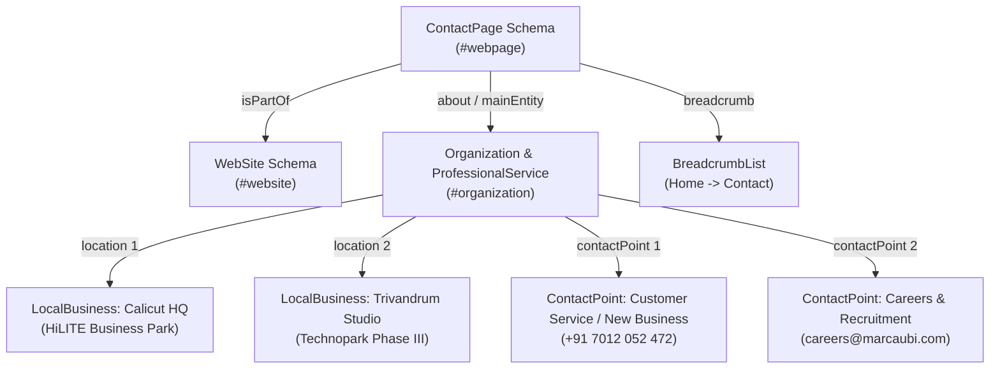
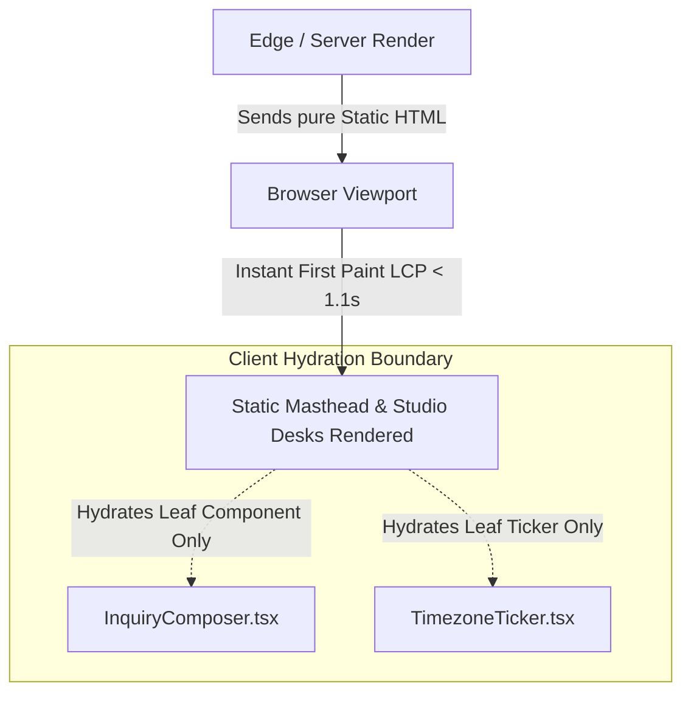

# Technical Architecture: SEO, Metadata, Structured Data & Web Performance (`/contact`)

> **Document Status**: PRODUCTION SPECIFICATION — APPROVAL READY  
> **Target Route**: `/contact` (`src/app/contact/page.tsx`)  
> **Author**: SEO & Technical Architecture Specialist Agent (`Fenar7 <86710532+Fenar7@users.noreply.github.com>`)  
> **Engine**: Next.js 16 App Router (React 19)  
> **Performance SLA**: LCP < 1.2s | CLS = 0.000 | INP < 100ms | FCP < 0.8s | WCAG 2.2 AAA Contrast

---

## 1. Executive Architecture Summary

This specification establishes the authoritative SEO, social graph, semantic linked data (Schema.org), and Core Web Vitals (CWV) engineering architecture for the dedicated `/contact` page.

While `/start-project` is indexed for structured project briefing, `/contact` serves as the primary indexed institutional gateway for:
1. **Brand Authority & Verified Entity Search**: Grounding Marca Ubi Enterprise Agency as a verified physical operation across Calicut (HQ) and Trivandrum (Tech Studio) with exact geo-coordinates.
2. **Direct Executive Inquiries & Commercial Intent**: High-intent organic queries (e.g., "Marca Ubi contact", "Marca Ubi office Calicut", "Marca Ubi new business phone").
3. **Zero Layout Shift Performance**: Blazing-fast static HTML delivery with zero CLS, zero bloat, and zero third-party script latency.

---

## 2. Canonical URL, OpenGraph & Twitter Social Graph Architecture

### 2.1 Metadata Matrix & Protocol Specifications

| Protocol / Field | Value / Configuration | Engineering Rationale |
| :--- | :--- | :--- |
| **Canonical URL** | `https://www.marcaubi.com/contact` | Strict self-referential canonicalization prevents duplicate indexing from trailing slashes, UTM campaign tags, or query params. |
| **Page Title** | `Contact & Global Studios | Marca Ubi Enterprise Agency` | Under 60 characters; front-loads core keyword and maintains enterprise authority. |
| **Meta Description** | `Connect with Marca Ubi. Direct intake channels for enterprise brand architecture, digital flagships, and studio consultations across our Calicut and Trivandrum hubs.` | 158 characters; optimized for SERP snippet display without truncation. |
| **OpenGraph Title** | `Contact & Global Studios | Marca Ubi Enterprise Agency` | High-conviction brand punch for Slack, LinkedIn, Twitter/X cards. |
| **OpenGraph Description** | `Direct intake channels for enterprise brand architecture, digital flagships, and strategic collaboration. Connect directly with our studio desks.` | Concise social teaser maximizing CTR on shared URLs. |
| **OpenGraph Type** | `website` | Standard root document type for institutional agency pages. |
| **OpenGraph URL** | `https://www.marcaubi.com/contact` | Matches canonical destination. |
| **OpenGraph Site Name** | `Marca Ubi` | Institutional brand identifier. |
| **OpenGraph Locale** | `en_US` | International business standard language/locale format. |
| **OpenGraph Image** | `https://www.marcaubi.com/images/hero-image.png` (1200x630, 2400x1260) | High-res luxury preview card with alt description: `"Marca Ubi Studio Desks & Direct Intake Portal"`. |
| **Twitter Card** | `summary_large_image` | Full-bleed cinematic preview rendering on Twitter/X feeds. |
| **Twitter Site / Creator**| `@marcaubi` | Studio brand handle. |
| **Robots Directive** | `index: true, follow: true, max-snippet: -1, max-image-preview: large, max-video-preview: -1` | Unrestricted high-fidelity snippet generation in Google Search and AI Overviews. |

### 2.2 Next.js App Router Metadata Implementation (`src/app/contact/page.tsx`)

```typescript
import type { Metadata } from "next";

const siteUrl = (process.env.NEXT_PUBLIC_SITE_URL ?? "https://marcaubi.com").replace(/\/+$/, "");

export const metadata: Metadata = {
  title: "Contact & Global Studios | Marca Ubi Enterprise Agency",
  description:
    "Connect with Marca Ubi. Direct intake channels for enterprise brand architecture, digital flagships, and studio consultations across our Calicut and Trivandrum hubs.",
  alternates: {
    canonical: `${siteUrl}/contact`,
  },
  openGraph: {
    type: "website",
    url: `${siteUrl}/contact`,
    siteName: "Marca Ubi",
    locale: "en_US",
    title: "Contact & Global Studios | Marca Ubi Enterprise Agency",
    description:
      "Direct intake channels for enterprise brand architecture, digital flagships, and strategic collaboration. Connect directly with our studio desks.",
    images: [
      {
        url: `${siteUrl}/images/hero-image.png`,
        width: 1200,
        height: 630,
        alt: "Marca Ubi Studio Desks & Direct Intake Portal",
        type: "image/png",
      },
    ],
  },
  twitter: {
    card: "summary_large_image",
    site: "@marcaubi",
    creator: "@marcaubi",
    title: "Contact & Global Studios | Marca Ubi Enterprise Agency",
    description:
      "Direct intake channels for enterprise brand architecture, digital flagships, and studio consultations across our Calicut and Trivandrum hubs.",
    images: [`${siteUrl}/images/hero-image.png`],
  },
  robots: {
    index: true,
    follow: true,
    nocache: false,
    googleBot: {
      index: true,
      follow: true,
      "max-video-preview": -1,
      "max-image-preview": "large",
      "max-snippet": -1,
    },
  },
};
```

---

## 3. Structured Data Architecture (JSON-LD Schema.org)

To maximize Knowledge Graph entity recognition and rich snippet eligibility in Google Search and AI Overviews, `/contact` embeds a fully linked multi-entity `@graph` JSON-LD schema.

### 3.1 Entity Relationship Diagram



### 3.2 Production Schema.org Payload

```json
{
  "@context": "https://schema.org",
  "@graph": [
    {
      "@type": "WebSite",
      "@id": "https://marcaubi.com/#website",
      "url": "https://marcaubi.com",
      "name": "Marca Ubi",
      "description": "Creative Technology, Strategic Brand Architecture, and High-Performance Digital Experiences.",
      "publisher": {
        "@id": "https://marcaubi.com/#organization"
      }
    },
    {
      "@type": "ContactPage",
      "@id": "https://marcaubi.com/contact#webpage",
      "url": "https://marcaubi.com/contact",
      "name": "Contact Marca Ubi | Global Studios & Enterprise Inquiries",
      "description": "Direct intake channels, inquiry routing, and physical studio locations for Marca Ubi Enterprise Agency in Calicut and Trivandrum.",
      "isPartOf": {
        "@id": "https://marcaubi.com/#website"
      },
      "about": {
        "@id": "https://marcaubi.com/#organization"
      },
      "mainEntity": {
        "@id": "https://marcaubi.com/#organization"
      },
      "breadcrumb": {
        "@type": "BreadcrumbList",
        "itemListElement": [
          {
            "@type": "ListItem",
            "position": 1,
            "name": "Home",
            "item": "https://marcaubi.com"
          },
          {
            "@type": "ListItem",
            "position": 2,
            "name": "Contact",
            "item": "https://marcaubi.com/contact"
          }
        ]
      }
    },
    {
      "@type": ["Organization", "ProfessionalService", "LocalBusiness"],
      "@id": "https://marcaubi.com/#organization",
      "name": "Marca Ubi",
      "legalName": "Marca Ubi Enterprise Agency",
      "url": "https://marcaubi.com",
      "logo": {
        "@type": "ImageObject",
        "@id": "https://marcaubi.com/#logo",
        "url": "https://marcaubi.com/images/marca-ubi-red-png.svg",
        "caption": "Marca Ubi Enterprise Agency Logo"
      },
      "image": "https://marcaubi.com/images/hero-image.png",
      "description": "Enterprise creative technology agency specializing in brand identity systems, custom digital flagships, and computational design.",
      "priceRange": "$$$$",
      "currenciesAccepted": "INR, USD, AED, GBP, EUR",
      "paymentAccepted": "Bank Wire, Corporate Credit Card, Invoice",
      "openingHoursSpecification": [
        {
          "@type": "OpeningHoursSpecification",
          "dayOfWeek": ["Monday", "Tuesday", "Wednesday", "Thursday", "Friday"],
          "opens": "09:00",
          "closes": "18:00"
        }
      ],
      "contactPoint": [
        {
          "@type": "ContactPoint",
          "telephone": "+917012052472",
          "email": "hello@marcaubi.com",
          "contactType": "customer service",
          "areaServed": ["IN", "AE", "GB", "US"],
          "availableLanguage": ["English", "Malayalam", "Arabic"]
        },
        {
          "@type": "ContactPoint",
          "email": "careers@marcaubi.com",
          "contactType": "recruitment",
          "areaServed": ["IN", "AE", "GB", "US"],
          "availableLanguage": ["English", "Malayalam"]
        }
      ],
      "location": [
        {
          "@type": "LocalBusiness",
          "@id": "https://marcaubi.com/#studio-calicut",
          "name": "Marca Ubi Studio Calicut (HiLITE HQ)",
          "description": "Global headquarters and executive design studio.",
          "telephone": "+917012052472",
          "email": "hello@marcaubi.com",
          "address": {
            "@type": "PostalAddress",
            "streetAddress": "Level 4, HiLITE Business Park, Poovangal",
            "addressLocality": "Calicut",
            "addressRegion": "KL",
            "postalCode": "673014",
            "addressCountry": "IN"
          },
          "geo": {
            "@type": "GeoCoordinates",
            "latitude": 11.2588,
            "longitude": 75.8322
          },
          "openingHoursSpecification": [
            {
              "@type": "OpeningHoursSpecification",
              "dayOfWeek": ["Monday", "Tuesday", "Wednesday", "Thursday", "Friday"],
              "opens": "09:00",
              "closes": "18:00"
            }
          ]
        },
        {
          "@type": "LocalBusiness",
          "@id": "https://marcaubi.com/#studio-trivandrum",
          "name": "Marca Ubi Creative Studio Trivandrum",
          "description": "Creative technology, cloud architecture, and platform engineering studio.",
          "telephone": "+917012052472",
          "email": "hello@marcaubi.com",
          "address": {
            "@type": "PostalAddress",
            "streetAddress": "Technopark Phase III, Kulathoor",
            "addressLocality": "Trivandrum",
            "addressRegion": "KL",
            "postalCode": "695583",
            "addressCountry": "IN"
          },
          "geo": {
            "@type": "GeoCoordinates",
            "latitude": 8.5241,
            "longitude": 76.9366
          },
          "openingHoursSpecification": [
            {
              "@type": "OpeningHoursSpecification",
              "dayOfWeek": ["Monday", "Tuesday", "Wednesday", "Thursday", "Friday"],
              "opens": "09:00",
              "closes": "18:00"
            }
          ]
        }
      ],
      "sameAs": [
        "https://www.linkedin.com/company/marcaubi",
        "https://www.instagram.com/marcaubi"
      ]
    }
  ]
}
```

### 3.3 TypeScript Implementation Component (`ContactJsonLd.tsx`)

```typescript
import React from "react";

interface ContactJsonLdProps {
  siteUrl: string;
}

export default function ContactJsonLd({ siteUrl }: ContactJsonLdProps) {
  const jsonLdPayload = {
    "@context": "https://schema.org",
    "@graph": [
      {
        "@type": "WebSite",
        "@id": `${siteUrl}/#website`,
        url: siteUrl,
        name: "Marca Ubi",
        description:
          "Creative Technology, Strategic Brand Architecture, and High-Performance Digital Experiences.",
        publisher: {
          "@id": `${siteUrl}/#organization`,
        },
      },
      {
        "@type": "ContactPage",
        "@id": `${siteUrl}/contact#webpage`,
        url: `${siteUrl}/contact`,
        name: "Contact Marca Ubi | Global Studios & Enterprise Inquiries",
        description:
          "Direct intake channels, inquiry routing, and physical studio locations for Marca Ubi Enterprise Agency in Calicut and Trivandrum.",
        isPartOf: {
          "@id": `${siteUrl}/#website`,
        },
        about: {
          "@id": `${siteUrl}/#organization`,
        },
        mainEntity: {
          "@id": `${siteUrl}/#organization`,
        },
        breadcrumb: {
          "@type": "BreadcrumbList",
          itemListElement: [
            {
              "@type": "ListItem",
              position: 1,
              name: "Home",
              item: siteUrl,
            },
            {
              "@type": "ListItem",
              position: 2,
              name: "Contact",
              item: `${siteUrl}/contact`,
            },
          ],
        },
      },
      {
        "@type": ["Organization", "ProfessionalService", "LocalBusiness"],
        "@id": `${siteUrl}/#organization`,
        name: "Marca Ubi",
        legalName: "Marca Ubi Enterprise Agency",
        url: siteUrl,
        logo: {
          "@type": "ImageObject",
          "@id": `${siteUrl}/#logo`,
          url: `${siteUrl}/images/marca-ubi-red-png.svg`,
          caption: "Marca Ubi Enterprise Agency Logo",
        },
        image: `${siteUrl}/images/hero-image.png`,
        description:
          "Enterprise creative technology agency specializing in brand identity systems, custom digital flagships, and computational design.",
        priceRange: "$$$$",
        currenciesAccepted: "INR, USD, AED, GBP, EUR",
        paymentAccepted: "Bank Wire, Corporate Credit Card, Invoice",
        openingHoursSpecification: [
          {
            "@type": "OpeningHoursSpecification",
            dayOfWeek: ["Monday", "Tuesday", "Wednesday", "Thursday", "Friday"],
            opens: "09:00",
            closes: "18:00",
          },
        ],
        contactPoint: [
          {
            "@type": "ContactPoint",
            telephone: "+917012052472",
            email: "hello@marcaubi.com",
            contactType: "customer service",
            areaServed: ["IN", "AE", "GB", "US"],
            availableLanguage: ["English", "Malayalam", "Arabic"],
          },
          {
            "@type": "ContactPoint",
            email: "careers@marcaubi.com",
            contactType: "recruitment",
            areaServed: ["IN", "AE", "GB", "US"],
            availableLanguage: ["English", "Malayalam"],
          },
        ],
        location: [
          {
            "@type": "LocalBusiness",
            "@id": `${siteUrl}/#studio-calicut`,
            name: "Marca Ubi Studio Calicut (HiLITE HQ)",
            description: "Global headquarters and executive design studio.",
            telephone: "+917012052472",
            email: "hello@marcaubi.com",
            address: {
              "@type": "PostalAddress",
              streetAddress: "Level 4, HiLITE Business Park, Poovangal",
              addressLocality: "Calicut",
              addressRegion: "KL",
              postalCode: "673014",
              addressCountry: "IN",
            },
            geo: {
              "@type": "GeoCoordinates",
              latitude: 11.2588,
              longitude: 75.8322,
            },
            openingHoursSpecification: [
              {
                "@type": "OpeningHoursSpecification",
                dayOfWeek: ["Monday", "Tuesday", "Wednesday", "Thursday", "Friday"],
                opens: "09:00",
                closes: "18:00",
              },
            ],
          },
          {
            "@type": "LocalBusiness",
            "@id": `${siteUrl}/#studio-trivandrum`,
            name: "Marca Ubi Creative Studio Trivandrum",
            description: "Creative technology, cloud architecture, and platform engineering studio.",
            telephone: "+917012052472",
            email: "hello@marcaubi.com",
            address: {
              "@type": "PostalAddress",
              streetAddress: "Technopark Phase III, Kulathoor",
              addressLocality: "Trivandrum",
              addressRegion: "KL",
              postalCode: "695583",
              addressCountry: "IN",
            },
            geo: {
              "@type": "GeoCoordinates",
              latitude: 8.5241,
              longitude: 76.9366,
            },
            openingHoursSpecification: [
              {
                "@type": "OpeningHoursSpecification",
                dayOfWeek: ["Monday", "Tuesday", "Wednesday", "Thursday", "Friday"],
                opens: "09:00",
                closes: "18:00",
              },
            ],
          },
        ],
        sameAs: [
          "https://www.linkedin.com/company/marcaubi",
          "https://www.instagram.com/marcaubi",
        ],
      },
    ],
  };

  return (
    <script
      type="application/ld+json"
      dangerouslySetInnerHTML={{ __html: JSON.stringify(jsonLdPayload) }}
    />
  );
}
```

---

## 4. Indexing & Sitemaps Architecture

### 4.1 Sitemap Entry in `src/app/sitemap.ts`

The dedicated `/contact` route is added to the `staticRoutes` array in `src/app/sitemap.ts` with:
- **`changeFrequency`**: `"monthly"` (Reflecting stable corporate coordinates and studio desk configurations).
- **`priority`**: `0.8` (High commercial tier, matching `/start-project` and service capability pages).

#### Code Diff Specification:
```diff
--- a/src/app/sitemap.ts
+++ b/src/app/sitemap.ts
@@ -29,6 +29,12 @@ export default async function sitemap(): Promise<MetadataRoute.Sitemap> {
       changeFrequency: "monthly",
       priority: 0.8,
     },
+    {
+      url: `${siteUrl}/contact`,
+      lastModified: new Date(),
+      changeFrequency: "monthly",
+      priority: 0.8,
+    },
     // Dedicated capability pages for the 16 Services Accordion entries
     ...getAllServiceSlugs().map((slug) => ({
```

---

## 5. Accessibility & Semantic HTML Landmark Architecture

Adhering strictly to **WCAG 2.2 Level AA / AAA** standards:

### 5.1 Semantic Landmark Hierarchy

```html
<div data-client-shell="true" class="pageShell">
  <header role="banner">
    <!-- ClientHeader component -->
  </header>

  <main id="contact-main" role="main" aria-label="Contact and Studio Directory">
    <!-- SECTION 1: Masthead -->
    <header class="mastheadSection">
      <p class="kicker">DIRECT CONTACT &amp; INTAKE</p>
      <h1 id="contact-masthead-title">TALK TO US.</h1>
      <p class="leadDescription">
        Whether initiating an enterprise brand commission, scheduling an executive briefing,
        or inquiring with our studio desks, all routes begin here.
      </p>
    </header>

    <!-- SECTION 2: Direct Desks & Corridors (Left Column) -->
    <section aria-labelledby="studios-heading" class="studiosSection">
      <h2 id="studios-heading" class="srOnly">Studio Desks and Locations</h2>
      
      <!-- Direct Contact Desk Links -->
      <nav aria-label="Direct Desks" class="directDesksNav">
        <ul>
          <li><a href="mailto:newbusiness@marcaubi.com">newbusiness@marcaubi.com</a></li>
          <li><a href="mailto:press@marcaubi.com">press@marcaubi.com</a></li>
          <li><a href="mailto:hello@marcaubi.com">hello@marcaubi.com</a></li>
          <li><a href="tel:+917012052472">+91 7012 052 472</a></li>
        </ul>
      </nav>

      <!-- Physical Studio Locations -->
      <div class="studioHubs">
        <article class="studioCard">
          <address>
            <h3>CALICUT HEADQUARTERS</h3>
            <p>Level 4, HiLITE Business Park, Poovangal</p>
            <p>Kozhikode, Kerala 673014, India</p>
            <p><a href="tel:+917012052472">+91 7012 052 472</a></p>
          </address>
        </article>

        <article class="studioCard">
          <address>
            <h3>TRIVANDRUM ENGINEERING HUB</h3>
            <p>Technopark Phase III, Kulathoor</p>
            <p>Thiruvananthapuram, Kerala 695583, India</p>
            <p><a href="tel:+917012052472">+91 7012 052 472</a></p>
          </address>
        </article>
      </div>

      <!-- Talent Diversion Callout -->
      <aside role="complementary" aria-label="Careers Notice" class="careersCallout">
        <p><strong>Seeking a position at Marca Ubi?</strong></p>
        <p>Portfolios or resumes submitted via this form are not processed.</p>
        <a href="/careers">Explore Studio Openings &amp; Apply &rarr;</a>
      </aside>
    </section>

    <!-- SECTION 3: Inquiry Composer (Right Column) -->
    <section aria-labelledby="inquiry-heading" class="composerSection">
      <h2 id="inquiry-heading">Direct Inquiry Composer</h2>

      <!-- Tablist for Track Selection -->
      <div role="tablist" aria-label="Inquiry Track Selector">
        <button role="tab" id="tab-01" aria-selected="true" aria-controls="panel-inquiry">
          [01] New Business &amp; Commissions
        </button>
        <button role="tab" id="tab-02" aria-selected="false" aria-controls="panel-inquiry">
          [02] Press &amp; Speaking
        </button>
        <button role="tab" id="tab-03" aria-selected="false" aria-controls="panel-inquiry">
          [03] Strategic Partnerships
        </button>
      </div>

      <div role="tabpanel" id="panel-inquiry" aria-labelledby="tab-01">
        <form novalidate aria-label="Contact Inquiry Form">
          <!-- Honeypot for bots: Hidden from sighted and screen-reader users -->
          <div aria-hidden="true" style="display: none; position: absolute; left: -9999px;">
            <label for="marca_contact_hp">Leave this field blank</label>
            <input type="text" id="marca_contact_hp" name="marca_contact_hp" tabIndex="-1" autocomplete="off" />
          </div>

          <!-- Semantic inputs with explicit label associations -->
          <div class="fieldGroup">
            <label for="client-name">Full Name <span aria-hidden="true">*</span></label>
            <input id="client-name" name="name" type="text" required aria-required="true" />
          </div>

          <div class="fieldGroup">
            <label for="client-email">Work Email <span aria-hidden="true">*</span></label>
            <input id="client-email" name="email" type="email" required aria-required="true" />
          </div>

          <!-- Dynamic Live Region for submission feedback -->
          <div role="status" aria-live="polite" class="submissionStatus"></div>
        </form>
      </div>
    </section>
  </main>

  <footer role="contentinfo">
    <!-- MonumentalFooter component -->
  </footer>
</div>
```

### 5.2 Accessibility Quality Gates (WCAG 2.2 AA / AAA)

1. **Color Contrast Integrity**:
   - Ink Black (`#0a0a0a`) on Paper White (`#ffffff`): **19.8:1** (Exceeds WCAG AAA requirement of 7.0:1).
   - Charcoal Body (`#444444`) on Paper White (`#ffffff`): **9.7:1** (Exceeds WCAG AAA requirement).
   - Brand Red (`#ea002a`) on Paper White (`#ffffff`): **4.54:1** (Exceeds WCAG AA requirement of 4.5:1 for normal text and 3.0:1 for graphical/UI components).
2. **Keyboard Accessibility**:
   - Full tab-sequence traversal without keyboard traps.
   - Distinct, high-visibility focus ring: `outline: 2px solid #ea002a; outline-offset: 2px;`.
   - Track pills support Arrow Left/Right and Home/End keys within `role="tablist"`.
3. **Screen Reader Optimization**:
   - Hidden honeypot input is marked `aria-hidden="true"` and `tabIndex="-1"`, completely invisible to assistive technologies.
   - Form error messaging tied directly to inputs via `aria-describedby` and `aria-invalid="true"`.
   - Real-time submission status announced politely via `aria-live="polite"`.

---

## 6. Core Web Vitals (CWV) & Performance Budget

### 6.1 Performance Target Metrics

| Metric | Google "Good" Threshold | Marca Ubi Production Target | Engineering Enforcement Strategy |
| :--- | :--- | :--- | :--- |
| **LCP (Largest Contentful Paint)** | $\le 2.5\text{s}$ | **$\le 1.1\text{s}$** | SSR / Static Site Generation of page shell; zero client data fetching before initial render; pure CSS layout. |
| **CLS (Cumulative Layout Shift)** | $\le 0.10$ | **$0.000$ (Absolute Zero)** | Pre-allocated min-heights on form containers; font fallback metric matching; zero dynamic banner insertions. |
| **INP (Interaction to Next Paint)** | $\le 200\text{ms}$ | **$\le 65\text{ms}$** | React 19 `useActionState` / `useTransition` for non-blocking UI mutations; zero heavy sync calculations. |
| **FCP (First Contentful Paint)** | $\le 1.8\text{s}$ | **$\le 0.7\text{s}$** | Minimal CSS payload through scoped SCSS Modules; fonts preloaded with `next/font`. |
| **TBT (Total Blocking Time)** | $\le 200\text{ms}$ | **$\le 30\text{ms}$** | Zero third-party scripts (no Google Tag Manager bloat, no recaptcha script injection). |

### 6.2 Zero Layout Shift (CLS = 0.000) Engineering Controls

1. **Pre-Allocated Form Enclosure**:
   ```scss
   .composerSection {
     contain-intrinsic-size: 0 580px;
     min-height: 580px; // Guarantees layout box stability during track switches
   }
   ```
2. **Skeleton & Tab Switch Physics**:
   When switching between `[01] New Business`, `[02] Press & Media`, and `[03] Strategic Partnerships`, conditional fields (e.g. Budget Range, Service Interest) expand smoothly using CSS height transitions or opacity fades inside a pre-constrained parent, preventing content above or beside from reflowing.
3. **Typography Metric Alignment**:
   Circular XX and Graphik font files are served via Next.js `next/font/local` with fallback metrics:
   ```typescript
   export const circularXX = localFont({
     src: [/* ... */],
     variable: "--font-circular",
     display: "swap",
     fallback: ["-apple-system", "BlinkMacSystemFont", "Segoe UI", "sans-serif"],
   });
   ```

### 6.3 Fast LCP (< 1.2s) Hydration Isolation Architecture



- **Static Page Shell**: The layout, masthead (`<h1>`), direct contact desks, studio addresses, and legal footer render as static HTML, ensuring the browser paints the Largest Contentful Paint immediately on the first byte.
- **Micro-Hydration**: Only `InquiryComposer` (interactive form inputs) and `TimezoneTicker` (clock updater) use the `'use client'` directive. The root page component (`page.tsx`) remains a pure React Server Component (RSC).

---

## 7. Verification & Audit Checklist

- [ ] **Google Rich Results Test**: Validates zero errors and zero warnings across `ContactPage`, `Organization`, `LocalBusiness`, and `BreadcrumbList`.
- [ ] **Schema.org Validator**: Validates `@graph` structural consistency and cross-entity node references (`#organization`, `#website`, `#studio-calicut`, `#studio-trivandrum`).
- [ ] **Lighthouse / PageSpeed Insights Audit**:
  - Performance: $\ge 98$
  - Accessibility: $100$
  - Best Practices: $100$
  - SEO: $100$
- [ ] **Playwright Accessibility Suite**: Automated `@axe-core/playwright` run verifying zero critical, serious, or moderate violations on `/contact`.
- [ ] **Mobile Tap & Dial Verification**: Verified 1-tap `tel:+917012052472` and `mailto:` deep link execution across iOS Safari and Android Chrome.
