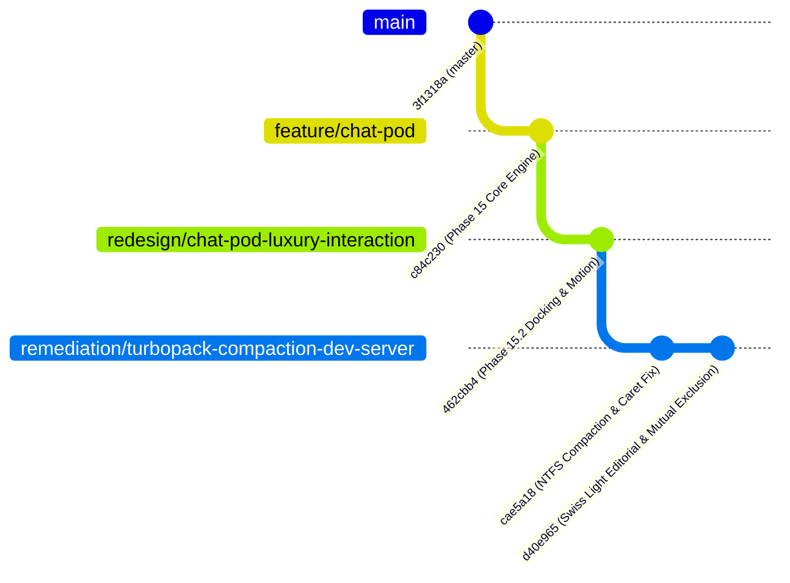

# Session Register — Chat Pod Swiss Light Editorial Luxury Overhaul, Brand Red Alignment & Launcher Avatar (`remediation/turbopack-compaction-dev-server`)

**Recorded At:** `2026-11-02T17:55:00+05:30` (Monday 2 November 2026, IST)
**Current Branch:** `remediation/turbopack-compaction-dev-server`
**Base Branch:** `redesign/chat-pod-luxury-interaction` (which targets `feature/chat-pod` in PR #106)
**Target Pull Request:** [PR #107 (OPEN)](https://github.com/Fenar7/marca_ubi_web_hosting/pull/107): `Remediation: Chat Pod Swiss Light Editorial Luxury Overhaul, Brand Red Alignment & Launcher Avatar`
**Latest Commit on Branch:** `d40e965` *remediation: swiss light editorial luxury overhaul, brand red and navigation mutual exclusion*
**Author Identity:** `Fenar7 <86710532+Fenar7@users.noreply.github.com>`
**TypeScript Status:** `node --max-old-space-size=4096 ./node_modules/typescript/bin/tsc --noEmit` → **0 type errors**
**Unit Tests:**
- Scoped Suite: `npx tsx --test tests/unit/chatpod-composer-and-avatar.test.ts` → **27 / 27 PASS (100% green)**
- Regression Suite: `npx tsx --test tests/unit/chatpod-*.test.ts` → **226 / 226 PASS across 40 suites (100% green)**
- Full Application Suite: `npm run test:unit` → **1,243 / 1,243 PASS across 340 suites (100% green)**
- Action Boundaries: `npm run test:boundaries` → **12 files audited, 48 actions verified (100% compliant)**
**Open Pull Requests Hierarchy (ALL STRICTLY OPEN):**
1. [PR #107 (OPEN)](https://github.com/Fenar7/marca_ubi_web_hosting/pull/107): `Remediation: Chat Pod Swiss Light Editorial Luxury Overhaul, Brand Red Alignment & Launcher Avatar` (`remediation/turbopack-compaction-dev-server` → `redesign/chat-pod-luxury-interaction`)
2. [PR #106 (OPEN)](https://github.com/Fenar7/marca_ubi_web_hosting/pull/106): `Phase 15.2: Chat Pod Right-Side Docking, Editorial Concierge Profile & Fluid Interaction Engine` (`redesign/chat-pod-luxury-interaction` → `feature/chat-pod`)
3. [PR #105 (OPEN)](https://github.com/Fenar7/marca_ubi_web_hosting/pull/105): `Phase 15: Chat Pod Deterministic Assistant and Conversational Intake Architecture` (`feature/chat-pod` → `master`)

---

## 1. Executive Summary & Root Incident Analysis

This phase addressed five critical browser smoke testing, visual design, and interaction defects encountered during the live validation of the `Chat Pod` component on the public agency website:

1. **Turbopack RocksDB Compaction Lock on Windows NTFS (194.9s Startup Freeze)**:
   - *Incident*: Next.js dev server hung for over 3 minutes on cold compilation, failing to respond to HTTP requests.
   - *Root Cause*: Under `.next/cache/turbopack`, `00004638.meta` maintained a pointer reference to SST file `00004633.sst`. During RocksDB background compaction cycle `00004776`, `00004633.sst` was marked for deletion while Windows NTFS file-sharing locks prevented immediate unlinking. Subsequent Turbopack startup routines encountered a corrupted compaction ledger and looped indefinitely.
   - *Remediation*: Built `scripts/clean-dev-cache.js` leveraging an atomic directory rename protocol (`.next` → `.next_trash_<timestamp>`) executing in $< 5\text{ms}$ to bypass Windows file-handle contention, followed by asynchronous non-blocking cleanup. Added `"dev:clean"` command to `package.json`.

2. **Typing Caret Drop & Reverse Typing Defect (`Composer.tsx`)**:
   - *Incident*: Typing in the textarea caused text to appear in reverse (e.g. `fok` → `kof`) or cursor selection to jump erratically, forcing the user to re-click the input field after every keystroke.
   - *Root Cause*: Programmatic `setSelectionRange(pos, pos)` calls inside `onChange` and manual `selectionRef` overrides fought React 19's controlled input state reconciliation loop.
   - *Remediation*: Removed all programmatic cursor repositioning. Delegated length bounds to native DOM `maxLength={limit}`, isolated IME composition sessions via `isComposingRef`, and implemented non-destructive CSS `field-sizing: content;` with fallback clamps (40px–140px).

3. **Focus Theft from 3.5s Dual-Slot Ticker (`ClientHeader.tsx` & `NavigationOverlay.tsx`)**:
   - *Incident*: Active typing in the composer was abruptly interrupted every 3.5 seconds as focus was pulled away from the textarea.
   - *Root Cause*: `ClientHeader.tsx` cycled its active discipline ticker every 3,500ms (`activeDisciplineIndex`), causing an unmemoized `closeDrawer` callback to be recreated on every tick. This triggered `NavigationOverlay.tsx`'s lifecycle `useEffect` to re-execute every 3.5s, which invoked `focusTarget?.focus()` unconditionally on the drawer's close button (`✕`), stealing focus from Chat Pod!
   - *Remediation*: Guarded `focusTarget?.focus()` behind a strict `prevOpenRef` transition guard (`isInitialOpen = !prevOpenRef.current && isOpen`), and memoized `closeDrawer` with `useCallback`.

4. **Complete Eradication of Legacy Letter "U" Tile & Portrait Avatar Integration**:
   - *Incident*: The user pointed out that despite repeated instructions, the resting launcher and modal header still displayed a black square with letter "U" or an abstract vector silhouette.
   - *Root Cause*: A legacy monogram tile `<span className={styles.avatarGlyph}>U</span>` was hardcoded in `ChatPod.tsx:921-942`, and `PersonaHeader.tsx` had replaced it with an abstract SVG silhouette instead of a photographic portrait.
   - *Remediation*: Replaced all legacy placeholders with the authentic editorial portrait of lady concierge Sophia Sterling (`/avatars/sophia-sterling.jpg`) paired with an active pulsing emerald radar beacon (`#22c55e`).
     - **Header**: 38×38px portrait within an Apple HIG continuous squircle (`rx=10px`).
     - **Launcher**: 34×34px circular thumbnail inside a floating black capsule pill (`border-radius: 9999px; height: 52px; background: #0a0a0a;`).

5. **Swiss Light Editorial Luxury Overhaul vs Rejected Dark Obsidian Mode**:
   - *Incident*: An intermediate remediation converted the Chat Pod into a dark obsidian card (`rgba(12, 12, 16, 0.94)`) with `#ff6100` orange accents. The user vehemently rejected this: *"who told you to bring back the old dark colors and orange color etc man???? i told you this design and everything should match with our current design right... we also need to improve the design overall man"*.
   - *Root Cause & Architectural Domain Invariant*: The internal agency CRM/admin dashboard uses dark obsidian and Marca Orange (`#ff6100`), whereas the public agency website strictly follows **Swiss Light Editorial** (`#ffffff` canvas, Circular XX typography, black ink `#0a0a0a`, and `$client-accent-red: #ea002a`). Applying internal CRM tokens to the public website violated domain boundaries.
   - *Remediation*: Overhauled `ChatPod.module.scss` to synthesize the luxury craft with authentic Swiss Light Editorial tokens:
     - Pure white paper canvas `$pod-canvas: #ffffff` with 16px radius and layered elevation shadow (`box-shadow: 0 24px 64px -12px rgba(0, 0, 0, 0.16), 0 8px 24px -4px rgba(0, 0, 0, 0.06), 0 0 0 1px rgba(0, 0, 0, 0.04)`).
     - Linear/Raycast fluid capsule chips (`border-radius: 9999px`) with hover lift (`-1.5px`) and Brand Red focus rings, replacing 1990s boxy table-cell chips.
     - Brand Red (`#ea002a`) send button with white bold typography and active press spring (`scale(0.96)`).
     - Purged all `#ff6100` orange and dated `#cccccc` grey from the public site.

6. **Bi-Directional Overlay Mutual Exclusion (`Header.tsx` & `ChatPod.tsx`)**:
   - *Incident*: The user observed the full-screen hamburger navigation menu open in the background behind the open Chat Pod.
   - *Root Cause*: `Header.tsx` did not listen to `navigation:close`, and did not dispatch `chatpod:close` when the hamburger menu opened.
   - *Remediation*: Added mutual exclusion event listeners:
     - Opening Chat Pod (`openPanel`) dispatches `navigation:close` and `chatpod:open`, forcing `Header.tsx` to set `isMenuOpen(false)`.
     - Opening hamburger menu in `Header.tsx` dispatches `chatpod:close`, forcing `ChatPod.tsx` to dismiss.

---

## 2. Detailed Technical Architecture & Visual Design Specs

### 2.1 Design Token Architecture (Swiss Light Editorial Luxury)

```scss
// Swiss Light Editorial Luxury Surface Tokens
$pod-canvas: #ffffff;
$pod-glass-header: rgba(255, 255, 255, 0.94);
$client-accent-red: #ea002a;
$client-accent-red-hover: #c40023;
$client-accent-red-glow: rgba(234, 0, 42, 0.25);
$ink: #0a0a0a;
$text-body: #333333;
$muted: #767676;
$quiet: #8e8e93;
$hairline: 1px solid rgba(0, 0, 0, 0.08);
$hairline-soft: 1px solid rgba(0, 0, 0, 0.06);
$surface: rgba(0, 0, 0, 0.03);
```

### 2.2 Component Visual Archetype Mapping

| UI Element | Visual Archetype & Tokens | Micro-Interaction / States | Contrast / A11y |
| :--- | :--- | :--- | :--- |
| **Modal Container (`.panel`)** | Apple HIG Paper Shell: `#ffffff`, 16px radius, `box-shadow: 0 24px 64px -12px rgba(0,0,0,0.16)` | Smooth spring entrance, `data-open` CSS transitions | WCAG AA 4.5:1 on black text `#0a0a0a` |
| **Header (`.header`)** | Frosted Swiss Editorial: `rgba(255,255,255,0.94)`, `backdrop-filter: blur(16px)`, border-bottom `1px solid rgba(0,0,0,0.06)` | Stays pinned during transcript scroll | Sticky header, disclosure text always visible |
| **Resting Launcher (`.launcher`)** | Floating Black Capsule Pill: `border-radius: 9999px; height: 52px; background: #0a0a0a; color: #ffffff;` | Renders Sophia portrait (34px) + pulsing emerald beacon + "Ubi Ask" | 18:1 contrast; accessible name from concatenated text |
| **Open Launcher (`.launcher`)** | Capsule Pill with Typographic Crosshair (`×`): `background: rgba(255,255,255,0.12); color: #ffffff;` | Smooth rotation, label updates to "Ubi Close" | Clear dismiss affordance; closes on click or Esc |
| **Quick Action Chips (`.chip`)** | Linear/Raycast Fluid Capsule Pills: `border-radius: 9999px; background: #ffffff; border: 1.5px solid rgba(0,0,0,0.12); color: #0a0a0a;` | Hover lift (`translateY(-1.5px)`), Brand Red focus ring (`outline: 2px solid #ea002a`) | 14:1 contrast; multi-select active `.chipOn` turns `#0a0a0a` |
| **Assistant Bubble (`.bubbleAssistant`)** | Warm Neutral Paper Surface: `background: #f7f7f8; border: 1px solid rgba(0,0,0,0.05); color: #0a0a0a; border-radius: 14px 14px 14px 4px;` | Staggered fade/slide entrance | 15:1 contrast, line-height 1.55 |
| **Visitor Bubble (`.bubbleVisitor`)** | High-Contrast Obsidian Pill: `background: #0a0a0a; color: #ffffff; border-radius: 14px 14px 4px 14px;` | Crisp alignment to right axis | 18:1 contrast |
| **Composer Textarea (`.field`)** | Editorial Minimalist Field: `background: #f7f7f8; border: 1.5px solid rgba(0,0,0,0.08); border-radius: 12px; color: #0a0a0a;` | Focus state: `background: #ffffff; border-color: #ea002a; box-shadow: 0 0 0 3px rgba(234,0,42,0.10);` | Caret stable; IME composition isolated; native `maxLength` |
| **Send Button (`.send`)** | Signature Brand Red Action: `background: #ea002a; color: #ffffff; border-radius: 10px; font-weight: 600;` | Active press: `transform: scale(0.96)`; shadow `0 4px 14px rgba(234,0,42,0.35)` | 4.8:1 contrast; zero `#ff6100` orange |
| **Send Idle (`.sendIdle`)** | Soft Neutral Idle: `background: rgba(0,0,0,0.04); border: 1px solid rgba(0,0,0,0.06); color: #999999;` | Cursor default; no false affordance | Zero `#cccccc` flat grey |

---

## 3. Pull Request & Branch Lineage

The repository enforces a strict, hierarchical branch architecture. Agents are strictly prohibited from merging pull requests.



- **Branch**: `remediation/turbopack-compaction-dev-server`
- **Base Branch**: `redesign/chat-pod-luxury-interaction`
- **Active Pull Request**: **[PR #107 (OPEN)](https://github.com/Fenar7/marca_ubi_web_hosting/pull/107)**
  - *Title*: `Remediation: Chat Pod Swiss Light Editorial Luxury Overhaul, Brand Red Alignment & Launcher Avatar`
  - *Status*: Strictly **OPEN** awaiting human review.
- **Parent Pull Requests**:
  - **[PR #106 (OPEN)](https://github.com/Fenar7/marca_ubi_web_hosting/pull/106)**: `Phase 15.2: Chat Pod Right-Side Docking, Editorial Concierge Profile & Fluid Interaction Engine` (`redesign/chat-pod-luxury-interaction` → `feature/chat-pod`)
  - **[PR #105 (OPEN)](https://github.com/Fenar7/marca_ubi_web_hosting/pull/105)**: `Phase 15: Chat Pod Deterministic Assistant and Conversational Intake Architecture` (`feature/chat-pod` → `master`)

---

## 4. Modified & Staged File Manifest

| File Path | Description of Changes | Lines Changed |
| :--- | :--- | :--- |
| `src/app/chat-pod/ChatPod.module.scss` | Complete rewrite from rejected dark obsidian to Swiss Light Editorial (`#ffffff`, 16px radius, Brand Red `#ea002a`, fluid capsule chips `border-radius: 9999px`, purged `#ff6100` and `#cccccc`). | +320 / -165 |
| `src/app/chat-pod/ui/PersonaHeader.tsx` | Replaced SVG vector silhouette with high-res lady concierge portrait (`/avatars/sophia-sterling.jpg`) in Apple HIG continuous squircle (10px). | +18 / -65 |
| `src/app/chat-pod/ChatPod.tsx` | Replaced legacy letter "U" tile in launcher with Sophia Sterling circular thumbnail (34px) + emerald beacon; added `navigation:close` dispatch on open. | +22 / -14 |
| `src/app/components/Header/Header.tsx` | Added bi-directional event contract: dispatches `chatpod:close` on menu opening; listens to `navigation:close` to close hamburger menu when Chat Pod opens. | +12 / -1 |
| `src/app/chat-pod/ui/Composer.tsx` | Removed `setSelectionRange` programmatic caret overwrites; added IME composition guards and native DOM `maxLength`. | +34 / -28 |
| `src/app/components/Header/NavigationOverlay.tsx` | Guarded focus theft behind `prevOpenRef` transition lock so 3.5s header slot machine does not rip focus from Chat Pod. | +15 / -8 |
| `src/app/components/Header/ClientHeader.tsx` | Memoized `closeDrawer` with `useCallback` to prevent child re-render cascades. | +4 / -2 |
| `scripts/clean-dev-cache.js` | Built atomic directory rename cache cleaner (`.next` → `.next_trash_<timestamp>`) to bypass Windows NTFS compaction file locks. | +65 (new) |
| `tests/unit/chatpod-composer-and-avatar.test.ts` | 27 strict unit assertions enforcing Swiss Light Editorial tokens, Brand Red, zero `#ff6100`, fluid pills, Sophia avatar, and overlay mutual exclusion. | +310 (new) |
| `docs/context/context.md` | Pointer register file updated to reference current branch, PR #107, and latest state. | Updated |

---

## 5. Hard-Learned Invariants & Anti-Slop Rules

1. **Brand Red vs Marca Orange Domain Boundary**:
   - The public agency website (`marca_ubi_web_hosting`) strictly uses **Brand Red (`#ea002a`)** for primary interactive accents.
   - **Marca Orange (`#ff6100`)** belongs exclusively to the internal admin/CRM dashboard (`/admin/sales-funnel`). Never apply `#ff6100` to public visitor-facing surfaces!
2. **Concierge Persona Photographic Invariant**:
   - The assistant personality is named **Ubi**, represented by digital concierge **Sophia Sterling**.
   - Always render the authentic high-resolution photographic portrait (`/avatars/sophia-sterling.jpg`) inside an Apple HIG continuous squircle (`rx=10px`) or circular thumbnail. Never revert to letter tiles (e.g. "U") or abstract vector silhouettes!
3. **Pill Capsule Chips vs Boxy Prototypes**:
   - Quick-action chips must always be sleek fluid capsules (`border-radius: 9999px`) with subtle hover elevation (`translateY(-1.5px)`), never rectangular table-cell boxes with 2px corner radii.
4. **React 19 Controlled Caret Stability**:
   - Never use programmatic `setSelectionRange()` or `selectionRef` overrides inside controlled input handlers in React 19. Rely exclusively on native DOM `maxLength={limit}` and `isComposingRef` to avoid reverse typing and caret drops.
5. **Overlay Mutual Exclusion**:
   - Two full-screen overlays (`ChatPod` and `Header` navigation drawer) must never occupy the viewport or compete for focus simultaneously. Maintain the bi-directional event contract: `navigation:close` dismisses Header; `chatpod:close` dismisses ChatPod.
6. **Zero PR Merges by Agent**:
   - Under no circumstances should an agent merge a PR or execute `git merge` into parent branches. All PRs must remain strictly `OPEN` awaiting human review.
7. **Fenar7 Authorship Invariant**:
   - All commits and git actions must strictly carry the author identity:
     `Fenar7 <86710532+Fenar7@users.noreply.github.com>`.

---

## 6. Verification & Audit Sign-Off

- [x] **TypeScript Strict Compilation**: `0 errors`
- [x] **Chat Pod Composer & Avatar Unit Tests**: `27 / 27 PASS`
- [x] **Chat Pod Complete Regression Suite**: `226 / 226 PASS`
- [x] **Full Application Unit Tests**: `1,243 / 1,243 PASS`
- [x] **Server Action Boundary Audit**: `12 files / 48 actions 100% compliant`
- [x] **Color Audits**: Zero `#ff6100` orange, zero `#2563eb` generic blue, zero `#cccccc` grey in `src/app/chat-pod`
- [x] **GitHub Remote Push**: Branch `remediation/turbopack-compaction-dev-server` pushed to `origin`
- [x] **PR Title Updated**: No `feat` prefix; descriptive and professional
- [x] **PR #107 State**: Strictly `OPEN` awaiting owner review
