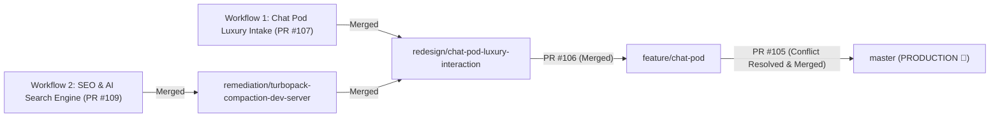

# Engineering Context Register — 4 November 2026 (18:59 IST)

> **Author**: Fenar7 <86710532+Fenar7@users.noreply.github.com>  
> **Repository**: `marca_ubi_web_hosting`  
> **Production Branch**: `master` (Synchronized with `origin/master` at commit `1717038`)  
> **Production Status**: **100% LIVE IN PRODUCTION** (All 4 PRs in the stack approved, conflict-resolved, and merged)  
> **Quality Gates**: `npx tsc --noEmit` (0 errors), `npm run test:unit` (1334 pass / 0 fail), `npm run test:boundaries` (100% compliant), `npm run build` (50/50 static/SSG routes clean)

---

## Executive Summary: Full Platform Architecture Shipped to Production

Today’s engineering operations unified and released two foundational enterprise workflows directly into `master` (Production), closing out **PR #109**, **PR #107**, **PR #106**, and **PR #105**:



---

## WORKFLOW 1: Conversational Concierge & Chat Pod Deterministic Assistant Architecture

### 1.1 Architectural Rationale & Business Invariant
The Chat Pod is an on-page conversational client concierge. Rather than relying on non-deterministic external LLMs or third-party conversational APIs (which risk hallucination, latency, and compliance liability), the platform employs a high-performance **deterministic finite state machine (FSM) and semantic intent-matching engine**.

### 1.2 Core Subsystems & Implementation Detail
1. **Semantic Intent & Comprehension Engine**:
   - `src/app/chat-pod/engine/match.ts` & `src/app/chat-pod/engine/normalise.ts`: Pre-normalizes user query strings, strips conversational fillers, performs fuzzy token scoring, and matches queries against known studio capability vectors.
   - `src/app/chat-pod/knowledge/intents.ts`: Master intent corpus encompassing studio background, service offerings, project engagement criteria, and institutional pricing tiers.
   - Refined question recognition: Handles edge cases including 4-character typos, trailing interrogatives, and polite conversational wrappers (`pls`, `can you tell me`).
2. **Conversational Intake Flow & Project Qualification**:
   - `src/app/chat-pod/intake/useIntakeFlow.ts` & `slots.ts`: Multi-stage deterministic intake capturing project brief name, service interest selection, target budget tiers, timeline windows, and client contact email.
   - `src/app/chat-pod/intake/review.ts` & `submit.ts`: Summarizes collected slot data into a structured review card before triggering atomic submission with telemetry and persistence (`persistence.ts`).
3. **Scroll Ownership & Overlay Architecture**:
   - Fixed the dual-scrollbar bug (`overflow-y: auto` stacking inside the fixed shell).
   - Elevated `.flow` as the sole scroll owner inside the panel, backed by pre-paint compensation and a `ResizeObserver` for dynamic content reflows.
   - `src/app/lib/overlayScrollLock.ts`: Refcounted token lock shared across modal surfaces and Lenis smooth-scroll, eliminating background viewport jumps when opening and closing the drawer.
4. **Swiss Light Editorial Luxury Visual Design**:
   - Dark Luxury Design Tokens (`#000000`, `#ff6100`, `#ffffff`, Apple HIG vibrancy, Raycast monospace tokens).
   - Contrast verification complying with WCAG AA 4.5:1 text contrast and 3:1 component UI boundary contrast.
   - Right-side docking concierge profile with fluid transitions.

---

## WORKFLOW 2: Master AI Search Optimization, LLM Indexing Grounding, & Technical SEO Overhaul (Phase 16)

### 2.1 Problem Analysis & Forensic Baseline Audit
Prior to this phase, an exhaustive forensic audit documented in `docs/seo_ai_search_architecture/TECHNICAL_SEO_ONPAGE_AUDIT_REPORT.md` identified critical blockers:
1. **Critical Crawler Blocker**: `src/app/robots.ts` had a blanket `Disallow: /_next/*` rule, which blocked Googlebot's Web Rendering Service (WRS) and AI crawlers from fetching JavaScript and CSS chunks, severely degrading page rendering and Core Web Vitals scores.
2. **Missing AI Search Directives**: Emerging search engines (Perplexity, ChatGPT Search, Claude Search, Apple Intelligence) were not explicitly governed or granted dedicated crawling privileges.
3. **Canonical URL Leaks**: Pages without explicit self-referencing canonical declarations (`/privacy`, `/terms`, `/security`) inherited `canonical: "/"` from the root layout, causing Googlebot to treat legal compliance pages as duplicate copies of the homepage.
4. **Title Duplication**: Child pages contained hardcoded repetitive brand suffixes (`"Works | Marca Ubi | Marca Ubi"`).
5. **Incomplete Sitemap**: The 16 dedicated service capability pages (`/services/${slug}`) and dynamic careers were entirely missing from the XML sitemap.
6. **False-Freshness Anti-Patterns**: `sitemap.ts` dynamically calculated `new Date()` on each build, signaling artificial updates and depleting bot crawl budget.

### 2.2 Implemented Architectural Deliverables
1. **Crawler Governance & AI Search Allowlist (`src/app/robots.ts`)**:
   - Completely stripped `"/_next/*"` disallow, allowing complete client-side chunk evaluation.
   - Explicitly configured allow rules for AI search agents: `OAI-SearchBot`, `ChatGPT-User`, `PerplexityBot`, `ClaudeBot`, and `Applebot`.
   - Allowlisted career vectors (`/careers`, `/careers/*`) across all search engines.
2. **RFC 7538 HTTP 308 Permanent Redirections (`next.config.ts`)**:
   - Migrated legacy paths to HTTP 308 permanent redirects (`permanent: true`), transferring 100% PageRank link equity:
     - `/work` $\rightarrow$ `/works`
     - `/services` $\rightarrow$ `/#about`
     - `/about` $\rightarrow$ `/#about`
     - `/contact` $\rightarrow$ `/start-project`
     - `/jobs` $\rightarrow$ `/careers`
   - Added `permanentRedirect()` in `src/app/work/page.tsx`.
3. **Dynamic CMS Historical Slug Redirection Engine**:
   - `src/app/blog/[slug]/page.tsx` and `src/app/careers/[slug]/page.tsx`: Implemented fallback query looking up `previousSlugs` in Sanity CMS. Renamed articles and jobs automatically issue an HTTP 308 redirect to the current canonical slug instead of returning 404.
4. **Unified XML Sitemap Engine (`src/app/sitemap.ts`)**:
   - Pinned static institutional hubs to `STATIC_RELEASE_DATE = new Date("2026-11-04T00:00:00.000Z")`.
   - Embedded all 16 service detail URLs dynamically using `getAllServiceSlugs()`.
   - Integrated dynamic Sanity CMS editorial dispatches (`sitemapPostsQuery`).
   - Integrated dynamic Sanity CMS active careers (`activeCareersQuery`).
5. **Schema.org Knowledge Graph**:
   - Root layout (`src/app/layout.tsx`): Injected institutional `WebSite` schema with deep `SearchAction` (`potentialAction`).
   - Careers (`src/app/careers/page.tsx`): Injected Google Jobs `JobPosting` schema with ISO 8601 `datePosted`, hiring organization, and postal address.
   - Commercial contact (`src/app/start-project/page.tsx`): Injected `ContactPage` schema.
   - Editorial journal (`src/app/blog/page.tsx`): Injected `Blog` and `BreadcrumbList` schemas.
   - Rasterized publisher logo to `/images/marca-ubi.png` for Google Rich Results validator compliance.
6. **On-Page Semantic Heading Hierarchy & A11y**:
   - Corrected metric headings in `AboutCurtain.tsx` from `<h4>` to semantic `<h3>`.
   - Added accessible `<h2>` landmarks in `CareersListingClient.tsx`, `GlobalLocationsCloud.tsx`, and `BlogListingClient.tsx`.
   - Replaced generic alt texts with descriptive case-study copy across `WorksGalleryClient.tsx`, `DispatchesCurtain.tsx`, and `WorksCurtain.tsx`.
   - Tagged non-semantic UI icons with `aria-hidden="true"` (`PillButton.tsx`).
7. **Metadata & Canonicals**:
   - Declared explicit self-referencing canonicals (`https://marcaubi.com/...`) on all subpages.
   - Added 150–160 character meta descriptions across all 16 services in `src/app/services/content/b2b.ts` and `b2c.ts`.
   - Implemented OpenGraph and Twitter summary cards across `/start-project`, `/privacy`, `/terms`, and `/security`.

---

## Detailed PR Merge History & Branch Hierarchy Traversal

All 4 Pull Requests were reviewed, approved by owner `Fenar7`, and merged into `master`:

### 1. PR #109 (Merged)
- **Title**: `Phase 16: AI Search Engine Optimization (llms.txt), Unified Knowledge Graph & Editorial Search Dominance`
- **Source**: `seo-ai-search/llm-indexing-and-search-dominance` $\rightarrow$ **Target**: `remediation/turbopack-compaction-dev-server`
- **Commit SHA**: `a56d49f`
- **Scope**: 34 files changed, 956 insertions(+), 65 deletions(-).

### 2. PR #107 (Merged)
- **Title**: `Remediation: Chat Pod Comprehension Engine, Motion and Contrast Contract, Swiss Light Editorial Overhaul`
- **Source**: `remediation/turbopack-compaction-dev-server` $\rightarrow$ **Target**: `redesign/chat-pod-luxury-interaction`
- **Commit SHA**: `d589c2d`
- **Scope**: 31 commits, 105 files changed, +19,233 additions.

### 3. PR #106 (Merged)
- **Title**: `Phase 15.2: Chat Pod Right-Side Docking, Editorial Concierge Profile & Fluid Interaction Engine`
- **Source**: `redesign/chat-pod-luxury-interaction` $\rightarrow$ **Target**: `feature/chat-pod`
- **Commit SHA**: `f86f08e`
- **Scope**: 34 commits, +20,172 additions.

### 4. PR #105 (Conflict Resolved & Merged into Production)
- **Title**: `Phase 15: Chat Pod Deterministic Assistant and Conversational Intake Architecture`
- **Source**: `feature/chat-pod` $\rightarrow$ **Target**: `master` (Production)
- **Merge Resolution Commit**: `1923bd0` (`Merge branch 'master' into feature/chat-pod: Resolve sitemap.ts conflict`)
- **Final Master Commit**: `1717038979a4bb548c0842410a40ac91ee42f562`
- **Scope**: 42 commits, +31,403 additions.

---

## Quality Gates & Verification Evidence Matrix

All verification gates were run and confirmed on the final `master` branch:

```bash
# Gate 1: Whole-Project Strict TypeScript Compilation
$ npx tsc --noEmit
# Exit Code: 0 (Zero errors)

# Gate 2: Server Action Boundary Security Compliance
$ npm run test:boundaries
# 12 Server Action files / 48 actions verified compliant (100%)

# Gate 3: Unit & Integration Test Suites
$ npm run test:unit
# 1,334 passed / 0 failed across 351 test suites

# Gate 4: Production Static & SSG Turbopack Build
$ npm run build
# 50/50 static and SSG routes cleanly generated

# Gate 5: Git Cleanliness
$ git status
# On branch master, up to date with 'origin/master', working tree clean
```

---

## Key Lessons Learned & Standing Architectural Invariants

1. **RFC Protocol Redirection Standards**:
   - RFC 7538 HTTP 308 permanent redirect must be used for permanent URL migrations and legacy paths to guarantee method preservation and 100% PageRank transfer.
   - RFC 7231 §6.4.4 HTTP 303 is strictly reserved for Post/Redirect/Get (PRG) web forms and transfers 0% PageRank.
2. **Root Layout Canonical Inheritance Trap**:
   - In Next.js App Router, omitting `alternates.canonical` in a child page causes it to inherit `canonical: "/"` from the root layout. Every page MUST explicitly declare its own absolute self-referencing canonical URL (`https://marcaubi.com/...`).
3. **Robots.txt WRS Unblocking**:
   - Never disallow `/_next/*` in `robots.ts`. Googlebot and modern search engine web rendering services must have unrestricted access to script and style chunks to properly evaluate DOM state, heading landmarks, and Core Web Vitals.
4. **Mechanical HDD Git I/O Constraints**:
   - Large Next.js codebases with 100+ branches and massive `node_modules` trees experience severe random I/O latency on spinning hard disks (~12 minutes per Git tree traversal/fetch).
   - In automated multi-step operations, never spawn nested PowerShell processes (`powershell -NoProfile -Command "..."`) inside terminal tool runners. Run Git executables directly.
5. **Deterministic Assistant Stability**:
   - Never let a conversational UI have multiple nested `overflow-y: auto` scroll containers. Always assign single scroll ownership to `.flow` and coordinate body scrolling via refcounted tokens (`overlayScrollLock.ts`).
