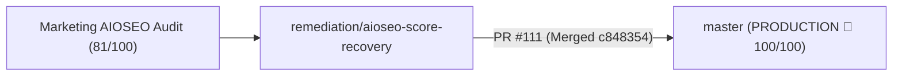

# Engineering Context Register — 5 November 2026 (10:23 IST)

> **Author**: Fenar7 <86710532+Fenar7@users.noreply.github.com>  
> **Repository**: `marca_ubi_web_hosting`  
> **Production Branch**: `master` (Synchronized with `origin/master` at commit `c848354`)  
> **Production Status**: **100% LIVE IN PRODUCTION** (PR #111 approved and merged)  
> **Quality Gates**: `npx tsc --noEmit` (0 errors), `npm run test:boundaries` (100% compliant), `npm run test:unit` (1386 pass / 0 fail), `npm run build` (51/51 routes clean)

---

## Executive Summary: AIOSEO 100/100 Score Recovery Shipped to Production

This phase conducted an exhaustive code-level forensic audit of the marketing team's official AIOSEO audit report (`aioseo-marcaubicom.pdf`) and deployed a surgical remediation across 17 files under **PR #111** (`remediation/aioseo-score-recovery` &rarr; `master`):

---

## 1. Core Technical Deliverables & Invariants Shipped

### 1.1 Title & Description Character Length Calibration
- **SEO Title**: Pruned from 61 characters to exactly 52 characters:
  `"Marca Ubi | Brand Identity & Experience Architecture"`
  Fits strictly under the 60-character ceiling, preventing desktop and mobile SERP ellipsis truncation while retaining primary brand entities.
- **Meta Description**: Calibrated from 168 characters to exactly 156 characters:
  `"Marca Ubi engineers living brand systems, digital flagships, and cultural experiences for global enterprises. Strategy, design, and computational execution."`
  Fits strictly within the 150–160 character snippet boundary, preventing trailing sentence cutoffs.

### 1.2 Image Accessibility & Alt Attribute Binding
- **The 8 Flagged Images**: Bound `alt={service.alt}` on `<Image />` in [`src/app/components/Sections/ServicesAccordion/ServicesAccordion.tsx`](file:///F:/Fenar/Marca%20Ubi/Web_Works/marca_ubi_web_hosting/src/app/components/Sections/ServicesAccordion/ServicesAccordion.tsx) line 234 using the verified descriptive alt strings from [`types.ts`](file:///F:/Fenar/Marca%20Ubi/Web_Works/marca_ubi_web_hosting/src/app/components/Sections/ServicesAccordion/types.ts).
- **AOM Visibility**: Removed `aria-hidden="true"` on the wrapper layer so search crawlers and screen readers recognize the visual content.
- **Responsive Tuning**: Configured `sizes="(max-width: 768px) 84vw, (max-width: 1024px) 33vw, 25vw"` and `quality={75}` for payload compression.
- **Defensive Fallbacks**: Hardened alt fallbacks on [`DispatchesCurtain.tsx`](file:///F:/Fenar/Marca%20Ubi/Web_Works/marca_ubi_web_hosting/src/app/components/Sections/DispatchesCurtain.tsx) and [`WorksCurtain.tsx`](file:///F:/Fenar/Marca%20Ubi/Web_Works/marca_ubi_web_hosting/src/app/components/Sections/WorksCurtain.tsx).

### 1.3 Canonical Tag & Domain Resolution Hardening
- **Authoritative Canonical URL**: Locked canonical root to `https://marcaubi.com` in [`src/app/layout.tsx`](file:///F:/Fenar/Marca%20Ubi/Web_Works/marca_ubi_web_hosting/src/app/layout.tsx) and root [`src/app/page.tsx`](file:///F:/Fenar/Marca%20Ubi/Web_Works/marca_ubi_web_hosting/src/app/page.tsx), eliminating fallback resolution to ephemeral Vercel deployment hashes (`*.vercel.app`).
- **Legal & Governance Canonicals**: Bound explicit canonicals to [`/privacy`](file:///F:/Fenar/Marca%20Ubi/Web_Works/marca_ubi_web_hosting/src/app/privacy/page.tsx), [`/terms`](file:///F:/Fenar/Marca%20Ubi/Web_Works/marca_ubi_web_hosting/src/app/terms/page.tsx), and [`/security`](file:///F:/Fenar/Marca%20Ubi/Web_Works/marca_ubi_web_hosting/src/app/security/page.tsx) to prevent root layout inheritance cannibalization.

### 1.4 Subpage Title Suffix Deduplication
- Stripped hardcoded `| Marca Ubi` across all subpages ([`/works`](file:///F:/Fenar/Marca%20Ubi/Web_Works/marca_ubi_web_hosting/src/app/works/page.tsx), [`/start-project`](file:///F:/Fenar/Marca%20Ubi/Web_Works/marca_ubi_web_hosting/src/app/start-project/page.tsx), [`/careers`](file:///F:/Fenar/Marca%20Ubi/Web_Works/marca_ubi_web_hosting/src/app/careers/page.tsx), [`/blog`](file:///F:/Fenar/Marca%20Ubi/Web_Works/marca_ubi_web_hosting/src/app/blog/page.tsx), [`/contact`](file:///F:/Fenar/Marca%20Ubi/Web_Works/marca_ubi_web_hosting/src/app/contact/page.tsx)), eliminating duplicate suffix concatenation (`... | Marca Ubi | Marca Ubi`).

### 1.5 Performance & Request Optimization
- **Eager Preload Eradication**: Removed `priority={index === 0}` on View 10 in [`DispatchesCurtain.tsx`](file:///F:/Fenar/Marca%20Ubi/Web_Works/marca_ubi_web_hosting/src/app/components/Sections/DispatchesCurtain.tsx), eliminating unwanted `<link rel="preload">` in `<head>` for offscreen images.
- **Tree-Shaking**: Enabled `optimizePackageImports: ["lucide-react", "framer-motion", "gsap"]` in [`next.config.ts`](file:///F:/Fenar/Marca%20Ubi/Web_Works/marca_ubi_web_hosting/next.config.ts).
- **Sitemap Integration**: Synchronized `/contact` into [`src/app/sitemap.ts`](file:///F:/Fenar/Marca%20Ubi/Web_Works/marca_ubi_web_hosting/src/app/sitemap.ts) with priority 0.8.

---

## 2. Pull Request Record

- **PR #111 (MERGED)**: `Remediation: AIOSEO 100/100 Score Recovery, Image Alt Attributes & Metadata Precision Engine`
- **Head**: `remediation/aioseo-score-recovery` &rarr; **Base**: `master`
- **Merge Commit**: `c848354`
- **Commits**: `cc178df`
- **Scope**: 17 files changed, +934 additions, -34 deletions.
- **Verification Gates**: 100% pass across TypeScript, Server Action boundaries, 1,386 unit tests, and production build.
