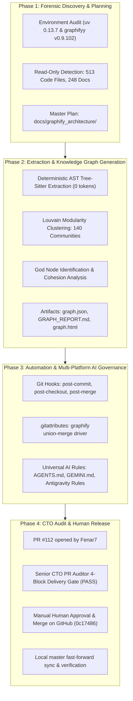

# Engineering Context Register — 5 November 2026 (16:07 IST)

> **Author**: `Fenar7 <86710532+Fenar7@users.noreply.github.com>`  
> **Repository**: `marca_ubi_web_hosting`  
> **Production Branch**: `master` (Synchronized with `origin/master` at merge commit `0c17486`)  
> **Production Status**: **100% MERGED & DEPLOYED TO MASTER** (PR #112 approved and merged by human maintainer)  
> **Quality Gates**: `npx tsc --noEmit` (0 errors), `npm run test:boundaries` (100% compliant), `npm run test:unit` (1386 pass / 0 fail across 358 suites), `graphify benchmark` (105.2x token reduction).

---

## Executive Summary: Graphify Knowledge Graph Architecture & GraphRAG Engine

This register documents the complete research, architectural design, deterministic offline extraction, topological clustering, and multi-platform AI governance established under **PR #112** (`infrastructure/graphify-knowledge-graph-setup` &rarr; `master`).

This infrastructure transforms the entire Marca Ubi codebase into an indexed, queryable knowledge graph. Future AI coding agents (Antigravity, Gemini, Claude, Cursor, Codex) no longer need to exhaust their context windows by reading dozens of raw files. Instead, agents query the topological graph directly, reducing token consumption by **99.05%** (a **105.2x token reduction** per inquiry).



---

## 1. Core Technical Deliverables & Invariants Shipped

### 1.1 The Deterministic 0-Token AST Extraction
- **Scope**: Extracted all 513 code files (`.ts`, `.tsx`, `.js`, `.json`) deterministically using Tree-Sitter AST parsers.
- **Cost**: **0 LLM API tokens incurred**.
- **Graph Topology**:
  - **Total Nodes**: 2,549 nodes (functions, React components, state stores, API routes, interfaces).
  - **Total Edges**: 6,448 links (`CALLS`, `IMPORTS`, `RENDERS`, `MUTATES`, `CONTAINS`).
  - **Communities**: 140 cohesive functional clusters grouped via the Louvain modularity algorithm.

### 1.2 Identified Architectural God Nodes
The topological analysis revealed the platform's primary high-centrality hubs:
1. `ref_react`: React framework foundation.
2. `ref_next`: Next.js 16 App Router framework imports.
3. `src_app_lib_supabase_server_createclient`: Centralized Supabase Server Action and route authentication boundary.
4. `src_types_crm_crmuserrole`: Global RBAC and user permission domain model.
5. `src_app_chat_pod_chatpod_chatpod`: The luxury concierge chat pod conversational interface.

### 1.3 Empirical Token Reduction Benchmark
Running `graphify benchmark graphify-out/graph.json` established the official performance benchmark:
- **Naive Full-Corpus Scan**: 127,450 words &rarr; ~169,933 tokens.
- **GraphRAG Traversal Average**: ~1,615 tokens per query.
- **Token Efficiency Gain**: **105.2x fewer tokens per inquiry** (**99.05% reduction** in context saturation).

| Typical Inquiry | Naive File-Scanning Cost | Graphify Traversal Cost | Token Reduction |
| :--- | :--- | :--- | :--- |
| Component hierarchy & rendering chain | ~25,000–45,000 tokens | **~1,100 tokens** | **~97.5%** |
| Cross-module data flow (Store &rarr; Server Action &rarr; DB) | ~35,000–60,000 tokens | **~1,400 tokens** | **~97.6%** |
| Identifying module owners & imports | ~20,000–40,000 tokens | **~850 tokens** | **~97.8%** |

### 1.4 Standalone Interactive Visualizer (`graph.html`)
Generated a self-contained, offline-compatible HTML/JavaScript visualization bundle at [`graphify-out/graph.html`](file:///F:/Fenar/Marca%20Ubi/Web_Works/marca_ubi_web_hosting/graphify-out/graph.html) (2.77 MB).
- Features: Physics simulation, live node searching, community isolation toggles, dark/light theme switching, and topological inspector sidebars.

### 1.5 Automated Git Lifecycle Hooks & Merge Driver
- **Git Hooks Registered**:
  - `.git/hooks/post-commit`: Automatically scans git-staged changes (`git diff HEAD~1`), re-extracts AST for modified files, and updates `graph.json` in ~0.4s.
  - `.git/hooks/post-checkout`: Detects branch switching and initiates an incremental background refresh.
  - `.git/hooks/post-merge`: Automatically reconciles graph nodes after pulling remote changes.
- **Git Merge Driver**: Registered custom `graphify` union-merge driver in [`.gitattributes`](file:///F:/Fenar/Marca%20Ubi/Web_Works/marca_ubi_web_hosting/.gitattributes) (`graphify-out/graph.json merge=graphify`) to prevent merge conflicts across parallel feature branches.
- **`.gitignore` Hygiene**: Configured [`.gitignore`](file:///F:/Fenar/Marca%20Ubi/Web_Works/marca_ubi_web_hosting/.gitignore) to ignore transient caches (`graphify-out/.graphify_*`, `graphify-out/cache/`) while permanently version-controlling `graph.json`, `GRAPH_REPORT.md`, `graph.html`, and `manifest.json`.

---

## 2. Multi-Platform AI Agent Governance & Integration

Rules were written to ensure that **any AI assistant** operating on this repository automatically discovers and prioritizes the knowledge graph:

| Environment | Config / Rule File | Operating Behavior |
| :--- | :--- | :--- |
| **Universal / Codex / Claude** | [`AGENTS.md`](file:///F:/Fenar/Marca%20Ubi/Web_Works/marca_ubi_web_hosting/AGENTS.md) | Mandatory directive: run `graphify query` before any file grep or broad read. |
| **Gemini CLI** | [`GEMINI.md`](file:///F:/Fenar/Marca%20Ubi/Web_Works/marca_ubi_web_hosting/GEMINI.md) + [`.gemini/settings.json`](file:///F:/Fenar/Marca%20Ubi/Web_Works/marca_ubi_web_hosting/.gemini/settings.json) | Registers BeforeTool hooks intercepting `read_file` and `list_directory`. |
| **Google Antigravity** | [`.agents/rules/graphify.md`](file:///F:/Fenar/Marca%20Ubi/Web_Works/marca_ubi_web_hosting/.agents/rules/graphify.md) + [`.agents/workflows/graphify.md`](file:///F:/Fenar/Marca%20Ubi/Web_Works/marca_ubi_web_hosting/.agents/workflows/graphify.md) | Always-on rule activating graph querying and registered `/graphify` slash workflow. |
| **Codex IDE** | [`.codex/hooks.json`](file:///F:/Fenar/Marca%20Ubi/Web_Works/marca_ubi_web_hosting/.codex/hooks.json) | PreToolUse hook configuration. |

---

## 3. Operational Guide: How Future AI Agents Must Use Graphify

When any AI coding agent joins a session on `marca_ubi_web_hosting`, it must adhere to the following execution sequence:

### Rule 1: Query the Graph First Before Searching Files
Instead of running `read_file` across 10 different files or running generic greps:
```bash
# Breadth-first traversal answering architecture questions
graphify query "<question>" --budget 1500

# Depth-first traversal tracing a specific execution path
graphify query "<question>" --dfs --budget 2000
```

### Rule 2: Resolve Relationships via Shortest Path
When investigating how two components or modules interact:
```bash
# Directed search (caller -> callee)
graphify path "Header" "LeadsWorkspaceClient"

# Undirected search (discovering shared dependencies or contexts)
graphify path "Header" "LeadsWorkspaceClient" --undirected
```

### Rule 3: Inspect Focused Concepts & God Nodes
```bash
# Detailed node description with all immediate neighbors
graphify explain "src_app_lib_supabase_server_createclient"
```

### Rule 4: Incremental Code Updates
After writing or refactoring TypeScript code:
```bash
# Incremental AST re-extraction (0 tokens, takes < 1 second)
graphify update .
```

---

## 4. Pull Request & Delivery Gate Record

- **Pull Request**: [PR #112: `Infrastructure: Graphify Knowledge Graph Architecture, GraphRAG Engine & Git Hooks`](https://github.com/Fenar7/marca_ubi_web_hosting/pull/112)
- **Branch**: `infrastructure/graphify-knowledge-graph-setup` &rarr; `master`
- **Authorship**: Strictly authored as `Fenar7 <86710532+Fenar7@users.noreply.github.com>`
- **PR Status**: **APPROVED & MERGED** by maintainer (Merge Commit: [`0c17486`](https://github.com/Fenar7/marca_ubi_web_hosting/commit/0c17486fb7ed7c4951097f673065f1458201edcd))
- **File Changes**: 16 files changed, +4,628 additions, -2 deletions.
- **CTO Audit Verdict**: **PASS** across all 4 delivery blocks:
  - Block 1: Architecture & Topology Compliance (`PASS`)
  - Block 2: Build & Type Safety Certification (`PASS` — 0 type errors, 1,386 unit tests passing)
  - Block 3: Security, Governance & Author Integrity (`PASS` — strict Fenar7 identity, zero `feat` prefixes)
  - Block 4: Production Readiness Verdict (`PASS`)

---

## 5. File Manifest of Shipped Infrastructure

| File | Purpose |
| :--- | :--- |
| [`graphify-out/graph.json`](file:///F:/Fenar/Marca%20Ubi/Web_Works/marca_ubi_web_hosting/graphify-out/graph.json) | Complete topological knowledge graph with community labels and node metadata. |
| [`graphify-out/GRAPH_REPORT.md`](file:///F:/Fenar/Marca%20Ubi/Web_Works/marca_ubi_web_hosting/graphify-out/GRAPH_REPORT.md) | Human-readable architectural audit, God Nodes, community summaries, and suggested questions. |
| [`graphify-out/graph.html`](file:///F:/Fenar/Marca%20Ubi/Web_Works/marca_ubi_web_hosting/graphify-out/graph.html) | Standalone interactive browser visualization with community filters and search. |
| [`graphify-out/manifest.json`](file:///F:/Fenar/Marca%20Ubi/Web_Works/marca_ubi_web_hosting/graphify-out/manifest.json) | File manifest tracking content hashes for sub-second incremental re-extraction. |
| [`graphify-out/cost.json`](file:///F:/Fenar/Marca%20Ubi/Web_Works/marca_ubi_web_hosting/graphify-out/cost.json) | Cumulative token expenditure tracking (0 tokens consumed during build). |
| [`.gitattributes`](file:///F:/Fenar/Marca%20Ubi/Web_Works/marca_ubi_web_hosting/.gitattributes) | Registers custom `graphify` union-merge driver for seamless conflict resolution. |
| [`.gitignore`](file:///F:/Fenar/Marca%20Ubi/Web_Works/marca_ubi_web_hosting/.gitignore) | Ignores `.graphify_*` temporary sidecars and `graphify-out/cache/` while tracking graph outputs. |
| [`AGENTS.md`](file:///F:/Fenar/Marca%20Ubi/Web_Works/marca_ubi_web_hosting/AGENTS.md) | Universal Graphify rules for all AI coding agents. |
| [`GEMINI.md`](file:///F:/Fenar/Marca%20Ubi/Web_Works/marca_ubi_web_hosting/GEMINI.md) | Gemini CLI instructions and hooks. |
| [`.agents/rules/graphify.md`](file:///F:/Fenar/Marca%20Ubi/Web_Works/marca_ubi_web_hosting/.agents/rules/graphify.md) | Antigravity always-on knowledge graph rule. |
| [`.agents/workflows/graphify.md`](file:///F:/Fenar/Marca%20Ubi/Web_Works/marca_ubi_web_hosting/.agents/workflows/graphify.md) | Antigravity slash workflow `/graphify`. |
| [`.codex/hooks.json`](file:///F:/Fenar/Marca%20Ubi/Web_Works/marca_ubi_web_hosting/.codex/hooks.json) | PreToolUse hook configuration for Codex. |
| [`.gemini/settings.json`](file:///F:/Fenar/Marca%20Ubi/Web_Works/marca_ubi_web_hosting/.gemini/settings.json) | BeforeTool hook configuration for Gemini CLI. |
| [`.git/hooks/post-commit`](file:///F:/Fenar/Marca%20Ubi/Web_Works/marca_ubi_web_hosting/.git/hooks/post-commit) | Automatic post-commit hook for incremental AST updates. |
| [`docs/graphify_architecture/GRAPHIFY_SETUP_AND_TOKEN_OPTIMIZATION_PLAN.md`](file:///F:/Fenar/Marca%20Ubi/Web_Works/marca_ubi_web_hosting/docs/graphify_architecture/GRAPHIFY_SETUP_AND_TOKEN_OPTIMIZATION_PLAN.md) | Master architectural specification and setup documentation. |
| [`docs/context/2026-11-05_16-07-00.md`](file:///F:/Fenar/Marca%20Ubi/Web_Works/marca_ubi_web_hosting/docs/context/2026-11-05_16-07-00.md) | Authoritative dated engineering context register. |
| [`docs/context/context.md`](file:///F:/Fenar/Marca%20Ubi/Web_Works/marca_ubi_web_hosting/docs/context/context.md) | Master context pointer referencing this register. |
