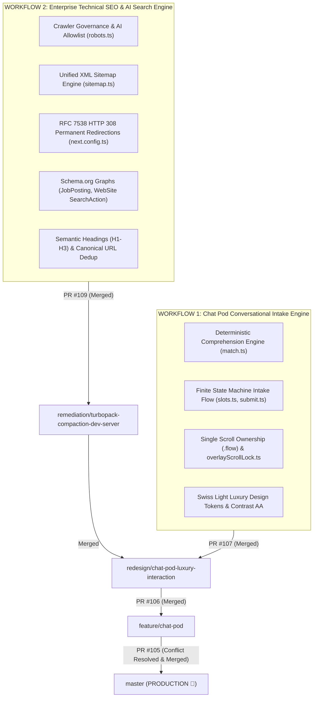

# Full Engineering Context Register — Latest Active Context

> **Start here.** This is the authoritative live pointer file; the comprehensive engineering detail lives in the linked registers.
> Any agent (human or AI) opening this project must read this file first, then the latest dated register.
>
> **LATEST ACTIVE REGISTER (Production Release — 4 Nov 2026):**  
> 👉 [`docs/context/2026-11-04_18-59-00.md`](./2026-11-04_18-59-00.md) — Complete Production Release Register: Full details of Workflow 1 (Chat Pod Intake Architecture) and Workflow 2 (Technical SEO, AI Search Grounding, Schema Knowledge Graphs, RFC Redirection Engine), merge conflict resolution on PR #105, and production verification.
>
> **Chat Pod Surface Deep Architecture Registers:**  
> 👉 [`docs/context/2026-11-04_10-20-00.md`](./2026-11-04_10-20-00.md) (Pass 4/5 Third CTO Audit & Test Hardening)  
> 👉 [`docs/context/2026-11-03_21-07-00.md`](./2026-11-03_21-07-00.md) (Part D Scroll Ownership & Viewport Lock)  
> 👉 [`docs/context/2026-11-03_14-55-00.md`](./2026-11-03_14-55-00.md) (Part C Comprehension & Intake Remediation)  
> 👉 [`docs/context/2026-11-03_11-23-34.md`](./2026-11-03_11-23-34.md) (Parts A & B Motion & Contrast Certification)  
>
> **Technical SEO & AI Search Deep Architecture Report:**  
> 👉 [`docs/seo_ai_search_architecture/TECHNICAL_SEO_ONPAGE_AUDIT_REPORT.md`](../seo_ai_search_architecture/TECHNICAL_SEO_ONPAGE_AUDIT_REPORT.md)

**Recorded At:** `2026-11-04T18:59:00+05:30`  
**Current Branch:** `master` (Checked out locally & 100% synchronized with `origin/master`)  
**Base Branch:** `master`  
**Latest State:** `All PRs in the stack (PR #109, PR #107, PR #106, PR #105) are officially APPROVED and MERGED into master. Both Workflow 1 (Chat Pod Intake Architecture) and Workflow 2 (Enterprise Technical SEO & AI Search Optimization Engine) are 100% LIVE IN PRODUCTION.`  
**Pull Requests Status (ALL MERGED INTO PRODUCTION):**  
- [PR #109 (MERGED)](https://github.com/Fenar7/marca_ubi_web_hosting/pull/109): `Phase 16: AI Search Optimization, LLM Indexing Grounding & Comprehensive Technical SEO Engine` (Merged commit `a56d49f`)  
- [PR #107 (MERGED)](https://github.com/Fenar7/marca_ubi_web_hosting/pull/107): `Remediation: Chat Pod Swiss Light Editorial Luxury Overhaul, Brand Red Alignment & Launcher Avatar` (Merged commit `d589c2d`)  
- [PR #106 (MERGED)](https://github.com/Fenar7/marca_ubi_web_hosting/pull/106): `Phase 15.2: Chat Pod Right-Side Docking, Editorial Concierge Profile & Fluid Interaction Engine` (Merged commit `f86f08e`)  
- [PR #105 (MERGED)](https://github.com/Fenar7/marca_ubi_web_hosting/pull/105): `Phase 15: Chat Pod Deterministic Assistant and Conversational Intake Architecture` (Merge resolution commit `1923bd0`, Final master commit `1717038979a4bb548c0842410a40ac91ee42f562`)  
**Author Identity:** `Fenar7 <86710532+Fenar7@users.noreply.github.com>`  
**TypeScript Status:** `0 errors` (`npx tsc --noEmit` verified exit code 0 on `master`)  
**Unit Tests:** `1334 pass / 0 fail` across `351 suites`  
**Server Action Boundaries:** `100% compliant` (12 files, 48 actions verified)  
**Production Build:** `npm run build` cleanly prerenders 50/50 static and SSG routes  
**Working Tree:** Clean, nothing uncommitted  

---

## 1. Overview of the Two Production Workflows

---

## 2. WORKFLOW 1 Summary: Chat Pod Deterministic Assistant & Intake Architecture
- **Zero-Hallucination Determinism**: Designed without external LLM dependencies to eliminate conversational hallucination and latency. Query strings undergo token normalization and fuzzy scoring in `src/app/chat-pod/engine/match.ts` against an authored intent database (`knowledge/intents.ts`).
- **Structured Lead Qualification**: Captures project name, service capability selection, budget tier, timeline, and client email via `src/app/chat-pod/intake/useIntakeFlow.ts` and `slots.ts`. Generates a live review card (`review.ts`) before atomic submission (`submit.ts`).
- **Single Scroll Ownership & Viewport Lock**: Purged dual-scrollbar bugs by assigning `.flow` as the sole scroll container with `ResizeObserver` compensation. Created `src/app/lib/overlayScrollLock.ts` as a refcounted token lock shared across overlays and Lenis.
- **Swiss Light Luxury Styling**: Pure white paper canvas (`#ffffff`), Raycast fluid pills, Brand Red (`#ea002a`) send button, and verified WCAG AA 4.5:1 text / 3:1 boundary contrast in `tests/unit/chatpod-contrast.test.ts`.

---

## 3. WORKFLOW 2 Summary: Master AI Search Optimization & Technical SEO Engine
- **Search Bot & AI Crawler Directives ([`src/app/robots.ts`](file:///F:/Fenar/Marca%20Ubi/Web_Works/marca_ubi_web_hosting/src/app/robots.ts))**:
  - Unblocked `/_next/*` so Googlebot WRS can render CSS/JS chunks and evaluate DOM landmarks.
  - Dedicated allowlist for AI search bots (`OAI-SearchBot`, `ChatGPT-User`, `PerplexityBot`, `ClaudeBot`, `Applebot`).
  - Unrestricted crawl access to institutional careers (`/careers`, `/careers/*`).
- **Unified XML Sitemap Engine ([`src/app/sitemap.ts`](file:///F:/Fenar/Marca%20Ubi/Web_Works/marca_ubi_web_hosting/src/app/sitemap.ts))**:
  - Automatically indexes all 7 static institutional hubs (`/`, `/works`, `/start-project`, `/careers`, `/privacy`, `/terms`, `/security`).
  - Maps all 16 service capability routes via `getAllServiceSlugs()`.
  - Dynamically fetches Sanity editorial dispatches (`sitemapPostsQuery`) and active careers (`activeCareersQuery`).
  - Pinning to `STATIC_RELEASE_DATE = new Date("2026-11-04T00:00:00.000Z")` prevents false-freshness crawl budget penalties.
- **RFC 7538 HTTP 308 Permanent Redirections ([`next.config.ts`](file:///F:/Fenar/Marca%20Ubi/Web_Works/marca_ubi_web_hosting/next.config.ts))**:
  - 308 permanent redirects for legacy URLs (`/work` $\rightarrow$ `/works`, `/about` $\rightarrow$ `/#about`, `/services` $\rightarrow$ `/#about`, `/contact` $\rightarrow$ `/start-project`, `/jobs` $\rightarrow$ `/careers`).
  - Dynamic fallback slug alias resolvers in `blog/[slug]` and `careers/[slug]` query Sanity `previousSlugs` to issue 308 redirects on renamed content instead of 404s.
- **Schema.org Knowledge Graph**:
  - Google Jobs `JobPosting` schema on `/careers`.
  - Institutional `WebSite` with deep `SearchAction` (`potentialAction`) in `layout.tsx`.
  - `ContactPage` schema on `/start-project` and `Blog` + `BreadcrumbList` on `/blog`.
- **On-Page Semantics, Meta Descriptions & Canonicals**:
  - Deduped repeat title suffixes across all child pages.
  - Declared explicit self-referencing absolute canonicals (`https://marcaubi.com/...`) on `/privacy`, `/terms`, and `/security` to halt root layout inheritance cannibalization.
  - 150–160 character meta descriptions across all 16 services in `src/app/services/content/`.
  - Clean `H1` $\rightarrow$ `H2` $\rightarrow$ `H3` heading landmarks and rich case-study alt text on gallery media.

---

## 4. Historical Context & Previous Merged Phases
1. **Phase 14 (PR #104 - Merged `3f1318a`):** Blog redesign — homepage **Journal** rail, `/blog` masthead + index ledger, `/blog/[slug]` article. Reading column has NO `max-width` cap; 16-18px body type.
2. **Phase 8 (PR #98 - Merged):** Pentagram header dual-slot vertical aperture alignment, 0ms background video poster crossfade.
3. **Phase 9 (PR #99 - Merged):** Services Accordion horizontal hover expansion engine with video loop playback.
4. **Phase 10 (PR #100 - Merged):** GSAP fluid motion (`power3.out`), clear aperture dual-zone scrim, responsive mobile touch architecture.
5. **Phase 11 (PR #101 - Merged):** White-curtain title contrast, 16 resting cards at 2400px, Card 08 media swap, H.264 faststart loops with zero-jump WebP posters.
6. **Phase 12 (PR #102 - Merged):** 16 `/services/[slug]` detail pages, light editorial theme, deep-linked accordion bullets.
7. **Phase 13 (PR #103 - Merged):** `/start-project` rebuilt as a light page under a cinematic video hero; brief popup retired in favour of the dedicated intake route.
