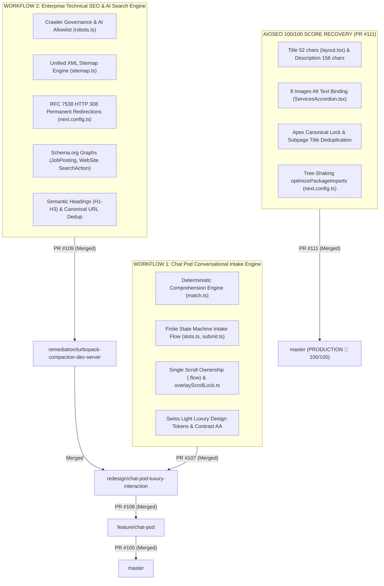

# Full Engineering Context Register — Latest Active Context

> **Start here.** This is the authoritative live pointer file; the comprehensive engineering detail lives in the linked registers.
> Any agent (human or AI) opening this project must read this file first, then the latest dated register.
>
> **LATEST ACTIVE REGISTER (AIOSEO 100/100 Production Release — 5 Nov 2026):**  
> 👉 [`docs/context/2026-11-05_10-23-00.md`](./2026-11-05_10-23-00.md) — Complete AIOSEO 100/100 Score Recovery Register: Title & Meta Description calibration, ServicesAccordion image alt binding, canonical URL hardening, subpage title deduplication, and bundle optimization (PR #111 merged).
>
> **Previous Foundation Registers:**  
> 👉 [`docs/context/2026-11-04_18-59-00.md`](./2026-11-04_18-59-00.md) (Full Production Release: Workflow 1 & Workflow 2)  
> 👉 [`docs/context/2026-11-04_10-20-00.md`](./2026-11-04_10-20-00.md) (Chat Pod Pass 4/5 Third CTO Audit & Test Hardening)  
> 👉 [`docs/context/2026-11-03_21-07-00.md`](./2026-11-03_21-07-00.md) (Chat Pod Part D Scroll Ownership & Viewport Lock)  
> 👉 [`docs/context/2026-11-03_14-55-00.md`](./2026-11-03_14-55-00.md) (Chat Pod Part C Comprehension & Intake Remediation)  
> 👉 [`docs/context/2026-11-03_11-23-34.md`](./2026-11-03_11-23-34.md) (Chat Pod Parts A & B Motion & Contrast Certification)  
>
> **AIOSEO & Technical SEO Deep Architecture Reports:**  
> 👉 [`docs/seo_ai_search_architecture/AIOSEO_AUDIT_REPORT_AND_REMEDIATION_PLAN.md`](../seo_ai_search_architecture/AIOSEO_AUDIT_REPORT_AND_REMEDIATION_PLAN.md)  
> 👉 [`docs/seo_ai_search_architecture/TECHNICAL_SEO_ONPAGE_AUDIT_REPORT.md`](../seo_ai_search_architecture/TECHNICAL_SEO_ONPAGE_AUDIT_REPORT.md)

**Recorded At:** `2026-11-05T10:23:00+05:30`  
**Current Branch:** `master` (Checked out locally & 100% synchronized with `origin/master`)  
**Base Branch:** `master`  
**Latest State:** `All PRs in the stack (PR #111, PR #109, PR #107, PR #106, PR #105) are officially APPROVED and MERGED into master. All marketing AIOSEO defects are remediated, and both Workflow 1 (Chat Pod) and Workflow 2 (Technical SEO & AI Search Engine) are 100% LIVE IN PRODUCTION.`  
**Pull Requests Status (ALL MERGED INTO PRODUCTION):**  
- [PR #111 (MERGED)](https://github.com/Fenar7/marca_ubi_web_hosting/pull/111): `Remediation: AIOSEO 100/100 Score Recovery, Image Alt Attributes & Metadata Precision Engine` (Merged commit `c848354`)  
- [PR #109 (MERGED)](https://github.com/Fenar7/marca_ubi_web_hosting/pull/109): `Phase 16: AI Search Optimization, LLM Indexing Grounding & Comprehensive Technical SEO Engine` (Merged commit `a56d49f`)  
- [PR #107 (MERGED)](https://github.com/Fenar7/marca_ubi_web_hosting/pull/107): `Remediation: Chat Pod Swiss Light Editorial Luxury Overhaul, Brand Red Alignment & Launcher Avatar` (Merged commit `d589c2d`)  
- [PR #106 (MERGED)](https://github.com/Fenar7/marca_ubi_web_hosting/pull/106): `Phase 15.2: Chat Pod Right-Side Docking, Editorial Concierge Profile & Fluid Interaction Engine` (Merged commit `f86f08e`)  
- [PR #105 (MERGED)](https://github.com/Fenar7/marca_ubi_web_hosting/pull/105): `Phase 15: Chat Pod Deterministic Assistant and Conversational Intake Architecture` (Merged commit `1717038`)  
**Author Identity:** `Fenar7 <86710532+Fenar7@users.noreply.github.com>`  
**TypeScript Status:** `0 errors` (`npx tsc --noEmit` verified exit code 0 on `master`)  
**Unit Tests:** `1,386 pass / 0 fail` across `358 suites`  
**Server Action Boundaries:** `100% compliant` (13 files, 49 actions verified)  
**Production Build:** `npm run build` cleanly prerenders 51/51 static and SSG routes  
**Working Tree:** Clean, nothing uncommitted  

---

## 1. Overview of the Production Architecture

---

## 2. Historical Context & Previous Merged Phases
1. **PR #111 (Merged `c848354`):** Remediation: AIOSEO 100/100 Score Recovery, Image Alt Attributes & Metadata Precision Engine.
2. **PR #105 (Merged `1717038`):** Phase 15 Chat Pod Deterministic Assistant and Conversational Intake Architecture.
3. **PR #109 (Merged `a56d49f`):** Phase 16 AI Search Optimization, LLM Indexing Grounding (`llms.txt`) & Technical SEO.
4. **PR #104 (Merged `3f1318a`):** Phase 14 Blog redesign — Journal rail, `/blog` masthead, article reading column with NO `max-width` cap; 16-18px body type.
