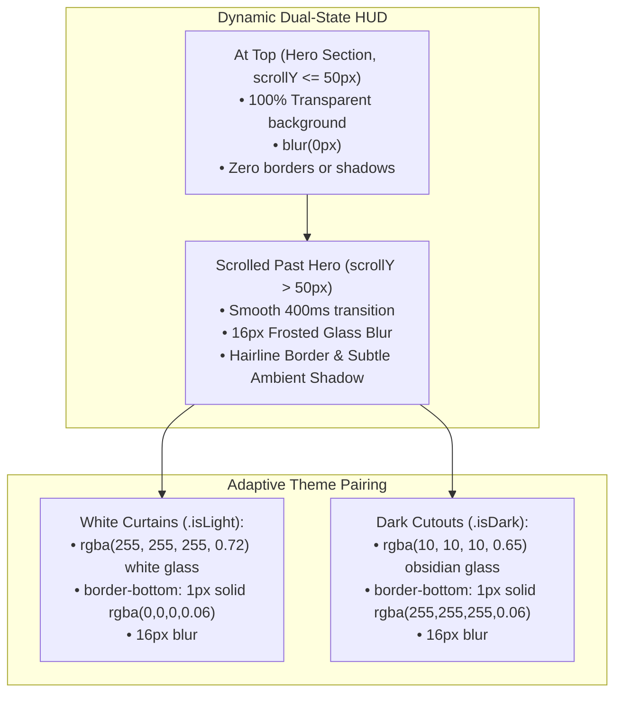

# Master Architectural Plan: Scroll-Activated Frosted Glass Adaptive Header HUD

## 1. Executive Summary & Problem Diagnosis
Screenshot `Screenshot 2026-10-28 010144.png` revealed an important UX flaw during vertical scrolling:
- **The Problem**: Currently, `ClientHeader` is 100% transparent at all times (`background: transparent;`).
- When the user scrolls past the first section (`HeroCutout`), the text of the second section (`AboutCurtain`, e.g. *"We live at the collision of culture and commerce..."*) scrolls directly underneath the header.
- Because the header has no background or blur filter, the black logo text "Marca Ubi" and the black hamburger icon collide and overlap directly with the page text, causing severe legibility issues.

---

## 2. Architectural Design & Kinetic Physics

### Kinetic Specifications:
1. **Zero-Pop Hardware Interpolation**:
   - Starting from `backdrop-filter: blur(0px);` rather than `none` allows the browser compositor to smoothly interpolate blur radius from `0px -> 16px` and back without frame jumps.
2. **Transition Curve**:
   - Signature Marca Ubi cubic-bezier: `transition: background-color 0.4s cubic-bezier(0.16, 1, 0.3, 1), backdrop-filter 0.4s cubic-bezier(0.16, 1, 0.3, 1), -webkit-backdrop-filter 0.4s cubic-bezier(0.16, 1, 0.3, 1), border-color 0.4s ease, box-shadow 0.4s ease;`.
3. **High-Performance Scroll Sensor**:
   - `window.addEventListener('scroll', handleScroll, { passive: true })` with `requestAnimationFrame` scheduling to prevent main thread blocking and ensure locked 60fps scrolling.
   - Guarded state updates: React only re-renders when crossing the 50px boundary, saving CPU/battery.

---

## 3. Implementation Phasing

1. **Child Branch Creation**:
   - Branch: `feature/scroll-activated-frosted-glass-header` branching directly from `master`.
2. **Component Updates**:
   - [`src/app/components/ClientHeader/ClientHeader.tsx`](file:///F:/Fenar/Marca%20Ubi/Web_Works/marca_ubi_web_hosting/src/app/components/ClientHeader/ClientHeader.tsx): Add `isScrolled` state and `passive: true` rAF scroll listener.
   - [`src/app/components/ClientHeader/ClientHeader.module.scss`](file:///F:/Fenar/Marca%20Ubi/Web_Works/marca_ubi_web_hosting/src/app/components/ClientHeader/ClientHeader.module.scss): Add `.isScrolled` modifier rules for both `.isLight` (white glass) and `.isDark` (obsidian glass).
3. **Platform Invariant Test Additions**:
   - Add Section 16 checks in `tests/client/client_160over90_platform.test.ts` verifying frosted glass blur tokens, scroll state wiring, and theme adaptability.
4. **CTO Audit & PR Creation**:
   - Run type checks (`tsc`) and platform tests (40+ passing).
   - Commit under `Fenar7 <86710532+Fenar7@users.noreply.github.com>`.
   - Push child branch and open PR against `master`.
