# Marca Ubi — Graphify Knowledge Graph Architecture & Token Optimization Plan

> **Document Version**: 1.0.0  
> **Target Platform**: Marca Ubi Enterprise Web & CRM (`marca_ubi_web_hosting`)  
> **Author**: `Fenar7 <86710532+Fenar7@users.noreply.github.com>`  
> **Status**: Architectural Blueprint & Implementation Plan (Awaiting User "Proceed" Confirmation)  
> **Execution Gate**: Strict Zero-Action Gate Active (Zero code generated, zero git hooks installed, zero repo mutations until explicit approval)

---

## 1. Executive Summary & Value Proposition

### 1.1 The Token Problem in Multi-Agent Codebases
When AI coding agents (Team Lead, Frontend Developer, Backend Engineer, CTO PR Auditor) execute tasks across the Marca Ubi platform, they typically consume **25,000 to 80,000 tokens per investigation** by executing repetitive `read_file`, `grep`, and directory scans. Each subagent reads whole files repeatedly to discover component hierarchies, state flows, and API integrations.

### 1.2 The Graphify Solution
**Graphify** (`graphifyy v0.9.102`) transforms the codebase into a persistent, queryable knowledge graph. Instead of brute-force scanning:
1. **0-Token AST Extraction**: Analyzes all TypeScript, TSX, and JavaScript source files offline using deterministic tree-sitter AST parsers. Costs **0 LLM tokens**.
2. **Topological Graph Traversal**: AI agents query `graphify query "<question>" --budget 1500` or `graphify path "<source>" "<target>"`, returning exact topological paths, call flows, and dependency chains in **under 1,500 tokens**.
3. **Token Reduction Impact**: Achieves a **70% to 95% token savings** per session while eliminating context exhaustion and hallucinated dependencies.
4. **Interactive Architectural Map**: Produces `graphify-out/graph.html` for human engineers to visually inspect module boundaries, bridge nodes, and dependency cycles in a browser.

```mermaid
flowchart TD
    subgraph Traditional["Traditional AI Agent Workflow"]
        A1[Agent Prompt] --> A2[Grep Codebase]
        A2 --> A3[Read Full Files 10-30x]
        A3 --> A4[Consume 40,000 - 80,000 Tokens]
        A4 --> A5[High Context Saturation & Latency]
    end

    subgraph Graphify["Graphify GraphRAG Workflow"]
        B1[Agent Prompt] --> B2[Query Knowledge Graph]
        B2 --> B3[graphify query / path / explain]
        B3 --> B4[AST & Community Topology]
        B4 --> B5[Consume 800 - 1,500 Tokens]
        B5 --> B6[Instant, Precise Surgical Edits]
    end
```



---

## 2. Forensic Discovery & Environment Analysis

Forensic audits of the host system confirmed full readiness without needing external compiler toolchains:

| Component | Status | Environment Path / Specification |
| :--- | :--- | :--- |
| **Package Tool** | Installed & Healthy | `uv 0.13.7` |
| **Python Runtime** | Installed & Isolated | `Python 3.12` under `C:\Users\firoz\AppData\Roaming\uv\tools\graphifyy\Scripts\python.exe` |
| **Graphify Core** | Pre-installed & Tested | `graphifyy v0.9.102` (`graphify.exe` located at `C:\Users\firoz\AppData\Roaming\uv\tools\graphifyy\Scripts\graphify.exe`) |
| **Library Import** | Verified (Exit Code 0) | `import graphify` verified via Python runtime |
| **Git Hooks Status** | Clean (Ready to wire) | Post-commit, post-checkout, post-merge currently uninstalled |

### Codebase Detection Breakdown
A read-only detection pass on `marca_ubi_web_hosting` revealed:
- **Total Detected Files**: 887 files
  - **Code Files**: 513 files (`.ts`, `.tsx`, `.js`, `.mjs`, `.json`) &rarr; 100% covered by deterministic AST extraction (0 tokens).
  - **Documentation**: 247 files (`.md`, `.txt`) &rarr; Architectural specs, PRDs, context logs.
  - **Media / Assets**: 106 images, 18 videos, 3 papers &rarr; Skipped or cached.

---

## 3. Architecture & Topology Overview

Graphify categorizes codebase entities into a graph structure `G = (V, E)`:

### Node Types
- `function`: Exported and internal functions, async handlers, server actions.
- `component`: React TSX components (e.g. `Header`, `ContactCurtain`, `SalesFunnel`).
- `store`: Zustand / React state stores (e.g. `useSalesFunnelStore`).
- `api_route`: Next.js App Router route handlers (`/api/sales-funnel/...`).
- `concept`: Architectural domains (e.g. "Brand Identity", "AIOSEO Remediation").

### Edge Types
- `CALLS`: Direct function invocation.
- `IMPORTS`: ES module dependency link.
- `RENDERS`: JSX/TSX component composition.
- `MUTATES`: State update actions.
- `INFERRED`: Semantic bridge across documents or concepts.

### Community Detection & God Nodes
Graphify applies the **Louvain modularity algorithm** to cluster nodes into cohesive communities (e.g. `Community 0: Sales Funnel CRM Engine`, `Community 1: Kinetic Visuals & Header Ticker`, `Community 2: Navigation & Liquid Glass`).
It automatically highlights **God Nodes** (nodes with unusually high degree centrality, e.g., global Supabase clients or base layout wrappers) that require extra engineering caution during refactoring.

---

## 4. Phase-by-Phase Implementation Roadmap

Upon explicit user approval ("proceed" / "do it"), the implementation will proceed through the following 6 phases:

### Phase 1: Environment & Persistence Configuration
1. Initialize `graphify-out/` directory.
2. Generate `graphify-out/.graphify_python` pointing explicitly to `C:\Users\firoz\AppData\Roaming\uv\tools\graphifyy\Scripts\python.exe` with UTF-8 BOM-less encoding.
3. Generate `graphify-out/.graphify_root` pointing to project root.

### Phase 2: AST & Semantic Extraction Pipeline
1. **Part A (Structural AST)**:
   - Run AST extraction on the 513 code files via `graphify.extract`.
   - Generates `.graphify_ast.json` in sub-seconds with 0 tokens.
2. **Part B (Semantic Extraction)**:
   - For markdown architectural documentation in `docs/`, check semantic cache (`check_semantic_cache`).
   - Extract relevant concepts using cached results or local host agent extraction.
3. **Part C (Merge & Provenance)**:
   - Merge AST nodes with semantic nodes.
   - Tag provenance explicitly (`_origin: 'ast'` vs `_origin: 'semantic'`).
   - Generate `graphify-out/.graphify_extract.json`.

### Phase 3: Graph Construction, Louvain Clustering & Analysis
1. Construct directed network graph from extraction payload.
2. Run Louvain community clustering and calculate intra-community cohesion scores.
3. Execute `diagnose_extraction` health check (identifying dangling edges, collapsed endpoints, or self-loops).
4. Identify God Nodes and surprising architectural cross-links.
5. Curate plain-language community labels (e.g., "Sales Intelligence Pipeline", "Kinetic Stage Visual Engine").
6. Export `graphify-out/graph.json` and `graphify-out/GRAPH_REPORT.md`.

### Phase 4: Interactive Visualizer & Export Artifacts
1. Execute `graphify export html` to produce `graphify-out/graph.html`.
2. Verify interactive browser graph visualization with community filters and node inspection panels.

### Phase 5: Automated Git Hooks & Agent Governance Integration
1. **Git Hook Installation**:
   - Run `graphify hook install` to register post-commit, post-checkout, and post-merge hooks.
   - On every subsequent `git commit`, only changed code files will be re-extracted via AST (taking ~0.4s), keeping `graph.json` perpetually fresh with 0 manual intervention.
2. **`.gitignore` Hygiene**:
   - Add temporary cache sidecars (`graphify-out/.graphify_*`, `graphify-out/cache/`) to `.gitignore`.
   - Keep `graphify-out/graph.json`, `graphify-out/GRAPH_REPORT.md`, and `graphify-out/graph.html` version-controlled or ignored based on team preference.
3. **Agent Rules Integration (`AGENTS.md` & `GEMINI.md`)**:
   - Add Graphify guidance so future AI agents know how to query the graph:
     ```markdown
     <!-- graphify:start -->
     ## Knowledge Graph & GraphRAG Navigation
     Before scanning or reading multiple raw files, check `graphify-out/graph.json`:
     - Query: `graphify query "<question>" --budget 1500`
     - Path: `graphify path "<nodeA>" "<nodeB>"`
     - Node Details: `graphify explain "<nodeName>"`
     <!-- graphify:end -->
     ```

### Phase 6: Token Reduction Benchmarking & Verification
1. Run `graphify benchmark graphify-out/graph.json` to calculate and log the empirical token reduction percentage.
2. Test query resolution on sample questions:
   - *"How does the sales funnel lead routing work?"*
   - *"Trace the data flow from Contact form submission to Supabase."*
3. Record metrics in the session register.

---

## 5. Security, Quality & Behavioral Safeguards

1. **Deterministic & Offline**: AST extraction executes purely locally. No proprietary source code is uploaded to third-party APIs.
2. **Zero Performance Overhead**: The post-commit hook takes < 500ms and operates only on git-staged changes.
3. **No Breaking Changes**: Graphify introduces no runtime dependencies to `package.json` or Next.js build pipelines. Turbopack and Vercel builds remain unaffected.
4. **Strict Permission Compliance**: In accordance with user rules, **no files will be created or altered until the user explicitly responds with "proceed" or "do it"**.

---

## 6. Decision Points for the User

1. **Version Control for `graphify-out/`**:
   - *Option A (Recommended)*: Commit `graphify-out/graph.json` and `graphify-out/GRAPH_REPORT.md` so all agents and team members share the graph, while ignoring temporary cache sidecars (`.graphify_*`).
   - *Option B*: Gitignore all of `graphify-out/` completely, generating the graph purely locally per developer/agent workstation.
2. **Observation & Visualization**:
   - Would you like `graphify-out/graph.html` opened in your default browser once generated for visual exploration?
