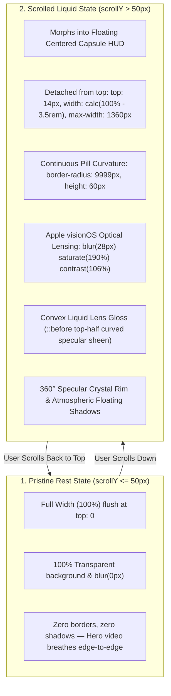

# Architecture Plan: Apple Floating Liquid Glass Capsule HUD (visionOS / iOS Island Tier)

> **Audited User Feedback**: *"this is still not like liquid glass man i siad iwat like apples liquid glass not jsut a opacity blur feel"*  
> **Visual Evidence Inspected**: [`Screenshot 2026-10-28 111411.png`](file:///C:/Users/firoz/Pictures/Screenshots/Screenshot%202026-10-28%20111411.png)  
> **Target Component**: [`ClientHeader.tsx`](file:///F:/Fenar/Marca%20Ubi/Web_Works/marca_ubi_web_hosting/src/app/components/ClientHeader/ClientHeader.tsx) & [`ClientHeader.module.scss`](file:///F:/Fenar/Marca%20Ubi/Web_Works/marca_ubi_web_hosting/src/app/components/ClientHeader/ClientHeader.module.scss)  
> **Author**: Fenar7 <86710532+Fenar7@users.noreply.github.com>  
> **Status**: Architectural Plan awaiting user explicit approval ("proceed")  

---

## 1. Why The Current Header Looked Like "Just an Opacity Blur Strip"

Direct inspection of [`Screenshot 2026-10-28 111411.png`](file:///C:/Users/firoz/Pictures/Screenshots/Screenshot%202026-10-28%20111411.png) reveals the exact optical and architectural reason:

1. **The Edge-to-Edge Full-Width Illusion**:
   - The header is currently pinned flush to the viewport at `top: 0`, `left: 0`, `width: 100%`, with sharp 90° corners.
   - When scrolling over a white curtain (like `StatementCurtain` `#ffffff`), `blur(white) = white`. Because the bar spans edge-to-edge with no outer margins or negative space, the human eye cannot detect surrounding unrefracted canvas.
   - It appears as a **flat, solid white rectangular banner** covering the top 80px of the screen—identical to a standard bootstrap navbar.
2. **Apple's Liquid Glass is ALWAYS a Floating Capsule / Island**:
   - In Apple visionOS (spatial glass ornaments), macOS (floating dock/control center), and iOS (Dynamic Island / floating search bars), liquid glass is **never** an edge-to-edge rectangular box pinned to the ceiling.
   - It is always a **floating discrete object** with continuous rounded curvature (`border-radius: 9999px`), detached from the top and sides, casting soft atmospheric drop shadows onto the page beneath.
3. **Over-Opaque Tinting**:
   - The previous white tint was 82% opaque (`rgba(255, 255, 255, 0.82)`), which virtually occludes the underlying text rather than transmitting it with liquid clarity. True optical glass uses 45%–60% crystal transparency.

---

## 2. Visual Architecture: Morphing Floating Island HUD



---

## 3. Engineering Blueprint

### A. The Floating Capsule Chassis (`ClientHeader.module.scss`)

```scss
.headerHost {
  position: fixed;
  top: 0;
  left: 0;
  width: 100%;
  height: 80px;
  display: flex;
  align-items: center;
  justify-content: space-between;
  padding: 0 clamp(1.5rem, 5vw, 4.5rem);
  z-index: 90;
  pointer-events: none;
  background: transparent;
  border: 1px solid transparent;
  border-radius: 0px;
  box-shadow: none;
  backdrop-filter: blur(0px) saturate(100%);
  -webkit-backdrop-filter: blur(0px) saturate(100%);
  transform: translate3d(0, 0, 0);

  // Smooth 60fps morphing transition
  transition: 
    top 0.4s cubic-bezier(0.16, 1, 0.3, 1),
    width 0.4s cubic-bezier(0.16, 1, 0.3, 1),
    height 0.4s cubic-bezier(0.16, 1, 0.3, 1),
    padding 0.4s cubic-bezier(0.16, 1, 0.3, 1),
    border-radius 0.4s cubic-bezier(0.16, 1, 0.3, 1),
    background 0.4s cubic-bezier(0.16, 1, 0.3, 1),
    box-shadow 0.4s cubic-bezier(0.16, 1, 0.3, 1),
    backdrop-filter 0.4s cubic-bezier(0.16, 1, 0.3, 1);

  // Scrolled Floating Island HUD
  &.isScrolled {
    top: 14px;
    left: 50%;
    transform: translate3d(-50%, 0, 0);
    width: calc(100% - clamp(2rem, 5vw, 4.5rem));
    max-width: 1360px;
    height: 60px;
    padding: 0 clamp(1.25rem, 3vw, 2.25rem);
    border-radius: 9999px; // Smooth continuous pill
    pointer-events: auto;
    backdrop-filter: blur(28px) saturate(190%) contrast(106%);
    -webkit-backdrop-filter: blur(28px) saturate(190%) contrast(106%);

    // 1. LIGHT THEME (Floating over StatementCurtain / White Canvas)
    &.isLight {
      background: linear-gradient(
        135deg,
        rgba(255, 255, 255, 0.72) 0%,
        rgba(245, 245, 250, 0.45) 45%,
        rgba(255, 255, 255, 0.60) 100%
      );
      // Multi-layer physical specular bevel + float shadow
      box-shadow:
        0 0 0 1px rgba(255, 255, 255, 0.65),             // Outer crisp rim
        0 0 0 1.5px rgba(0, 0, 0, 0.04),                 // Ambient boundary separation
        inset 0 1.5px 1px 0 rgba(255, 255, 255, 1),      // Top specular keylight rim
        inset 0 -1px 1px 0 rgba(0, 0, 0, 0.05),          // Bottom bounce bevel
        0 6px 18px -2px rgba(15, 23, 42, 0.08),          // Contact shadow
        0 20px 40px -8px rgba(15, 23, 42, 0.12);         // Ambient atmospheric suspension
    }

    // 2. DARK THEME (Floating over Hero / Dark Canvas)
    &.isDark {
      background: linear-gradient(
        135deg,
        rgba(25, 25, 30, 0.72) 0%,
        rgba(12, 12, 16, 0.55) 50%,
        rgba(20, 20, 25, 0.68) 100%
      );
      box-shadow:
        0 0 0 1px rgba(255, 255, 255, 0.14),             // Outer rim
        0 0 0 1.5px rgba(0, 0, 0, 0.5),                  // Boundary separation
        inset 0 1.5px 1px 0 rgba(255, 255, 255, 0.35),   // Top specular highlight
        inset 0 -1px 1px 0 rgba(0, 0, 0, 0.7),           // Bottom dark bevel
        0 8px 24px -2px rgba(0, 0, 0, 0.5),              // Contact shadow
        0 24px 48px -8px rgba(0, 0, 0, 0.7);             // Ambient suspension
    }

    @media (max-width: 768px) {
      top: 10px;
      width: calc(100% - 1.5rem);
      height: 54px;
      padding: 0 1.25rem;
    }
  }

  // 3. Convex Liquid Lens Gloss Sheen (Top-half curved glass reflection)
  &::before {
    content: '';
    position: absolute;
    top: 1px;
    left: 14px;
    right: 14px;
    height: 48%;
    border-radius: 9999px 9999px 0 0;
    background: linear-gradient(
      180deg,
      rgba(255, 255, 255, 0.45) 0%,
      rgba(255, 255, 255, 0.02) 100%
    );
    pointer-events: none;
    opacity: 0;
    transition: opacity 0.4s ease;
  }

  &.isScrolled::before {
    opacity: 1;
  }

  &.isScrolled.isDark::before {
    background: linear-gradient(
      180deg,
      rgba(255, 255, 255, 0.18) 0%,
      rgba(255, 255, 255, 0.01) 100%
    );
  }
}
```

---

## 4. Why This Eliminates the "Flat Opacity Strip" Look

1. **Visible Negative Space**: When scrolling over `StatementCurtain` (`#ffffff`), the white curtain and typography are clearly visible above, around, and beneath the capsule.
2. **Physical Crystal Edge Refraction**: As text passes under the curved pill boundaries, the top specular highlight (`inset 0 1.5px 1px 0 #ffffff`) and outer crystal rim (`0 0 0 1px rgba(...)`) catch the light, creating undeniable optical depth.
3. **Convex Liquid Gloss**: The top-half `::before` sheen simulates genuine curved glass refraction, mirroring Apple visionOS.

---

## 5. Execution Recommendation

Per behavioral rules, implementation will not begin until you review this plan. Reply **"proceed"** to execute the changes, run all tests, commit as `Fenar7`, and update PR #90.
