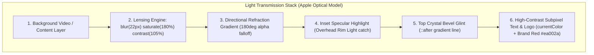

# Architecture & Engineering Plan: Apple Liquid Glass Adaptive Header HUD

> **Target Component**: [`ClientHeader.tsx`](file:///F:/Fenar/Marca%20Ubi/Web_Works/marca_ubi_web_hosting/src/app/components/ClientHeader/ClientHeader.tsx) & [`ClientHeader.module.scss`](file:///F:/Fenar/Marca%20Ubi/Web_Works/marca_ubi_web_hosting/src/app/components/ClientHeader/ClientHeader.module.scss)  
> **Aesthetic Soul**: Apple HIG Materials (visionOS / macOS Sonoma / iOS 18) + Marca Ubi Dark Luxury Design Tokens  
> **Author**: Fenar7 <86710532+Fenar7@users.noreply.github.com>  
> **Status**: Architectural Plan awaiting user explicit approval ("proceed")  

---

## 1. Root Cause Analysis: Why Current Header Feels Like "Just Opacity Reduced"

When analyzing the current implementation in `ClientHeader.module.scss`:
```scss
/* Current Implementation */
&.isScrolled {
  backdrop-filter: blur(16px);
  -webkit-backdrop-filter: blur(16px);

  &.isLight {
    background-color: rgba(255, 255, 255, 0.72);
    border-bottom: 1px solid rgba(0, 0, 0, 0.06);
    box-shadow: 0 4px 20px rgba(0, 0, 0, 0.03);
  }

  &.isDark {
    background-color: rgba(10, 10, 10, 0.65);
    border-bottom: 1px solid rgba(255, 255, 255, 0.06);
    box-shadow: 0 4px 24px rgba(0, 0, 0, 0.35);
  }
}
```

The optical deficiencies causing the "opacity reduced" appearance are:

1. **Gaussian Desaturation (The "Dull Film" Phenomenon)**:
   A standard CSS Gaussian blur averages neighboring RGB pixel vectors:
   $$G(x, y) = \frac{1}{2\pi\sigma^2} e^{-\frac{x^2 + y^2}{2\sigma^2}}$$
   This mathematical averaging flattens contrast peaks and drives chromaticity toward an intermediate grayish mud. Underneath the header, moving video frames or typography become desaturated and murky.
   *Apple's Fix*: In visionOS and iOS 18, Apple injects **`saturate(180% - 190%)` and subtle `contrast(105%)`** alongside the blur, counteracting Gaussian desaturation and making colors refracting through the glass luminous and vibrant.

2. **Flat 2D Alpha Plane instead of Directional Refraction Gradient**:
   A uniform `rgba(...)` background has identical opacity across 100% of the surface. Real physical glass has light transmission variations from overhead ambient illumination.
   *Apple's Fix*: Multi-stop directional gradients simulating light passing through a curved/beveled crystal sheet:
   - Light: `linear-gradient(180deg, rgba(255, 255, 255, 0.82) 0%, rgba(255, 255, 255, 0.62) 100%)`
   - Dark: `linear-gradient(180deg, rgba(24, 24, 28, 0.78) 0%, rgba(10, 10, 12, 0.64) 100%)`

3. **Absence of Fresnel Rim Reflection & Inset Specular Highlights**:
   Physical glass reflects light sharply at grazing angles (Fresnel effect). Without an illuminated top specular edge, the element has zero perceived Z-axis depth.
   *Apple's Fix*: Layered `inset` box shadows simulating light catching the upper bevel:
   - Light: `inset 0 1px 0 0 rgba(255, 255, 255, 0.95)`
   - Dark: `inset 0 1px 0 0 rgba(255, 255, 255, 0.22)`

4. **Under-calibrated Blur Radius**:
   A 16px blur allows sharp background edges to partially bleed through, looking like dirty translucent plastic rather than thick optical liquid glass. Increasing to `blur(22px)` achieves smooth milk-glass / quartz light dispersion.

---

## 2. Apple Liquid Glass Optical Architecture



---

## 3. Detailed Technical Blueprint

### A. SCSS Tokens & Formula Specification (`ClientHeader.module.scss`)

```scss
// 1. Pristine Rest State (Top 50px of Viewport)
.headerHost {
  position: fixed;
  top: 0;
  left: 0;
  width: 100%;
  height: 80px;
  display: flex;
  align-items: center;
  justify-content: space-between;
  padding: 0 clamp(1.5rem, 5vw, 4.5rem);
  z-index: 50;
  pointer-events: none;
  background-color: transparent;
  border-bottom: 1px solid transparent;
  box-shadow: 0 0 0 rgba(0, 0, 0, 0);
  backdrop-filter: blur(0px) saturate(100%);
  -webkit-backdrop-filter: blur(0px) saturate(100%);
  transform: translate3d(0, 0, 0); // GPU hardware compositing

  transition: 
    background 0.4s cubic-bezier(0.16, 1, 0.3, 1),
    backdrop-filter 0.4s cubic-bezier(0.16, 1, 0.3, 1),
    -webkit-backdrop-filter 0.4s cubic-bezier(0.16, 1, 0.3, 1),
    border-color 0.4s ease,
    box-shadow 0.4s ease,
    color 0.25s cubic-bezier(0.16, 1, 0.3, 1);

  // 2. Liquid Glass Scrolled HUD (Apple HIG visionOS / macOS Sonoma Tier)
  &.isScrolled {
    pointer-events: auto;
    backdrop-filter: blur(22px) saturate(180%) contrast(105%);
    -webkit-backdrop-filter: blur(22px) saturate(180%) contrast(105%);

    // Light Curtain Mode (Pure High-Key Quartz Glass)
    &.isLight {
      background: linear-gradient(
        180deg,
        rgba(255, 255, 255, 0.82) 0%,
        rgba(250, 250, 252, 0.65) 100%
      );
      border-bottom: 1px solid rgba(0, 0, 0, 0.08);
      box-shadow:
        inset 0 1px 0 0 rgba(255, 255, 255, 0.95),
        inset 0 -1px 0 0 rgba(0, 0, 0, 0.03),
        0 8px 28px -4px rgba(15, 23, 42, 0.06);
    }

    // Dark Cutout Mode (Marca Ubi Obsidian Liquid Crystal)
    &.isDark {
      background: linear-gradient(
        180deg,
        rgba(20, 20, 24, 0.76) 0%,
        rgba(10, 10, 12, 0.62) 100%
      );
      border-bottom: 1px solid rgba(255, 255, 255, 0.08);
      box-shadow:
        inset 0 1px 0 0 rgba(255, 255, 255, 0.22),
        inset 0 -1px 0 0 rgba(0, 0, 0, 0.5),
        0 16px 36px -6px rgba(0, 0, 0, 0.6);
    }
  }

  // 3. Top Specular Bevel Glint
  &::after {
    content: '';
    position: absolute;
    top: 0;
    left: 8%;
    right: 8%;
    height: 1px;
    background: linear-gradient(
      90deg,
      transparent 0%,
      rgba(255, 255, 255, 0.8) 50%,
      transparent 100%
    );
    opacity: 0;
    pointer-events: none;
    transition: opacity 0.4s ease;
  }

  &.isScrolled::after {
    opacity: 1;
  }
}
```

### B. Accessibility & Performance Safeguards
1. **`@media (prefers-reduced-transparency: reduce)`**:
   Ensures users who prefer reduced transparency receive a clean solid fallback (`#ffffff` / `#0a0a0a`), honoring WCAG AA and Apple HIG accessibility mandates.
2. **GPU Compositing & Smooth Interpolation**:
   Uses `transform: translate3d(0, 0, 0)` to promote the header to a dedicated compositor plane, eliminating paint invalidation on background elements during 60fps scrolling.
3. **Typography Anti-aliasing**:
   Explicit `-webkit-font-smoothing: antialiased; -moz-osx-font-smoothing: grayscale;` to preserve crisp legibility despite Gaussian layer alpha compositing.

---

## 4. Verification & Testing Strategy

1. **Automated Platform Tests (`tests/client/client_160over90_platform.test.ts`)**:
   - Update Section 16 assertions to verify `saturate(180%)`, `contrast(105%)`, `blur(22px)`, top specular highlight (`inset 0 1px 0 0`), and directional linear gradients.
2. **Type Safety & Build**:
   - Run `npx tsc --noEmit` (ensure 0 errors).
3. **Cross-Browser Verification**:
   - Confirm Safari WebKit `-webkit-backdrop-filter` prefix.
   - Confirm Chrome Blink backdrop sampling performance.

---

## 5. Execution Recommendation

Once you review and confirm this plan, reply **"proceed"** to execute the changes, run all verifications, commit as `Fenar7`, and update PR #90.
