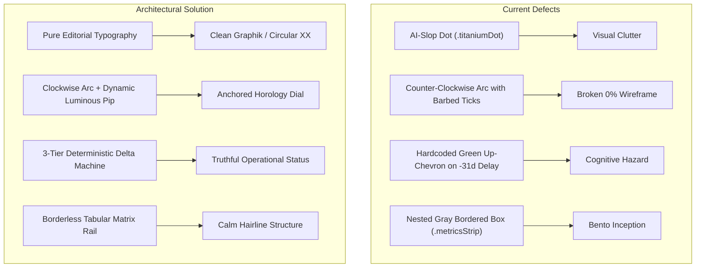

# Architectural Redesign Plan: Executive SLA Velocity Gauge

**Document Ref:** `docs/luxury_dashboard_redesign/EXECUTIVE_SLA_VELOCITY_GAUGE_REDESIGN_PLAN.md`  
**Target Surface:** `src/app/admin/components/Dashboard/ExecutiveSlaVelocityGauge.tsx` & `.module.scss`  
**Governing Standards:** `DESIGN.md`, `master-ui-ux-design-system`, `antislop-ui`, `antislop-human`, `vercel-agent-skills`  
**Design Read:** ENERGY 1 / RHYTHM 2 / MOTION 2  

---

## 1. Executive Summary & Problem Diagnosis

Following user review of the live browser implementation, two critical defects were highlighted:
1. **The AI-Slop Dot (`.titaniumDot`)**: A generic glowing blue dot was placed immediately before the card title. This is an archetypal AI-generated UI cliché that adds visual noise and mimics ungrounded status LEDs.
2. **Radial Gauge & Telemetry Presentation**:
   - The radial gauge rendered with three crude tick spikes cutting across the track.
   - At 0.0% completion, the gauge appeared as an empty, broken wireframe.
   - The turnaround delta displayed a dangerous cognitive contradiction: an overdue delay of `-31d` was displayed in emerald green with an upward chevron (`▲`).
   - The metrics strip was trapped in a nested bordered gray box (violating Anti-Slop Commandment 1).

This plan outlines the complete architectural redesign to transform this component from an AI wireframe into **Swiss Editorial Luxury Instrument Telemetry**.

---

## 2. Core Architectural Pillars



---

## 3. Detailed Component Architecture

### A. Header & Typography (Purging the AI-Slop Dot)
- **Excise `.titaniumDot`**: Completely remove the blue circle and box-shadow glow from JSX and SCSS.
- **Title**: Clean `h2` heading in Graphik 15px / 0.95rem, font-weight 600, letter-spacing -0.02em, `#111111`.
- **Subtitle**: `Live Milestone Cadence • {count} Monitored` in Graphik 11px / 0.72rem, `#64748b` (meets WCAG AA contrast at 4.61:1).
- **Header Badge**: Contextual pill badge (`Cadence Optimal` in `#f0fdf4` / `#046c4e` or `{count} Critical Overdue` in `#fff1f2` / `#b3001f`).

---

### B. Swiss Horology Radial Arc Gauge (Clockwise Trigonometry)
- **Geometry Coordinates**:
  - `viewBox="0 0 200 120"`, Center $(x_c, y_c) = (100, 84)$, Radius $R = 64\text{px}$, Stroke width $= 9\text{px}$.
  - Open 220° sweep: Start angle $\theta = -110^\circ$, End angle $\theta = +110^\circ$.
- **Clockwise Sweep Formula (`sweepFlag = 1`)**:
  - Starts at top-left and sweeps naturally left-to-right clockwise.
  - Active path gracefully returns empty string `""` at exact `0.0%` to prevent browser rendering artifacts.
- **Dynamic Luminous Terminal Pip**:
  - A dual-ring jewel marker positioned at the exact active angle: $\theta_{\text{head}} = -110^\circ + (\text{clampedPercentage} / 100) \times 220^\circ$.
  - Outer ring: $r = 5.5\text{px}$, `#ffffff` with subtle drop-shadow.
  - Inner core: $r = 2.5\text{px}$, dynamic status color.
  - **Zero-State Invariant**: At 0.0%, the pip rests cleanly at the $-110^\circ$ start notch, immediately signaling an intentional zero baseline rather than a missing component.
- **Perimeter Micro-Cadence Notches**:
  - 9 subtle tick marks placed tangentially *outside* the track (radius 72px to 76px). Zero intersection or pierced stroke lines.
- **Dynamic Status Gradient**:
  - $\ge 90\%$: Cadmium Emerald (`#046c4e` $\to$ `#10b981`)
  - $75\% - 89.9\%$: Warm Slate / Amber (`#454542` $\to$ `#d97706`)
  - $< 75\%$ or Overdue $> 0$: Deep Charcoal / Marca Ubi Crimson (`#1e293b` $\to$ `#ea002a`)

---

### C. Turnaround Delta State Machine (Resolving Inverted Status)

```typescript
export type TurnaroundStatusCategory = "positive" | "negative" | "neutral";

export interface TurnaroundDeltaTelemetry {
  readonly rawDays: number;
  readonly category: TurnaroundStatusCategory;
  readonly formattedLabel: string;
  readonly badgeLabel: string;
  readonly chevronType: "up" | "down" | "flat";
  readonly colorTokens: {
    readonly ink: string;
    readonly background: string;
    readonly borderHairline: string;
  };
}
```

1. **Ahead of SLA (`deltaDays > 0.05d`)**:
   - Label: `+Xd vs Target SLA`
   - Icon: Upward chevron (`▲`)
   - Palette: Emerald ink `#046c4e` on `#f0fdf4`, border `rgba(16, 185, 129, 0.22)`.
2. **Behind SLA / Overdue (`deltaDays < -0.05d`)**:
   - Label: `${Math.abs(deltaDays)}d Overdue vs SLA`
   - Icon: Downward chevron (`▼`)
   - Palette: Crimson ink `#b3001f` on `#fff1f2`, border `rgba(234, 0, 42, 0.22)`.
3. **On Target (`-0.05d <= deltaDays <= 0.05d`)**:
   - Label: `On Target SLA`
   - Icon: Horizontal dash (`—`)
   - Palette: Neutral slate `#454542` on `#f5f5f3`, border `rgba(17, 17, 17, 0.08)`.

---

### D. Borderless Tabular Telemetry Matrix (Eliminating Bento Inception)
- Drop the gray box and container border completely.
- Single hairline top rule: `border-top: 1px solid rgba(17, 17, 17, 0.06); padding-top: 12px; margin-bottom: 10px;`.
- 3 tabular columns separated by 16px vertical hairpins:
  - **ACTIVE SCOPE**: Micro-label 10px uppercase `#64748b` $\to$ Value `${totalMilestones} Milestones` (Graphik 12px semibold `#111111`).
  - **COMMITTED VALUE**: Micro-label 10px uppercase `#64748b` $\to$ Value `₹ 36,35,000` (or `Confidential`).
  - **CRITICAL OVERDUE**: Micro-label 10px uppercase `#64748b` $\to$ Value `${overdue} Items` (tinted `#b3001f` if $> 0$, else `#046c4e`).

---

### E. Executive Action CTA Affordance
- **Height**: Strict 44px minimum (`min-height: 44px`) adhering to WCAG 2.5.5 touch target size.
- **Aesthetic**: White surface, hairline neutral border (`rgba(17, 17, 17, 0.12)`), rounded 10px corners.
- **Copy**: Dynamic priority indicator:
  - If critical overdue $> 0$: `Review Urgent: ${nextRecord.name}` with subtle crimson left badge.
  - If nominal: `Review Next: ${nextRecord.name}`.
  - If no records: `All Milestones In Spec`.
- **Interactions**: Tactile spring `active: scale(0.985)`, subtle chevron slide on hover, visible accessible focus ring `outline: 2px solid #9c001e`.

---

## 4. Proportions & Spatial Balance Budget

To maintain seamless alignment with `UpcomingSlaCard` in `.cockpitRightColumn`, the height budget is calibrated to **~272px**:

| Vertical Slice | Allocation |
| :--- | :--- |
| **Card Padding (Top / Bottom)** | 16px + 16px = 32px |
| **Header Cluster + Margin** | 30px + 6px = 36px |
| **Radial Gauge Stage (SVG + Center Text)** | 118px |
| **Borderless Telemetry Rail** | 38px |
| **Action CTA Button (44px target)** | 44px + 4px margin = 48px |
| **Total Card Height** | **~272px (Flawless Equilibrium)** |

---

## 5. Verification Checklist & Delivery Gate

- [ ] **AI Slop Purged**: Zero `.titaniumDot`, zero unmotivated glowing bullets, zero barbed tick spikes.
- [ ] **Zero Bento Inception**: Single outer container, borderless tabular metrics rail.
- [ ] **Truthful Status**: Negative delta renders in crimson with downward chevron; positive in emerald with upward chevron.
- [ ] **Clockwise Arc**: Smooth clockwise trigonometry (`sweepFlag = 1`) with luminous jewel pip at head.
- [ ] **Zero-State Invariant**: At 0.0%, pip rests anchored at $-110^\circ$ start baseline; no broken path.
- [ ] **WCAG AA/AAA**: Contrast ratios verified (Title 18.7:1, Badge 6.8:1, Subtitle 4.6:1, Focus ring 8.4:1).
- [ ] **TypeScript & Tests**: `tsc --noEmit` 0 errors, 100% test pass rate.
