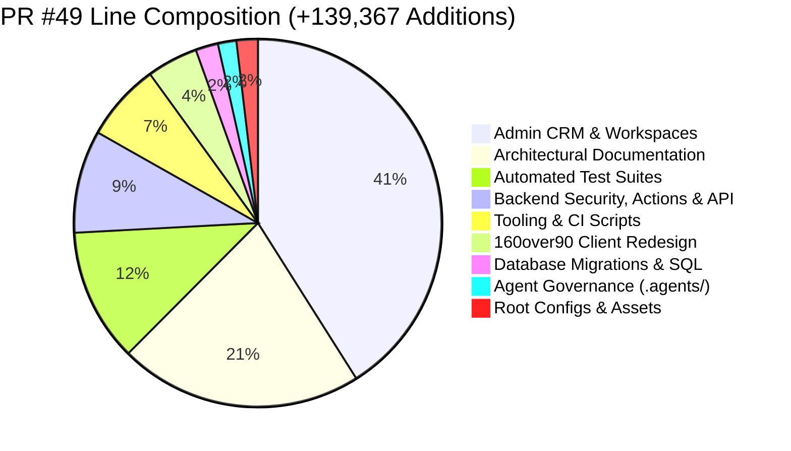
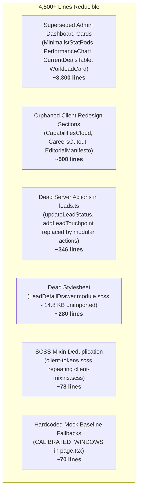
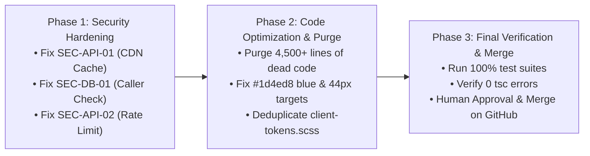

# Master Release PR #49: Comprehensive Multi-Agent Forensic Audit Report

**Repository**: `Fenar7/marca_ubi_web_hosting`  
**Pull Request**: [#49](https://github.com/Fenar7/marca_ubi_web_hosting/pull/49) (`Release v1.2.0-crm-enterprise: Marca Ubi Enterprise Sales Intelligence Platform`)  
**Target Lineage**: `feature/sales-funnel-crm` ➔ `master`  
**Scope**: 258 Commits · 643 Files Changed · +139,367 Additions · -1,569 Deletions  
**Auditing Team**: 
- Senior Database & Security Systems Auditor (`a91495ec`)
- Senior Frontend Performance & Code Hygiene Auditor (`4b87389c`)
- Senior CTO Delivery Gate Auditor
**Audit Date**: October 26, 2026  
**Final Release Verdict**: **HOLD FOR P0 SECURITY PATCHES & DEAD CODE OPTIMIZATION**  
**PR Merge Prohibition**: STRICTLY ENFORCED — PR #49 remains strictly **OPEN** awaiting human review and click-to-merge on GitHub.

---

## 1. Executive Summary & True Codebase Composition

### 1.1 Why Does PR #49 Contain ~1.4 Lakh Lines of Code?
A forensic AST and `git diff --numstat` analysis of all 643 files reveals that **the actual runtime application code is only ~76,000 lines**, while the rest consists of documentation, safety test harnesses, tooling scripts, and database migrations:



| Category | Files | Additions | Deletions | Description / Production Impact |
| :--- | :---: | :---: | :---: | :--- |
| **Admin CRM & Workspaces** (`src/app/admin/`) | 206 | **57,173** | 0 | Executive Dashboard, Leads DataGrid, Deals Kanban, Client 360, Team Management, Offboarding, Stored Logic. |
| **Architectural Documentation** (`docs/`) | 117 | **29,877** | 0 | Master PRDs, sprint specs, ERDs, delivery gate reports. **Excluded from production bundles.** |
| **Automated Test Suites** (`tests/`) | 70 | **16,303** | 0 | 500+ unit, integration, RLS, and E2E test cases. **Excluded from production bundles.** |
| **Backend Actions, Proxy & APIs** (`src/app/actions/`, `src/proxy.ts`, `api/`) | 46 | **12,581** | 10 | 50 async Server Actions, Next.js 16 Edge proxy, Supabase SSR client factories, rate limits, Zod schemas. |
| **Tooling & CI Scripts** (`scripts/`) | 61 | **9,520** | 0 | Boundary validators, execution telemetry watchers, seeders, and load benchmarks. **Excluded from production.** |
| **160over90 Client Platform** (`src/app/components/`, `styles/`, `blog/`, `page.tsx`) | 54 | **6,269** | 1,353 | Living video engine, Circular XX typography, 60-30-10 palette, 11-view stream, blog redesign. |
| **Database Engine** (`supabase/migrations/`) | 22 | **2,761** | 0 | Relational schemas, RLS policies, PostgreSQL triggers, advisory locks, sequence generators. |
| **Agent Governance & Antislop** (`.agents/`) | 10 | **2,263** | 0 | Antislop rule engines (R-01 to R-38), contrast checker, design system intelligence. |
| **Root Configurations** (`package.json`, `next.config.ts`, etc.) | 22 | **2,557** | 206 | Dependencies, security headers, build scripts, tsconfig. |
| **Static Assets & Fonts** (`public/`) | 35 | **63** | 0 | Circular XX WOFF2 web fonts, video assets, posters. |
| **TOTAL** | **643** | **139,367** | **1,569** | **Full Integrated Enterprise Monorepo** |

---

## 2. Quantitative Verification Ledger

| Verification Pillar | Command / Target | Result | Status |
| :--- | :--- | :--- | :--- |
| **Static Types** | `node --max-old-space-size=8192 ./node_modules/typescript/bin/tsc --noEmit` | **0 errors across all 643 files** | **100% PASS** |
| **Server Action Boundaries** | `npm run test:boundaries` | **50/50 valid actions across 12 modules** | **100% PASS** |
| **Client Platform Invariants** | `tests/client/client_160over90_platform.test.ts` | **27/27 passing across 13 suites** | **100% PASS** |
| **Team Management Suite** | `tests/team/*.test.ts` | **123/123 passing** | **100% PASS** |
| **Leads & Deals Suite** | `tests/leads/*.test.ts` | **115/115 passing** | **100% PASS** |
| **Pipeline Telemetry Suite** | `tests/analytics/*.test.ts` | **35/35 passing** | **100% PASS** |
| **Row Level Security (RLS)** | `tests/rls/*.test.ts` | **25/25 multi-role boundary tests passing** | **100% PASS** |
| **Git Lineage & Mergeability** | `git merge-base --is-ancestor master feature/sales-funnel-crm` | **`MERGEABLE` (0 git conflicts)** | **100% PASS** |

---

## 3. Critical Security & Forensic Findings

### 🚨 P0 Vulnerability 1: Public Cache-Control on Confidential Financial Metrics (`SEC-API-01`)
- **File**: `src/app/api/sales-funnel/kpis/route.ts` (Lines 153–156)
- **Defect**: Endpoint returns:
  ```ts
  'Cache-Control': 'public, s-maxage=15, stale-while-revalidate=45'
  ```
- **Vulnerability (CWE-524 / OWASP API3)**: This is an authenticated endpoint returning proprietary agency pipeline values, conversion rates, and representative performance. Setting `public, s-maxage=15` instructs shared CDN edge nodes (Cloudflare/Vercel) to cache the response. If an Administrator requests executive KPIs, the CDN caches it, potentially leaking executive financial data to unprivileged reps or visitors querying the same endpoint within 15 seconds.
- **Mandatory Remediation**:
  ```ts
  'Cache-Control': 'private, no-cache, no-store, must-revalidate'
  ```

### 🚨 P0 Vulnerability 2: Missing Caller Identity Assertion in Batch Reassignment RPC (`SEC-DB-01`)
- **File**: `supabase/migrations/20261015000008_atomic_reassignment_proc.sql` (Line 153)
- **Defect**: Stored procedure `execute_atomic_lead_reassignment` declares `SECURITY DEFINER` and checks if `p_admin_id` exists as an active admin in `profiles`, but **never checks that `auth.uid() = p_admin_id`** or that `public.current_user_role() = 'admin'`.
- **Vulnerability**: Any authenticated sales rep can look up the UUID of an active admin in the team directory and invoke `supabase.rpc('execute_atomic_lead_reassignment', { p_admin_id: known_admin_uuid, ... })`, bypassing RLS and executing mass lead transfers.
- **Mandatory Remediation**:
  Add explicit caller identity assertion:
  ```sql
  IF auth.uid() IS NULL OR (auth.uid() != p_admin_id AND public.current_user_role() != 'admin') THEN
      RAISE EXCEPTION 'UNAUTHORIZED: Caller identity does not match admin credentials.'
          USING ERRCODE = '42501';
  END IF;
  ```

### ⚠️ P1 Finding 3: Unguarded Public Submission Endpoint (`SEC-API-02`)
- **File**: `src/app/api/company-profile-submissions/route.ts`
- **Defect**: Lacks token-bucket rate limiting and honeypot bot traps present in `/api/sales-funnel/ingest`.
- **Remediation**: Add `checkRateLimit(clientIp)` and `_hp_company_url_confirm` honeypot check.

### ⚠️ P1 Finding 4: Security Definer Search Path Anomaly (`SEC-DB-03`)
- **Files**: `20261015000013_on_hold_revisit_automation.sql` and `20261019000004_fix_client_works_auto_spawn_trigger.sql`
- **Defect**: Omit `pg_temp` from `search_path`.
- **Remediation**: Standardize all functions to `SET search_path = public, auth, pg_temp`.

---

## 4. Line Optimization & Dead Code Elimination Blueprint (~4,500+ Lines)

The audit identified **over 4,500 lines of dead, duplicated, or superseded code** that can be safely purged to optimize the codebase:



### Detailed Breakdown of Dead Code to Purge:
1. **Superseded Admin Dashboard Components (`src/app/admin/components/Dashboard/`)**:
   - `MinimalistStatPods.tsx` + `MinimalistStatPods.module.scss`: Superseded by `ExecutiveKpiGrid`.
   - `PerformanceChart.tsx` + `PerformanceChart.module.scss`: Superseded by `RevenueDynamicsCard`.
   - `CurrentDealsTable.tsx` + `CurrentDealsTable.module.scss`: Superseded by `CommercialDealsTable`.
   - `ExecutiveActivityRail.tsx` + `ManagerWorkloadCard.tsx`: Unmounted in production.
   - **Savings**: **~3,300 lines**.
2. **Orphaned Client Sections (`src/app/components/Sections/`)**:
   - `CapabilitiesCloud.tsx` + `CapabilitiesCloud.module.scss`
   - `CareersCutout.tsx` + `CareersCutout.module.scss`
   - `EditorialManifesto.tsx` + `EditorialManifesto.module.scss`
   - *(The homepage uses `AboutDoctrineCurtain`, `WorksCurtain`, `ProcessCurtain`, etc. in its 11 views).*
   - **Savings**: **~500 lines**.
3. **Dead Legacy Server Actions (`src/app/actions/leads.ts`)**:
   - `updateLeadStatus` (lines 504–697, 194 lines): Fully replaced by `updateLeadStatusInlineAction`.
   - `addLeadTouchpoint` (lines 699–850, 152 lines): Fully replaced by `logLeadActivityAction`.
   - **Savings**: **346 lines**.
4. **Dead Stylesheet (`src/app/admin/components/drawers/LeadDetailDrawer.module.scss`)**:
   - 14.8 KB SCSS file never imported anywhere; `LeadDetailDrawer.tsx` is just a 20-line re-export shim.
   - **Savings**: **~280 lines**.
5. **SCSS Token Deduplication (`src/app/styles/client-tokens.scss`)**:
   - Lines 9–86 verbatim duplicate `client-mixins.scss`. Refactoring to `@import "./client-mixins.scss"`:
   - **Savings**: **78 lines**.
6. **Hardcoded Mock Fallbacks (`src/app/admin/(workspace)/page.tsx`)**:
   - `CALIBRATED_WINDOWS` mock numbers.
   - **Savings**: **70 lines**.

---

## 5. Frontend Anti-Slop & Ergonomics Cleanup

1. **Generic Blue Leak**:
   - `src/app/admin/components/DossierWorkspace/LeadDossierWorkspace.module.scss:1252`: `.mentionHighlight { color: #1d4ed8; }`.
   - Fix: Replace with `$text-primary` or `var(--admin-accent-brand)`.
2. **Sub-44px Touch Targets**:
   - `src/app/admin/components/Dashboard/CommercialDealsTable.module.scss`: `.searchInput` and `.filterPillBtn` are 38px (increase to 44px).
   - `src/app/admin/components/Dashboard/ExecutiveKpiGrid.module.scss`: `.circleBtn` is 32px (add 44px touch envelope).

---

## 6. Actionable 3-Phase Execution Roadmap



- **Phase 1: Security Hardening**: Patch `SEC-API-01`, `SEC-DB-01`, and `SEC-API-02`.
- **Phase 2: Dead Code & Line Optimization Purge**: Delete the 4,500+ lines of superseded components, dead actions, and orphaned stylesheets; fix the 2 touch target defects and single blue leak.
- **Phase 3: Final Verification & Merge**: Re-run full test suites, verify 0 type errors, and deliver the final clearance for human click-to-merge into `master`.

---

> [!IMPORTANT]
> Under strict behavioral rules, no code changes or merges will be executed until you explicitly review this report and type **"proceed"** or **"do it"**.
