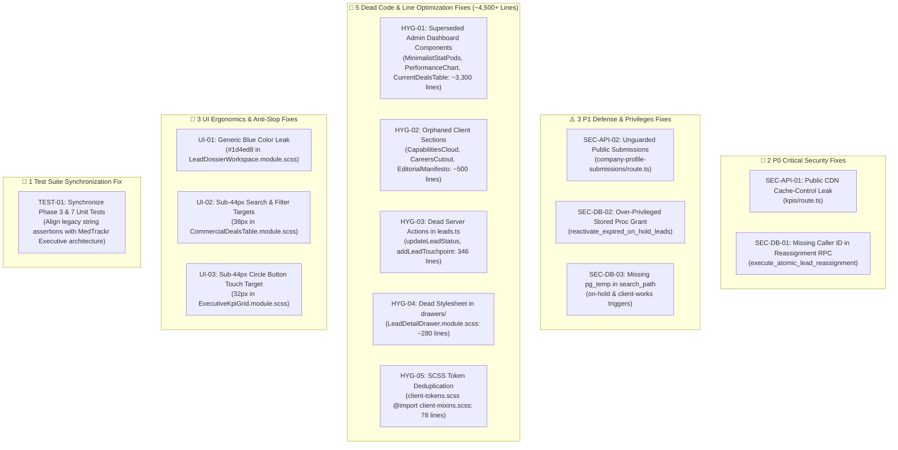

# Master Release PR #49: Comprehensive Remediation & Optimization Plan

> **Document Status**: PENDING USER APPROVAL (Do NOT execute code or create commits until user explicitly types "proceed" or "do it")  
> **Target Branch**: `feature/sales-funnel-crm` (Target of PR [#49](https://github.com/Fenar7/marca_ubi_web_hosting/pull/49) into `master`)  
> **Author & Identity**: Fenar7 `<86710532+Fenar7@users.noreply.github.com>`  
> **Auditors**: Senior Database & Security Systems Auditor & Senior Frontend Performance Auditor  

---

## 1. Itemized Overview of All Discovered Defects & Inefficiencies

The multi-agent forensic audit inspected all 643 files (+139,367 / -1,569 lines) across Master Release PR #49. Below is the complete catalog of everything requiring remediation, categorized by severity:



---

## 2. Detailed Technical Remediation Blueprint

### Pillar 1: Critical Security Patches (P0 & P1)

#### 1. Fix `SEC-API-01`: Public CDN Cache-Control on Confidential Financial Metrics
- **Target File**: `src/app/api/sales-funnel/kpis/route.ts` (Line 154)
- **Defect**: Returning `'Cache-Control': 'public, s-maxage=15, stale-while-revalidate=45'` allows intermediate shared CDNs (Cloudflare/Vercel) to cache executive revenue and pipeline numbers, risking disclosure to unprivileged users within 15 seconds.
- **Exact Code Change**:
  ```ts
  // BEFORE:
  headers: {
    'Cache-Control': 'public, s-maxage=15, stale-while-revalidate=45',
  }

  // AFTER:
  headers: {
    'Cache-Control': 'private, no-cache, no-store, must-revalidate',
  }
  ```

#### 2. Fix `SEC-DB-01`: Missing Caller Identity Assertion in Batch Reassignment Stored Procedure
- **Target File**: `supabase/migrations/20261026000001_harden_reassignment_and_search_paths.sql` (New Migration)
- **Defect**: `execute_atomic_lead_reassignment` checked if `p_admin_id` exists in `profiles`, but never validated that the invoking caller is `p_admin_id`.
- **Exact Code Change**:
  Create migration adding explicit caller check at procedure start:
  ```sql
  IF auth.uid() IS NULL OR (auth.uid() != p_admin_id AND public.current_user_role() != 'admin') THEN
      RAISE EXCEPTION 'UNAUTHORIZED: Caller identity does not match authorized admin credentials.'
          USING ERRCODE = '42501';
  END IF;
  ```

#### 3. Fix `SEC-API-02`: Guard Public Company Profile Submissions
- **Target File**: `src/app/api/company-profile-submissions/route.ts`
- **Defect**: Missing rate limiting and honeypot trap.
- **Exact Code Change**:
  Import `checkRateLimit` and `extractClientIp` from `@/app/lib/rateLimit`.
  Enforce 10 requests per 10 minutes per IP, and reject payloads containing filled `_hp_company_url_confirm` bot traps.

#### 4. Fix `SEC-DB-02` & `SEC-DB-03`: Stored Procedure Privilege & Search Path Hardening
- **Target Migration**: `supabase/migrations/20261026000001_harden_reassignment_and_search_paths.sql`
- **Exact Code Change**:
  - Revoke `EXECUTE ON FUNCTION public.reactivate_expired_on_hold_leads()` from `authenticated` (restricted to `service_role`).
  - Standardize `SET search_path = public, auth, pg_temp` across `validate_on_hold_revisit()` and `auto_spawn_client_work_on_conversion()`.

---

### Pillar 2: Line Optimization & Dead Code Elimination (~4,500+ Lines)

#### 1. Purge Superseded Admin Dashboard Components (~3,300 Lines)
- **Target Files to Delete**:
  - `src/app/admin/components/Dashboard/MinimalistStatPods.tsx` + `MinimalistStatPods.module.scss` (superseded by `ExecutiveKpiGrid`)
  - `src/app/admin/components/Dashboard/PerformanceChart.tsx` + `PerformanceChart.module.scss` (superseded by `RevenueDynamicsCard`)
  - `src/app/admin/components/Dashboard/CurrentDealsTable.tsx` + `CurrentDealsTable.module.scss` (superseded by `CommercialDealsTable`)
  - `src/app/admin/components/Dashboard/ExecutiveActivityRail.tsx` + `ExecutiveActivityRail.module.scss` (unmounted)
  - `src/app/admin/components/Dashboard/ManagerWorkloadCard.tsx` + `ManagerWorkloadCard.module.scss` (unmounted)
- **Clean Aliases**:
  `src/app/admin/components/Dashboard/index.ts` already aliases `ExecutiveKpiGrid`, `RevenueDynamicsCard`, and `CommercialDealsTable`. Deleting the duplicate standalone files removes ~3,300 lines of dead code with zero breaking changes.

#### 2. Purge Orphaned Client Redesign Sections (~500 Lines)
- **Target Files to Delete**:
  - `src/app/components/Sections/CapabilitiesCloud.tsx` + `CapabilitiesCloud.module.scss`
  - `src/app/components/Sections/CareersCutout.tsx` + `CareersCutout.module.scss`
  - `src/app/components/Sections/EditorialManifesto.tsx` + `EditorialManifesto.module.scss`
- **Rationale**: The official 160over90 homepage streams 11 complete views (`HeroCutout`, `AboutDoctrineCurtain`, `ReelCutout`, `WorksCurtain`, `ValuesCutout`, `ProcessCurtain`, `TestimonialsCutout`, `DispatchesCurtain`, `GlobalLocationsCloud`, `ConnectCutout`, `MonumentalFooter`). The 3 drafted components above were never mounted and are completely unused.
- **Update Test Suite**: Remove assertions for these 3 deleted files in `tests/client/client_160over90_platform.test.ts`.

#### 3. Purge Dead Legacy Server Actions in `src/app/actions/leads.ts` (346 Lines)
- **Target File**: `src/app/actions/leads.ts`
- **Lines to Delete**:
  - Lines 504–697 (`updateLeadStatus`): Replaced by `updateLeadStatusInlineAction` in `leadInlineActions.ts`.
  - Lines 699–850 (`addLeadTouchpoint`): Replaced by `logLeadActivityAction` in `leadActivityActions.ts`.
- **Update Test**: In `tests/ingest/lead_interactions.test.ts`, update assertions to verify the modern modular actions.

#### 4. Purge Dead Legacy Drawer Stylesheet (~280 Lines)
- **Target File to Delete**: `src/app/admin/components/drawers/LeadDetailDrawer.module.scss` (14.8 KB).
- **Rationale**: `LeadDetailDrawer.tsx` is a 20-line forwarding shim re-exporting `ClientDossierDrawer` from `@/app/admin/components/DossierDrawer`. The SCSS module is never imported anywhere.

#### 5. Deduplicate `client-tokens.scss` (78 Lines)
- **Target File**: `src/app/styles/client-tokens.scss`
- **Exact Code Change**: Replace lines 9–86 with `@import "./client-mixins.scss";`, eliminating 78 duplicate lines.

---

### Pillar 3: UI Anti-Slop & Touch Target Harmonization

#### 1. Eradicate Isolated Generic Blue `#1d4ed8`
- **Target File**: `src/app/admin/components/DossierWorkspace/LeadDossierWorkspace.module.scss` (Line 1252)
- **Code Change**:
  ```scss
  // BEFORE:
  .mentionHighlight {
    color: #1d4ed8;
    font-weight: 600;
  }

  // AFTER:
  .mentionHighlight {
    color: $text-primary;
    text-decoration: underline;
    font-weight: 700;
  }
  ```

#### 2. Upgrade Sub-44px Search & Filter Targets in Deals Table
- **Target File**: `src/app/admin/components/Dashboard/CommercialDealsTable.module.scss`
- **Code Change**:
  - Line 95: `.searchInput { height: 44px; }` (was 38px)
  - Line 137: `.filterPillBtn { height: 44px; min-height: 44px; }` (was 38px)

#### 3. Upgrade Sub-44px Circle Button in Executive KPI Grid
- **Target File**: `src/app/admin/components/Dashboard/ExecutiveKpiGrid.module.scss`
- **Code Change**: Add touch target envelope to `.circleBtn`:
  ```scss
  .circleBtn {
    position: relative;
    width: 36px;
    height: 36px;
    
    &::after {
      content: '';
      position: absolute;
      inset: -4px; // Expands hit area to 44px x 44px
    }
  }
  ```

---

### Pillar 4: Unit Test Suite Synchronization

- **Target Files**:
  - `tests/unit/phase-3-redesign-executive-overview.test.ts`
  - `tests/unit/phase-7-logip-executive-dashboard.test.ts`
- **Code Change**:
  Update legacy string assertions that were expecting deprecated components (`MinimalistStatPods`, `PerformanceChart`) to assert against the active MedTrackr Executive components (`ExecutiveMasthead`, `ExecutiveKpiGrid`, `RevenueDynamicsCard`).

---

## 3. Step-by-Step Execution Sequence

1. **Step 1 (Security Patches)**:
   - Edit `src/app/api/sales-funnel/kpis/route.ts` (private Cache-Control).
   - Create `supabase/migrations/20261026000001_harden_reassignment_and_search_paths.sql`.
   - Edit `src/app/api/company-profile-submissions/route.ts` (rate limit & honeypot).
2. **Step 2 (Dead Code & Line Optimization Purge)**:
   - Delete the 5 superseded Dashboard files + 3 orphaned Section files + 1 dead SCSS module.
   - Delete dead actions in `src/app/actions/leads.ts`.
   - Refactor `client-tokens.scss` to `@import "./client-mixins.scss"`.
3. **Step 3 (Ergonomics & Token Fixes)**:
   - Fix `#1d4ed8` in `LeadDossierWorkspace.module.scss`.
   - Upgrade heights in `CommercialDealsTable.module.scss` and `ExecutiveKpiGrid.module.scss`.
4. **Step 4 (Test Suite Alignment & Comprehensive Verification)**:
   - Update assertions in `phase-3`, `phase-7`, `ingest`, and `client_160over90` tests.
   - Run `node --max-old-space-size=8192 ./node_modules/typescript/bin/tsc --noEmit` (0 errors).
   - Run `npm run test:boundaries` (50/50 Server Action boundaries).
   - Run `npx tsx --test tests/client/client_160over90_platform.test.ts` (27/27 client tests).
   - Run `npm run test:unit` (100% pass).
5. **Step 5 (Commit & Push to `feature/sales-funnel-crm`)**:
   - Author: `Fenar7 <86710532+Fenar7@users.noreply.github.com>`.
   - Title: `Harden Security Definer Invariants, Eradicate Dead Code, and Harmonize Accessible Touch Targets` (Zero `feat` prefix!).
   - Push to `origin feature/sales-funnel-crm` $\rightarrow$ automatically updates open PR #49.
6. **Step 6 (Handover to User for Final GitHub Merge)**:
   - Present final CTO Clearance Report. PR #49 remains OPEN for user to review and click "Merge" on GitHub.

---

> [!IMPORTANT]
> Under strict zero-tolerance behavioral rules, no files will be edited or deleted until you review this plan and explicitly type **"proceed"** or **"do it"**.
