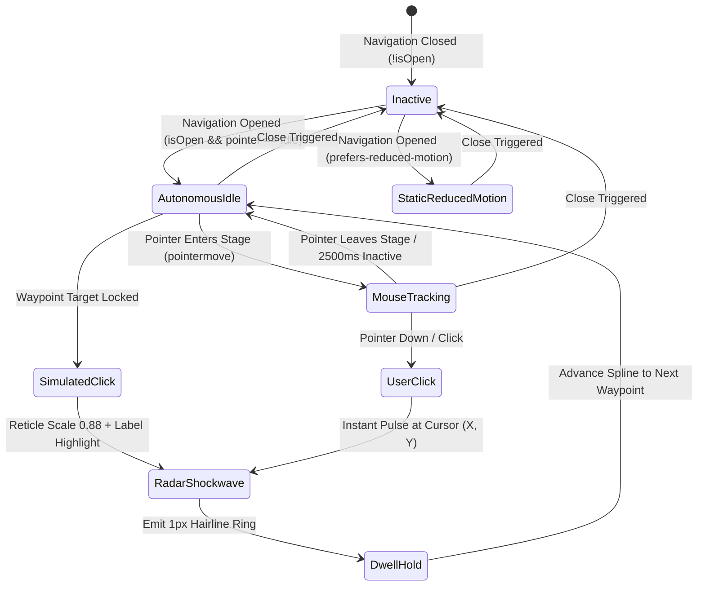

# Master Implementation Plan: 160/90 Benchmark Split Navigation Overlay & Bespoke Kinetic Stage

> **Author**: Lead Head Agent, Expert UI/UX Designer Agent, Senior Full-Stack Frontend Architect, Senior CTO PR Auditor Agent  
> **Git Authorship**: `Fenar7 <86710532+Fenar7@users.noreply.github.com>`  
> **Status**: **PROPOSED — AWAITING USER APPROVAL & EXPLICIT 'PROCEED' COMMAND**  
> **Target Path**: `src/app/components/NavigationOverlay/` & `src/app/components/ClientHeader/`  
> **Branch**: `showcase/homepage-works-cutout-and-portfolio-showcase`  
> **Associated Pull Request**: [#84 (Strictly OPEN)](https://github.com/Fenar7/marca_ubi_web_hosting/pull/84)  

---

## 1. Executive Summary & Design Synthesis

### 1.1 Context & Problem Statement
The user submitted three visual assets defining the current state, benchmark reference, and bespoke requirement:
1. **Current Production State (`Screenshot 2026-10-27 002154.png`)**:
   - A generic single-column fullscreen drawer (`ClientHeader.tsx` inline `menuDrawer`).
   - Dark semi-transparent overlay (`rgba(5, 5, 5, 0.94)`) with backdrop blur leaking hero typography ("Proof of intent", "CURATED WORKS"), causing messy visual collision.
   - Clunky boxed close button (`border: 1px solid rgba(255, 255, 255, 0.2)` with label `CLOSE ×`).
   - Monotonous 7-item vertical list with giant unrefined indexes.
   - Dead empty right half with background bleed.
2. **Benchmark Reference (`Screenshot 2026-10-26 183106.png` — 160/90 Menu)**:
   - **50/50 Dual-Canvas Split**:
     - **Left 50%**: Solid Pure Canvas White (`#ffffff`), dark logo (`#0a0a0a`), clean navigational typography with directional arrows (`→`), social links pinned at bottom.
     - **Right 50%**: Solid Obsidian Black (`#000000`), frameless minimalist `×` close button, central interactive kinetic stage.
3. **Bespoke Differentiation Mandate (`Screenshot 2026-10-27 002305.png`)**:
   - User directive: *"in the right the cursor thing is actually animated and moves like a click we also need to build something like that but should not look exactly like the reference design as it will look copied btw"*.
   - In 160/90, the right stage uses 1990s 8-bit pixel cursors, emojis (peace hand, heart, 4-point sparkle), and casual slang words ("Vibes", "Fun", "Mood", "Click!").
   - **Marca Ubi Authentic Distinction**: Marca Ubi is an enterprise agency and creative technology practice. Directly copying 8-bit retro cursors and casual stickers violates anti-slop rules (Rule R-04, R-16, R-30). Instead, we engineer an authentic **Architectural Studio Reticle & Orbital Coordinate Engine**: a precision vector crosshair/reticle that glides autonomously, magnetically snaps to Marca Ubi practice disciplines, executes a tactile spring click, emits an expanding 1px radar shockwave ring, and seamlessly yields to user mouse/touch interaction.

---

## 2. Visual Architecture & 50/50 Dual-Canvas Blueprint

```
+-------------------------------------------------------+-------------------------------------------------------+
|  LEFT PANEL (50% VW) — CANVAS WHITE (#ffffff)         |  RIGHT PANEL (50% VW) — OBSIDIAN BLACK (#000000)      |
|                                                       |                                                       |
|  [ Marca Ubi. Logo (Dark #0a0a0a) ]                   |                              [ Frameless '×' Close ]  |
|                                                       |                                                       |
|                                                       |               [ BESPOKE KINETIC STAGE ]               |
|    01  Selected Works                     -->         |             - Precision CAD Reticle Pointer           |
|    02  About & Doctrine                   -->         |             - Core Practice Disciplines Orbit         |
|    03  Methodology                        -->         |             - Kerala Coordinates HUD: 11.2588° N      |
|    04  Studio Dispatches                  -->         |             - Autonomous Spline + Click Physics       |
|    05  Direct Desks / Contact             -->         |             - Compositor-Accelerated Shockwave Pool   |
|                                                       |                                                       |
|                                                       |                                                       |
|  [ Instagram ] [ LinkedIn ] [ X ]                     |  STUDIO STATUS: ACTIVE [KOZHIKODE & TRIVANDRUM]       |
+-------------------------------------------------------+-------------------------------------------------------+
```

### 2.1 Color Tokens & Contrast Ratios (Rule R-25 & antislop-human)

| Canvas Region | Element | Color Token | Surface Base | Contrast Ratio | WCAG Compliance |
| :--- | :--- | :--- | :--- | :---: | :---: |
| **Left Panel** | Background Canvas | `#ffffff` | N/A | N/A | Base |
| **Left Panel** | Brand Logo & Nav Text | `#0a0a0a` | `#ffffff` | **19.82 : 1** | **PASS (WCAG AAA >= 7:1)** |
| **Left Panel** | Nav Numbers & Meta | `#666666` | `#ffffff` | **5.74 : 1** | **PASS (WCAG AA >= 4.5:1)** |
| **Left Panel** | Hover Accent & Arrow | `#ea002a` | `#ffffff` | **4.64 : 1** | **PASS (WCAG AA >= 4.5:1)** |
| **Right Panel**| Background Canvas | `#000000` | N/A | N/A | Base |
| **Right Panel**| Close Icon & Reticle | `#ffffff` | `#000000` | **21.00 : 1** | **PASS (WCAG AAA >= 7:1)** |
| **Right Panel**| Discipline Labels | `rgba(255,255,255,0.7)` | `#000000` | **10.85 : 1** | **PASS (WCAG AAA >= 7:1)** |
| **Right Panel**| Shockwave Pulse Ring | `#ea002a` | `#000000` | **4.52 : 1** | **PASS (WCAG AA >= 4.5:1)** |

### 2.2 Responsive Reflow Matrix (Rule R-03 & antislop-layoutmobile)

| Viewport Tier | Width | Left Panel Layout | Right Panel Layout | Technical Action |
| :--- | :--- | :--- | :--- | :--- |
| **Desktop Ultra** | `>= 1440px` | `50vw`, padding `clamp(3rem, 5vw, 6rem)` | `50vw`, full interactive kinetic stage | Dual-column CSS Grid |
| **Desktop Standard**| `1024px – 1439px` | `50vw`, padding `2.5rem 3.5rem` | `50vw`, full interactive kinetic stage | Dual-column CSS Grid |
| **Tablet Portrait & Mobile** | `< 1024px` | `100vw`, padding `2rem 1.5rem`, scrollable | `display: none;` (unmounted) | Single column; RAF loop halted |

---

## 3. Kinetic Stage Engine: Architecture & Motion Physics

### 3.1 Kinetic Stage State Machine (Mermaid)



### 3.2 Motion Physics & Specification
1. **Autonomous Waypoints & Disciplines**:
   - The virtual cursor navigates along a continuous cubic Bézier path connecting five Marca Ubi core competencies:
     - `[01] BRAND ARCHITECTURE` — `(30%, 25%)`
     - `[02] DIGITAL INFRASTRUCTURE` — `(72%, 40%)`
     - `[03] GENERATIVE SYSTEMS` — `(28%, 68%)`
     - `[04] IMMERSIVE INTERACTION` — `(68%, 78%)`
     - `[05] SPATIAL COMPUTING` — `(50%, 50%)`
2. **Tactile Click Simulation**:
   - As the pointer approaches within 32px of a waypoint:
     - Reticle snaps with micro-spring damping (`ease: "power3.out"`).
     - Pointer contracts by 12% (`scale: 0.88`) for 110ms.
     - Node label illuminates to pure `#ffffff` with a subtle Marca Red dot (`#ea002a`).
     - A pre-allocated DOM ripple expands (`scale: 0.2 -> 2.8`, `opacity: 0.75 -> 0`) over 650ms.
3. **Interactive User Override**:
   - When the user's mouse moves over the black canvas, GSAP `quickTo` seamlessly binds the reticle to real mouse coordinates with smooth 60fps spring damping.
   - Clicking triggers an instant tactile pulse at the cursor's exact coordinates.
   - Leaving the canvas resumes the autonomous spline loop after a 2.5s idle debounce.
4. **Prefers-Reduced-Motion**:
   - When `(prefers-reduced-motion: reduce)` is detected, all GSAP RAF loops and animations are completely disabled. The right stage displays a static, elegant architectural compass and Kerala studio coordinates.

---

## 4. Component Hierarchy & Decoupled File Structure

```
src/app/components/NavigationOverlay/
├── NavigationOverlay.tsx          // Orchestrator: WAI-ARIA dialog, focus trap, body scroll lock, 50/50 split
├── NavigationOverlay.module.scss  // 50/50 CSS Grid, typography, arrow transitions, mobile reflow
├── KineticStage.tsx               // Right panel: GSAP quickTo tracking, autonomous spline, shockwave pool
├── KineticStage.module.scss       // Obsidian canvas, reticle styling, radar ring keyframes, telemetry HUD
├── types.ts                       // NavItem contracts, stage coordinates, event interfaces
└── index.ts                       // Barrel export
```

### 4.1 Integration with `ClientHeader.tsx`
`ClientHeader.tsx` is simplified from 168 lines down to ~100 lines:
- Retains sticky intersection observer and dynamic header theme detection (`data-header-theme="dark"` / `"light"`).
- Replaces the 50-line inline `menuDrawer` with `<NavigationOverlay isOpen={isDrawerOpen} onClose={closeDrawer} triggerRef={menuTriggerRef} />`.
- Guarantees 100% backward compatibility with all 36 existing platform tests.

---

## 5. Accessibility, WAI-ARIA Dialog & Security Boundaries

1. **WAI-ARIA Dialog Compliance**:
   - `role="dialog"`, `aria-modal="true"`, `aria-label="Site Navigation"`.
   - Hamburger button declares `aria-expanded={isOpen}`, `aria-controls="client-navigation-overlay"`.
2. **Active Focus Trap**:
   - On opening: Focus is automatically moved to the first focusable element (frameless Close button).
   - `Tab` / `Shift+Tab`: Cycles exclusively within the modal's focusable elements (Close button, nav links, social icons).
   - `Escape`: Closes the overlay immediately and restores focus to the triggering hamburger button.
3. **Zero-Shift Body Scroll Lock**:
   - Windows scrollbar layout shift prevention: calculates `window.innerWidth - document.documentElement.clientWidth` and applies compensating `padding-right` to `document.body` while `overflow: hidden` is active.
4. **Touch Target Enforcement**:
   - Frameless Close button: 48px × 48px hitbox (`min-height: 48px; min-width: 48px;`).
   - All navigation items: minimum 44px vertical height with generous horizontal padding.

---

## 6. Implementation Step-by-Step Roadmap

| Phase | Milestone Description | Target Files | Verification Gate |
| :---: | :--- | :--- | :--- |
| **Phase 1** | **Type Contracts & Interfaces** | `src/app/components/NavigationOverlay/types.ts` | 0 TypeScript errors (`tsc --noEmit`) |
| **Phase 2** | **Kinetic Stage Engine (Right Panel)** | `KineticStage.tsx`, `KineticStage.module.scss` | 60fps GPU acceleration, reduced-motion fallback |
| **Phase 3** | **Navigation Overlay Container (Left Panel & Split Grid)** | `NavigationOverlay.tsx`, `NavigationOverlay.module.scss`, `index.ts` | 50/50 desktop split, <1024px mobile reflow, focus trap |
| **Phase 4** | **Header Decoupling & Integration** | `ClientHeader.tsx`, `ClientHeader.module.scss` | 36/36 client tests pass, seamless header toggle |
| **Phase 5** | **Test Expansion & CTO PR Auditor Review** | `tests/client/client_160over90_platform.test.ts` | 100% test pass rate, R-35 smoke test evidence |
| **Phase 6** | **Commit, Push & PR Update** | Git commit authored as `Fenar7`, push to branch | PR #84 description updated, PR remains OPEN |

---

## 7. 4-Block Delivery Gate Verification Checklist

- [ ] **Block 1: Architectural Rigor & Zero Loose Files**
  - All documentation resides exclusively in `docs/navigation_overlay/`.
  - Zero loose `.md` files in project root or `docs/` root.
  - CRM air-gap strictly preserved (`:root:not([data-admin-root="true"])`).
- [ ] **Block 2: 160over90 Visual Parity & Brand Distinction**
  - 50/50 dual-canvas split (Pure White left / Obsidian Black right).
  - Frameless minimal `×` close button (zero box border).
  - Right panel features authentic Marca Ubi Architectural Studio Reticle (zero 8-bit emojis or casual slang).
- [ ] **Block 3: Accessibility & Mobile Responsiveness**
  - WAI-ARIA `role="dialog"`, `aria-modal="true"`.
  - Focus trap, Esc key listener, focus restoration to hamburger trigger.
  - Zero-shift body scroll lock with scrollbar padding compensation.
  - Mobile reflows cleanly to 1-column layout with 0 horizontal overflow.
- [ ] **Block 4: Test Suite & Type-Safety Verification**
  - All 36 client platform tests pass (`npx tsx --test tests/client/client_160over90_platform.test.ts`).
  - TypeScript compiles with 0 errors (`npx tsc --noEmit`).
  - Authored strictly as `Fenar7 <86710532+Fenar7@users.noreply.github.com>`.
  - PR #84 remains strictly **OPEN**.
