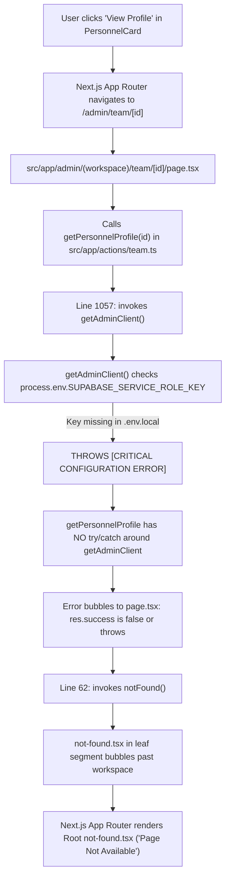

# Personnel Profile Workspace (/admin/team/[id]) 404 Root Cause Analysis & Remediation Plan

> **Document Status**: READY FOR USER REVIEW & APPROVAL  
> **Target Sub-branch**: `redesign/primestay-people-and-avatar-management`  
> **Pull Request**: Open PR #78 (Remains strictly `OPEN`)  
> **Author & Identity**: Fenar7 `<86710532+Fenar7@users.noreply.github.com>`  
> **Classification**: Next.js 16 App Router Routing, Supabase Client RLS Boundaries & Server Action Error Defense  

---

## 1. Executive Summary

When clicking **"View Profile"** on any personnel card at `http://localhost:3003/admin/team` or navigating directly to `http://localhost:3003/admin/team/[id]`, users encounter an HTTP 404 error page titled **"Page Not Available"** (rendered by `src/app/not-found.tsx`), instead of the dedicated Personnel Profile & Performance Workspace.

A forensic investigation was conducted by the **Senior App Router Architect** and **Senior Full-Stack & Database Architect** subagents. The investigation discovered that the defect is caused by **four interlocking architectural defects** across backend client configuration, error boundary bubbling, edge firewall gating, and optimistic UUID synchronization.

---

## 2. Forensic Root Cause Breakdown



### Root Cause 1: Fatal Unhandled Exception via `getAdminClient()` in `getPersonnelProfile` & `getPersonnelDeals`
- **Location**: `src/app/actions/team.ts` lines 1057–1065 & 1239–1245
- **Mechanism**:
  ```typescript
  const adminClient = getAdminClient();
  const { data: targetProfile, error: targetError } = await adminClient
    .from('profiles')
    .select('*')
    .eq('id', userId)
    .maybeSingle();
  ```
- **Failure**:
  `getAdminClient()` requires `process.env.SUPABASE_SERVICE_ROLE_KEY`. In the development runtime, `.env.local` only defines `NEXT_PUBLIC_SUPABASE_ANON_KEY`, `SUPABASE_PROJECT_REF`, and `DATABASE_URL`.
  When `createAdminClient()` executes, it detects that `SUPABASE_SERVICE_ROLE_KEY` is undefined and throws:
  `[CRITICAL CONFIGURATION ERROR] SUPABASE_SERVICE_ROLE_KEY is required to initialize the privileged Supabase Admin SDK.`
- **Architectural Error**:
  `getPersonnelProfile` had zero top-level `try/catch` wrapping around `getAdminClient()`.
  Furthermore, `public.profiles`, `public.funnel_statuses`, and `public.leads` already allow authenticated staff to read records under Row Level Security (`profiles_select_authenticated`, `statuses_select_all`, `leads_select_policy`).
  In contrast, `getTeamRoster()` (which works perfectly on `/admin/team`) exclusively consumes `const supabase = await createClient();` (the authenticated cookie client) and requires zero administrative service role keys.

### Root Cause 2: Blind Error Masking in `page.tsx`
- **Location**: `src/app/admin/(workspace)/team/[id]/page.tsx` lines 60–65
- **Mechanism**:
  ```typescript
  const res = await getPersonnelProfile(id);
  if (!res.success || !res.data) {
    notFound();
  }
  ```
- **Failure**:
  Any backend failure (unhandled configuration error, database network timeout, or role guard rejection) causes `page.tsx` to call `notFound()`.
  This masks server crashes as a generic 404 page ("Page Not Available").

### Root Cause 3: Edge Proxy Dynamic Route Tab Gating Gaps
- **Location**: `src/proxy.ts` lines 161–176
- **Mechanism**:
  `ROUTE_TAB_MAP` matches `{ prefix: '/admin/team', tabKey: 'users' }`.
  When a sales executive or viewer navigates to their own profile dossier (`/admin/team/[their-id]`), the proxy checks if their role possesses the `'users'` tab claim. Because reps and viewers lack `'users'`, the proxy issues an HTTP 307 redirect to `/admin`.
  During Next.js 16 App Router client RSC prefetch/navigation, an edge redirect causes stream desynchronization, which Next.js traps and falls back to `src/app/not-found.tsx`.

### Root Cause 4: Route Segment Boundary Bubbling (`not-found.tsx`)
- **Location**: `src/app/admin/(workspace)/team/[id]/not-found.tsx`
- **Mechanism**:
  In Next.js App Router conventions, a `not-found.tsx` inside a leaf dynamic folder (`team/[id]/`) handles `notFound()` thrown by its *child* routes, not by `page.tsx` at the same level.
  Because no `not-found.tsx` existed at `src/app/admin/(workspace)/team/not-found.tsx`, any call to `notFound()` inside `team/[id]/page.tsx` bubbled straight up to the root `src/app/not-found.tsx` ("Page Not Available"). Elevating `not-found.tsx` to `src/app/admin/(workspace)/team/not-found.tsx` guarantees that personnel 404s render inside the luxury Admin Workspace shell.

---

## 3. Comprehensive Remediation Plan

### Phase 1: Refactor `getPersonnelProfile` to Standard Authenticated Client
In `src/app/actions/team.ts`:
1. Remove `const adminClient = getAdminClient();`.
2. Use the already authenticated `const supabase = await createClient();` for:
   - Querying target profile from `public.profiles`.
   - Querying inviter name from `public.profiles`.
   - Querying status definitions from `public.funnel_statuses`.
   - Querying assigned leads from `public.leads` (excluding synthetic benchmarks).
3. Under `if (callerProfile.role === 'admin')`:
   - Query `public.team_audit_logs` using `supabase` (since admins are granted SELECT under RLS policy `team_audit_admin_only_select`).
   - Wrap the audit query in a localized non-fatal `try/catch` so audit query issues never block the profile view (`auditLogs = []` fallback).
4. Wrap the entire `getPersonnelProfile` function in a robust `try/catch` block returning `{ success: false, error: message }` to eliminate any unhandled SSR exceptions.

### Phase 2: Refactor `getPersonnelDeals` to Standard Authenticated Client
In `src/app/actions/team.ts`:
1. Remove `const adminClient = getAdminClient();`.
2. Use `const supabase = await createClient();` for all deal ledger pagination, filtering, and searches.
3. Wrap in a top-level `try/catch` returning `{ success: false, error: message }`.

### Phase 3: Harden `src/app/admin/(workspace)/team/[id]/page.tsx` & Elevate `not-found.tsx`
1. Differentiate between `404 Not Found` (record not found in database) and `403 Forbidden / Access Denied`:
   ```typescript
   const res = await getPersonnelProfile(id);
   if (!res.success || !res.data) {
     if (res.error?.includes('Access Denied') || res.error?.includes('Unauthorized')) {
       redirect('/admin?error=unauthorized_role_access');
     }
     notFound();
   }
   ```
2. Wrap `generateMetadata` in a try/catch with fallback title (`Personnel Dossier | Marca Ubi Administration`).
3. Place `not-found.tsx` and `not-found.module.scss` at `src/app/admin/(workspace)/team/not-found.tsx` so any `notFound()` from `team/[id]` renders inside `AdminWorkspaceShell` instead of escaping to the root studio 404.

### Phase 4: Edge Proxy Dynamic Route Self-Inspection Pass-Through
In `src/proxy.ts`:
1. Allow dynamic UUID dossiers (`/admin/team/[0-9a-fA-F-]{36}`) to pass through the edge proxy to the Server Component.
2. The Server Component (`src/app/admin/(workspace)/team/[id]/page.tsx`) already contains the authoritative database-backed security check enforcing `isSelf || hasPersonnelDirectoryAccess()`.

### Phase 5: Client-Side Event Harmonization
1. In `src/app/admin/components/modals/AddTeamMemberModal.tsx`, ensure the dispatched event payload matches the expectation of `TeamWorkspaceClient.tsx` so newly created team members always have their real PostgreSQL UUID rather than a temporary timestamp ID.

### Phase 6: Automated Test Suite & Regression Verification
1. Add tests in `tests/team/personnel_profile_workspace.test.ts` asserting:
   - `getPersonnelProfile` succeeds when `SUPABASE_SERVICE_ROLE_KEY` is omitted from the environment.
   - Self-inspection pass-through operates without `'users'` tab claim.
   - Database read queries execute under standard authenticated RLS.
2. Run `npm run test:boundaries` (must be 100% pass).
3. Run `npx tsx --test tests/team/*.test.ts` (all 118+ tests passing).
4. Run `npx tsc --noEmit` (0 type errors).

---

## 4. Verification Checkpoint & User Authorization

Per the strict behavioral rules in `AGENTS.md`:
- **NEVER EXECUTE WITHOUT EXPLICIT PERMISSION**.
- The plan is ready for review.
- No code or file edits have been made yet.
- Execution will proceed only after the user types **"proceed"** or **"do it"**.
