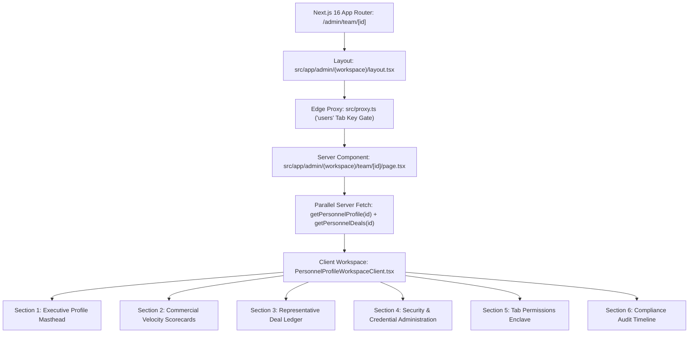

# Master PRD & Engineering Architecture: Dedicated Personnel Profile & Performance Workspace (`/admin/team/[id]`)

> **Feature Directory**: `docs/personnel_profile_workspace/`  
> **Route Path**: `/admin/team/[id]`  
> **Target Branch**: `redesign/primestay-people-and-avatar-management`  
> **Architectural Standard**: Accordion Executive Editorial × Sypher Minimalist SaaS × Linear Fluid Archetypes  
> **Author**: `Fenar7 <86710532+Fenar7@users.noreply.github.com>`  

---

## 1. Executive Summary & Problem Root Cause

### 1.1 The User Critique & Root Cause Analysis
In the current `/admin/team` personnel directory, clicking the **"View Profile"** button on any personnel fluid card (e.g., Sophia Sterling) unexpectedly opens the **"Configure Tab Permissions"** modal (`EditUserPermissionsModal.tsx`).

#### Root Cause in Code:
Inspection of [`PersonnelCard.tsx`](file:///F:/Fenar/Marca%20Ubi/Web_Works/marca_ubi_web_hosting/src/app/admin/%28workspace%29/team/components/PersonnelCard.tsx#L239-L258) reveals:
```typescript
{isAdmin && member.role !== 'sales_executive' && canEditAvatar ? (
  <button
    type="button"
    className={styles.secondaryButton}
    onClick={() => onOpenAvatarModal(member)}
  >
    {member.avatar_url ? 'Change Photo' : 'Set Photo'}
  </button>
) : (
  <button
    type="button"
    className={styles.secondaryButton}
    onClick={() => onOpenPermissionsModal(member)} // <-- DEFECT: Reuses Permissions modal for View Profile
  >
    View Profile
  </button>
)}
```
`View Profile` was hardcoded to trigger `onOpenPermissionsModal(member)`. In an enterprise agency CRM, tab permissions configuration is an administrative access control task, whereas a Personnel Profile Workspace is a complete 360° commercial dossier providing:
1. Executive Profile Masthead with verified contact coordinates and live availability status.
2. Commercial Performance & Velocity KPIs (Won revenue, active pipeline, win rate %, capacity utilization).
3. Representative Deal Ledger (Filterable, sortable list of all leads assigned to or converted by this representative).
4. Security & Credential Administration Enclave (Admin temporary password generation, password rotation enforcement, session termination).
5. Tab Permissions & Access Governance Summary with instant modal trigger.
6. Chronological Audit Trail & Compliance Timeline.

---

## 2. Dynamic Route & App Router Architecture



### 2.1 Next.js 16 App Router Conventions
- Dynamic Route Path: `src/app/admin/(workspace)/team/[id]/page.tsx`
- In Next.js 16 and React 19, `props.params` is a Promise:
  ```typescript
  interface PersonnelProfilePageProps {
    params: Promise<{ id: string }>;
  }
  ```
- Dynamic Metadata Resolution:
  Generates document title based on profile identity: `${profile.full_name} (${profile.job_title}) | Personnel Profile Workspace`.

### 2.2 Edge Proxy Matching (`src/proxy.ts`)
Line 162 in `src/proxy.ts`:
```typescript
{ prefix: '/admin/team', tabKey: 'users' },
```
The matcher logic evaluates `pathname === m.prefix || pathname.startsWith(`${m.prefix}/`)`. Therefore, `/admin/team/[id]` is already automatically protected at the edge under the `'users'` tab key requirement.

### 2.3 Breadcrumb Engine Integration (`AdminBreadcrumbs.tsx`)
`AdminBreadcrumbs.tsx` already listens for `admin-breadcrumb-label-update` window events. The client component dispatches:
```typescript
window.dispatchEvent(
  new CustomEvent('admin-breadcrumb-label-update', {
    detail: {
      path: window.location.pathname,
      label: profile.full_name,
    },
  })
);
```
Resulting spatial navigation trail:
`🔥 Marca Ubi / Administration / User Management / Sophia Sterling`

---

## 3. Database Schema, Relations & Server Actions

### 3.1 Relational Models
1. `public.profiles`: Contains `id`, `full_name`, `email`, `role`, `status`, `job_title`, `phone`, `avatar_url`, `allowed_tabs`, `feature_permissions`, `must_change_password`, `invited_by`, `created_at`.
2. `public.leads`: Contains `id`, `lead_id`, `name`, `company`, `phone`, `email`, `expected_value`, `status_id`, `priority`, `assigned_to`, `created_at`, `brief_payload`.
3. `public.funnel_statuses`: Contains `id`, `name`, `bucket` (`open`, `potential`, `converted`, `lost`), `color_code`, `sort_order`.
4. `public.team_audit_logs`: Contains `id`, `actor_id`, `action`, `target_user_email`, `details`, `created_at`.

### 3.2 Server Actions (`src/app/actions/team.ts`)

#### 1. `getPersonnelProfile(userId: string)`
- RBAC Boundary: Evaluates `hasPersonnelDirectoryAccess`. If caller is `sales_executive`, caller can only view their own profile (`caller.id === userId`).
- Aggregates profile, invited_by name, and high-level portfolio counts.

#### 2. `getPersonnelDeals(userId: string)`
- Retrieves all non-synthetic deals where `assigned_to = userId`.
- Computes:
  - Total Won Value (`funnel_statuses.bucket = 'converted'`).
  - Active Pipeline Deals Count & Valuation (`funnel_statuses.bucket IN ('open', 'potential')`).
  - Conversion / Win Rate % (`won / (won + lost) * 100`).
  - Capacity Utilization (`active_deals / 15 * 100`).

#### 3. `adminResetPersonnelPassword(userId: string, input: AdminResetPasswordPayload)`
- RBAC Boundary: Strictly requires `assertActiveAdmin()`.
- Generates high-entropy 16-character password or sets specified temporary password via `adminClient.auth.admin.updateUserById(userId, { password })`.
- Sets `must_change_password = true` in both `app_metadata` and `public.profiles`.
- Records immutable `password_reset_dispatched` action in `public.team_audit_logs`.

#### 4. `adminRevokePersonnelSessions(userId: string)`
- RBAC Boundary: Strictly requires `assertActiveAdmin()`.
- Invokes `adminClient.auth.admin.signOut(userId, 'global')`.

#### 5. `updatePersonnelCoordinates(userId: string, data: UpdatePersonnelCoordinatesPayload)`
- Permitted for active admins or self (`caller.id === userId`).
- Non-admin callers cannot mutate `role`, `status`, `allowed_tabs`, or `feature_permissions`.

#### 6. `getPersonnelAuditHistory(userId: string)`
- Retrieves historical logs for this user from `public.team_audit_logs`.

---

## 4. UI/UX Design System & Layout Blueprint

### 4.1 Marca Ubi Dark Luxury × Editorial Light Tokens
- **Canvas**: Editorial Neutral `#f7f8fa`
- **Cards & Surfaces**: Pure White `#ffffff` with 1px hairline border `#e2e5ea`
- **Primary CTAs**: Accordion Lemon Yellow (`#eefb87`) with Slate Ink typography (`#1f242f`)
- **Typography**: MessinaSans Display headers, SF Pro Text body, Tabular Numerals (`tabular-nums`) for currency and percentages
- **No AI Slop**: 0 generic blue (`#2563eb`), 0 unapproved drop shadows, 44px touch targets.

### 4.2 Workspace Layout (Desktop & Mobile)

```
┌────────────────────────────────────────────────────────────────────────┐
│ [Breadcrumbs: Marca Ubi / Administration / User Management / Sophia]   │
├────────────────────────────────────────────────────────────────────────┤
│ EXECUTIVE MASTHEAD                                                     │
│ [72px Avatar]  Sophia Sterling          [Monospace Role: SALES REP]    │
│                Senior Luxury Consultant [Online Status: Active]        │
│                sophia@marcaubi.com · +971 50 123 4567                  │
│                                                                        │
│                [ WhatsApp ]  [ Call ]  [ Email ]   [ Edit Profile ]    │
├────────────────────────────────────────────────────────────────────────┤
│ COMMERCIAL VELOCITY SCORECARDS (Stripe Archetype)                      │
│ ┌────────────────┐ ┌────────────────┐ ┌────────────────┐ ┌───────────┐ │
│ │ Total Won Rev  │ │ Active Pipeline│ │ Win Rate %     │ │ Capacity  │ │
│ │ ₹ 1.45 Cr      │ │ ₹ 68.5 L (9)   │ │ 34.2%          │ │ 60% (9/15)│ │
│ └────────────────┘ └────────────────┘ └────────────────┘ └───────────┘ │
├────────────────────────────────────────────────────────────────────────┤
│ REPRESENTATIVE DEAL LEDGER (Linear Fluid Archetype)                    │
│ [Search Deals...] [Filter Stage ▼]                [Export Report]      │
│ ┌────────────────────────────────────────────────────────────────────┐ │
│ │ Lead Title       │ Client           │ Valuation │ Stage   │ Action │ │
│ │ LD-10492 Penthouse│ Apex Holdings    │ ₹ 45.0 L  │ Proposal│ View → │ │
│ │ LD-10488 Villa B  │ Emaar Prime      │ ₹ 23.5 L  │ Won     │ View → │ │
│ └────────────────────────────────────────────────────────────────────┘ │
├────────────────────────────────────────────────────────────────────────┤
│ SECURITY & CREDENTIAL ENCLAVE | TAB ACCESS & GOVERNANCE ENCLAVE        │
│ ┌─────────────────────────────┐ ┌────────────────────────────────────┐ │
│ │ Temporary Password Reset    │ │ 3 Canonical Enclaves Overview      │ │
│ │ [ Generate & Issue Temp PW ]│ │ • Commercial Pipeline (4 tabs)     │ │
│ │ Mandatory Rotation: [ ON ]  │ │ • Agency Operations (2 tabs)       │ │
│ │ [ Sign Out All Devices ]    │ │ • Governance (1 tab)               │ │
│ │                             │ │ [ Configure Permissions Modal ]    │ │
│ └─────────────────────────────┘ └────────────────────────────────────┘ │
├────────────────────────────────────────────────────────────────────────┤
│ AUDIT & COMPLIANCE TIMELINE (Notion Archetype)                         │
│ • 2026-10-23 14:15 - Password reset dispatched by Admin (Firoz Khan)   │
│ • 2026-10-21 09:30 - Account provisioned with role 'sales_executive'  │
└────────────────────────────────────────────────────────────────────────┘
```

---

## 5. Phased Implementation Plan

- **Phase 1: Database Actions & Security Contracts**
  - Implement `getPersonnelProfile`, `getPersonnelDeals`, `adminResetPersonnelPassword`, `adminRevokePersonnelSessions`, `updatePersonnelCoordinates`.
  - Add unit tests in `tests/team/personnel-profile-actions.test.ts`.
- **Phase 2: App Router Workspace Route & Shell**
  - Create `src/app/admin/(workspace)/team/[id]/page.tsx`, `loading.tsx`, `not-found.tsx`, and SCSS modules.
  - Implement dynamic metadata and breadcrumbs dispatch.
- **Phase 3: Interactive Client Workspace & Component Sub-Blocks**
  - Build `PersonnelProfileWorkspaceClient.tsx`.
  - Build `ExecutiveMasthead`, `CommercialVelocityScorecards`, `RepresentativeDealLedger`, `PersonnelSecurityEnclave`, `AuditTimeline`.
- **Phase 4: Personnel Card & Directory Linkage**
  - Update `PersonnelCard.tsx` and `PersonnelActionMenu.tsx` to link to `/admin/team/[id]`.
- **Phase 5: Verification & PR Auditor Gate**
  - Run full test suite (`npm run test:boundaries`, `npm run test:unit`, `npx tsc --noEmit`).
  - Prepare PR Auditor delivery gate report.
