# Master Architectural Plan: Cadence Calibration & Project Brief Modal

## 1. Executive Summary & Objective Alignment
Per the provided screenshots and directives:
1. **Calibrate Viewport Heights Across All Sections (Except Hero)**:
   - **`HeroCutout` (`View 01`)**: **Remains strictly untouched at `100dvh`** as the singular full-screen opening monument.
   - **All Other Sections (`WorksCutout`, `ConnectCutout`, `ValuesCutout`, `TestimonialsCutout`)**: Excessive `100dvh` / `85vh` / `80vh` heights and massive clamp paddings are reduced to cinematic letterbox windows (`clamp(460px, 62vh, 640px)`) and organic auto-heights with refined vertical padding. This eliminates huge dead gaps and brings the page rhythm into direct parity with high-end editorial agency benchmarks.
2. **Multi-Page Project Submission Brief Modal ("Start a Project")**:
   - Modernize and mount the authentic 4-step wizard (`src/app/components/ProjectForm/`) into an accessible, responsive dark luxury modal (`ProjectBriefModal.tsx`).
   - Wire opening the modal to:
     - The **"Start a Project Brief"** button in [`ConnectCutout.tsx`](file:///F:/Fenar/Marca%20Ubi/Web_Works/marca_ubi_web_hosting/src/app/components/Sections/ConnectCutout.tsx).
     - A **new "Start a Project" button** in [`WorksCutout.tsx`](file:///F:/Fenar/Marca%20Ubi/Web_Works/marca_ubi_web_hosting/src/app/components/Sections/WorksCutout.tsx) placed alongside the existing `"View Works →"` button.
   - Pause the living background video when the modal is open (`BackgroundVideoEngine isPausedByModal={isReelOpen || isBriefOpen}`) for buttery 60fps form completion performance.
   - Maintain the standalone `/start-project` page intact for direct links and crawler discovery.

---

## 2. Section Cadence & Viewport Height Calibration

```mermaid
flowchart TD
    subgraph Stream["Alternating Cinematic Stream"]
        Hero["View 01: HeroCutout (100dvh Full Viewport Monument - Untouched)"]
        About["View 02: AboutCurtain (Solid Pure White)"]
        Reel["View 03: ReelCutout (Calibrated clamp 480px–68vh)"]
        Stmt["View 04: StatementCurtain (Solid Pure White)"]
        Works["View 05: WorksCutout (Calibrated clamp 460px–62vh, New 'Start a Project' CTA)"]
        Process["View 06: ProcessCurtain (Solid Pure White)"]
        Values["View 07: ValuesCutout (min-height: auto, tightened padding)"]
        Testimonial["View 08: TestimonialsCutout (min-height: auto, tightened padding)"]
        Dispatches["View 09: DispatchesCurtain (Solid Pure White)"]
        Global["View 10: GlobalLocationsCloud (Solid Pure White)"]
        Connect["View 11: ConnectCutout (min-height: auto, triggers Brief Modal)"]
        Footer["View 12: MonumentalFooter (Obsidian Black)"]
    end
    Hero --> About --> Reel --> Stmt --> Works --> Process --> Values --> Testimonial --> Dispatches --> Global --> Connect --> Footer
```



### Detailed Height & Padding Calibration Matrix:
| Section Component | File | Current Height / Padding | Calibrated Benchmark Value | Engineering Rationale |
| :--- | :--- | :--- | :--- | :--- |
| **Hero Cutout** | `HeroCutout.module.scss` | `height: 100dvh; min-height: 600px;` | **No Change (`100dvh`)** | User explicit requirement: hero must remain full screen. |
| **Works Cutout** | `WorksCutout.module.scss` | `height: 100dvh; min-height: 680px;`<br>(tablet: `80dvh; min-height: 540px;`) | `height: clamp(460px, 62vh, 640px); min-height: 460px;`<br>(tablet: `clamp(400px, 54vh, 500px);`) | Replaces the awkward 100dvh dead space with an intentional cinematic window framing the headline and dual CTAs. |
| **Values Cutout** | `ValuesCutout.module.scss` | `min-height: 80vh;`<br>`padding: clamp(6rem, 12vw, 11rem) 0;` | `min-height: auto;`<br>`padding: clamp(4rem, 7vw, 6.5rem) 0;` | Lets the glassmorphic cards dictate organic height without dragging the screen. |
| **Testimonials Cutout** | `TestimonialsCutout.module.scss` | `min-height: 80vh;`<br>`padding: clamp(6.5rem, 12vw, 11rem) 0;` | `min-height: auto;`<br>`padding: clamp(4.5rem, 7.5vw, 7rem) 0;` | Tightens vertical pacing leading into Dispatches. |
| **Connect Cutout** | `ConnectCutout.module.scss` | `min-height: 85vh;`<br>`padding: clamp(6rem, 10vw, 10rem) clamp(...);` | `min-height: auto;`<br>`padding: clamp(4.5rem, 7.5vw, 7rem) clamp(...);` | Removes 85vh dead space; studio coordinates and action triggers sit comfortably above the footer. |

---

## 3. Multi-Page Project Submission Brief Modal Architecture

### A. New Component: `ProjectBriefModal`
Located at `src/app/components/ProjectBriefModal/ProjectBriefModal.tsx` and `.module.scss`:
- **Accessibility & UX**:
  - `role="dialog"`, `aria-modal="true"`, `aria-labelledby="brief-modal-title"`.
  - Body scroll lock (`document.body.style.overflow = "hidden"`).
  - Trapped focus cycle & `Escape` key handler to dismiss.
  - Return focus to trigger button upon close.
- **Visual Design**:
  - Backdrop: `rgba(8, 8, 8, 0.82)` with `-webkit-backdrop-filter: blur(24px)`.
  - Dialog Canvas: Deep Obsidian `#0c0c0c` container with `1px solid rgba(255, 255, 255, 0.12)` and subtle inner glow.
  - Floating close button `✕` with smooth `#ea002a` hover transition.
  - Integrated with [`ProjectForm`](file:///F:/Fenar/Marca%20Ubi/Web_Works/marca_ubi_web_hosting/src/app/components/ProjectForm/ProjectForm.tsx) passing `isModal={true}` and `onClose={handleCloseBrief}` so users can dismiss or receive confirmation within the modal seamlessly.

### B. Trigger Points:
1. **`WorksCutout.tsx` ("Work with us")**:
   - Add new action button alongside `"View Works →"`:
     - **Primary Accent Button**: `"Start a Project"` (triggers `onOpenBrief`).
     - **Secondary Outline Pill**: `"View Works →"` (navigates to `/works`).
2. **`ConnectCutout.tsx` ("Let's Build Something That Holds")**:
   - Update `"Start a Project Brief"` action to invoke `onOpenBrief` on click while keeping `href="/start-project"` for progressive enhancement and search crawlers.

### C. State Orchestration in `ClientHomeExperience.tsx`:
```tsx
const [isBriefOpen, setIsBriefOpen] = useState(false);
const handleOpenBrief = () => setIsBriefOpen(true);
const handleCloseBrief = () => setIsBriefOpen(false);

// Living video engine pauses if reel OR brief modal is active:
<BackgroundVideoEngine isPausedByModal={isReelOpen || isBriefOpen} />

// Passing triggers:
<WorksCutout onOpenBrief={handleOpenBrief} />
<ConnectCutout onOpenBrief={handleOpenBrief} />

// Rendering Modal:
<ProjectBriefModal isOpen={isBriefOpen} onClose={handleCloseBrief} />
```

---

## 4. Verification & Quality Gates
1. **Tests**: Run `node --import tsx --test tests/client/client_160over90_platform.test.ts` to ensure 100% pass rate.
2. **Type Check**: Run `npx tsc --noEmit` to ensure zero TypeScript errors.
3. **Commit Identity**: Strict authorship `Fenar7 <86710532+Fenar7@users.noreply.github.com>`.
4. **Zero Auto-Merge**: PR #87 remains open on GitHub awaiting manual review.
