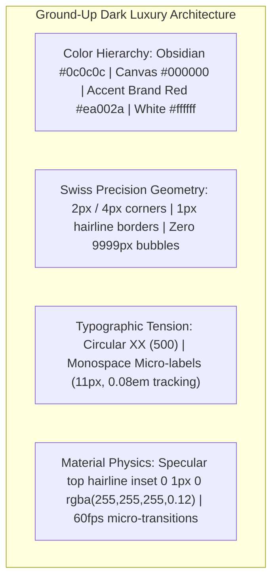

# Master Architectural Plan: Ground-Up Dark Luxury Redesign of Project Brief Form

## 1. Executive Summary & Problem Diagnosis
Screenshot `Screenshot 2026-10-27 190738.png` revealed that while the modal container was correctly rendered, the inner form (`ProjectForm` and `Step1Services` through `Step4Summary`) was still carrying legacy 2023 design patterns:
1. **Discordant Brand Color**: Hardcoded orange (`#ff6100` / `$cta-orange`), whereas Marca Ubi's design system strictly mandates **Brand Red (`#ea002a`)**.
2. **Outdated Bubbly Geometry (Anti-Slop Violation)**: Bubbly `border-radius: 9999px` capsule tags and rounded `12px` / `16px` cards instead of Swiss architectural precision (`border-radius: 2px` / `4px`).
3. **Muddy Grey Surfaces & Low Contrast**: Cards sat on flat `rgba(255, 255, 255, 0.02)` without specular top highlights, and icons used muted `rgba(255, 255, 255, 0.4)` grey.
4. **Outdated Step Indicators**: "Step 1 of 4" with orange rounded pill bars instead of an architectural Raycast-style segmented step rail with monospace coordinates (`01 // 04`).
5. **Casual AI-Slop Copy**: Casual copy like *"Let's do this!"* and an unstyled `#fff0f0` pink error box in Step 4.

---

## 2. Design System Alignment & Master Tokens

### Direct Comparative Matrix:
| Component | Legacy Form (Screenshot 190738.png) | **New Marca Ubi Dark Luxury Standard** |
| :--- | :--- | :--- |
| **Accent Hue** | `$cta-orange: #ff6100` | **`$client-accent-red: #ea002a`** (Hover: `#c40023`, Glow: `rgba(234, 0, 42, 0.35)`) |
| **Corner Radius** | `border-radius: 9999px` & `16px` | **`border-radius: 2px`** (Cards: `4px` max) |
| **Surface Styling** | Muddy grey `rgba(255, 255, 255, 0.02)` | **Deep Obsidian `#0c0c0c`** + `1px solid rgba(255, 255, 255, 0.1)` + top specular highlight |
| **Step Progress** | 4 orange rounded pills + "Step 1 of 4" | **Raycast-style segmented rail**: 4 hairline blocks with red fill + Monospace `[01 // 04] SERVICE SELECTION` |
| **Category Tabs** | Rounded capsule pills (`border-radius: 9999px`) | **Swiss architectural tab rail**: `border-radius: 2px`, uppercase monospace font, active white fill with black text |
| **Service Cards** | Muddy grey cards, orange border on select | **Sharp Obsidian cards**: `border-radius: 2px`, subtle white hover lift, `#ea002a` active border with red indicator dot |
| **Form Inputs** | Rounded 12px inputs, grey border | **Precision Obsidian fields**: `border-radius: 2px`, monospace floating micro-labels, crisp `#ea002a` focus ring |
| **Submission CTA** | Casual *"Let's do this!"* pill | Command luxury copy: **`TRANSMIT PROJECT BRIEF →`** on Swiss `#ea002a` button |
| **Submit Errors** | Pink alert box (`#fff0f0`, red text) | **Notion Callout Luxury Archetype**: Obsidian background, `#ea002a` left border, monospace `[SYSTEM NOTICE]` |

---

## 3. Step-by-Step Architectural Redesign

### Step 1: Services & Categories (`Step1Services.tsx`)
- **Category Tabs**: Architectural horizontal rail with `border-radius: 2px`, hairline borders, uppercase monospace tracking. Active category in solid `#ffffff` with `#000000` text.
- **Service Cards**: 3–4 column responsive grid. Deep `#0c0c0c` surface, `border-radius: 2px`, high-contrast icons. Active state triggers 1.5px `#ea002a` border and red corner dot.
- **Footer**: Swiss 52px button (`border-radius: 2px`) with `NEXT: BUSINESS PROFILE →`.

### Step 2: Business & Project Profile (`Step2Business.tsx`)
- **Inputs Grid**: Responsive dual-column grid.
- **Micro-Labels**: Monospace indexed headers:
  - `01 // CLIENT FULL NAME *`
  - `02 // CORPORATE EMAIL *`
  - `03 // CONTACT DIRECT LINE`
  - `04 // SOCIAL / INSTAGRAM HANDLE`
  - `05 // PRIMARY WORKING LANGUAGE`
  - `06 // PROJECT DESIGNATION / ENTITY *`
  - `07 // EXECUTIVE SCOPE OVERVIEW *`
  - `08 // COMMERCIAL SECTOR / INDUSTRY`
  - `09 // DIGITAL TOUCHPOINTS / WEBSITE`
- **Agency Status**: 3 Swiss selection cards with 2px radius and monospace status labels.

### Step 3: Scope Specifications & Timelines (`Step3Details.tsx`)
- **Reference URLs**: Monospace indexed URL repeater (`REF 01`, `REF 02`) with architectural delete buttons. Zero inline styles.
- **Timeline Grid**: Stripe Scorecard archetype with monospace timeline badges (`48 HOURS`, `1 WEEK`, `2 WEEKS`, `1 MONTH`, `CUSTOM WINDOW`, `ADVISORY CALL`) and turn-around subtext.
- **NDA / Showcase Permission**: Clean dual Swiss toggle cards: `[PERMISSION GRANTED]` vs `[CONFIDENTIAL NDA]`.

### Step 4: Executive Dossier & Transmission (`Step4Summary.tsx`)
- **Summary Cards**: Linear Fluid Dossier cards for Step 1, 2, and 3 with monospace section headers (`// DOSSIER 01: SERVICE SELECTION`) and Swiss `[ EDIT SECTION ↗ ]` buttons.
- **Error Callout**: Dark luxury Notion Callout box (Obsidian with `#ea002a` left border, zero pink backgrounds).
- **Submit Action**: Professional, commanding luxury button: **`TRANSMIT PROJECT BRIEF →`** (loading state: `TRANSMITTING BRIEF SPECIFICATION...`).

### Success Confirmation State (`ProjectForm.tsx`)
- Replace the orange checkmark with a minimalist Brand Red luxury geometric monogram (`#ea002a`).
- Monospace submission token: `BRIEF SPECIFICATION TRANSMITTED // REF: [IDEMPOTENCY_KEY]`.
- Direct studio coordinates rail (+91 7012 052 472 / hello@marcaubi.com).
- Swiss outline button: `← RETURN TO MARCA UBI HOMEPAGE` or `CLOSE DIALOG`.

---

## 4. Phasing & Quality Gates
1. Update `ProjectForm.module.scss` and `Step.module.scss` importing `$client-accent-red`, `$font-circular`, `$font-mono`.
2. Refactor `ProjectForm.tsx`, `Step1Services.tsx`, `Step2Business.tsx`, `Step3Details.tsx`, `Step4Summary.tsx`.
3. Verify with `npx tsc --noEmit` and `node --import tsx --test tests/client/client_160over90_platform.test.ts`.
4. Commit with author `Fenar7 <86710532+Fenar7@users.noreply.github.com>`.
5. Update PR #88 and keep open.
