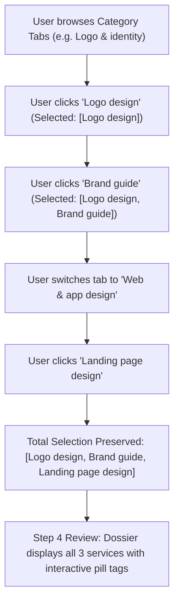

# Architectural Plan: Multi-Service Selection Engine for Project Brief Questionnaire

> **Task ID**: `TASK-CLIENT-FORM-MULTISELECT-001`  
> **Status**: READY FOR USER REVIEW  
> **Author**: `Fenar7 <86710532+Fenar7@users.noreply.github.com>`  
> **Branch**: `refactor/project-form-option-restoration-and-luxury-polish`  
> **Target Alignment**: `Screenshot 2026-10-28 103401.png`, `master-ui-ux-design-system`, `antislop-ui`

---

## 1. Problem Statement & User Directive

In `Screenshot 2026-10-28 103401.png`, the user reviewed Step 1 ("What do you need designed?") and noted:
> *"there should be option to select multiple options btw"*

Currently, service selection operates as single-choice radio (`updateFormData("service", service)`), meaning selecting a new service replaces the previous selection, and switching categories clears the selection. In real commercial agency engagements, prospective luxury clients frequently require multiple deliverables simultaneously (e.g., both "Logo design" and "Brand guide" in *Logo & identity*, or cross-category scopes such as "Brand guide" + "Landing page design" + "Product packaging").

---

## 2. Architectural Solution

### A. State Management & Data Schema
1. **Multi-Selection Array**:
   - In `Step1Services.tsx`, store an array `selectedServices: string[]` (parsed from `formData.service ? formData.service.split(", ").map(s => s.trim()) : []`).
   - Clicking an unselected card appends it to `selectedServices`.
   - Clicking an already-selected card toggles it off and removes it from `selectedServices`.
2. **Cross-Category Persistence**:
   - Switching category tabs does **NOT** wipe previously selected services from other categories.
   - Category tabs will display a subtle notification dot/badge if services within that category are currently selected, allowing clients to navigate back and forth effortlessly.
3. **Synchronized Form Payload (`ProjectFormData`)**:
   - `formData.service`: Store joined string: `selectedServices.join(", ")`.
   - `formData.category`: Automatically derive unique categories based on selected services: `uniqueCategories.join(", ")`.
   - `types.ts`: Extend `ProjectFormData` with optional `services?: string[];` and `categories?: string[];` for full TypeScript type safety without breaking existing contracts.

### B. UI/UX & Visual Elevation
1. **Interactive Service Cards**:
   - Multi-select toggle behavior with tactile press state.
   - Selected card: `1px solid #ea002a` border, Brand Red glow (`box-shadow: 0 0 16px rgba(234, 0, 42, 0.2)`), filled red indicator dot with white checkmark/dot.
   - Unselected card: Hairline border `rgba(255, 255, 255, 0.09)`, subtle hover elevation (`#141414`).
2. **Live Selection Counter & Clear Action**:
   - Display a clean summary status above the action bar:
     `3 services selected across 2 disciplines` with an optional minimal `"Clear all"` button.
   - Action Button: `"Continue"` (or `"Continue with 3 services →"`), enabled whenever `selectedServices.length > 0`.
3. **Step 4 Summary Dossier (`Step4Summary.tsx`)**:
   - Under "1. Design Needs", display selected services as elegant obsidian tags/chips with Brand Red borders.
   - Display unique categories clearly.
4. **CRM Lead Ingestion (`ProjectForm.tsx` & `/api/sales-funnel/ingest`)**:
   - Maps primary service category to the dominant category or `"Full-Suite Advisory"` when multiple cross-disciplinary services are chosen.
   - Includes full enumerated service list in `notes` and `brief_payload.services`.

---

## 3. Verification & Safety Strategy
- Update unit tests in `tests/client/client_project_form_restoration.test.ts` to assert multi-select toggle, array serialization, and cross-category persistence.
- Verify `npx tsc --noEmit` exits with 0 errors.
- Verify all 42 platform tests continue to pass (100%).
- Commit strictly authored as `Fenar7 <86710532+Fenar7@users.noreply.github.com>`.
- Push to existing branch `refactor/project-form-option-restoration-and-luxury-polish` and update PR #90.
