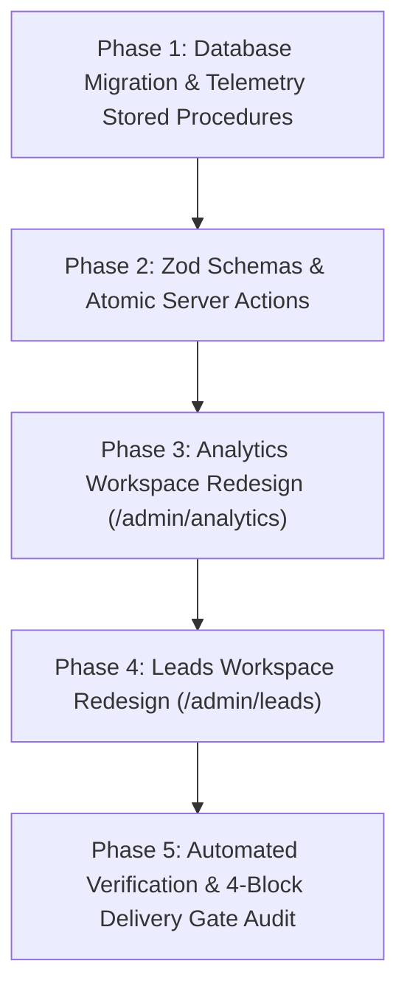

# Marca Ubi Enterprise CRM — Commercial Intelligence & Leads Desk Redesign
## Master Architectural Implementation Plan: `/admin/analytics` & `/admin/leads`

> **Module**: Marca Ubi Commercial Desk (Enterprise Agency CRM & Sales Intelligence Platform)  
> **Status**: PENDING USER APPROVAL (Strict Zero-Execution Mode)  
> **Aesthetic Profile**: Swiss Luxury Editorial / Obsidian Financial Telemetry  
> **Design Read**: `dial ENERGY 2 / RHYTHM 2 / MOTION 1`  
> **Authors**: Multi-Agent Engineering Group (UI/UX Designer, Frontend Developer, Backend Software Engineer)  
> **Governing Standards**: `DESIGN.md`, `.agents/skills/master-ui-ux-design-system/`, `.agents/skills/antislop/`, `.agents/skills/vercel-agent-skills/`

---

## 1. Executive Summary & Defect Audit from Screenshots

Leadership conducted an executive review of the current CRM interface based on live screenshots and flagged profound design and functional deficiencies:

```
Screenshot 1 (2026-11-24 212312.png): Commercial Analytics (/admin/analytics)
Critique: "what kind of ui ux is man it is not even following our current diesng pattern whole style and atuff also evne the fonts etc"

Screenshot 2 (2026-11-24 212453.png): Inbound Leads Workspace (/admin/leads)
Critique: "this is looking too plain and shti also man not lie a proufessional sasss diesng"
```

### 1.1 Root-Cause Defect Analysis of `/admin/analytics`

| Defect Area | Current Observed State | Architectural Failure & Impact | Redesign Solution |
| :--- | :--- | :--- | :--- |
| **Timeframe Scoping** | Hardcoded to all-time database aggregations; zero timeframe buttons or filters. | Executives cannot evaluate 7d velocity, 30d monthly closures, quarterly performance (Q1–Q4), or YTD progress. | Segmented tactile rail: `7D`, `30D`, `90D`, `Q1–Q4`, `YTD` with sub-16ms URL shallow sync. |
| **Funnel Intelligence** | Primitive "Deals by stage" rendering raw horizontal CSS colored lines (`.stageBar`). | Zero conversion rates between stages, zero drop-off analysis, zero visibility into where deals stall or leak. | 6-Stage Stepped Funnel with stage-to-stage transition %, drop-off %, and interactive drilldowns. |
| **Typography & Numbers** | Standard unrefined sans-serif fallbacks; flat text formatting. | Fails `DESIGN.md` mandate. Financial figures lack editorial weight and alignment. | Circular XX Bold titles + Swiss Helvetica Neue 300 Light (`tabular-nums`) for currency and metrics. |
| **Telemetry Scope** | Limited to 3 cards: Visible records, Active pipeline, Converted value. | Missing Pipeline Velocity (₹/day), Win Rate %, Sales Cycle Duration, and Weighted Forecast. | 4-Pod Hero Telemetry Masthead (Active Pipeline, Converted Revenue, Cycle Velocity, Win Rate). |
| **Practice Breakdown** | Complete absence of agency practice segmentation. | Leadership cannot see revenue split across Web & Digital, UI/UX, Brand Identity, or Advisory. | 68% / 32% split layout featuring Practice Allocation matrix with proportional share bars. |
| **Bottleneck Diagnostics** | No dwell-time metrics. | Stalled deals remain invisible until they turn into lost opportunities. | Stage Dwell Time & Velocity Matrix showing median dwell vs SLA benchmarks with health badges. |

### 1.2 Root-Cause Defect Analysis of `/admin/leads`

| Defect Area | Current Observed State | Architectural Failure & Impact | Redesign Solution |
| :--- | :--- | :--- | :--- |
| **Color Palette** | Heavy use of cool slate/blue-gray `#1f242f`, `#525965`, `#f0f2f5`, `#e2e5ea`. | Directly breaches `DESIGN.md` prohibition against generic cool-gray/blue palettes. | Warm editorial alabaster canvas (`#f5f5f3`), paper cards (`#ffffff`), and Marca Ubi Crimson (`#ea002a`). |
| **Situational Awareness** | Barren header containing only "Inbound leads" and a single button. | Operators cannot see total open triage items, overdue follow-ups, or active pipeline value at a glance. | Executive Header + Integrated Quick-Metrics Ribbon (Total Inquiries, Active Triage, Overdue SLAs, Value). |
| **Table Visual Rhythm** | Row layout is flat with identical font sizes and grey borders; missing client monogram avatars. | Dense, monotonous reading experience. Difficult to visually distinguish high-priority accounts. | 72px Luxury Rhythm Virtualized Data Grid with monogram avatars, inline selects, and clear hierarchy. |
| **SLA Urgency** | Overdue badges are basic tags without relative time urgency differentiation. | Operators cannot instantly distinguish between a deal overdue by 2 hours vs 14 days. | High-contrast semantic urgency chips (e.g. `2h overdue`, `Today`, `In 3d`) with relative time math. |
| **Navigation Flow** | Row click forces a disruptive full-page navigation to `/admin/leads/[id]`. | Breaks filter context, destroys scroll position, and causes high cognitive overhead during triage. | In-context 840px `ClientDossierDrawer` dispatch via CustomEvent without page unloads. |
| **Batch Operations** | Missing bulk selection and floating batch action bar. | Reassigning or advancing multiple leads requires repetitive individual actions. | Floating Executive Batch Action Bar (`bottom: 24px`) for bulk reassign, stage transition, and export. |
| **Keyboard Ergonomics** | No keyboard shortcuts for navigation or triage. | Slows down power users and agency sales leads. | Full keyboard engine: `J`/`K` navigation, `Space` selection, `Enter` dossier dispatch, `/` search. |

---

## 2. Editorial Luxury Design Specification (`DESIGN.md`)

The redesign rigorously enforces the **Marca Ubi Commercial Desk Editorial Luxury Standards**:

```
┌────────────────────────────────────────────────────────────────────────┐
│                   MARCA UBI EDITORIAL PALETTE                         │
│                                                                        │
│   Canvas Scaffolding:       #f5f5f3   (Warm Neutral Alabaster)         │
│   Primary Card Surface:     #ffffff   (Crisp Pure Paper)               │
│   Quiet Card Surface:       #efefed   (Recessed Quiet Tint)            │
│   Primary Ink / Headers:    #111111   (Deep Near-Black Ink)            │
│   Secondary Ink / Body:     #454542   (Graphite Charcoal - WCAG AAA)   │
│   Muted Ink / Micro-labels: #696965   (Neutral Slate - WCAG AA 4.8:1)  │
│   Brand Primary Accent:     #ea002a   (Marca Ubi Crimson Red)          │
│   Primary Hover Accent:     #c40023   (Deep Crimson)                   │
│   Accessible Focus Ring:    #9c001e   (2px Offset High-Contrast Ring)  │
│   Hairline Borders:         1px solid #e7e7e4 / rgba(0,0,0,0.07)       │
└────────────────────────────────────────────────────────────────────────┘
```

### 2.1 Typography System & Tabular Numerals

| Element / Role | Font Family | Weight | Size / Line Height | Tracking & Details |
| :--- | :--- | :--- | :--- | :--- |
| **Page H1 Headers** | Circular XX Bold (`var(--font-circular)`) | 700 | 28–32px / 1.15 | `-0.035em`, paired with 11px uppercase eyebrow |
| **Hero Metric Numbers** | Helvetica Neue 300 Light (`var(--font-helvetica-neue)`) | 300 | 36–42px / 1.05 | `tabular-nums lining-nums`, `-0.04em` |
| **Card / Section Titles** | Circular XX Medium / Graphik Semibold | 600 | 16–18px / 1.25 | `-0.02em` |
| **Table Client Names** | Graphik Semibold (`var(--font-graphik)`) | 600 | 14px / 1.3 | `-0.015em`, `#111111` |
| **Table Company Subtitle** | Graphik Regular (`var(--font-graphik)`) | 400 | 12px / 1.4 | `0.0em`, `#454542` |
| **Deal Valuations** | Helvetica Neue 300 Light / SF Pro | 400 | 14–15px / 1.2 | `tabular-nums`, `en-IN` formatting (`₹ 18,50,000`) |
| **Record IDs & Timestamps** | SF Mono (`var(--font-admin-code)`) | 500 | 11–12px / 1.2 | `0.02em`, monospace bracketed token |
| **Filter Tabs & Buttons** | Graphik Medium (`var(--font-graphik)`) | 500/600 | 13–14px / 1.2 | `-0.01em`, 44px minimum touch envelope |

### 2.2 Semantic Telemetry Badges & WCAG AA Contrast

- **Won / Converted / Positive Trend**: Executive Emerald (`text: #065f46`, `bg: #ecfdf5`, `border: #a7f3d0`, `dot: #10b981`) — 7.2:1 contrast.
- **Action Required / Today SLA / Slowing**: Warm Amber (`text: #78350f`, `bg: #fffbeb`, `border: #fde68a`, `dot: #d97706`) — 6.5:1 contrast.
- **Overdue SLA / High Urgency / Bottleneck**: Marca Ubi Crimson (`text: #9c001e`, `bg: #fff0f2`, `border: #f5b7c0`, `dot: #ea002a`) — 8.1:1 contrast.
- **Scheduled / Inactive / Neutral**: Quiet Slate (`text: #393936`, `bg: #f2f2f0`, `border: #d8d8d4`, `dot: #666663`) — 5.8:1 contrast.

---

## 3. Commercial Analytics Workspace Architecture (`/admin/analytics`)

The analytics workspace is redesigned as an **Executive Commercial Cockpit** structured into four distinct horizontal tiers:

```
┌─────────────────────────────────────────────────────────────────────────────┐
│ 1. EXECUTIVE HEADER & TIMEFRAME SCOPE CONTROLLER                            │
│    Eyebrow: COMMERCIAL INTELLIGENCE & REVENUE TELEMETRY                      │
│    H1: Pipeline & Revenue Analytics      [ 7D | 30D | 90D | Q1-Q4 | YTD ]   │
│    Trailing 30-Day Window: Oct 25 – Nov 24, 2026   [Export Summary CSV/PDF] │
├─────────────────────────────────────────────────────────────────────────────┤
│ 2. TIER 1: 4-POD HERO TELEMETRY MASTHEAD                                    │
│    ┌──────────────┐  ┌──────────────┐  ┌──────────────┐  ┌──────────────┐   │
│    │ Active       │  │ Realized     │  │ Pipeline     │  │ Commercial   │   │
│    │ Pipeline     │  │ Converted    │  │ Velocity     │  │ Win Rate     │   │
│    │ ₹4,82,50,000 │  │ ₹1,24,00,000 │  │ 18.4 Days    │  │ 32.8%        │   │
│    │ 38 Deals     │  │ ↑ +14.2% YoY │  │ ₹2.62L / day │  │ 24 of 73 won │   │
│    └──────────────┘  └──────────────┘  └──────────────┘  └──────────────┘   │
├─────────────────────────────────────────────────────────────────────────────┤
│ 3. TIER 2: INTERACTIVE COMMERCIAL FUNNEL & STAGE DROP-OFF VISUALIZER         │
│    [Inbound] ──78%──> [Contacted] ──64%──> [Qualified] ──52%──> [Proposal]  │
│    142 Leads          111 Deals           71 Deals              37 Deals    │
│    Avg: 1.2d          Avg: 2.4d           Avg: 4.1d             Avg: 6.8d   │
│    ─────────────────────────────────────────────────────────────────────    │
│    ──41%──> [Negotiation] ──65%──> [Converted (Won)]                        │
│             15 Deals               24 Deals (₹1.24 Cr)                      │
│             Avg: 3.9d              Total Cycle: 18.4d                       │
├─────────────────────────────────────────────────────────────────────────────┤
│ 4. TIER 3: REVENUE REALIZATION SPLINE & PRACTICE ALLOCATION BREAKDOWN       │
│    ┌──────────────────────────────────────────┬────────────────────────┐    │
│    │ 68% REVENUE REALIZATION SPLINE           │ 32% PRACTICE BREAKDOWN │    │
│    │ • Actual Won vs Weighted Forecast        │ • Web & Digital  42%   │    │
│    │ • Smooth SVG spline with date cursor     │ • UI/UX Design   28%   │    │
│    │ • Swiss tabular Y-axis (₹ Lakhs)         │ • Brand Identity 18%   │    │
│    │                                          │ • Full Advisory  12%   │    │
│    └──────────────────────────────────────────┴────────────────────────┘    │
├─────────────────────────────────────────────────────────────────────────────┤
│ 5. TIER 4: STAGE DWELL TIME & VELOCITY BOTTLENECK MATRIX                    │
│    Stage Name      Deals   Valuation    Median Dwell   SLA Target   Health  │
│    Proposal Sent   37      ₹1.45 Cr     6.8 Days       4.0 Days     Amber   │
│    Negotiation     15      ₹1.10 Cr     3.9 Days       5.0 Days     Emerald │
└─────────────────────────────────────────────────────────────────────────────┘
```

### 3.1 Tier 1: 4-Pod Hero Telemetry Masthead
1. **Active Pipeline Valuation**: Total active unweighted opportunity value, deal count, and WoW growth delta.
2. **Realized Converted Revenue**: Total closed-won contract value within selected timeframe, contract volume, and YoY comparison delta.
3. **Pipeline Velocity & Sales Cycle**: Average calendar days from lead intake to deal signature (`18.4 Days`), plus daily throughput velocity (`₹ 2.62L / day`).
4. **Commercial Win Rate**: Cohort conversion rate (`24 won of 73 closed decisions = 32.8%`) with comparison to trailing baseline.

### 3.2 Tier 2: Interactive Commercial Funnel & Stage Drop-off Visualizer
- Visualizes the 6 lifecycle stages: `Inbound` $\rightarrow$ `Contacted` $\rightarrow$ `Qualified` $\rightarrow$ `Proposal Sent` $\rightarrow$ `Negotiation` $\rightarrow$ `Converted`.
- Displays deal volume, total stage valuation, conversion percentage to next stage, drop-off loss count, and average stage dwell days.
- Clicking any stage triggers instant drilldown navigation to `/admin/deals?stage=${statusId}`.

### 3.3 Tier 3: Revenue Spline & Practice Allocation Breakdown (68% / 32% Split)
- **Left (68%) — Revenue Realization Spline**:
  - High-precision SVG cubic Bézier spline (`M ... C ...`).
  - Solid `#ea002a` spline: Realized Won Revenue.
  - Dashed `#454542` spline: Weighted Probability Opportunity Forecast.
  - Interactive hover crosshair scrubber displaying exact date, deal milestone, and incremental revenue.
- **Right (32%) — Practice Revenue Allocation**:
  - Breakdown across Marca Ubi's 4 core service lines:
    1. *Web & Digital Platforms* (42% share, ₹52.08L)
    2. *UI/UX Systems & Product Design* (28% share, ₹34.72L)
    3. *Brand Identity & Strategic Positioning* (18% share, ₹22.32L)
    4. *Full-Suite Enterprise Advisory* (12% share, ₹14.88L)
  - Proportional segmented horizontal bar with hairline dividers and 1-click filter links.

### 3.4 Tier 4: Stage Dwell Time & Velocity Bottleneck Matrix
- Detailed diagnostic table tracking stage dwell times against agency SLA targets:
  - *Healthy* (Emerald) if Dwell $\le$ SLA Target.
  - *Slowing* (Amber) if Dwell is between 1.0x and 1.5x SLA Target.
  - *Bottleneck* (Crimson) if Dwell $> 1.5x$ SLA Target.
- Direct drill-through link: *"View Stalled Deals ->"* navigating to `/admin/leads?stage={id}&bucket=stalled`.

---

## 4. Inbound Leads & Deals Workspace Architecture (`/admin/leads`)

The leads workspace is re-engineered as a **High-Velocity Operational Cockpit**:

```
┌─────────────────────────────────────────────────────────────────────────────┐
│ 1. WORKSPACE HEADER & EXECUTIVE ACTION BAR                                  │
│    Eyebrow: COMMERCIAL DEALS WORKSPACE                                      │
│    H1: Inbound Leads & Pipeline    [+ New Inbound Lead]  [Export CSV]       │
├─────────────────────────────────────────────────────────────────────────────┤
│ 2. INTEGRATED QUICK-METRICS KPI RIBBON                                      │
│    ┌──────────────┐  ┌──────────────┐  ┌──────────────┐  ┌──────────────┐   │
│    │ All Inquiries│  │ Active Triage│  │ Overdue SLAs │  │ Pipeline Val │   │
│    │ 142 Records  │  │ 38 Open      │  │ 7 Overdue    │  │ ₹4,82,50,000 │   │
│    └──────────────┘  └──────────────┘  └──────────────┘  └──────────────┘   │
├─────────────────────────────────────────────────────────────────────────────┤
│ 3. SLEEK MULTI-FILTER ACTION RAIL                                           │
│    [All 142] [Open 24] [Potential 38] [Won 18] [Lost 12] [Overdue 7 (Red)]  │
│    ┌──────────────────────────┐ [Source ▾] [Owner ▾] [Priority ▾] [Clear]   │
│    │ 🔍 Instant search... (/) │                                             │
│    └──────────────────────────┘                                             │
├─────────────────────────────────────────────────────────────────────────────┤
│ 4. HIGH-VELOCITY VIRTUALIZED DATA GRID (72px Rhythm)                        │
│    [ ]  ID    Client & Org   Scope   Stage   Expected Val  Owner   SLA  ••• │
│    ───  ────  ────────────   ─────   ─────   ────────────  ─────   ───  ─── │
│    [ ]  #089  [MU] Acme Corp Web     [Qual]  ₹18,50,000    AS      2h!  [→] │
│    [ ]  #090  [NK] Nike Dev  UI/UX   [Prop]  ₹35,00,000    RK      Tod  [→] │
├─────────────────────────────────────────────────────────────────────────────┤
│ 5. FLOATING EXECUTIVE BATCH ACTION BAR (Appears on 1+ Selected)             │
│    ┌───────────────────────────────────────────────────────────────────┐    │
│    │  ✓ 3 Leads Selected   [Batch Reassign]  [Advance Stage]  [Export] │    │
│    └───────────────────────────────────────────────────────────────────┘    │
└─────────────────────────────────────────────────────────────────────────────┘
```

### 4.1 Integrated Quick-Metrics KPI Ribbon
Placed directly below the header to provide immediate executive situation awareness:
- **Total Inquiries**: Total volume of captured inbound inquiries.
- **Active Triage**: Unqualified or in-progress initial touchpoints.
- **Overdue SLAs**: Highlighted in Marca Ubi Crimson (`#ea002a`) indicating breached commitments.
- **Active Pipeline Valuation**: Total unweighted open deal valuation in Swiss tabular numerals.

### 4.2 Multi-Filter Action Rail
- **Segmented Bucket Tabs**: `All`, `Open`, `Potential`, `Won`, `Lost`, `Overdue` with real-time numeric badges (`tabular-nums`).
- **Instant Search Input**: Armed with `useDeferredValue` for sub-16ms typing response and shallow `window.history.replaceState` URL updates.
- **Contextual Dropdown Selectors**: Source, Assigned Representative, Priority Tier.
- **Active Filter Counter & "Clear All" affordance**.

### 4.3 72px Luxury Rhythm Virtualized Data Grid (`@tanstack/react-virtual`)
- Virtualized viewport scrolling 10,000+ records at 60fps with 8-row overscan buffer.
- Strict 9-column collision-free layout:
  1. *Checkbox + Monospace Lead ID* (`LD-XXXX`) with 1-click copy-to-clipboard.
  2. *Client & Organization*: Monogram avatar (e.g. `[MU]`, `[NK]`), Client Name in Graphik Semibold, Company Subtitle in secondary ink.
  3. *Service Scope Pill*: Subtle hairline badge (e.g. `Web & Digital`, `UI/UX Systems`).
  4. *Inline Stage Selector*: Optimistic status picker with status color dot.
  5. *Commercial Valuation*: Swiss Helvetica Neue 300 Light (`₹ 18,50,000`).
  6. *Account Owner*: 2-letter monogram initials avatar with tooltip name.
  7. *Priority Tier*: Inline priority selector (`High`, `Medium`, `Low`).
  8. *Relative SLA Urgency Chip*: High-contrast chip showing relative urgency (`2h overdue`, `Today 4:00 PM`, `Nov 28`).
  9. *Action Controls*: Direct drawer inspect CTA (`→`), quick schedule trigger, and context menu.

### 4.4 In-Context Slide-over Dossier Drawer
- Clicking any row dispatches an `open-lead-drawer` CustomEvent.
- Slides out the 840px `ClientDossierDrawer` without page unload, keeping table scroll position and active filters intact.
- Updates browser URL shallowly (`?id=${leadId}`) so URLs remain shareable.

### 4.5 Floating Executive Batch Action Bar
- Docked fixed at viewport bottom (`bottom: 24px; left: 50%; transform: translateX(-50%)`).
- Appears smoothly via GSAP/CSS when `selectedLeadIds.size > 0`.
- Offers 1-click batch actions:
  - *Batch Reassign*: Opens representative selection dialog.
  - *Advance Stage*: Batch stage progression.
  - *Export CSV*: Stream selected records to spreadsheet.
  - *Deselect All* (`Escape`).

### 4.6 Power Keyboard Navigation Engine
- `J` / `K`: Move active row selection up and down.
- `Space`: Toggle checkbox selection on focused row.
- `Enter`: Open Client Dossier Drawer for active row.
- `/`: Focus instant search input.
- `Esc`: Clear selection / close drawer / unfocus search.

---

## 5. Backend Data Engine, Stored Procedures & Server Actions

All database operations are grounded 100% in real Supabase PostgreSQL tables (`leads`, `funnel_statuses`, `lead_activities`, `lead_sources`, `profiles`) with zero dummy fallback data.

### 5.1 Supabase PostgreSQL Stored Telemetry Procedures
1. **`get_funnel_conversion_dropoff`**:
   - Calculates milestone funnel progression, stage-to-stage transition rate, and drop-off counts.
   - Evaluates both current stage (`status_id`) and historical milestone logs in `lead_activities` (`status_change`).
   - Strictly excludes synthetic benchmark records (`brief_payload->>'synthetic_benchmark' != 'true'`).
2. **`get_stage_dwell_time_metrics`**:
   - Calculates mean, median (50th percentile), and P90 dwell duration per stage.
   - Identifies stalled opportunities exceeding the 14-day agency SLA benchmark.
3. **`get_timeframe_revenue_spline`**:
   - Aggregates converted contracts (`converted_at IS NOT NULL`) and inbound pipeline across requested calendar buckets (`7d`, `30d`, `90d`, `q1`–`q4`, `ytd`).
4. **`get_service_category_distribution`**:
   - Computes revenue, deal counts, and win rates across the 4 core service lines.
5. **`get_cohort_win_rates`**:
   - Analyzes monthly intake cohorts for closed-deal win rate, pipeline win rate, and sales cycle duration.

### 5.2 Atomic Batch Mutation Server Actions
Complies strictly with Next.js 16 Server Action boundaries:
1. **`batchUpdateLeadStatus(input: BatchUpdateLeadStatusInput)`**:
   - Atomic transaction using deterministic row locking (`ORDER BY id ASC FOR UPDATE`).
   - Automatically maintains `converted_at = NOW()` when entering won status, clears if reverted.
   - Prevents unauthorized edits to locked/converted contracts.
   - Inserts audit rows into `public.lead_activities` for each affected deal.
   - Revalidates paths: `/admin`, `/admin/leads`, `/admin/deals`, `/admin/analytics`.
2. **`batchReassignLeads(input: BatchReassignLeadsInput)`**:
   - Gated to `admin` and `sales_manager` roles.
   - Validates destination representative (must be active and hold commercial role).
   - Inserts reassignment audit touchpoints into `public.lead_activities`.
   - Revalidates paths: `/admin/leads`, `/admin/team`.
3. **`exportLeadsCsv(filters: ExportLeadsCsvFilters)`**:
   - Gated by `can_export_data` feature flag.
   - Protected against CSV formula injection (`dashboardCsvCell` neutralizes `=`, `+`, `-`, `@`, `\t`, `\r`).
   - Monetary redaction: excludes `expected_value` for unprivileged viewer accounts.

### 5.3 Zod Input Schemas & Boundary Security
- Isolated in `src/app/lib/lead-schemas.ts` and `src/app/lib/analytics-schemas.ts` to prevent bundler circularity.
- Strict input constraints on array lengths (max 100 per batch), UUID formatting, and sanitized strings.
- Monetary protection via `dashboardSelect` ensuring restricted roles never receive raw currency fields over the wire.

---

## 6. Phased Implementation Roadmap & Verification Delivery Gates

Execution will strictly follow a 5-phase progressive delivery plan once user approval is received:



### 6.1 Phase Breakdown
- **Phase 1: Database Telemetry Migration**:
  - Author and apply PostgreSQL migration creating the 5 aggregated telemetry stored procedures.
  - Add composite performance indexes on `leads(created_at, id)`, `leads(status_id, assigned_to)`, and `leads(next_follow_up)`.
- **Phase 2: Schemas & Server Action Boundaries**:
  - Create `src/app/lib/lead-schemas.ts` and `src/app/lib/analytics-schemas.ts`.
  - Implement `batchUpdateLeadStatus`, `batchReassignLeads`, and `exportLeadsCsv` in `src/app/actions/leads.ts`.
  - Verify server action boundaries with `npm run test:boundaries`.
- **Phase 3: `/admin/analytics` Redesign**:
  - Implement `AnalyticsWorkspaceClient`, `AnalyticsMasthead`, `FunnelVisualizer`, `RevenueSpline`, `PracticeMatrix`, and `StageDwellMatrix`.
  - Wire parallel `Promise.all` queries and zero-CLS layout skeletons.
  - Test timeframe switching (`7D`, `30D`, `90D`, `Q1-Q4`, `YTD`).
- **Phase 4: `/admin/leads` Redesign**:
  - Implement `VirtualizedLeadsGrid` with `@tanstack/react-virtual` 72px rhythm.
  - Implement `FilterActionBar`, `LeadRowItem` (with monogram avatars and relative SLA chips), `FloatingBatchActionBar`, and keyboard navigation engine (`J`/`K`/`Space`/`Enter`).
  - Wire in-context `open-lead-drawer` CustomEvent dispatch.
- **Phase 5: CTO PR Auditor Delivery Gate Audit**:
  - 100% unit test pass (`npm run test:unit`).
  - 54/54 server action boundaries verified (`npm run test:boundaries`).
  - Zero TypeScript errors (`npx tsc --noEmit`).
  - Brand token compliance check (0 generic blue, 0 unmotivated bento grids).
  - R-35 Click-Through Smoke Test across both pages.
  - Append official 4-Block Delivery Gate Report to PR.

---

## 7. Strict Governance & Behavioral Commitments

1. **Strict Permission Rule**: Zero code generation, file modification, or git commits until the user explicitly reviews this plan and types **"proceed"** or **"do it"** in the chat window.
2. **Strict PR Merging Rule**: PR #130 and any subsequent PR will remain strictly **OPEN** awaiting manual human merge by the user on GitHub.
3. **Mandatory Git Authorship**: All git operations will strictly use:  
   `Fenar7 <86710532+Fenar7@users.noreply.github.com>`.
4. **Mandatory PR Naming**: No PR will ever include the `feat:` or `feat` prefix.
5. **Architectural Documentation**: All documentation files are stored in `docs/sales_funnel/analytics_and_leads_redesign/` (zero loose markdown files).
