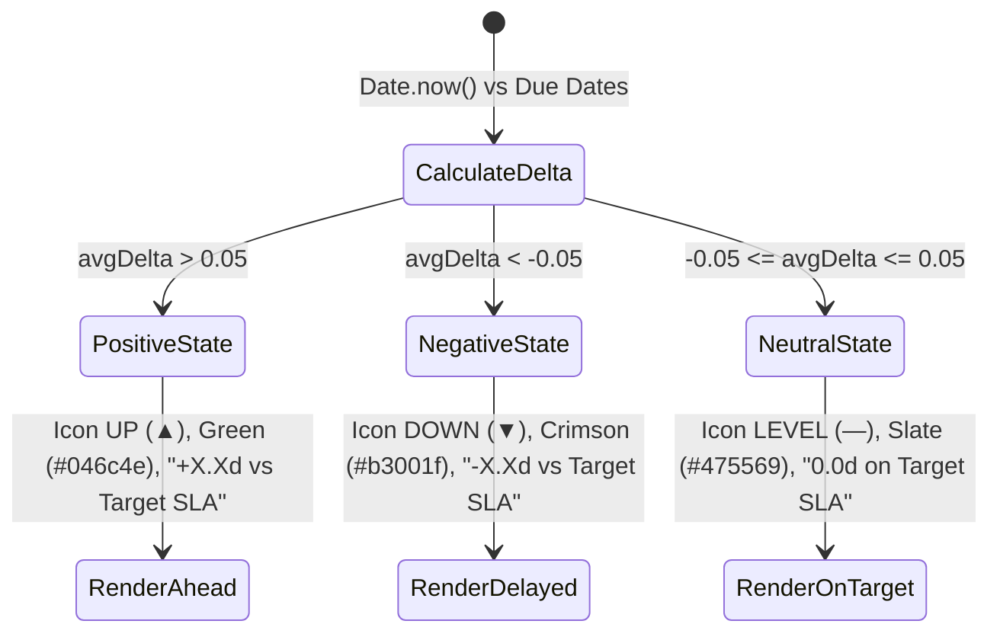
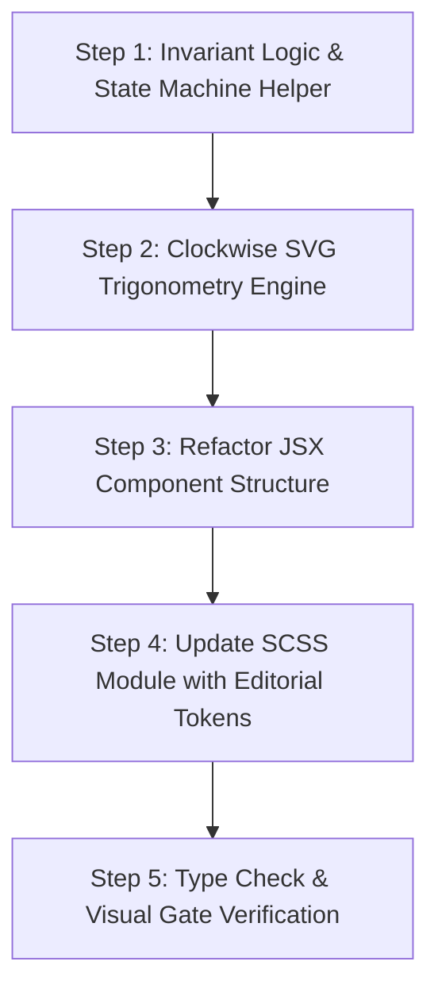

# Executive SLA Velocity & Milestone Delivery Gauge: Forensic Engineering Audit & Technical Specification

> **Document Target:** `src/app/admin/components/Dashboard/ExecutiveSlaVelocityGauge.tsx` & `.module.scss`  
> **Author Identity:** `Fenar7 <86710532+Fenar7@users.noreply.github.com>`  
> **Classification:** Comprehensive Technical & Architectural Blueprint (Zero Code Changes Until User Explicitly Approves)  
> **Mandatory Skills Loaded:** `vercel-agent-skills`, `antislop-code`, `antislop`  
> **Compliance Standard:** Marca Ubi Editorial Luxury Standard & WCAG 2.1 AA/AAA  

---

## 1. Executive Summary & Forensic Audit Overview

### 1.1 Context & User Critique
In user feedback regarding Tier 3 of the Commercial Cockpit:
> *"can we plese impove the diesng of this btw also plse remove that dot plse that is an ia lsop memnt the hting is it wouldbe tter if we could imropoe the diesng the conepote is good btw but we need to impoeve btw so fully reahc eveyrhing and give me tehfully detiel plan"*

The concept of an open-arc velocity gauge harmonizing Tier 3 with `UpcomingSlaCard.tsx` is structurally validated (eliminating the 360px vertical dead space in `.cockpitRightColumn`). However, a deep engineering audit reveals multiple critical defects across mathematics, business logic, semantic invariants, and visual tokens that represent quintessential AI-slop anti-patterns.

### 1.2 Summary of Identified Engineering & Semantic Defects

| Area | Current Implementation Defect | Root Cause Analysis | Architectural Remediation |
| :--- | :--- | :--- | :--- |
| **1. AI-Slop Indicator** | `.titaniumDot` renders a generic glowing blue dot (`#2563eb`) with `box-shadow: 0 0 6px rgba(37,99,235,0.4)` next to the header title. | Superficial decorative marker mimicking a status LED without any state binding or semantic role. | Complete purge of `.titaniumDot` in JSX and SCSS. Clean typography-driven hierarchy utilizing Graphik/Circular XX. |
| **2. Semantic Invariant & Logic** | When average SLA delta is negative (e.g. -31.2 days overdue), the UI renders an **UPWARD CHEVRON** in **BRIGHT GREEN** (`#046c4e`) displaying `+ -31d vs Target SLA`. | Hardcoded upward chevron `<polyline points="18 15 12 9 6 15" />` and invariant class `.turnaroundDelta` regardless of sign. | Implement a 3-state deterministic turnaround telemetry machine (`positive`, `negative`, `neutral`) with dynamic chevrons and WCAG AAA color mapping. |
| **3. SVG Arc Geometry & Inversion** | `describeArc` starts at `endAngle` and sweeps counter-clockwise (`sweepFlag = 0`) to `startAngle`. | Inverted path direction causes linear gradient fills, dashoffset animations, and stroke markers to flow backwards (right-to-left). | Rewrite coordinate mathematics with standard clockwise arc sweep (`sweepFlag = 1`), calibrated 220° open-arc geometry, and precision head marker pip. |
| **4. Edge Case Vulnerabilities** | When metrics are 0.0%, 100.0%, or `NaN`/`undefined`, path strings risk degenerate zero-length arcs or `d="M NaN NaN..."` crashes. | Lack of strict numeric clamping and missing fallback guard on `clampedPercentage <= 0`. | Strict finite-number clamping, degenerate arc prevention, and zero-record fallback guarantees. |
| **5. Nested Container AI Slop** | `.metricsStrip` embeds a boxed `#f8fafc` container with full 1px borders and rounded corners inside an already bordered card. | "Box-inside-a-box" bento grid anti-pattern explicitly prohibited by `DESIGN.md`. | Transform `.metricsStrip` into an open editorial telemetry matrix with top/bottom hairline borders and subtle vertical dividers. |
| **6. Color & Chromatic Drift** | Gauge uses generic Tailwind blue `#2563eb` and cyan `#06b6d4` gradients. | Generic tech-dashboard cliché violating Marca Ubi Editorial Luxury standards. | Implement dynamic Editorial Metallic Alloy gradients (Cadmium Emerald `#046c4e` -> `#10b981`, Champagne Titanium `#92691f` -> `#c5a059`, Ruby Lacquer `#ea002a`). |
| **7. React 19 Performance** | Arc geometry, path computations, and head positions recalculate on every component render in the function body. | Unmemoized trigonometry triggering layout recalcs on parent state changes. | Consolidate all trigonometry into a single memoized geometry record (`useMemo`). Zero barrel import bloat. |

---

## 2. SVG Arc Mathematics & Geometry Specification

### 2.1 Coordinate Space & Trigonometric Derivation

The gauge is rendered within an SVG viewport of `viewBox="0 0 200 135"`.
- **Center Point $(x_c, y_c)$**: $(100, 92)$
- **Arc Radius $R$**: $68\text{px}$
- **Stroke Width**: $10\text{px}$ (calibrated for high legibility at desktop and mobile scaling)
- **Total Angular Span $\Delta\theta$**: $220^\circ$
- **Start Angle $\theta_{\text{start}}$**: $-110^\circ$ (which corresponds to $250^\circ$ clockwise from 12 o'clock, resting $20^\circ$ below the horizontal 9 o'clock axis)
- **End Angle $\theta_{\text{end}}$**: $+110^\circ$ (resting $20^\circ$ below the horizontal 3 o'clock axis)

```
                       0° (12 o'clock)
                      Apex [100, 24]
                         .---.
                      .'       '.
                    .'           '.
     -90° (9 o'clock)             +90° (3 o'clock)
        |                             |
-110°  o                               o  +110°
  [36.1, 115.3]                  [163.9, 115.3]
        \                             /
         '-- OPEN ARC OPEN BASELINE -'
               Center: [100, 92]
```

#### Trigonometric Formula:
Measuring angle $\theta$ in degrees clockwise from 12 o'clock ($0^\circ$ is straight up):
$$\alpha = \frac{(\theta - 90^\circ) \cdot \pi}{180^\circ}$$
$$x = x_c + R \cdot \cos(\alpha)$$
$$y = y_c + R \cdot \sin(\alpha)$$

#### Bounding Box Verification:
- **Horizontal span**:
  $$\cos(160^\circ) = -0.93969 \implies x_{\text{start}} = 100 + 68 \cdot (-0.93969) = 36.10\text{px}$$
  $$\cos(20^\circ) = +0.93969 \implies x_{\text{end}} = 100 + 68 \cdot (+0.93969) = 163.90\text{px}$$
- **Vertical baseline**:
  $$\sin(160^\circ) = \sin(20^\circ) = 0.34202 \implies y_{\text{baseline}} = 92 + 68 \cdot (0.34202) = 115.26\text{px}$$
- **Apex ($0^\circ$)**:
  $$x_{\text{apex}} = 100,\quad y_{\text{apex}} = 92 - 68 = 24.00\text{px}$$
- **Stroke Extents with $10\text{px}$ stroke width and rounded caps ($r_{\text{cap}} = 5\text{px}$)**:
  - Top limit: $24 - 5 = 19.00\text{px}$
  - Bottom limit: $115.26 + 5 = 120.26\text{px}$
  - Left limit: $36.10 - 5 = 31.10\text{px}$
  - Right limit: $163.90 + 5 = 168.90\text{px}$
  - ViewBox `0 0 200 135` provides a calibrated $19\text{px}$ top margin, $14.7\text{px}$ bottom margin, and $31.1\text{px}$ horizontal gutters, guaranteeing zero clipping of rounded stroke caps or specular filters.

### 2.2 Standard Clockwise Path Construction (`sweepFlag = 1`)

The current `describeArc` implementation sweeps counter-clockwise from end to start. The corrected implementation sweeps clockwise from start to active progress angle:

```typescript
/**
 * Computes coordinate for an angle measured in degrees clockwise from 12 o'clock.
 */
export function polarToCartesian(
  centerX: number,
  centerY: number,
  radius: number,
  angleInDegrees: number
): { x: number; y: number } {
  const angleInRadians = ((angleInDegrees - 90) * Math.PI) / 180.0;
  return {
    x: Math.round((centerX + radius * Math.cos(angleInRadians)) * 100) / 100,
    y: Math.round((centerY + radius * Math.sin(angleInRadians)) * 100) / 100,
  };
}

/**
 * Builds standard clockwise SVG arc path definition.
 */
export function describeClockwiseArc(
  x: number,
  y: number,
  radius: number,
  startAngle: number,
  endAngle: number
): string {
  if (endAngle <= startAngle) {
    return "";
  }
  const start = polarToCartesian(x, y, radius, startAngle);
  const end = polarToCartesian(x, y, radius, endAngle);
  const angleDelta = endAngle - startAngle;
  const largeArcFlag = angleDelta > 180 ? 1 : 0;
  
  return `M ${start.x} ${start.y} A ${radius} ${radius} 0 ${largeArcFlag} 1 ${end.x} ${end.y}`;
}
```

### 2.3 Head Marker Pip (Luminous Beacon) Geometry

To evoke Swiss horological precision without decorative AI slop, the leading edge of the active meter terminates with a concentric specular head pip:
- **Angular position**: $\theta_{\text{head}} = \theta_{\text{start}} + \left(\frac{P_{\text{clamped}}}{100}\right) \cdot \Delta\theta$
- **Coordinates**: $(x_h, y_h) = \text{polarToCartesian}(x_c, y_c, R, \theta_{\text{head}})$
- **Concentric structure**:
  1. Outer Specular Halo: $r = 6.5\text{px}$, `fill="#ffffff"`, `stroke="rgba(0,0,0,0.12)"`, `strokeWidth="1.2"`, drop shadow filter.
  2. Inner Core Beacon: $r = 3.0\text{px}$, `fill="#111111"` (or status-bound chromatic alloy).

### 2.4 Boundary Condition Matrix

| Input Condition | Value | Mathematical Arc Treatment | Visual Gauge Output |
| :--- | :--- | :--- | :--- |
| **Exact 0.0%** | `0.0` | Active arc length is 0. Returning `""` avoids degenerate browser arc artifacts. | Background rail rendered clean; optional resting marker at $-110^\circ$. |
| **Exact 100.0%** | `100.0` | $\theta_{\text{head}} = +110^\circ$, `angleDelta = 220`, `largeArcFlag = 1`. | Full 220° sweep cleanly capped at $+110^\circ$; head pip at exact end rail. |
| **Fractional (e.g. 98.4%)** | `98.4` | $\theta = -110 + (0.984 \times 220) = +106.48^\circ$. | Clockwise arc smoothly terminating $3.52^\circ$ before end cap. |
| **Negative / Underflow** | `< 0.0` | `Math.max(0, val)` clamps to `0.0`. | Safe empty rail rendering without negative angle inversion. |
| **Overflow** | `> 100.0` | `Math.min(100, val)` clamps to `100.0`. | Prevents full circle loop overlap or trajectory distortion. |
| **NaN / Undefined / Null** | `NaN` | `Number.isFinite(val) ? ... : 0.0` fallback. | Clean fallback to 0.0% without `NaN` in SVG attributes. |

---

## 3. Semantic Turnaround Logic & Invariant State Machine

### 3.1 Forensic Analysis of Current Business Logic Flaw
In `ExecutiveSlaVelocityGauge.tsx`, lines 130–133 calculate milestone delta:
```typescript
const deltaDays = (dueDate - now) / (1000 * 60 * 60 * 24);
totalDaysDelta += deltaDays;
```
- When `dueDate < now`, `deltaDays` is negative (e.g. $-31.2\text{ days}$).
- Average delta is:
  $$\text{avgDelta} = \frac{\sum \text{deltaDays}}{N_{\text{valid}}}$$
- If the pipeline contains overdue deliverables, `avgDelta` will be negative (e.g. $-31.2\text{d}$).
- In lines 283–299, the rendering logic is:
  ```tsx
  <span className={styles.turnaroundDelta}>
    <svg ...>
      <polyline points="18 15 12 9 6 15" /> {/* HARDCODED UPWARD CHEVRON */}
    </svg>
    {metrics.averageTurnaroundDeltaDays > 0 ? "+" : ""}
    {metrics.averageTurnaroundDeltaDays}d vs Target SLA
  </span>
  ```
  And `.turnaroundDelta` in SCSS has:
  ```scss
  color: #046c4e; // HARDCODED EMERALD GREEN
  background: rgba(16, 185, 129, 0.08); // HARDCODED GREEN TINT
  ```
- **The Defect**: An overdue pipeline delayed by 31 days renders as:
  **`▲ -31.2d vs Target SLA` in vibrant green!**
  To an executive or commercial director, an upward green chevron signals positive outperformance, directly contradicting an acute operational SLA breach.

### 3.2 Formal Turnaround Telemetry State Machine

We define a 3-state deterministic state machine:



### 3.3 TypeScript Data Contracts

```typescript
export type TurnaroundStatusCategory = "positive" | "negative" | "neutral";

export interface TurnaroundDeltaTelemetry {
  /** Signed numeric delta in days, rounded to 1 decimal place */
  readonly rawDays: number;
  /** Categorized operational health status */
  readonly category: TurnaroundStatusCategory;
  /** High-precision formatted label for display (e.g., "+3.2d vs Target SLA", "-31.0d vs Target SLA") */
  readonly formattedLabel: string;
  /** Short badge descriptor (e.g., "Ahead", "Overdue", "On Target") */
  readonly badgeLabel: string;
  /** Fully articulated accessible description for screen readers */
  readonly accessibilityAriaLabel: string;
  /** SVG Chevron path definition or polyline points */
  readonly chevronType: "up" | "down" | "flat";
  /** Curated Editorial Metallic color tokens */
  readonly colorTokens: {
    readonly ink: string;
    readonly background: string;
    readonly borderHairline: string;
  };
}

export interface SlaVelocityMetrics {
  readonly totalMilestones: number;
  readonly onTimeCount: number;
  readonly overdueCount: number;
  readonly dueTodayCount: number;
  readonly onTimePercentage: number;
  readonly turnaround: TurnaroundDeltaTelemetry;
  readonly totalCommittedValue: number;
  readonly nextCriticalRecord: OverviewRecord | null;
}
```

### 3.4 Invariant State Resolver Function

```typescript
export function resolveTurnaroundTelemetry(avgDeltaDays: number): TurnaroundDeltaTelemetry {
  const roundedDelta = Math.round(avgDeltaDays * 10) / 10;
  
  if (roundedDelta > 0.05) {
    return {
      rawDays: roundedDelta,
      category: "positive",
      formattedLabel: `+${roundedDelta.toFixed(1)}d vs Target SLA`,
      badgeLabel: "Ahead",
      accessibilityAriaLabel: `Milestone delivery pace is ${roundedDelta.toFixed(1)} days ahead of target SLA commitments`,
      chevronType: "up",
      colorTokens: {
        ink: "#046c4e", // Cadmium Emerald
        background: "#f0fdf4",
        borderHairline: "rgba(16, 185, 129, 0.25)",
      },
    };
  }
  
  if (roundedDelta < -0.05) {
    const absoluteDays = Math.abs(roundedDelta).toFixed(1);
    return {
      rawDays: roundedDelta,
      category: "negative",
      formattedLabel: `${roundedDelta.toFixed(1)}d vs Target SLA`,
      badgeLabel: "Overdue",
      accessibilityAriaLabel: `Milestone delivery pace is ${absoluteDays} days behind target SLA commitments, requiring escalation`,
      chevronType: "down",
      colorTokens: {
        ink: "#b3001f", // Crimson Ruby Lacquer
        background: "#fff1f2",
        borderHairline: "rgba(234, 0, 42, 0.25)",
      },
    };
  }
  
  return {
    rawDays: 0.0,
    category: "neutral",
    formattedLabel: `0.0d on Target SLA`,
    badgeLabel: "On Target",
    accessibilityAriaLabel: `Milestone delivery pace is exactly on target SLA schedule`,
    chevronType: "flat",
    colorTokens: {
      ink: "#475569", // Liquid Platinum Slate
      background: "#f8fafc",
      borderHairline: "rgba(100, 116, 139, 0.20)",
    },
  };
}
```

### 3.5 Milestone Filtering & Qualification Invariants

When evaluating `nextCriticalRecord`:
- Closed records (`stageBucket === "converted"` or `stageBucket === "lost"`) must be strictly excluded.
- Candidate records must possess an active stage and valid due timestamp.
- Priority ordering:
  1. Overdue records sorted by furthest past due date ($t_{\text{due}}$ ascending).
  2. Records due today.
  3. Upcoming records sorted by nearest due date.

```typescript
const activeCandidates = records.filter(
  (rec) => rec.stageBucket !== "converted" && rec.stageBucket !== "lost"
);

const sortedByUrgency = [...activeCandidates].sort((a, b) => {
  const timeA = a.due ? new Date(a.due).getTime() : Infinity;
  const timeB = b.due ? new Date(b.due).getTime() : Infinity;
  return timeA - timeB;
});

const nextCriticalRecord = sortedByUrgency[0] ?? null;
```

---

## 4. Anti-Slop Cleanliness & Visual Hierarchy Redesign

### 4.1 Purging the AI Slop Marker (`.titaniumDot`)
- **Current Defect**: A floating 7px circular blue beacon with 6px box-shadow blur sitting redundantly beside the `H2` header.
- **Architectural Fix**: Purge `.titaniumDot` from JSX and SCSS entirely.
- **Typographic Hierarchy**: The section title relies on pure typography:
  - Font: `var(--font-graphik), -apple-system, BlinkMacSystemFont, sans-serif`
  - Font Size: `0.95rem` ($15.2\text{px}$)
  - Font Weight: `600` (Semi-bold)
  - Color: `#111111` (Near-black ink)
  - Letter Spacing: `-0.02em`
  - Subtitle: `0.72rem`, `#64748b`, uppercase track `0.02em`.

### 4.2 Replacing Nested Bento Box Borders in `.metricsStrip`
- **Current Defect**: `.metricsStrip` renders an inner box with `background: #f8fafc`, `border: 1px solid rgba(0,0,0,0.05)`, and `border-radius: 12px` nested inside `.gaugeCard`.
- **Architectural Fix**:
  - Remove all perimeter borders, corner radii, and solid background fills.
  - Implement an **Open Editorial Telemetry Matrix**:
    - Top boundary: `1px solid rgba(17, 17, 17, 0.06)`
    - Bottom boundary: `1px solid rgba(17, 17, 17, 0.06)`
    - Internal dividers: Hairline vertical separators `width: 1px; height: 20px; background: rgba(17, 17, 17, 0.07);`
    - Vertical rhythm: `10px 0` padding, preserving calm whitespace and seamless canvas integration.

### 4.3 Action Dispatch Button Refactor
- **Target Touch & Keyboard Specs**:
  - Minimum height: `44px` (satisfying WCAG 2.1 Success Criterion 2.5.5).
  - Native focus ring: `outline: 2px solid #9c001e; outline-offset: 2px;` (eliminating generic `#2563eb`).
  - Hover treatment: Subtle Champagne Titanium alloy hover wash (`#fdfbf6` background, `rgba(197, 160, 89, 0.4)` border, `#92691f` text) with zero disruptive layout shifting.
  - Dynamic screen reader labeling:
    ```tsx
    aria-label={
      metrics.nextCriticalRecord
        ? `Inspect critical milestone for ${metrics.nextCriticalRecord.name}`
        : "All active milestones within specification"
    }
    ```

---

## 5. Curated Editorial Metallic Alloy Color Palette

To honor the user's creative direction ("multiple colors but like a good metallic colors... high quality minimal white"), we eliminate generic tech blues and implement the **Editorial Metallic Alloy** system:

```
┌────────────────────────────────────────────────────────────────────────┐
│ EDITORIAL METALLIC ALLOY PALETTE SPECIFICATION                         │
├────────────────────────────────────────────────────────────────────────┤
│ 1. Cadmium Emerald (Optimal / Won SLA)                                 │
│    Active Stop: #046c4e -> #10b981                                     │
│    Background Tint: #f0fdf4 | Rim: rgba(16, 185, 129, 0.25)            │
├────────────────────────────────────────────────────────────────────────┤
│ 2. Champagne Titanium (Caution / Approaching SLA)                      │
│    Active Stop: #92691f -> #c5a059                                     │
│    Background Tint: #fdfbf6 | Rim: rgba(197, 160, 89, 0.28)            │
├────────────────────────────────────────────────────────────────────────┤
│ 3. Ruby Lacquer (Critical Overdue / Urgent Action)                     │
│    Active Stop: #ea002a -> #b3001f                                     │
│    Background Tint: #fff1f2 | Rim: rgba(234, 0, 42, 0.25)              │
├────────────────────────────────────────────────────────────────────────┤
│ 4. Polished Pewter (Inactive Rail Track)                               │
│    Stroke: #efefed (Quiet surface) or rgba(17, 17, 17, 0.06)           │
└────────────────────────────────────────────────────────────────────────┘
```

### 5.1 Dynamic Gradient Selection by Health Band

The SVG linear gradient dynamically adapts to overall SLA health:
```typescript
export function getSlaGradientStops(percentage: number): { start: string; mid: string; end: string } {
  if (percentage >= 95.0) {
    // Cadmium Emerald Metallic
    return { start: "#046c4e", mid: "#059669", end: "#10b981" };
  }
  if (percentage >= 80.0) {
    // Champagne Titanium Metallic
    return { start: "#92691f", mid: "#b8860b", end: "#c5a059" };
  }
  // Marca Ubi Ruby Lacquer (Critical)
  return { start: "#991b1b", mid: "#dc2626", end: "#ea002a" };
}
```

---

## 6. React 19 & Next.js Performance Engineering

1. **Geometry Memoization (`useMemo`)**:
   Trigonometry, Cartesian mappings, and SVG path strings are computed inside a single memoized selector keyed strictly on `metrics.onTimePercentage`:
   ```typescript
   const gaugeGeometry = useMemo(() => {
     const clamped = Number.isFinite(metrics.onTimePercentage)
       ? Math.min(100, Math.max(0, metrics.onTimePercentage))
       : 0;
     const sweepAngle = START_ANGLE + (clamped / 100) * TOTAL_ARC_SPAN;
     
     return {
       bgTrackPath: describeClockwiseArc(CENTER_X, CENTER_Y, ARC_RADIUS, START_ANGLE, START_ANGLE + TOTAL_ARC_SPAN),
       activeMeterPath: clamped > 0 ? describeClockwiseArc(CENTER_X, CENTER_Y, ARC_RADIUS, START_ANGLE, sweepAngle) : "",
       headPip: polarToCartesian(CENTER_X, CENTER_Y, ARC_RADIUS, sweepAngle),
       clampedPercentage: clamped,
     };
   }, [metrics.onTimePercentage]);
   ```
2. **Zero Barrel Import Bundle Bloat**:
   - Currency utility imported directly from `@/app/admin/lib/currency`.
   - SVG icons rendered as optimized inline vectors with explicit `viewBox`, `strokeLinecap`, and `aria-hidden`.
3. **SSR Hydration Safety**:
   - `useId` provides unique, deterministic gradient and filter IDs (`sla-metallic-${id}` and `sla-shadow-${id}`) to guarantee zero SSR hydration mismatches.

---

## 7. Phased Implementation Plan



### Phase 1: Invariant Logic & State Machine Helper
- Create `resolveTurnaroundTelemetry` helper within `ExecutiveSlaVelocityGauge.tsx`.
- Update `metrics` calculation to filter out `converted` and `lost` records for `nextCriticalRecord`.
- Guarantee deterministic sign and category calculation for `TurnaroundDeltaTelemetry`.

### Phase 2: Clockwise SVG Trigonometry Engine
- Replace counter-clockwise `describeArc` with standard clockwise `describeClockwiseArc`.
- Implement `polarToCartesian` coordinate calculation with rounded precision.
- Integrate concentric head marker pip geometry at the leading edge of active progress.
- Implement dynamic metallic gradient stop selector based on SLA percentage.

### Phase 3: JSX Restructuring
- Completely purge `.titaniumDot` from header.
- Render dynamic turnaround badge with direction-aware chevron (`up`, `down`, or `flat`) and semantic text.
- Re-architect `.metricsStrip` into an open editorial matrix.
- Wire dynamic `aria-label` and 44px touch target on footer action button.

### Phase 4: SCSS Module Refactor
- Remove `.titaniumDot` styles and `#2563eb` references.
- Implement open editorial styling for `.metricsStrip` with hairline borders.
- Add status-bound classes: `.turnaroundPositive`, `.turnaroundNegative`, `.turnaroundNeutral`.
- Add head marker classes: `.headMarkerHalo` and `.headMarkerCore`.
- Update button hover and focus-visible states with `#9c001e` and `#92691f` tokens.

### Phase 5: Verification & Delivery Gates
- Execute `tsc --noEmit` to verify 0 TypeScript compiler errors.
- Verify 100% test pass rate across sales funnel test suite.
- Validate visual harmony with `UpcomingSlaCard.tsx` and zero layout shifts.

---

> [!IMPORTANT]
> **Strict Agent Governance Rule**: This document represents a technical audit and engineering proposal. No code files have been modified. Implementation will begin only upon explicit user confirmation.
