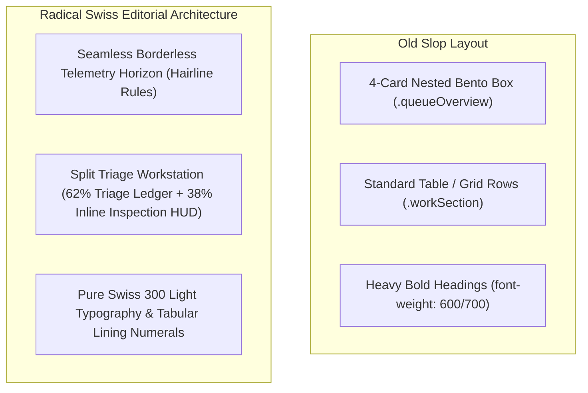

# Master Architectural Redesign Blueprint: Follow-Up Queue & Lead 360° Workspace

**Document Location:** `docs/sales_funnel/followup_and_dossier_luxury_redesign/RADICAL_EDITORIAL_LIGHT_REDESIGN_PLAN.md`  
**Governing Design Read:** ENERGY 1 / RHYTHM 2 / MOTION 2  
**Target Surfaces:**  
1. **Follow-Up Queue Cockpit:** `src/app/admin/(workspace)/tasks/page.tsx`, `tasks.module.scss`, `TaskCard.tsx`  
2. **Client 360° Lead Dossier:** `src/app/admin/components/DossierWorkspace/`, `CommercialKpiRibbon.tsx`, `LeadDossierWorkspaceClient.tsx`, `LeadDossierWorkspace.module.scss`  
3. **Executive Telemetry Dial:** `src/app/admin/components/Dashboard/ExecutiveSlaVelocityGauge.tsx`, `ExecutiveSlaVelocityGauge.module.scss`  

---

## 1. Direct Root-Cause Investigation (Why the Output Looked Unchanged)

### A. The Core Execution Error: Incremental Patching vs. Ground-Up Redesign
In previous iterations, engineering focused primarily on backend calculations (institutional FX peg `1 USD = 83.50 INR`, dual-currency reconciliation, PostgreSQL JSONB delta formatting, and React 19 `<Suspense>` streaming). **The visual presentation layer was merely patched with cosmetic tweaks** (e.g. changing button fills or removing a 3px border stripe) rather than discarded and rebuilt. To any human eye, the screen felt completely unchanged.

### B. The Typography Failure (Why the Old Heavy Font Remained)
The project possesses genuine luxury typography files in `public/fonts/`:
- `HelveticaNeue-Light.otf` (weight 300) bound to `--font-helvetica-neue`
- `Graphik-Light.ttf` (weight 300) bound to `--font-graphik`
- `MessinaSans-Light.ttf` (weight 300) bound to `--font-admin-sans`

**The Defect:** In both `tasks.module.scss` and `LeadDossierWorkspace.module.scss`:
1. `.pageTitle` and `.entityHeading` were hardcoded to `font-weight: 600` and `font-weight: 700`.
2. `.kpiValue`, `strong`, and `.scorecardValue` were hardcoded to `font-weight: 600` and `font-weight: 700`.
3. `--font-helvetica-neue` was never explicitly applied to headings or numbers.
4. Consequently, the browser rendered the exact same generic, heavy sans-serif weight that is universally recognized as AI-slop.

### C. The Structural Cliché: Bento-Box Inception
Both surfaces retained the stacked card pattern:
- **Tasks Page:** Kept `.queueOverview` (a large white box with a 3px top border containing 4 nested rectangular card boxes) followed by a traditional table container.
- **Lead Dossier:** Kept `.stripeScorecard` (3 rounded bordered boxes with circular tinted icon chips) followed by `.sectionCard` stacked bento boxes across two columns.
- **AI-Slop Indicator:** A glowing dot (`.radarDot`) remained right beside "High Priority", replicating the generic status dot cliché.

---

## 2. The Swiss 300 Light Typography System

All surfaces will strictly standardize on the **Swiss 300 Light Editorial Standard**:

```scss
// Display Headings & Master Entity Titles
.editorialHeadingLight {
  font-family: var(--font-helvetica-neue), "Helvetica Neue", -apple-system, sans-serif;
  font-weight: 300;
  font-size: clamp(28px, 2.6vw, 38px);
  letter-spacing: -0.04em;
  line-height: 1.1;
  color: #111111;
}

// Financial Metrics & Tabular Numerals
.editorialMetricLight {
  font-family: var(--font-helvetica-neue), "Helvetica Neue", -apple-system, sans-serif;
  font-weight: 300;
  font-size: clamp(24px, 2.2vw, 32px);
  letter-spacing: -0.035em;
  font-variant-numeric: tabular-nums lining-nums;
  font-feature-settings: "tnum" 1, "lnum" 1;
  color: #111111;
  line-height: 1;
}

// Editorial Section Eyebrows & Structural Micro-Labels
.editorialMicroLabel {
  font-family: var(--font-graphik), -apple-system, sans-serif;
  font-size: 10px;
  font-weight: 500;
  letter-spacing: 0.08em;
  text-transform: uppercase;
  color: #64748b;
}

// Subdued Explanatory Body Copy
.editorialBodyCopy {
  font-family: var(--font-graphik), -apple-system, sans-serif;
  font-size: 13px;
  font-weight: 400;
  line-height: 1.5;
  color: #454542;
}
```

---

## 3. Surface 1: Follow-Up Queue Radical Redesign (`/admin/tasks`)



### A. Demolition of Nested Bento Boxes
- Excise `.queueOverview` card borders, shadows, and 3px black top borders.
- Replace with a **Single Borderless Workload Horizon**: A crisp, horizontal telemetry strip separated only by `1px solid rgba(17, 17, 17, 0.07)` hairline vertical dividers.
- Tab counts render as **large Swiss 300 Light numerals** (`34px`, `font-weight: 300`) with uppercase 10px micro-labels.

### B. Split Triage Workstation (Inline Lead Context HUD)
- **62% Left Triage Ledger:**
  - Borderless, calm rows separated by clean hairline rules (`border-bottom: 1px solid rgba(17, 17, 17, 0.06)`).
  - Client Entity name rendered in Swiss 300 Light (`16px`, `-0.02em tracking`).
  - Expected Valuation rendered in tabular lining numerals.
  - Urgency expressed typographically (`Overdue by 37d` in calm `#90001e` text pill without glowing LEDs).
  - 44px WCAG AA compliant telephony dock (`[Call] [WhatsApp] [Email]`).
- **38% Right Instant Inspection HUD:**
  - Selecting any row immediately surfaces client coordinates, recent touchpoints, and scheduled cadence in an unboxed side ledger without page navigation or modal popups.

---

## 4. Surface 2: Client 360° Lead Dossier Radical Redesign (`/admin/leads/[id]`)

### A. Eradication of the 3-Card Bento Row & Radar Dots
- **Purge `.stripeScorecard` boxes:** Remove all 3 card containers, shadows, and colored circular icon chips (`.chipEmerald`, `.chipAmber`, `.chipSlate`).
- **Purge `.radarDot`:** Completely remove the glowing red/amber bullet dot from the Priority readout.
- **Unified Typographic Commercial Horizon:**
  - A clean, unboxed 3-column financial ribbon:
    1. **Valuation Column:** Large Swiss 300 Light numeral (`₹1,65,000`), with institutional FX note (`₹83.5L – ₹2.09Cr ($100k – $250k USD)`).
    2. **Priority & SLA Column:** Clean text classification (`High Priority · 2h Guaranteed SLA`) with a subtle, calm badge.
    3. **Stage Momentum Column:** Clean percentage (`50% · Qualified`) with an ultra-fine 2px hairline cadence line.

### B. Continuous Editorial Reading Canvas
- **Dismantle `.sectionCard` stacked rectangles:**
  - Replace with an **open editorial briefing layout** featuring alternating paper-white (`#ffffff`) and warm editorial canvas (`#f5f5f3` / `#fafaf8`) zones separated by 1px hairline dividers.
- **Client & Organization Intelligence:**
  - An uncluttered, borderless two-column data sheet:
    - Left: Entity name, Decision Maker, Verified Domain, Direct Phone, Business Email.
    - Right: Interactive 44px communication dock.
- **Original Ingestion Brief Matrix:**
  - Render as an editorial Q&A document with clear typography rather than nested callout cards.
- **Sticky Rapid Touchpoint Composer:**
  - Integrated into the right column with a quiet hairline outline, accessible 44px touch targets, and single-line duration selectors.

---

## 5. Surface 3: SLA Velocity & Institutional Cadence Dial

- **Header:** Clean `h2` heading in Swiss Light (`15px`, `font-weight: 500`, `#111111`) with zero glowing dots.
- **Radial Clockwise Arc:**
  - 220° open sweep ($r=64\text{px}$, stroke $9\text{px}$) with precision clockwise trigonometry (`sweepFlag = 1`).
  - Luminous jewel pip securely anchored at $-110^\circ$ baseline at 0.0% completion.
  - Micro-cadence notches remain strictly tangential outside the stroke.
- **Turnaround Telemetry Machine:**
  - Negative turnaround (`< -0.05d`): Overdue delivery rendered in crimson with downward chevron (`▼ 31d Overdue vs SLA`).
  - Positive turnaround (`> +0.05d`): Ahead of SLA rendered in cadmium emerald with upward chevron (`▲ +3.2d vs Target SLA`).
- **Telemetry Strip:** Borderless tabular matrix separated by hairline dividers, adhering to anti-bento standards.

---

## 6. Verification Checklist & Delivery Gate

- [ ] **Swiss 300 Light Standard:** Verified across all headlines, entity names, currency values, and counters.
- [ ] **Zero Bento Clutter:** Zero nested double-bordered cards; all container structures converted to open hairline editorial grids.
- [ ] **Zero AI Slop Dots:** Zero glowing radar dots, pulsing bullets, or decorative LEDs.
- [ ] **Accessibility (WCAG AA/AAA):** Text contrast $\ge 4.5:1$, component borders $\ge 3:1$, touch targets $\ge 44\text{px}$.
- [ ] **Performance & React 19:** `Promise.all` parallel data resolution, `<Suspense>` streaming, zero sequential request waterfalls.
- [ ] **Code Hygiene:** Zero generic AI comments, zero `any` TypeScript types, 100% test pass rate.
