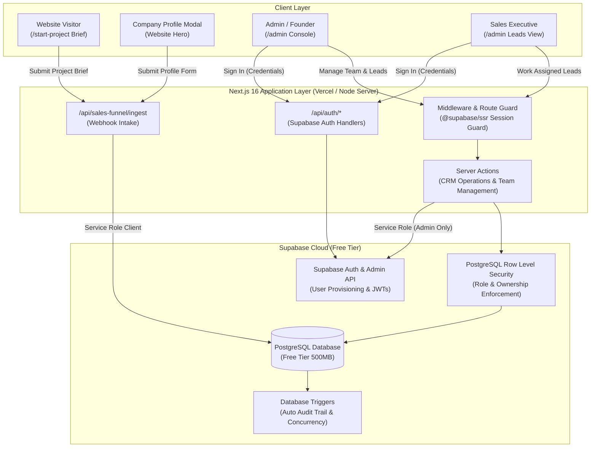
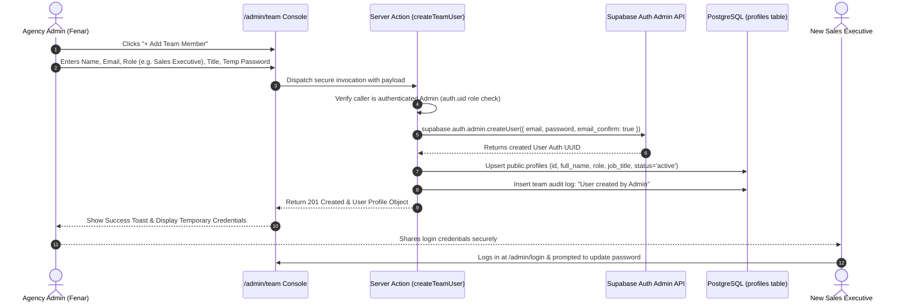
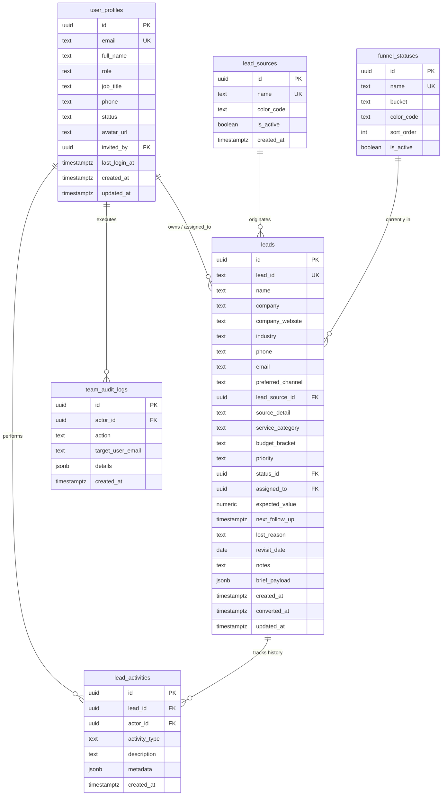
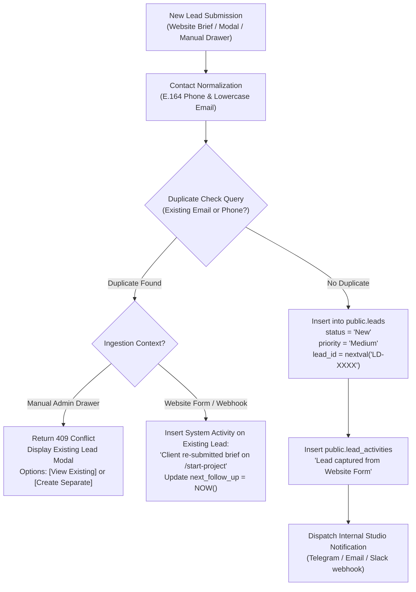

<style>
  @media print {
    body {
      font-family: -apple-system, BlinkMacSystemFont, "Segoe UI", Roboto, Helvetica, Arial, sans-serif;
      font-size: 9.5pt;
      line-height: 1.45;
      color: #111;
    }
    h1, h2, h3, h4 {
      color: #0b0b0b;
      page-break-after: avoid;
    }
    h1 { font-size: 19pt; margin-bottom: 0.4rem; }
    h2 { font-size: 13.5pt; border-bottom: 1.5px solid #ff6100; padding-bottom: 3px; margin-top: 1.4rem; }
    h3 { font-size: 10.5pt; margin-top: 1.1rem; }
    table {
      width: 100%;
      border-collapse: collapse;
      margin: 0.8rem 0;
      font-size: 8.5pt;
      page-break-inside: avoid;
    }
    th, td {
      border: 1px solid #ddd;
      padding: 5px 8px;
      text-align: left;
    }
    th {
      background-color: #f7f7f7;
      font-weight: 600;
    }
    .page-break {
      page-break-after: always;
      break-after: page;
    }
    pre, code {
      font-family: ui-monospace, SFMono-Regular, Menlo, Monaco, Consolas, monospace;
      font-size: 8pt;
      background: #f4f4f4;
      border-radius: 4px;
    }
    pre {
      padding: 8px;
      border: 1px solid #e0e0e0;
      page-break-inside: avoid;
    }
  }
</style>

# Marca Ubi — Enterprise Agency CRM & Sales Intelligence Platform
## Production Architecture & Comprehensive Implementation Specification
**Document ID:** `SPEC-MARCA-CRM-2026-ENTERPRISE`  
**Target Release:** Production Phase 1 (Enterprise-Grade MVP)  
**Primary Stack:** Next.js 16 (App Router, Turbopack, React 19) + Supabase Cloud (PostgreSQL 15+, Supabase Auth Admin SDK, Row Level Security)  
**Document Author:** Principal Systems Architect & Senior Creative Engineering Team  
**Created:** October 15, 2026 | **Classification:** Highly Confidential / Internal Commercial Engineering Blueprint  

---

### Executive Document Summary

| Property | Value |
|---|---|
| **Project Name** | Marca Ubi In-House Agency CRM & Sales Pipeline Portal |
| **System Code** | `marca-agency-crm` |
| **Target Audience** | Executive Leadership, Agency Directors, Sales Managers, Account Executives, Systems Engineers |
| **Backend Engine** | Supabase Cloud (Free Tier Managed PostgreSQL 15+ with Connection Pooling & Supabase Admin SDK) |
| **Frontend Framework** | Next.js 16.1.6 App Router, React 19, SCSS Modules (Marca Ubi Luxury Brand Tokens: `$black`, `$white`, `$cta-orange`) |
| **Security Architecture**| Database-Level Row Level Security (RLS) + HttpOnly Secure JWT Session Cookies (`@supabase/ssr`) |
| **Team Management** | Multi-User Admin Console (`/admin/team`) with In-App User Provisioning, Role Scoping & Reassignment Wizard |
| **Primary Ingestion** | Public Website Brief Form (`/start-project`), Modal (`CompanyProfileModal`), Direct CRM Fast Drawer |
| **Quality Engineering** | Automated E2E & RLS Testing Suite, Database Triggers for Immutable Audit Trails, ACID Transaction Safety |

<div class="page-break" style="page-break-after: always;"></div>

## Table of Contents

1. [Executive Overview & Strategic Business Objectives](#1-executive-overview--strategic-business-objectives)
2. [High-Level System Architecture & Topology](#2-high-level-system-architecture--topology)
3. [User Roles, RBAC & Multi-User Governance Engine](#3-user-roles-rbac--multi-user-governance-engine)
4. [CRM Client 360° & Funnel Pipeline State Machine](#4-crm-client-360-and-funnel-pipeline-state-machine)
5. [Relational Database Schema, Triggers & Data Modeling](#5-relational-database-schema-triggers--data-modeling)
6. [Security Architecture & Row Level Security (RLS) Policies](#6-security-architecture--row-level-security-rls-policies)
7. [Lead Ingestion Engine, Normalization & Deduplication](#7-lead-ingestion-engine-normalization--deduplication)
8. [Admin Panel UI/UX & Interactive Component Wireframes](#8-admin-panel-uiux--interactive-component-wireframes)
9. [Edge Cases, Error Handling & System Resilience](#9-edge-cases-error-handling--system-resilience)
10. [Internal API & Server Actions Contract](#10-internal-api--server-actions-contract)
11. [Comprehensive 10-Phase Production Engineering Delivery Blueprint](#11-comprehensive-10-phase-production-engineering-delivery-blueprint)
12. [Quality Assurance, Automated Testing & Verification Suite](#12-quality-assurance-automated-testing--verification-suite)

---

<div class="page-break" style="page-break-after: always;"></div>

## 1. Executive Overview & Strategic Business Objectives

### 1.1 The Agency Problem Statement: The Cost of Fragmented Pipelines
High-growth creative design, branding, and digital product consultancies suffer from **fragmented commercial intelligence**:
- High-value commercial inquiries arrive through multiple uncoordinated touchpoints: the website brief builder (`/start-project`), company profile discovery modals, direct WhatsApp messages, founder phone calls, client referrals, and industry events.
- Commercial opportunities are tracked across disconnected spreadsheets, Notion tables, paper notebooks, or personal chat threads.
- Sales ownership is vague: deals lack explicit assignees, follow-up deadlines are routinely missed, and high-margin creative pitches stall without executive visibility.
- Managing Directors and Growth Leads cannot accurately measure deal velocity, individual sales executive performance, channel ROI, or conversion drop-offs without manual, hours-long spreadsheet reconciliation.

### 1.2 The Core Value Proposition: A Dedicated In-House Agency CRM
The **Marca Ubi Agency CRM & Sales Funnel Platform** transforms our client acquisition process into a synchronized, single-source-of-truth command center. Every prospective client is captured, categorized by service interest, prioritized by commercial value, assigned to a dedicated team member, and systematically nurtured from initial brief to signed service contract.

### 1.3 Key Architectural Pillars for the Enterprise MVP
1. **Multi-User Provisioning & Team Administration**: The platform is not a single-user tool. Admins can create and invite team members (Sales Managers, Sales Executives, Viewers), manage role assignments, track individual sales workloads, and smoothly reassign accounts when team members transition.
2. **Contact & Company 360° Profile**: Every lead stores enriched commercial context—organization name, company website, industry domain, service category (Branding, Web Development, UI/UX, Performance Marketing), estimated budget bracket, and primary communication channel.
3. **Omnichannel Touchpoint Timeline**: An immutable chronological audit ledger tracking every status change, call log, WhatsApp dispatch, discovery meeting note, and follow-up reminder.
4. **PostgreSQL RLS Data Isolation**: Sales Executives view only their assigned commercial accounts, protecting sensitive agency pipelines while providing Sales Managers and Admins global oversight.
5. **Database-Level Integrity Triggers**: Audit logs and timestamp updates are managed at the PostgreSQL trigger level, preventing client applications from bypassing compliance and history tracking.

### 1.4 MVP vs Post-MVP Scope Boundaries

```
┌────────────────────────────────────────────────────────────────────────┐
│                   ENTERPRISE PHASE 1 (MVP) SCOPE                       │
├────────────────────────────────────────────────────────────────────────┤
│  ✓ Supabase PostgreSQL Schema with Sequences, Triggers & Constraints   │
│  ✓ Supabase Auth with Cookie Sessions & Role-Based RLS (@supabase/ssr) │
│  ✓ Multi-User Team Management Console (/admin/team):                   │
│     - In-App User Creation (Email, Temporary Password, Role, Title)    │
│     - User Role Management & Active/Suspended Status Toggles           │
│     - Automated Lead Reassignment Wizard on User Deactivation          │
│  ✓ 4-Bucket Funnel Pipeline (Open, Potential, Converted, Lost)         │
│  ✓ Client 360° Dossier (Company, Contacts, Budget, Service Interests)  │
│  ✓ Ingestion Webhook from /start-project & CompanyProfileModal         │
│  ✓ Real-Time KPI Ribbon (Pipeline Value, Conversion %, Overdue Tasks)  │
│  ✓ High-Performance Leads Table with Search, Multi-Filter & Pagination │
│  ✓ Add/Edit Lead Drawer with Real-Time Duplicate Phone/Email Checks    │
│  ✓ Inline Quick Status & Priority Toggles with Optimistic UI           │
│  ✓ Omnichannel Touchpoint & Activity Audit Timeline                    │
│  ✓ Automated E2E & RLS Test Suite (Playwright + Vitest)                │
└────────────────────────────────────────────────────────────────────────┘
                                   │
                                   ▼
┌────────────────────────────────────────────────────────────────────────┐
│                        POST-MVP (PHASES 2 & 3)                         │
├────────────────────────────────────────────────────────────────────────┤
│  ○ Full-Scale CSV/Excel Bulk Importer with Interactive Column Mapping  │
│  ○ Automated WhatsApp Business API & Drip Email Automations            │
│  ○ Third-Party Sync (HubSpot, Google Calendar, Notion Database)        │
│  ○ Automated PDF Commercial Proposal & Invoicing Engine                │
│  ○ AI-Powered Lead Scoring & Predictive Revenue Forecasting            │
└────────────────────────────────────────────────────────────────────────┘
```

---

<div class="page-break" style="page-break-after: always;"></div>

## 2. High-Level System Architecture & Topology

### 2.1 Architectural Flow Diagram



### 2.2 Technology Stack Breakdown

1. **Database & Persistence: Supabase Cloud Managed PostgreSQL 15+**
   - Free tier compliant (utilizes < 50MB of the 500MB storage ceiling for initial 25,000 leads and team logs).
   - Native JSONB columns for dynamic brief answers, technical requirements, and audit diffs.
   - Database-level sequences (`nextval('lead_code_seq')`) guaranteeing atomic, human-readable identifiers (`LD-1001`).
   - Declarative PostgreSQL Row Level Security (RLS) ensuring strict multi-tenant data boundaries.
   - Database triggers for automated audit logging, updating timestamps, and preventing orphaned accounts.

2. **Authentication & User Management: Supabase Auth + Supabase Admin SDK**
   - Eliminates custom password hashing and security vulnerabilities.
   - HttpOnly secure cookie-based session tokens utilizing `@supabase/ssr` with Next.js 16 App Router middleware.
   - Supabase Admin SDK (`supabase.auth.admin.createUser`) executing in secure Server Actions, allowing Admins to provision team members without public signup loopholes.

3. **Frontend Application: Next.js 16 App Router (Turbopack, React 19)**
   - React Server Components (RSC) for fast initial table rendering and KPI calculations.
   - Client Component islands for real-time search, filter pills, drawer state, and optimistic status updates.
   - Custom SCSS Modules strictly matching Marca Ubi's dark luxury visual identity (hairline borders, `$cta-orange` `#ff6100` accents, tabular numerals, `$font-movatif` headings).

---

<div class="page-break" style="page-break-after: always;"></div>

## 3. User Roles, RBAC & Multi-User Governance Engine

### 3.1 Persona Profiles & Hierarchy

```
┌─────────────────────────────────────────────────────────────┐
│                    ADMIN (Founders / Ops)                   │
│   • Full System Access   • User Creation & Role Provisioning│
│   • Global Pipeline View • Permanent Delete & Config Control│
└──────────────────────────────┬──────────────────────────────┘
                               │
                               ▼
┌─────────────────────────────────────────────────────────────┐
│               SALES MANAGER (Growth Director)               │
│   • Global Pipeline View  • Lead Assignment & Reallocation  │
│   • Team Workload Insights • Stage Transitions & Deal Edits │
└──────────────────────────────┬──────────────────────────────┘
                               │
                               ▼
┌─────────────────────────────────────────────────────────────┐
│             SALES EXECUTIVE (Account Closers)               │
│   • Isolated Pipeline: View & Edit ONLY Assigned Leads      │
│   • Log Touchpoints (Calls, WhatsApp, Meetings, Notes)      │
│   • Advance Deal Stages   • Cannot Reassign or Delete Deals │
└──────────────────────────────┬──────────────────────────────┘
                               │
                               ▼
┌─────────────────────────────────────────────────────────────┐
│                  VIEWER / AUDITOR (Finance)                 │
│   • Read-Only Inspection  • No Edit / No Create Permissions │
└─────────────────────────────────────────────────────────────┘
```

### 3.2 Granular Permissions Matrix

| Functional Capability | Admin | Sales Manager | Sales Executive | Viewer |
|---|:---:|:---:|:---:|:---:|
| **Access Admin Panel (`/admin`)** | Yes | Yes | Yes | Yes |
| **View Team Roster (`/admin/team`)** | Yes | Yes (View Only) | No | No |
| **Create / Provision New Users** | Yes | No | No | No |
| **Edit User Roles / Deactivate Users** | Yes | No | No | No |
| **View Global KPI Ribbon (Studio Totals)** | Yes | Yes | No (Own Stats) | Yes (Read Only) |
| **View Global Leads Table (All Assignees)**| Yes | Yes | No (Assigned Only) | Yes (Read Only) |
| **Create New Lead Manually (Drawer)** | Yes | Yes | Yes (Auto-assigned) | No |
| **Edit Lead Details (Company, Contact)** | Yes | Yes | Yes (Own Leads) | No |
| **Update Funnel Stage / Priority** | Yes | Yes | Yes (Own Leads) | No |
| **Mark Lead as `Lost` (Requires Reason)** | Yes | Yes | Yes (Own Leads) | No |
| **Mark Lead as `Converted`** | Yes | Yes | Yes (Own Leads) | No |
| **Reassign Lead to Another Rep** | Yes | Yes | No | No |
| **Bulk Lead Reassignment on Offboarding**| Yes | Yes | No | No |
| **Permanently Delete Lead Record** | Yes | No | No | No |
| **Export Data to CSV / Excel** | Global | Global | Own Leads | No |
| **Inspect Omnichannel Activity Trail** | All Leads | All Leads | Own Leads | All Leads |

<div class="page-break" style="page-break-after: always;"></div>

### 3.3 Multi-User Provisioning & Lifecycle Workflow

To maintain a secure, private agency portal, **public self-registration is strictly disabled**. All user accounts must be provisioned by an authenticated Admin from the Team Management console (`/admin/team`):



### 3.4 Team Member Offboarding & Lead Reassignment Protocol
When a sales executive resigns or transitions off the commercial desk:
1. **Never Hard Delete User**: Hard-deleting users from the database destroys audit integrity and breaks activity history foreign keys.
2. **Deactivation & Token Revocation**: The Admin sets the user's status to `suspended` in `public.profiles`. The server action immediately calls `supabase.auth.admin.signOut(userId)` to invalidate active JWT sessions.
3. **Automated Lead Reassignment Wizard**:
   - The UI automatically scans `public.leads` for active records assigned to the deactivated user (`WHERE assigned_to = target_user AND status.bucket != 'lost'`).
   - If active leads are found, the Admin is prompted to select a destination team member (e.g., Sales Manager or another Executive).
   - In a single atomic database transaction, all active leads are updated, and an audit activity (`"Lead reassigned from [Old Rep] to [New Rep] due to account deactivation"`) is appended to each lead.

---

<div class="page-break" style="page-break-after: always;"></div>

## 4. CRM Client 360° and Funnel Pipeline State Machine

### 4.1 Client 360° Profile Specification
In an agency context, a lead is an enterprise or commercial entity requiring custom digital transformation. The CRM models both the **Organization Profile** and the **Engagement Scope**:

```
┌────────────────────────────────────────────────────────────────────────┐
│                        CLIENT 360° DOSSIER                            │
├────────────────────────────────────────────────────────────────────────┤
│  🏢 ORGANIZATION & BRAND INTELLIGENCE                                  │
│     • Company Name: "Emaar Properties / Luxury Living"                 │
│     • Website / Domain: "https://emaar.com"                            │
│     • Industry: Real Estate & Luxury Hospitality                       │
│     • Commercial Tier: Tier 1 Enterprise (>$50K Budget)                │
│                                                                        │
│  👤 PRIMARY DECISION MAKER                                             │
│     • Full Name: "Zayd Al-Hadi"                                        │
│     • Designation: "VP of Brand Strategy"                              │
│     • Contact Channel: Phone (+971 50 123 4567) | WhatsApp Preferred   │
│     • Email: "zayd@emaar.ae"                                           │
│                                                                        │
│  🎨 ENGAGEMENT BRIEF & SCOPE                                           │
│     • Primary Service: High-Performance Web Hosting & Custom Next.js   │
│     • Secondary Service: Visual Identity & Interactive 3D WebGL        │
│     • Target Launch Timeline: Q2 2027 (Within 6 months)                │
│     • Budget Bracket: $25,000 - $50,000 (AED 90,000 - 185,000)        │
│                                                                        │
│  📊 COMMERCIAL HEALTH & VELOCITY                                       │
│     • Current Funnel Stage: Negotiation (Bucket: Potential)            │
│     • Priority: High (Orange Brand Token #ff6100)                      │
│     • Assigned Account Executive: Anita Nair                           │
│     • Next Scheduled Touchpoint: Oct 18, 2026 (Contract Review Call)   │
└────────────────────────────────────────────────────────────────────────┘
```

<div class="page-break" style="page-break-after: always;"></div>

### 4.2 State Machine Lifecycle Diagram

```mermaid
stateDiagram-v2
    [*] --> New: Ingested via Brief / Added Manually
    
    state "Bucket: OPEN" as OpenBucket {
        New --> Contacted: First Touch Completed (Call/WhatsApp)
        Contacted --> OnHold: Client Requests Pause (Budget/Seasonality)
        OnHold --> Contacted: Scheduled Revisit Date Reached
    }
    
    state "Bucket: POTENTIAL" as PotentialBucket {
        Contacted --> Qualified: Scope, Budget & Authority Verified
        Qualified --> ProposalSent: Scope Document & Commercial Pitch Sent
        ProposalSent --> Negotiation: Terms, Pricing & SLA Review
        Negotiation --> ProposalSent: Scope Revision Required
    }

    state "Bucket: CONVERTED" as ConvertedBucket {
        Negotiation --> Converted: Contract Executed & Retainer Paid
        ProposalSent --> Converted: Direct Acceptance
    }

    state "Bucket: LOST" as LostBucket {
        New --> Lost: Invalid Ingestion / Spam
        Contacted --> Lost: Unresponsive (4+ attempts)
        Qualified --> Lost: Budget Incompatible
        ProposalSent --> Lost: Selected Competitor
        Negotiation --> Lost: Terms Inflexible
    }

    Converted --> [*]: Closed Won (Record Locked)
    Lost --> [*]: Closed Lost (Reason Documented)
```

### 4.3 Comprehensive Status Specifications

| Status Name | Mapped Bucket | Transition Preconditions | Required Data on Entry | System Automations |
|---|:---:|---|---|---|
| **New** | `Open` | Lead created via webhook or manual drawer. | Name, Phone/Email, Source. | Sequence ID generated (`LD-XXXX`); notification logged. |
| **Contacted** | `Open` | First outreach logged (call, WhatsApp, email). | Contact method logged. | Activity record logged; `next_follow_up` prompted. |
| **On Hold** | `Open` | Client requests delayed review (e.g., Q3 budget freeze).| `revisit_date` *(Mandatory)*. | Overdue alerts paused until `revisit_date`. |
| **Qualified** | `Potential` | Verified genuine creative need, timeline, and decision maker. | `service_category`, `budget_bracket`. | Lead enters Potential Pipeline Value metrics. |
| **Proposal Sent** | `Potential` | Formal commercial pitch or design deck delivered. | `expected_value` *(Recommended)*. | Follow-up clock set to +3 business days. |
| **Negotiation** | `Potential` | Active terms, milestone, or contract discussions. | `expected_value` *(Mandatory)*. | Highlighted in executive pipeline summary. |
| **Converted** | `Converted` | Client executes agreement or remits initial deposit. | `converted_at` *(Auto)*, `expected_value` *(Final)*. | **Record is locked** from non-admin edits. Added to Studio Revenue. |
| **Lost** | `Lost` | Opportunity terminates without agreement. | `lost_reason` *(Mandatory Enum)*. | Removed from active follow-up queues. |

---

<div class="page-break" style="page-break-after: always;"></div>

## 5. Relational Database Schema, Triggers & Data Modeling

### 5.1 Entity-Relationship Diagram (ERD)



<div class="page-break" style="page-break-after: always;"></div>

### 5.2 PostgreSQL DDL Specification & Automated Triggers

```sql
-- Enable UUID extension
CREATE EXTENSION IF NOT EXISTS "uuid-ossp";

-- ============================================================================
-- 1. USER PROFILES TABLE (Mirrors Supabase auth.users & powers Team Management)
-- ============================================================================
CREATE TABLE public.profiles (
    id UUID PRIMARY KEY REFERENCES auth.users(id) ON DELETE CASCADE,
    email TEXT NOT NULL UNIQUE,
    full_name TEXT NOT NULL,
    role TEXT NOT NULL CHECK (role IN ('admin', 'sales_manager', 'sales_executive', 'viewer')),
    job_title TEXT NOT NULL DEFAULT 'Commercial Desk',
    phone TEXT,
    status TEXT NOT NULL DEFAULT 'active' CHECK (status IN ('active', 'suspended', 'invited')),
    avatar_url TEXT,
    invited_by UUID REFERENCES public.profiles(id) ON DELETE SET NULL,
    last_login_at TIMESTAMPTZ,
    created_at TIMESTAMPTZ NOT NULL DEFAULT timezone('utc'::text, now()),
    updated_at TIMESTAMPTZ NOT NULL DEFAULT timezone('utc'::text, now())
);

-- ============================================================================
-- 2. LEAD SOURCES TABLE
-- ============================================================================
CREATE TABLE public.lead_sources (
    id UUID PRIMARY KEY DEFAULT uuid_generate_v4(),
    name TEXT NOT NULL UNIQUE,
    color_code TEXT NOT NULL DEFAULT '#ff6100',
    is_active BOOLEAN NOT NULL DEFAULT true,
    created_at TIMESTAMPTZ NOT NULL DEFAULT timezone('utc'::text, now())
);

-- ============================================================================
-- 3. FUNNEL STATUSES TABLE
-- ============================================================================
CREATE TABLE public.funnel_statuses (
    id UUID PRIMARY KEY DEFAULT uuid_generate_v4(),
    name TEXT NOT NULL UNIQUE,
    bucket TEXT NOT NULL CHECK (bucket IN ('open', 'potential', 'converted', 'lost')),
    color_code TEXT NOT NULL DEFAULT '#ffffff',
    sort_order INT NOT NULL DEFAULT 0,
    is_active BOOLEAN NOT NULL DEFAULT true,
    created_at TIMESTAMPTZ NOT NULL DEFAULT timezone('utc'::text, now())
);

-- ============================================================================
-- 4. SEQUENCE FOR HUMAN-READABLE LEAD IDENTIFIERS (LD-1001, LD-1002...)
-- ============================================================================
CREATE SEQUENCE IF NOT EXISTS lead_code_seq START WITH 1001;

-- ============================================================================
-- 5. LEADS TABLE (Comprehensive CRM Record)
-- ============================================================================
CREATE TABLE public.leads (
    id UUID PRIMARY KEY DEFAULT uuid_generate_v4(),
    lead_id TEXT NOT NULL UNIQUE DEFAULT ('LD-' || nextval('lead_code_seq')::text),
    name TEXT NOT NULL,
    company TEXT,
    company_website TEXT,
    industry TEXT,
    phone TEXT,
    email TEXT,
    preferred_channel TEXT DEFAULT 'Phone' CHECK (preferred_channel IN ('Phone', 'WhatsApp', 'Email', 'Meeting')),
    lead_source_id UUID NOT NULL REFERENCES public.lead_sources(id) ON DELETE RESTRICT,
    source_detail TEXT,
    service_category TEXT DEFAULT 'Web & Digital' CHECK (service_category IN ('Branding', 'Web & Digital', 'Mobile Apps', 'UI/UX Design', 'Full-Suite Advisory', 'Other')),
    budget_bracket TEXT,
    priority TEXT NOT NULL DEFAULT 'Medium' CHECK (priority IN ('High', 'Medium', 'Low')),
    status_id UUID NOT NULL REFERENCES public.funnel_statuses(id) ON DELETE RESTRICT,
    assigned_to UUID REFERENCES public.profiles(id) ON DELETE SET NULL,
    expected_value NUMERIC(12, 2) DEFAULT 0.00,
    next_follow_up TIMESTAMPTZ,
    lost_reason TEXT,
    revisit_date DATE,
    notes TEXT,
    brief_payload JSONB DEFAULT '{}'::jsonb,
    created_at TIMESTAMPTZ NOT NULL DEFAULT timezone('utc'::text, now()),
    converted_at TIMESTAMPTZ,
    updated_at TIMESTAMPTZ NOT NULL DEFAULT timezone('utc'::text, now()),
    
    -- Integrity: At least phone or email must exist
    CONSTRAINT chk_lead_contact_info CHECK (phone IS NOT NULL OR email IS NOT NULL)
);

-- ============================================================================
-- 6. AUDIT & TOUCHPOINT ACTIVITIES TABLE
-- ============================================================================
CREATE TABLE public.lead_activities (
    id UUID PRIMARY KEY DEFAULT uuid_generate_v4(),
    lead_id UUID NOT NULL REFERENCES public.leads(id) ON DELETE CASCADE,
    actor_id UUID REFERENCES public.profiles(id) ON DELETE SET NULL,
    activity_type TEXT NOT NULL CHECK (activity_type IN (
        'status_change', 'priority_change', 'reassignment', 
        'call_logged', 'whatsapp_sent', 'meeting_notes', 
        'note_added', 'follow_up_scheduled', 'system_event'
    )),
    description TEXT NOT NULL,
    metadata JSONB DEFAULT '{}'::jsonb,
    created_at TIMESTAMPTZ NOT NULL DEFAULT timezone('utc'::text, now())
);

-- ============================================================================
-- 7. TEAM MANAGEMENT AUDIT LOGS
-- ============================================================================
CREATE TABLE public.team_audit_logs (
    id UUID PRIMARY KEY DEFAULT uuid_generate_v4(),
    actor_id UUID REFERENCES public.profiles(id) ON DELETE SET NULL,
    action TEXT NOT NULL,
    target_user_email TEXT NOT NULL,
    details JSONB DEFAULT '{}'::jsonb,
    created_at TIMESTAMPTZ NOT NULL DEFAULT timezone('utc'::text, now())
);

-- ============================================================================
-- 8. AUTOMATED DATABASE TRIGGERS
-- ============================================================================

-- Function 1: Automatically update updated_at timestamps
CREATE OR REPLACE FUNCTION public.handle_updated_at()
RETURNS TRIGGER AS $$
BEGIN
    NEW.updated_at = timezone('utc'::text, now());
    RETURN NEW;
END;
$$ LANGUAGE plpgsql;

CREATE TRIGGER update_leads_timestamp
BEFORE UPDATE ON public.leads
FOR EACH ROW EXECUTE FUNCTION public.handle_updated_at();

CREATE TRIGGER update_profiles_timestamp
BEFORE UPDATE ON public.profiles
FOR EACH ROW EXECUTE FUNCTION public.handle_updated_at();

-- Function 2: Prevent sole active admin demotion or suspension
CREATE OR REPLACE FUNCTION public.protect_sole_admin()
RETURNS TRIGGER AS $$
DECLARE
    admin_count INT;
BEGIN
    IF OLD.role = 'admin' AND (NEW.role != 'admin' OR NEW.status != 'active') THEN
        SELECT count(*) INTO admin_count FROM public.profiles WHERE role = 'admin' AND status = 'active' AND id != OLD.id;
        IF admin_count = 0 THEN
            RAISE EXCEPTION 'Operation rejected: Cannot demote or suspend the sole active administrator in the agency.';
        END IF;
    END IF;
    RETURN NEW;
END;
$$ LANGUAGE plpgsql;

CREATE TRIGGER prevent_sole_admin_lockout
BEFORE UPDATE ON public.profiles
FOR EACH ROW EXECUTE FUNCTION public.protect_sole_admin();

-- ============================================================================
-- 9. PERFORMANCE INDEXES
-- ============================================================================
CREATE INDEX idx_leads_assigned_to ON public.leads(assigned_to);
CREATE INDEX idx_leads_status_id ON public.leads(status_id);
CREATE INDEX idx_leads_source_id ON public.leads(lead_source_id);
CREATE INDEX idx_leads_priority ON public.leads(priority);
CREATE INDEX idx_leads_created_at ON public.leads(created_at DESC);
CREATE INDEX idx_leads_next_follow_up ON public.leads(next_follow_up);
CREATE INDEX idx_leads_email_search ON public.leads(email);
CREATE INDEX idx_leads_phone_search ON public.leads(phone);
CREATE INDEX idx_activities_lead_id ON public.lead_activities(lead_id);
CREATE INDEX idx_profiles_role ON public.profiles(role);
CREATE INDEX idx_profiles_status ON public.profiles(status);
```

---

<div class="page-break" style="page-break-after: always;"></div>

## 6. Security Architecture & Row Level Security (RLS) Policies

### 6.1 Defense-in-Depth Model
Client-side checks are cosmetic. True access control is enforced directly by PostgreSQL via Supabase Row Level Security (RLS). Every query executed through `@supabase/ssr` passes through these SQL policies:

```sql
-- Enable RLS across all tables
ALTER TABLE public.profiles ENABLE ROW LEVEL SECURITY;
ALTER TABLE public.leads ENABLE ROW LEVEL SECURITY;
ALTER TABLE public.lead_sources ENABLE ROW LEVEL SECURITY;
ALTER TABLE public.funnel_statuses ENABLE ROW LEVEL SECURITY;
ALTER TABLE public.lead_activities ENABLE ROW LEVEL SECURITY;
ALTER TABLE public.team_audit_logs ENABLE ROW LEVEL SECURITY;

-- Helper Function: Extract user role from profiles
CREATE OR REPLACE FUNCTION public.current_user_role()
RETURNS TEXT AS $$
  SELECT role FROM public.profiles WHERE id = auth.uid();
$$ LANGUAGE sql STABLE SECURITY DEFINER;

-- ----------------------------------------------------
-- 1. RLS POLICIES FOR PROFILES & TEAM
-- ----------------------------------------------------

-- All authenticated studio staff can view teammate profiles (needed for Assignee dropdowns)
CREATE POLICY "profiles_select_policy" ON public.profiles
FOR SELECT TO authenticated
USING (true);

-- Users can update their own personal details (name, avatar, phone)
-- Only Admins can update roles or change statuses to suspended
CREATE POLICY "profiles_update_policy" ON public.profiles
FOR UPDATE TO authenticated
USING (
    public.current_user_role() = 'admin'
    OR id = auth.uid()
)
WITH CHECK (
    public.current_user_role() = 'admin'
    OR (
        id = auth.uid() 
        AND role = (SELECT role FROM public.profiles WHERE id = auth.uid())
        AND status = (SELECT status FROM public.profiles WHERE id = auth.uid())
    )
);

-- Only Admins can insert or delete profile records
CREATE POLICY "profiles_admin_insert" ON public.profiles
FOR INSERT TO authenticated
WITH CHECK (public.current_user_role() = 'admin');

CREATE POLICY "profiles_admin_delete" ON public.profiles
FOR DELETE TO authenticated
USING (public.current_user_role() = 'admin');

-- ----------------------------------------------------
-- 2. RLS POLICIES FOR LEADS
-- ----------------------------------------------------

-- SELECT: Admins/Managers/Viewers view all leads. Sales Executives view ONLY their assigned leads.
CREATE POLICY "leads_select_policy" ON public.leads
FOR SELECT TO authenticated
USING (
    public.current_user_role() IN ('admin', 'sales_manager', 'viewer')
    OR assigned_to = auth.uid()
);

-- INSERT: Authenticated staff can insert leads. Executives are auto-assigned as owner.
CREATE POLICY "leads_insert_policy" ON public.leads
FOR INSERT TO authenticated
WITH CHECK (
    public.current_user_role() IN ('admin', 'sales_manager')
    OR (public.current_user_role() = 'sales_executive' AND assigned_to = auth.uid())
);

-- UPDATE: Admins/Managers update any lead. Executives update only their assigned leads.
CREATE POLICY "leads_update_policy" ON public.leads
FOR UPDATE TO authenticated
USING (
    public.current_user_role() IN ('admin', 'sales_manager')
    OR assigned_to = auth.uid()
)
WITH CHECK (
    public.current_user_role() IN ('admin', 'sales_manager')
    OR (public.current_user_role() = 'sales_executive' AND assigned_to = auth.uid())
);

-- DELETE: Strictly restricted to Admin role.
CREATE POLICY "leads_delete_policy" ON public.leads
FOR DELETE TO authenticated
USING (
    public.current_user_role() = 'admin'
);
```

---

<div class="page-break" style="page-break-after: always;"></div>

## 7. Lead Ingestion Engine, Normalization & Deduplication

### 7.1 Ingestion Flow Architecture



### 7.2 Contact Normalization Specifications
1. **Email Normalization**:
   - `input.trim().toLowerCase()`
   - Strict RFC-5322 regex validation.
2. **Phone Normalization**:
   - Stripping all non-digits, parentheses, spaces, and hyphens.
   - International prefix standard (e.g. `+91`, `+971`, `+44`).
3. **Smart Ingestion for `/start-project` Form**:
   - When a client completes the 4-step brief builder on the live site, their selected design services, timeline, budget range, and project brief text are serialized into the `brief_payload` JSONB column.
   - This ensures the sales executive sees the client's exact requirements right in the CRM drawer without losing context.

---

<div class="page-break" style="page-break-after: always;"></div>

## 8. Admin Panel UI/UX & Interactive Component Wireframes

### 8.1 Admin Dashboard Layout Hierarchy

```
┌──────────────────────────────────────────────────────────────────────────────────┐
│  MARCA UBI  •  STUDIO CRM      [Pipeline]  [👥 Team (Admin)]   👤 Fenar (Admin)  │
├──────────────────────────────────────────────────────────────────────────────────┤
│                                                                                  │
│  [ KPI SUMMARY RIBBON ]                                                          │
│  ┌──────────────┬──────────────┬──────────────┬──────────────┬────────────────┐  │
│  │ TOTAL LEADS  │  POTENTIAL   │  CONVERTED   │  CONV. RATE  │ OVERDUE TODAY  │  │
│  │     142      │  38 (₹48.5L) │  19 (₹32.0L) │    13.4%     │   4 LEADS ⚠️   │  │
│  └──────────────┴──────────────┴──────────────┴──────────────┴────────────────┘  │
│                                                                                  │
│  [ FILTER & ACTION BAR ]                                                         │
│  Filter: [ All Dispatches ] [ Potential ] [ Converted ] [ Lost ] [ Overdue ⚠️ ]  │
│  Dropdowns: [ Source ▼ ] [ Assignee ▼ ] [ Priority ▼ ]   [+ Add Lead Manual]     │
│                                                                                  │
│  [ INTERACTIVE LEADS TABLE ]                                                     │
│  ┌─────────┬──────────────┬──────────────┬──────────┬───────────┬──────────────┐ │
│  │ LEAD ID │ NAME / ORG   │ CONTACT      │ SOURCE   │ PRIORITY  │ STATUS       │ │
│  ├─────────┼──────────────┼──────────────┼──────────┼───────────┼──────────────┤ │
│  │ LD-1042 │ Zayd Al-Hadi │ +971 50 ...  │ Website  │ [High ▼]  │ [Negotiation]│ │
│  │         │ Emaar Tech   │ zayd@emaa... │ Form     │ (Orange)  │ (Amber)      │ │
│  ├─────────┼──────────────┼──────────────┼──────────┼───────────┼──────────────┤ │
│  │ LD-1041 │ Anita Nair   │ +91 9847 ... │ Referral │ [Medium ▼]│ [Proposal]   │ │
│  │         │ Malabar Ro...│ anita@mal... │ Word/M   │ (Grey)    │ (Blue)       │ │
│  └─────────┴──────────────┴──────────────┴──────────┴───────────┴──────────────┘ │
│  Showing 1 - 25 of 142 leads                              [ < Previous ] [ Next > ]│
└──────────────────────────────────────────────────────────────────────────────────┘
```

<div class="page-break" style="page-break-after: always;"></div>

### 8.2 Team & User Management Screen Wireframe (`/admin/team`)

```
┌──────────────────────────────────────────────────────────────────────────────────┐
│  MARCA UBI  •  STUDIO CRM      [Pipeline]  [👥 Team (Admin)]   👤 Fenar (Admin)  │
├──────────────────────────────────────────────────────────────────────────────────┤
│                                                                                  │
│  TEAM & USER MANAGEMENT                                                          │
│  Manage studio commercial seats, assign roles, and audit account access.         │
│                                                        [ + Add Team Member ]     │
│                                                                                  │
│  ┌──────────────────┬─────────────────┬──────────┬─────────────┬───────────────┐ │
│  │ TEAM MEMBER      │ ROLE            │ STATUS   │ ACTIVE DEALS│ ACTIONS       │ │
│  ├──────────────────┼─────────────────┼──────────┼─────────────┼───────────────┤ │
│  │ Fenar Saleem     │ [Admin]         │ [Active] │ 8 Deals     │ [Edit]        │ │
│  │ fenar@marca.ubi  │ Agency Founder  │ (Green)  │ (₹18.0L)    │               │ │
│  ├──────────────────┼─────────────────┼──────────┼─────────────┼───────────────┤ │
│  │ Anita Nair       │ [Sales Manager] │ [Active] │ 24 Deals    │ [Edit] [Pass] │ │
│  │ anita@marca.ubi  │ Growth Director │ (Green)  │ (₹42.5L)    │               │ │
│  ├──────────────────┼─────────────────┼──────────┼─────────────┼───────────────┤ │
│  │ Rahul Sharma     │ [Sales Exec]    │ [Active] │ 14 Deals    │ [Edit] [Deact]│ │
│  │ rahul@marca.ubi  │ Account Exec    │ (Green)  │ (₹19.0L)    │               │ │
│  └──────────────────┴─────────────────┴──────────┴─────────────┴───────────────┘ │
│                                                                                  │
└──────────────────────────────────────────────────────────────────────────────────┘

SLIDE-OUT DRAWER: [ + Add Team Member ]
┌─────────────────────────────────────────────────────────────┐
│  PROVISION NEW TEAM MEMBER                                X │
├─────────────────────────────────────────────────────────────┤
│  Full Name:            [ Anita Nair                       ] │
│  Work Email:           [ anita@marcaubi.com               ] │
│  Assigned Role:        [ Sales Manager                  ▼ ] │
│  Job Title:            [ Head of Growth & Partnerships    ] │
│  Phone / Mobile:       [ +91 98470 00000                  ] │
│  Temporary Password:   [ ••••••••••••••                   ] │
│                                                             │
│  [✓] Require password change upon first authentication      │
│                                                             │
│  [ Cancel ]                             [ Provision User ]  │
└─────────────────────────────────────────────────────────────┘
```

<div class="page-break" style="page-break-after: always;"></div>

### 8.3 Client 360° Lead Detail Drawer Wireframe

```
┌────────────────────────────────────────────────────────────────────────────┐
│  LEAD DOSSIER: LD-1042 — EMAAR TECH                     [Status: Negotiation]│
├──────────────────────────────────────┬─────────────────────────────────────┤
│  CLIENT & PROJECT INTELLIGENCE       │  OMNICHANNEL ACTIVITY TIMELINE      │
│                                      │                                     │
│  Organization: Emaar Tech Living     │  [Quick Action: + Call | + Note]    │
│  Website: https://emaar.ae           │  ┌────────────────────────────────┐ │
│  Industry: Real Estate / Luxury      │  │ Today, 2:30 PM — Anita Nair    │ │
│  Contact: Zayd Al-Hadi (VP Strategy) │  │ 📞 Call Completed: Discussed   │ │
│  Phone: +971 50 123 4567 [WhatsApp]  │  │ custom Next.js hosting terms.  │ │
│  Email: zayd@emaar.ae                │  │ Budget approved at $35,000.    │ │
│                                      │  ├────────────────────────────────┤ │
│  Service: High-Performance Hosting   │  │ Oct 14, 11:00 AM — System      │ │
│  Budget Bracket: $25K - $50K         │  │ ⚡ Stage moved to Negotiation   │ │
│  Expected Value: ₹29,00,000 ($35,000)│  ├────────────────────────────────┤ │
│  Assigned To: [ Anita Nair        ▼] │  │ Oct 12, 09:15 AM — System      │ │
│  Next Follow-up: Oct 18, 2026 14:00  │  │ 🌐 Lead captured via /start-   │ │
│                                      │  │ project brief builder.         │ │
│  [ Edit Dossier ]   [ Mark Lost ]    │  └────────────────────────────────┘ │
└──────────────────────────────────────┴─────────────────────────────────────┘
```

---

<div class="page-break" style="page-break-after: always;"></div>

## 9. Edge Cases, Error Handling & System Resilience

### 9.1 Edge Cases Matrix

| Edge Case Scenario | Potential Failure / Risk | System Defensive Mechanism |
|---|---|---|
| **Sales Rep Leaves with Active Leads** | Leads become hidden by RLS or orphaned without owner. | Interactive **Reassignment Wizard** triggers when Admin deactivates rep; leads automatically transfer to designated teammate. |
| **Admin Self-Demotion / Lockout** | Sole admin demotes self or deactivates own seat. | SQL trigger and Server Action check: operation rejected with 403 if target is the last active Admin. |
| **Simultaneous Status Edits (Race Condition)** | Two managers edit status at the exact same millisecond.| PostgreSQL row-level locks and optimistic concurrency timestamp check (`updated_at`). |
| **Premature 'Converted' Status Click** | Accidental conversion skews revenue metrics. | Confirmation modal requires entering final signed deal value; lead subsequently locked from non-admin edits. |
| **Spam / Bot Submissions on `/start-project`** | Webhook flooding database with junk leads. | Next.js API route implements IP rate limiting (token bucket) and a cryptographic honeypot field. |
| **Network Loss During Inline Update** | Rep changes status but loses connection mid-transit. | Optimistic UI rollback with toast notification (`"Update failed: connection lost"`), restoring state. |

---

<div class="page-break" style="page-break-after: always;"></div>

## 10. Internal API & Server Actions Contract

### 10.1 Server Action Contracts

#### 1. `getLeads(filters: LeadFilterParams): Promise<LeadTableResponse>`
- **Arguments**:
  ```typescript
  interface LeadFilterParams {
    search?: string;
    statusBucket?: 'all' | 'open' | 'potential' | 'converted' | 'lost' | 'overdue';
    sourceId?: string;
    priority?: 'High' | 'Medium' | 'Low';
    assignedTo?: string;
    page: number;
    pageSize: 25 | 50 | 100;
    sortField: 'created_at' | 'expected_value' | 'next_follow_up';
    sortOrder: 'asc' | 'desc';
  }
  ```
- **Response**: Paginated leads array, total count, and aggregated KPI metrics.

#### 2. `createTeamUser(payload: CreateTeamUserInput): Promise<UserProfile>`
- **Arguments**: `email`, `fullName`, `role`, `jobTitle`, `phone`, `tempPassword`.
- **Security**: Validates caller is `admin`. Uses Supabase Admin SDK to create auth user and profile. Logs event in `team_audit_logs`.

#### 3. `deactivateUser(targetUserId: string, reassignmentUserId?: string): Promise<DeactivateResult>`
- **Security**: Ensures caller is `admin`. Revokes active sessions. Reassigns all active leads to `reassignmentUserId` in a single transaction.

#### 4. `updateLeadStatus(leadId: string, newStatusId: string, metadata?: { lostReason?: string, expectedValue?: number }): Promise<Result>`
- Validates transition rules, updates status, and appends audit row in `lead_activities`.

---

<div class="page-break" style="page-break-after: always;"></div>

## 11. Comprehensive 10-Phase Production Engineering Delivery Blueprint

To guarantee that the Marca Ubi CRM is built to the highest software engineering standards—with zero tech debt, rock-solid security, and flawless reliability—the implementation is structured across **10 distinct, rigorous engineering phases**:

```
┌────────────────────────────────────────────────────────────────────────┐
│             10-PHASE PRODUCTION ENGINEERING DELIVERY ROADMAP           │
├────────────────────────────────────────────────────────────────────────┤
│  PHASE 1: Database Architecture, Security Schema & Stored Logic        │
│  PHASE 2: Authentication Engine, Session Security & Route Protection   │
│  PHASE 3: Multi-User Identity, Team Provisioning & Governance Engine   │
│  PHASE 4: Offboarding Protocol & Automated Lead Reassignment Wizard    │
│  PHASE 5: Public Webhook Ingestion Engine & Deduplication Pipeline     │
│  PHASE 6: Executive Analytics, Dynamic KPI Ribbon & Aggregation Engine │
│  PHASE 7: Interactive Leads Workspace & High-Performance Data Grid     │
│  PHASE 8: Client 360° Dossier & Omnichannel Touchpoint Studio          │
│  PHASE 9: Task Management, Follow-up Scheduler & Overdue Escalations   │
│  PHASE 10: System Hardening, E2E Testing Suite & Production Runbook     │
└────────────────────────────────────────────────────────────────────────┘
```

<div class="page-break" style="page-break-after: always;"></div>

### Phase 1: Database Architecture, Security Schema & Stored Logic
* **Objective**: Establish the relational schema, constraints, sequences, and automated triggers in Supabase PostgreSQL.
* **Work Packages**:
  1. Initialize Supabase project and bind environment variables (`NEXT_PUBLIC_SUPABASE_URL`, `NEXT_PUBLIC_SUPABASE_ANON_KEY`, `SUPABASE_SERVICE_ROLE_KEY`).
  2. Execute master SQL DDL: `profiles`, `lead_sources`, `funnel_statuses`, `leads`, `lead_activities`, `team_audit_logs`.
  3. Create atomic sequence `lead_code_seq` starting at `1001`.
  4. Implement database triggers: `handle_updated_at` (automatic timestamp update) and `protect_sole_admin` (prevents accidental lockout of the agency's last administrator).
  5. Seed default funnel statuses (`New`, `Contacted`, `On hold`, `Qualified`, `Proposal sent`, `Negotiation`, `Converted`, `Lost`) and default lead sources (`Website form`, `Company profile modal`, `Phone call`, `WhatsApp direct`, `Referral`, `Event`).
* **Validation Gate**: Automated SQL verification script confirming table creation, foreign key constraints, and trigger firings.

### Phase 2: Authentication Engine, Session Security & Route Protection
* **Objective**: Implement secure session management and server-side route guards using `@supabase/ssr`.
* **Work Packages**:
  1. Install dependencies: `@supabase/supabase-js`, `@supabase/ssr`.
  2. Configure Supabase Server Client, Client Component Client, and Middleware Client helpers.
  3. Build Next.js 16 Edge Middleware (`middleware.ts`):
     - Unauthenticated requests to `/admin/*` redirect to `/admin/login?next=/admin`.
     - Session token validation with automatic refresh token rotation.
     - Role verification: Restrict `/admin/team` to users where `profiles.role IN ('admin', 'sales_manager')`.
  4. Develop branded `/admin/login` page adhering to Marca Ubi dark luxury aesthetic (`#0b0b0b`, `#ffffff`, `#ff6100`, glassmorphism card, and clear error alerts).
* **Validation Gate**: Unauthenticated browser curl test rejected with 307 redirect; authenticated admin successfully navigates to `/admin`.

### Phase 3: Multi-User Identity, Team Provisioning & Governance Engine (`/admin/team`)
* **Objective**: Deliver in-app user provisioning so agency leadership can create, configure, and monitor team accounts.
* **Work Packages**:
  1. Create Server Action `createTeamUser` utilizing the Supabase Admin API (`supabase.auth.admin.createUser`) with service role credentials.
  2. Prevent public registration: verify that caller is an authenticated `admin` before processing user creation.
  3. Build `/admin/team` dashboard view:
     - Team Roster table displaying: Full Name, Email, Role badge (`Admin`, `Sales Manager`, `Sales Executive`, `Viewer`), Job Title, Active Deals Count, and Account Status.
     - Slide-out **Add Team Member Drawer** with validation for email formatting, temporary password strength, and role selection.
  4. Implement `updateUserRole` Server Action with privilege escalation guards.
* **Validation Gate**: Admin successfully provisions a new `sales_executive` account from the UI; new executive can log in immediately.

### Phase 4: Offboarding Protocol & Automated Lead Reassignment Wizard
* **Objective**: Guarantee that when a sales rep leaves or transitions, active leads are never orphaned or lost under RLS.
* **Work Packages**:
  1. Build Server Action `deactivateUser(userId, targetUserId)`:
     - Validates caller is Admin.
     - Calls `supabase.auth.admin.signOut(userId)` to immediately revoke active JWT sessions.
     - Updates `profiles.status = 'suspended'`.
  2. Implement the **Lead Reassignment Wizard Modal**:
     - Queries count and monetary value of active deals currently assigned to the user.
     - Allows selecting a destination team member (or Unassigned Manager Pool).
     - Executes lead reassignment in a single ACID PostgreSQL transaction.
     - Appends an audit activity on every affected lead: `"Lead reassigned from [Old Rep] to [New Rep] due to account deactivation"`.
* **Validation Gate**: Suspending an executive account with 10 active leads successfully reassigns all 10 deals to the Sales Manager and revokes the executive's login.

### Phase 5: Public Webhook Ingestion Engine & Deduplication Pipeline
* **Objective**: Connect client touchpoints on the live website to the CRM database with zero lead loss.
* **Work Packages**:
  1. Build API route handler `/api/sales-funnel/ingest` with token-bucket IP rate limiting and honeypot validation.
  2. Bind `/start-project` Brief Builder: Serialize multi-step client responses (branding, web development, 3D, timeline, budget tier, message) into `brief_payload` JSONB.
  3. Bind `CompanyProfileModal`: Capture company inquiries directly from the homepage modal.
  4. Implement Contact Normalization: Lowercase RFC email check and E.164 phone standard.
  5. Smart Deduplication Engine: If incoming phone or email matches an existing active lead, append an urgent activity note and set `next_follow_up = NOW()` instead of duplicating records.
* **Validation Gate**: Submitting the live brief builder on `/start-project` creates lead `LD-1001` within 600ms with complete JSONB brief payload.

<div class="page-break" style="page-break-after: always;"></div>

### Phase 6: Executive Analytics, Dynamic KPI Ribbon & Aggregation Engine
* **Objective**: Provide instantaneous executive visibility into revenue, lead velocity, and team workload.
* **Work Packages**:
  1. Create high-performance SQL aggregation query and RPC function `get_pipeline_kpis`.
  2. Build reactive KPI Ribbon component:
     - **Total Leads**: Inflow within selected time window.
     - **Potential Pipeline**: Count and cumulative deal value ($\sum \text{expected\_value}$).
     - **Converted Revenue**: Closed deals count and final realized revenue.
     - **Studio Conversion Rate %**: $([\text{Converted} / \text{Total}] \times 100)$.
     - **Overdue Follow-ups**: Urgent alert badge showing leads requiring immediate attention.
  3. Dynamic filtering: KPI metrics recalculate instantly when date range, lead source, or team member filters are toggled.
* **Validation Gate**: Verifying mathematical precision of KPI formulas against raw database counts across all date filters.

### Phase 7: Interactive Leads Workspace & High-Performance Data Grid
* **Objective**: Build the daily driver interface for the sales team with instantaneous filtering, search, and inline edits.
* **Work Packages**:
  1. Implement Next.js 16 Server Component for initial leads table rendering with streaming Suspense skeleton.
  2. Multi-Filter Action Bar:
     - Pipeline Bucket tabs (`All`, `Open`, `Potential`, `Converted`, `Lost`, `Overdue Today`).
     - Dropdown filters: Source, Assignee (Admin/Manager only), Priority (`High`, `Medium`, `Low`).
     - Debounced instant search querying Lead ID, Contact Name, Company, Email, and Phone.
  3. Interactive Data Grid:
     - Tabular numerals, hairline border luxury styling, responsive column hiding on tablet viewports.
     - Inline Status & Priority dropdowns using React 19 `useOptimistic` for instantaneous UI feedback with automatic rollback on network failure.
* **Validation Gate**: Table renders in under 1.2s; changing inline status updates database and displays instant visual confirmation.

### Phase 8: Client 360° Dossier & Omnichannel Touchpoint Studio
* **Objective**: Empower account executives with complete commercial context and fast interaction logging.
* **Work Packages**:
  1. Build two-column sliding drawer / CRM detail view:
     - **Left Dossier**: Organization intelligence, website URL, industry, primary decision maker contact (Click-to-call, Click-to-WhatsApp), service category, budget bracket.
     - **Right Studio**: Omnichannel Activity Timeline & Quick Action Composer:
       - Log Call: Call duration, outcome (Connected, Busy, Left Message, Scheduled).
       - Log WhatsApp: Message notes, proposal shared.
       - Meeting Notes: Discovery meeting insights, decision-making timeline.
       - General Notes & Internal Tagging.
  2. Stage Transition Modals: Enforcing required data inputs (e.g. `expected_value` for Negotiation, `lost_reason` enum for Lost, final revenue for Converted).
* **Validation Gate**: Logging a call immediately appends an entry to the timeline and updates the lead's `updated_at` timestamp.

### Phase 9: Task Management, Follow-up Scheduler & Overdue Escalations
* **Objective**: Eliminate lead drop-off through systematic follow-up scheduling and overdue alerting.
* **Work Packages**:
  1. Build date-time picker for scheduling `next_follow_up`.
  2. Implement `On Hold` state handling with mandatory `revisit_date` (suppresses overdue alerts until the client's revisit milestone arrives).
  3. Overdue Escalation Engine: Visual alert badge and priority filter identifying leads where `next_follow_up < NOW()`.
  4. Sales rep workload summary: displaying overdue tasks per team member on the Manager dashboard.
* **Validation Gate**: Setting a follow-up in the past immediately flags the lead with an amber overdue warning badge in the table and ribbon.

### Phase 10: System Hardening, E2E Testing Suite & Production Runbook
* **Objective**: Perform comprehensive quality engineering, security audits, and prepare deployment runbooks.
* **Work Packages**:
  1. Playwright E2E Test Suite: Testing end-to-end workflows (Lead Ingestion $\rightarrow$ Assignment $\rightarrow$ Touchpoint Logging $\rightarrow$ Conversion).
  2. RLS Multi-Role Security Tests: Verifying that Sales Executives cannot view or update unauthorized deals under any circumstance.
  3. Performance Benchmarking: Query optimization with `EXPLAIN ANALYZE` on 10,000 synthetic leads (< 200ms query time).
  4. WCAG 2.1 AA Accessibility & Design QA: Validating touch target sizes ($\ge 44$px), focus-visible states, and color contrast.
  5. Production Migration Runbook: Environment secret configuration, database backup scheduling, and rollback protocols.
* **Validation Gate**: 100% automated test pass rate with zero TypeScript compiler errors (`npx tsc --noEmit`).

---

<div class="page-break" style="page-break-after: always;"></div>

## 12. Quality Assurance, Automated Testing & Verification Suite

### 12.1 Testing Strategy Matrix

| Test Layer | Framework | Scope & Target | Pass Criteria |
|---|---|---|---|
| **RLS Policy Verification** | Vitest + Supabase Client | Multi-role data isolation (Admin vs Manager vs Exec vs Viewer) | Sales Execs receive 0 rows for unassigned leads; Admins receive 100% of rows. |
| **Normalization Unit Tests** | Vitest | Phone E.164 parsing, Email lowercase RFC validation, Deduplication logic | 100% assertion coverage across edge case international numbers (+971, +91, +44, +1). |
| **State Machine Guardrails** | Vitest | Stage transition constraints (`Converted` requires revenue, `Lost` requires reason) | Invalid transitions throw validation errors before database write. |
| **End-to-End User Journeys** | Playwright | Full lifecycle: User creation $\rightarrow$ Ingestion $\rightarrow$ Reassignment $\rightarrow$ Deal conversion | All 8 core end-to-end user flows complete without UI or network failure. |
| **Load & Performance** | k6 / PostgreSQL Benchmark | 10,000 lead records with concurrent read/write queries | Lead table queries complete in < 250ms with active indexing. |
| **Accessibility & Mobile QA** | Lighthouse / Axe Core | Mobile drawer interaction, touch targets, dark theme contrast | Lighthouse Accessibility score $\ge 98$; zero WCAG AA violations. |

### 12.2 Production Definition of Done (DoD)
1. **Zero TypeScript Errors**: `npx tsc --noEmit` exits with code `0`.
2. **Zero Build Warnings**: Next.js production build (`npm run build`) completes cleanly with Turbopack.
3. **Database Security Verified**: 100% of queries pass through PostgreSQL RLS policies; direct API inspection confirms no data leakage between sales executives.
4. **User Lifecycle Validated**: Admins can provision, edit, suspend, and reassign team members without leaving the admin panel.
5. **Ingestion Reliability**: Submissions from `/start-project` brief builder and `CompanyProfileModal` persist to the database within 800ms.
6. **Data Integrity Guaranteed**: Database triggers guarantee that timestamps and audit logs are immutably captured on every state transition.
7. **Brand & Visual Excellence**: All screens adhere strictly to Marca Ubi's dark luxury identity with hairline borders, `$cta-orange` accents, and high-contrast typography.
