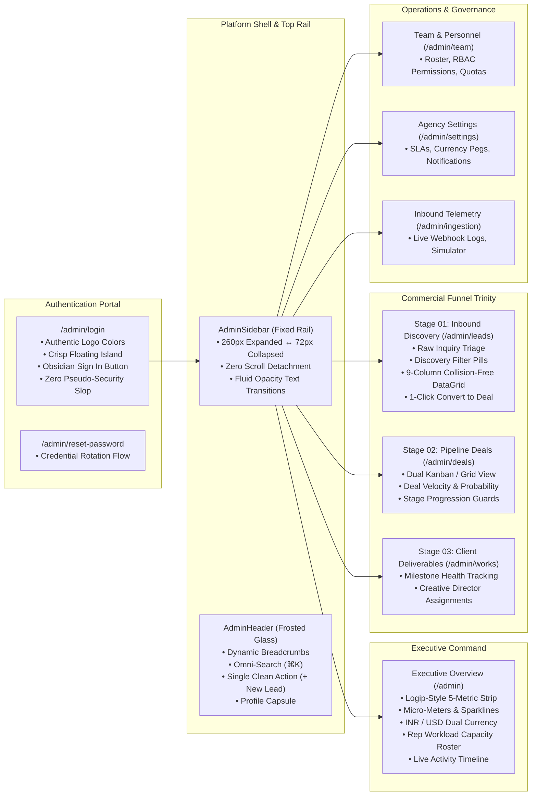

# Master SaaS Redesign Architecture & Fluid Motion System Plan: Marca Ubi Enterprise CRM

> **Document ID**: `docs/sales_funnel/redesign/crm_comprehensive_saas_redesign_plan.md`  
> **Author**: Fenar7 <86710532+Fenar7@users.noreply.github.com>  
> **Status**: PROPOSED — REVISED UPON USER DIRECTION FOR FULL-PLATFORM FLUIDITY & COMPLETE REDESIGN  
> **Aesthetic Soul**: Marca Ubi Monolithic Dark Luxury × Logip Fluid SaaS × LoopAI CRM Dossier × Sypher Precision Analytics  
> **Design Dials**: `ENERGY 2 (Luxury Precision) / RHYTHM 2 (Structured Fluidity) / MOTION 2 (Tactile Spring Physics)`  
> **Governing Standards**: `AGENTS.md`, `DESIGN.md`, `.agents/skills/master-ui-ux-design-system/`, `.agents/skills/antislop/`

---

## 1. Vision & Core Philosophy: The "Pious, Smooth & Fluid" Enterprise Standard

The goal of this redesign is **not** merely a bug patch of isolated CSS issues. It is a **full-fledged architectural and visual transformation** that elevates the entire Marca Ubi CRM to the summit of modern creative agency and luxury SaaS platforms (benchmarking [Logip](file:///C:/Users/firoz/Downloads/original-f0a51857256dd5802cfc7a47a6f070a2.webp), [LoopAI](file:///C:/Users/firoz/Downloads/original-7c45ec39bad34228c96bdaef50358655.webp), and [Sypher](file:///C:/Users/firoz/Downloads/dcdc387df0270974ed295b4e06fe3f79.webp)).

```
┌────────────────────────────────────────────────────────────────────────────────────────────────────────┐
│                                   THE 4 PILLARS OF PLATFORM PERFECTION                                 │
├──────────────────────────┬──────────────────────────┬──────────────────────────┬───────────────────────┤
│ 1. Fluid Motion Physics  │ 2. Pious Visual Luxury   │ 3. Universal Ergonomics  │ 4. Domain Mastery     │
├──────────────────────────┼──────────────────────────┼──────────────────────────┼───────────────────────┤
│ • Apple HIG tactile      │ • Authentic Marca Ubi    │ • Responsive 375px to 4K │ • Inbound Discovery   │
│   spring feedback        │   brand logo colors      │ • Fixed collapsible rail │   (/admin/leads)      │
│ • Buttery rail collapse  │ • Deep obsidian (#0b0d12)│   (260px ↔ 72px)         │ • Pipeline Deals      │
│ • Sparkline draw-in      │ • Crisp pure white cards │ • Mobile swipeable cards │   (/admin/deals)      │
│ • Fluid drawer slide-ins │ • Zero generic blue/neon │ • Zero horizontal cutoff │ • Works Production    │
│ • Tabular numeral stability• Zero fake security copy│ • 44px+ touch targets    │   (/admin/works)      │
└──────────────────────────┴──────────────────────────┴──────────────────────────┴───────────────────────┘
```

---

## 2. Fluid Motion & Micro-Interaction Design System

Every interactive surface will feel weighted, tactile, and buttery smooth using calibrated CSS transition variables and GPU-accelerated transforms:

```scss
// Fluid Motion Physics System (Master Tokens)
:root {
  --motion-spring: cubic-bezier(0.16, 1, 0.3, 1);       // Apple HIG fluid spring
  --motion-smooth: cubic-bezier(0.4, 0, 0.2, 1);        // Standard material ease
  --motion-exit: cubic-bezier(0.4, 0, 1, 1);            // Snappy exit deceleration
  --duration-instant: 120ms;
  --duration-snappy: 200ms;
  --duration-fluid: 320ms;
  --duration-entrance: 450ms;
}
```

### Micro-Interaction Specifications:
1. **Buttery Rail Collapsing**:
   - Sidebar smoothly animates width between `260px` and `72px` over `240ms var(--motion-spring)`.
   - Nav item labels and group headers smoothly fade and slide (`opacity: 0; transform: translateX(-8px)`) while icons remain centered.
   - Main viewport margin smoothly synchronizes (`transition: margin-left 240ms var(--motion-spring), width 240ms var(--motion-spring)`).
2. **Tactile Button Pressing**:
   - All buttons, chips, and cards feature a tactile active compression: `active: scale(0.98); transition: transform var(--duration-instant) var(--motion-spring);`.
   - Hover states provide a subtle 1px elevation lift and specular top-rim highlight.
3. **Card & Scorecard Entry**:
   - Metric scorecards render with smooth staggered fade-and-rise entrance animation (`opacity: 0; transform: translateY(12px)` $\rightarrow$ `opacity: 1; transform: translateY(0)` with 40ms stagger).
   - Trend sparklines animate on mount with SVG `stroke-dashoffset` draw-in animation (500ms ease-out).
4. **Slide-Out Dossier & Modals**:
   - Client 360° Dossier Drawer glides in from the right with physics-based spring dampening: `transform: translateX(100%)` $\rightarrow$ `transform: translateX(0)` with backdrop frosted blur fade.
   - Centered modals pop in with subtle concentric scale (`scale(0.96) opacity(0)` $\rightarrow$ `scale(1) opacity(1)`).
5. **DataGrid Live Transitions**:
   - Instant optimistic row feedback when changing priority or status, with smooth color chip cross-fade.
   - 1-Click Convert button provides instant micro-ripple feedback.

---

## 3. Universal Responsive Breakpoint Architecture

The platform will maintain visual symmetry and ergonomic usability from small mobile screens to massive 4K studio monitors:

```
┌────────────────────────────────────────────────────────────────────────────────────────────────────────┐
│                                 RESPONSIVE ERGONOMICS & BREAKPOINT MATRIX                               │
├─────────────────────┬───────────────┬──────────────────────────────────────────────────────────────────┤
│ Screen Category     │ Viewport Range│ Structural Layout & Behavior                                     │
├─────────────────────┼───────────────┼──────────────────────────────────────────────────────────────────┤
│ 📱 Mobile Portrait  │ 375px – 640px │ • Off-canvas slide-out navigation via blurred glass header      │
│                     │               │ • Metric scorecards render as smooth swipeable 1-row carousel    │
│                     │               │ • DataGrid reflows into high-density tactile Mobile Lead Cards   │
│                     │               │ • Full-screen modal sheets with bottom swipe dismissal           │
├─────────────────────┼───────────────┼──────────────────────────────────────────────────────────────────┤
│ 📱 Mobile Landscape │ 641px – 768px │ • 2-Column metric scorecard grid                                 │
│    & Small Tablet   │               │ • Compact search bar, collapsed filters                          │
│                     │               │ • Horizontal scroll table with sticky Lead ID & Action columns   │
├─────────────────────┼───────────────┼──────────────────────────────────────────────────────────────────┤
│ 💻 Tablet & Compact │ 769px – 1024px│ • Auto-compacted 72px icon rail with floating hover popovers    │
│    Laptops          │               │ • 3-Column metric scorecards                                     │
│                     │               │ • Full DataGrid with smooth horizontal pan & column rebalancing  │
├─────────────────────┼───────────────┼──────────────────────────────────────────────────────────────────┤
│ 🖥️ Standard Desktop │ 1025px–1440px │ • Expanded 260px fixed sidebar                                   │
│                     │               │ • Unified 5-column metric scorecard strip                        │
│                     │               │ • 9-column collision-free virtualized DataGrid                   │
│                     │               │ • Balanced 2.5rem padding gutters                                │
├─────────────────────┼───────────────┼──────────────────────────────────────────────────────────────────┤
│ 🖥️ Ultra-Wide / 4K  │ > 1440px      │ • Sidebar fixed at 280px                                         │
│                     │               │ • Main content constrained to max-width 1760px centered cleanly  │
│                     │               │ • Perfectly symmetrical left/right margins, zero lopsided void   │
└─────────────────────┴───────────────┴──────────────────────────────────────────────────────────────────┘
```

---

## 4. Full-Platform Module-by-Module Redesign Specifications



---

### Module 1: The Modern SaaS Authentication Portal (`/admin/login`)

```
┌────────────────────────────────────────────────────────┐
│                   MARCA UBI PORTAL                     │
├────────────────────────────────────────────────────────┤
│                                                        │
│                    [ MARCA UBI. ]                      │
│            (Original Authentic Brand Colors)           │
│                                                        │
│                 Sign in to Marca Ubi                   │
│      Enter your agency credentials to access CRM       │
│                                                        │
│  WORK EMAIL                                            │
│  ┌──────────────────────────────────────────────────┐  │
│  │ name@marcaubi.com                                │  │
│  └──────────────────────────────────────────────────┘  │
│                                                        │
│  PASSWORD                                              │
│  ┌───────────────────────────────────────────────┬──┐  │
│  │ ••••••••••••••••                              │👁│  │
│  └───────────────────────────────────────────────┴──┘  │
│                                                        │
│  ┌──────────────────────────────────────────────────┐  │
│  │                     SIGN IN                      │  │
│  │             (Obsidian #0f172a Button)            │  │
│  └──────────────────────────────────────────────────┘  │
│                                                        │
│       Need assistance? Contact Agency Administration   │
│                                                        │
└────────────────────────────────────────────────────────┘
```

#### Blueprint:
1. **Authentic Logo Integrity**:
   - Remove `filter: brightness(0);` from `login.module.scss`. Render authentic Marca Ubi logo with original colors.
2. **Purge AI-Slop Jargon**:
   - Delete `• EXECUTIVE ACCESS`, `COMMERCIAL AUTHENTICATION - Protected by enterprise MFA...`, `AUTHENTICATE SESSION`.
   - Replace with human, professional typography: "Sign in to Marca Ubi" (24px, 700 weight), "Enter your agency credentials to access the CRM console" (14px, `#64748b`).
3. **Pillars of Polish**:
   - Elevated pure white card (`max-width: 420px`, `border-radius: 20px`, `box-shadow: 0 20px 48px rgba(15, 23, 42, 0.08)`).
   - Crisp focus-visible ring (`outline: 2px solid #0f172a; outline-offset: 2px`).
   - Tactile primary button: `#0f172a` (Obsidian), text `#ffffff`, `border-radius: 10px`, smooth active press.

---

### Module 2: Persistent Navigation Rail & Unified Layout Shell

#### Blueprint:
1. **Permanent Fixed Left Rail**:
   - `AdminSidebar.module.scss`: `position: fixed; top: 0; left: 0; bottom: 0; width: var(--sidebar-width, 260px); height: 100vh; z-index: 40;`.
   - It will **never** scroll off-screen again on vertical document scrolling.
2. **Fluid Rail Collapse Animation**:
   - Toggle button smoothly expands/contracts between `260px` and `72px` with persistent state in `localStorage`.
   - Text labels fade with `opacity` and `transform` transitions.
3. **Eliminate 516px Doubled Margin**:
   - Remove the flex-item width collision in `admin-shell.module.scss`.
   - `.mainViewport` strictly takes `margin-left: var(--sidebar-width)` and `width: calc(100% - var(--sidebar-width))`.
4. **Balanced Layout Gutters**:
   - `.contentContainer`: `max-width: 1720px; margin: 0 auto; padding: 2rem 2.5rem 4rem;`.
   - Symmetric gutters on both sides on all widescreen resolutions.
5. **Header De-Duplication**:
   - Fix double-plus bug in `AdminHeader.tsx`: remove literal `+` in `<span>+ New Lead</span>` $\rightarrow$ `<span>New Lead</span>`.
   - Eliminate duplicate action buttons between header, page title, and sidebar.

---

### Module 3: Metric Scorecard Ribbon (Logip × Sypher Archetype)

```
┌────────────────────────────────────────────────────────────────────────────────────────────────────────────┐
│ 🟢 EXECUTIVE PIPELINE PULSE  Updated just now                                [ ₹ INR | $ USD ]  [↺ Refresh] │
├───────────────────┬───────────────────┬───────────────────┬───────────────────┬────────────────────────────┤
│ TOTAL LEADS    ⎔  │ POTENTIAL VALUE $ │ CONVERTED REV  🏆 │ CONVERSION RATE % │ OVERDUE FOLLOW-UPS      ⏱  │
│ 10,050            │ ₹ 50.12 Cr        │ ₹ 17.15 Cr        │ 12.5%             │ 978                        │
│ 7,540 in pipeline │ W: ₹26.06 Cr      │ ✓ 1,257 Closed    │ [====|====] 12.0% │ 🔴 107 Critical (>72h)     │
│ ↑ +14.2% vs last m│ 3,771 active      │ ↑ +8.4% velocity  │ Studio Benchmark  │ Escalation Active          │
└───────────────────┴───────────────────┴───────────────────┴───────────────────┴────────────────────────────┘
```

#### Blueprint:
1. **Unified Scorecard Island**:
   - Single contiguous white container (`border-radius: 16px`, `border: 1px solid #e2e8f0`) with internal 1px divider lines (`gap: 1px; background-color: #e2e8f0;`).
2. **36px Circular Icon Containers**:
   - Top right of each scorecard features a circular tinted icon badge:
     - Total Leads: `#f1f5f9` slate tint + filter vector.
     - Potential Value: `#fef3c7` amber tint + currency vector.
     - Converted Revenue: `#ecfdf5` emerald tint + trophy vector.
     - Conversion Rate: `#f0fdf4` mint tint + analytics percent vector.
     - Overdue Follow-ups: `#fef2f2` rose tint + clock vector.
3. **Collision-Proof Multi-Tier Hierarchy**:
   - **Top Row**: 11px uppercase label + 36px circular icon badge.
   - **Middle Row**: Proportional 26px–30px bold numeral with `font-variant-numeric: tabular-nums`.
   - **Bottom Subtext Row**: Dedicated secondary data:
     - For Potential Value: `W: ₹ 26.06 Cr stage-weighted` cleanly displayed below the numeral, **never** squeezed beside it!
     - For Conversion Rate: Horizontal micro-progress bar showing target vs actual.
     - For Overdue: Red pulsing radar dot with critical count.

---

### Module 4: Inbound Discovery Leads Workspace (`/admin/leads`)

#### Blueprint:
1. **Domain Scoping (Discovery Only)**:
   - Server query filtered exclusively to un-converted inbound discovery leads:
     ```ts
     .from('leads').select(...).eq('funnel_statuses.bucket', 'open').order('created_at', { ascending: false })
     ```
   - Segmented filter tabs tailored for Discovery:
     - `All Inquiries (250)`
     - `New Briefs (82)`
     - `In Review (64)`
     - `Discovery Scheduled (70)`
     - `Qualified (34)`
     - `Overdue SLA (18)`
   - Purges "Won", "Lost", and "All Deals" from the Leads page.
2. **Collision-Free 9-Column DataGrid**:
   - Expand table to dedicated 9 columns with `min-width: 1080px` horizontal scroll envelope:
     ```scss
     grid-template-columns:
       90px                 // Col 1: Lead ID (LD-10343)
       minmax(180px, 1.4fr) // Col 2: Client & Company
       130px                // Col 3: Service Scope
       140px                // Col 4: Funnel Status
       110px                // Col 5: Expected Value (Tabular ₹)
       140px                // Col 6: Representative
       90px                 // Col 7: Priority (Inline High/Med/Low)
       110px                // Col 8: Next SLA / Overdue Badge
       90px;                // Col 9: Actions (1-Click Convert or ...)
     ```
   - Dedicated column for Priority (`InlinePrioritySelect`).
   - Dedicated column for Next Touchpoint and Overdue Badge.
   - Dedicated column for the "⚡ Convert" CTA button.
   - Zero elements overlapping or crashing vertically!

---

### Module 5: Commercial Deals Workspace (`/admin/deals`)

#### Blueprint:
1. **Pipeline Negotiation Focus**:
   - Server query filtered to active negotiations: `bucket in ('potential', 'converted', 'lost')`.
   - Stages: `Proposal Drafted`, `Proposal Sent`, `Negotiation`, `Contract Review`, `Closed Won`, `Closed Lost`.
2. **Fluid Dual-View**:
   - Seamless switch between interactive **Kanban Board** (with drag-and-drop or 1-click stage advancement) and high-density **Data Grid**.
   - Deal velocity tracking, stage-weighted revenue cards, and close-rate forecasting.

---

### Module 6: Slide-Out Client 360° Dossier & Fluid Modals

#### Blueprint:
1. **LoopAI-Style 2-Column Dossier Workspace**:
   - Right-rail slide-out drawer (`width: min(680px, 100vw)`) with backdrop blur.
   - Left Column: Client metadata, contract terms, proposal attachments, and communication timeline.
   - Right Column: Soft pastel quick action cards (`Schedule Call`, `Draft Proposal`, `Reassign Lead`, `Log Note`).
2. **Fluid Centered Modals**:
   - `ConvertLeadToDealModal`: Fluid form with deal value slider, probability calculator, and rep assignment.
   - `NewLeadModal`: Clean step-by-step brief intake with zero visual clutter.
   - All modals support `Escape` key dismissal, focus trapping, and animated entry.

---

### Module 7: Typography & Font Hygiene

#### Blueprint:
1. **Eliminate Courier New Monospace Fallback**:
   - Define `--font-admin-mono` with modern system monospace fonts (`ui-monospace, SFMono-Regular, Menlo, Monaco, Consolas`).
   - In `ManagerWorkloadCard.module.scss`, apply primary sans font with `font-variant-numeric: tabular-nums` for all stats (`179 (₹2.41 Cr)`).
   - Monospace is restricted strictly to Lead/Deal IDs (`LD-10343`).

---

## 5. Phased Implementation Roadmap

```
Phase 1: Brand Soul, Typography & Authentication Portal Overhaul
├── Restore authentic Marca Ubi logo colors (remove brightness(0))
├── Purge pseudo-security AI slop copy from /admin/login
├── Implement sleek Obsidian #0f172a / Orange #ff6100 "Sign In" button
└── Eliminate Courier New typewriter font leak across workload and dashboard cards

Phase 2: Persistent Navigation Rail & Fluid Shell Architecture
├── Convert AdminSidebar to position: fixed with independent overflow scroll
├── Implement buttery smooth 260px ↔ 72px rail collapse with opacity transitions
├── Eliminate doubled 516px margin offset in admin-shell.module.scss
├── Unify symmetrical layout gutters across all viewports
└── Clean up AdminHeader (+ + New Lead bug and action deduplication)

Phase 3: Logip × Sypher Metric Scorecard Ribbon Transformation
├── Rebuild KpiRibbon into unified island with hairline dividers
├── Implement 36px circular tinted icon containers for each metric type
├── Relocate stage-weighted valuation (W:) into dedicated subtext row
├── Add micro-meter progress bar to Conversion Rate scorecard
└── Format all numerals with tabular-nums and percentage delta chips

Phase 4: Inbound Discovery Leads Workspace & Collision-Free DataGrid
├── Rebuild LeadsDataGrid into dedicated 9-column grid with 1080px scroll envelope
├── Isolate Priority (Col 7), Touchpoint SLA (Col 8), and 1-Click Convert (Col 9)
├── Scope /admin/leads query and filter tabs strictly to Discovery (open) inquiries
└── Implement smooth mobile card view reflow for screens < 768px

Phase 5: Pipeline Deals Workspace (Kanban & Grid) & Quality Delivery Gate
├── Polish /admin/deals with dual Kanban / Data Grid toggle
├── Enhance Client 360° Dossier Drawer with LoopAI soft action cards
├── Execute full test suite (0 type errors, 100% test pass)
└── Compile comprehensive delivery gate report and click-through evidence
```

---

## 6. Strict Verification & Delivery Gate Invariants

Before any pull request is opened or marked approval-ready:
1. **Type Safety**: 0 TypeScript errors (`npx tsc --noEmit`).
2. **Test Invariants**: 100% test pass rate (`npm run test:unit`, `npm run test:boundaries`).
3. **Brand Integrity**: 0 instances of `filter: brightness(0);` on the logo; authentic colors preserved.
4. **Zero Slop**: 0 instances of pseudo-milspec enterprise jargon or generic blue (`#2563eb`).
5. **Fluid Motion**: Sidebar remains permanently locked to viewport on scroll; zero margin jumps.
6. **Zero Collisions**: Zero overlapping elements in DataGrid cells; zero text collisions in KPI cards.
7. **Git Authorship**: Strictly authored as `Fenar7 <86710532+Fenar7@users.noreply.github.com>`.
8. **No 'Feat' Rule**: Strictly no `feat` prefix in commit messages or PR titles.
9. **Zero PR Merges by Agent**: All PRs remain in an **OPEN** state on GitHub for manual human review and merge.

---

> [!IMPORTANT]
> **AWAITING USER COMMAND**: In strict accordance with behavioral rules, NO code changes or file modifications will be executed until you review this expanded, full-platform redesign plan and explicitly type `"proceed"` or `"do it"`.
