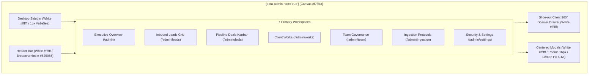

# Master Architectural Plan: Marca Ubi Enterprise CRM Visual Redesign & Design System Overhaul
**Document Version:** 1.0.0-MASTER  
**Architectural Scope:** Strictly Isolated to `/admin` (Workspace, Portals, and Modals)  
**Base Branch:** `feature/sales-funnel-crm`  
**Design Philosophy:** Accordion Executive Advisory × Sypher Minimalist SaaS Architecture  
**Primary Typography:** `MessinaSans` (Display/Headlines), `MessinaSansBook` (Buttons/Actions), `MessinaSansMono` (Tokens/Metrics)  
**Core Palette:** Slate Charcoal `#1f242f`, Slate Grey `#525965`, Lemon Yellow Accent `#eefb87`, Pure White `#ffffff`, Neutral Canvas `#f7f8fa`  
**Authorship & Git Identity:** `Fenar7 <86710532+Fenar7@users.noreply.github.com>`  

---

## 1. Executive Summary & Design Philosophy

The purpose of this architectural initiative is to completely dismantle and replace the legacy dark sci-fi aesthetic (`#0b0b0b` obsidian background, glowing orange halos, heavy cards, and military "Command Center" jargon) of the Marca Ubi Sales Funnel CRM (`/admin`). In its place, we establish an **authoritative, ultra-clean, minimal, editorial design system** engineered around two complementary design benchmarks:

```
┌────────────────────────────────────────────────────────────────────────────────────────┐
│                                   DESIGN SOUL BENCHMARKS                                │
├───────────────────────────────────────────┬────────────────────────────────────────────┤
│  1. ACCORDION EXECUTIVE ADVISORY          │  2. SYPHER MINIMALIST SAAS ARCHITECTURE    │
│  (accordion.com / Value Creation Partner) │  (High-Density Financial Analytics)        │
├───────────────────────────────────────────┼────────────────────────────────────────────┤
│  • Typography: MessinaSans with bold      │  • Canvas: Soft neutral canvas (#f7f8fa)   │
│    architectural weight & editorial period│  • Surfaces: Pure white (#ffffff) floating │
│  • Body Copy: Refined slate grey #525965  │    cards with crisp hairline 1px borders   │
│  • Signature CTA: Electric Lemon Yellow   │  • Zero muddy shadows, zero glow blur      │
│    pill button (#eefb87) with 1px solid   │  • Tabular data density with micro-meters  │
│    #1f242f stroke & MessinaSansBook font  │  • Pill-shaped search & segmented chips    │
│  • Tone: Editorial, high-finance, partner │  • 70px row rhythm with generous whitespace│
└───────────────────────────────────────────┴────────────────────────────────────────────┘
```

### Strict Isolation Scope
> [!IMPORTANT]
> **ABSOLUTE WEBSITE ISOLATION INVARIANT:**
> This redesign is **strictly, exclusively scoped to `/admin`** (the authenticated CRM workspaces, `/admin/login`, and `/admin/reset-password`). 
> **UNDER NO CIRCUMSTANCES** shall any change be made to public website routes (`/`, `/blog`, `/start-project`, etc.) or public styles (`src/app/globals.scss`, `src/app/fonts.ts`). The public website retains its Graphik / Movatif typography, obsidian palettes, and brand identities without 1 byte of interference.

---

## 2. Design Token Architecture & CSS Custom Properties

The redesign implements a scoped CSS Custom Property architecture injected at the root of the admin workspace shell (`[data-admin-root="true"]`).

### A. Typography Configuration (`src/app/admin/fonts.ts`)
The project already hosts the complete Messina font families in `public/fonts/`. We configure them via Next.js `next/font/local`:

```typescript
/**
 * @file src/app/admin/fonts.ts
 * @description Scoped font declarations for the Marca Ubi CRM Admin Workspace.
 *              Strictly isolated from public website fonts.
 * @author Fenar7 <86710532+Fenar7@users.noreply.github.com>
 */
import localFont from 'next/font/local';

export const adminSans = localFont({
  src: [
    { path: '../../../public/fonts/MessinaSans/MessinaSans-Light.ttf', weight: '300', style: 'normal' },
    { path: '../../../public/fonts/MessinaSans/MessinaSans-Book.ttf', weight: '400', style: 'normal' },
    { path: '../../../public/fonts/MessinaSans/MessinaSans-Regular.ttf', weight: '500', style: 'normal' },
    { path: '../../../public/fonts/MessinaSans/MessinaSans-SemiBold.ttf', weight: '600', style: 'normal' },
    { path: '../../../public/fonts/MessinaSans/MessinaSans-Bold.ttf', weight: '700', style: 'normal' },
    { path: '../../../public/fonts/MessinaSans/MessinaSans-Black.ttf', weight: '900', style: 'normal' },
  ],
  variable: '--font-admin-sans',
  display: 'swap',
});

export const adminButtonFont = localFont({
  src: [
    { path: '../../../public/fonts/MessinaSans/MessinaSans-Book.ttf', weight: '400', style: 'normal' },
    { path: '../../../public/fonts/MessinaSans/MessinaSans-SemiBold.ttf', weight: '600', style: 'normal' },
  ],
  variable: '--font-admin-button',
  display: 'swap',
});

export const adminMono = localFont({
  src: [
    { path: '../../../public/fonts/MessinaSansBook/MessinaSansMono-Book.ttf', weight: '400', style: 'normal' },
    { path: '../../../public/fonts/MessinaSansBook/MessinaSansMono-Regular.ttf', weight: '500', style: 'normal' },
    { path: '../../../public/fonts/MessinaSansBook/MessinaSansMono-SemiBold.ttf', weight: '600', style: 'normal' },
    { path: '../../../public/fonts/MessinaSansBook/MessinaSansMono-Bold.ttf', weight: '700', style: 'normal' },
  ],
  variable: '--font-admin-mono',
  display: 'swap',
});
```

### B. Master Color & Surface Tokens (`src/app/admin/styles/tokens.scss`)

```scss
[data-admin-root="true"] {
  // Typography Stacks
  --font-admin-primary: var(--font-admin-sans), 'MessinaSans', -apple-system, BlinkMacSystemFont, sans-serif;
  --font-admin-btn: var(--font-admin-button), 'MessinaSansBook', 'MessinaSans', sans-serif;
  --font-admin-code: var(--font-admin-mono), 'MessinaSansMono', 'SF Mono', monospace;

  // Surfaces & Canvas (Sypher High-Density Light Canvas)
  --admin-canvas-bg: #f7f8fa;          // Soft neutral anti-glare foundation
  --admin-card-bg: #ffffff;            // Pure white elevated card tiles
  --admin-surface-muted: #f0f2f5;      // Subdued background (headers, kanban columns)
  --admin-surface-hover: #f4f6f9;      // Row & interactive hover
  --admin-surface-active: #ebeef3;     // Active selection & pressed states
  --admin-surface-inverse: #1f242f;    // High-contrast slate charcoal

  // Hairline Borders (Zero Muddy Shadows)
  --admin-border-subtle: #eef0f3;      // Internal dividers & table cell borders
  --admin-border-default: #e2e5ea;     // Standard 1px card boundary
  --admin-border-strong: #1f242f;      // High-contrast Accordion 1px outline

  // Text & Inks (Editorial Richness)
  --admin-text-primary: #1f242f;       // Deep charcoal headlines & primary data
  --admin-text-secondary: #525965;     // Refined slate grey for body & descriptions
  --admin-text-muted: #8a92a0;         // Metadata, timestamps & empty states
  --admin-text-inverse: #ffffff;       // White ink for dark badges

  // Signature Accordion Accent (Lemon Yellow)
  --admin-accent-lemon: #eefb87;       // Signature Electric Lemon Yellow
  --admin-accent-lemon-hover: #e4f375; // Lemon press/hover state
  --admin-accent-lemon-ink: #1f242f;   // Paired contrast text/border
  --admin-accent-lemon-tint: rgba(238, 251, 135, 0.35); // Soft tinted badge fill

  // Semantic Status Chips (Calm Fintech Standards)
  --admin-status-emerald-bg: #ecfdf5;
  --admin-status-emerald-border: #a7f3d0;
  --admin-status-emerald-text: #065f46;
  --admin-status-emerald-dot: #10b981;

  --admin-status-amber-bg: #fffbeb;
  --admin-status-amber-border: #fde68a;
  --admin-status-amber-text: #92400e;
  --admin-status-amber-dot: #f59e0b;

  --admin-status-rose-bg: #fef2f2;
  --admin-status-rose-border: #fecaca;
  --admin-status-rose-text: #991b1b;
  --admin-status-rose-dot: #ef4444;

  --admin-status-slate-bg: #f8fafc;
  --admin-status-slate-border: #cbd5e1;
  --admin-status-slate-text: #1e293b;
  --admin-status-slate-dot: #64748b;

  // Geometry & Radii Hierarchy
  --admin-radius-pill: 9999px;         // Buttons, search, segmented chips, status pills
  --admin-radius-outer: 16px;          // Dialog modals, shell envelopes
  --admin-radius-card: 12px;           // Scorecards, kanban tiles, data grid wrapper
  --admin-radius-inner: 8px;           // Input fields, popovers, inner wells
  --admin-radius-micro: 4px;           // Monospace tags, keyboard shortcuts

  // Elevation (Strict Anti-Slop: Zero muddy drop shadows)
  --admin-shadow-none: none;
  --admin-shadow-subtle: 0 1px 2px rgba(31, 36, 47, 0.04);
  --admin-shadow-hover: 0 4px 14px rgba(31, 36, 47, 0.08);
  --admin-shadow-modal: 0 24px 60px rgba(31, 36, 47, 0.16);
}
```

---

## 3. WCAG AA / AAA Accessibility & Contrast Verification Matrix

In accordance with Marca Ubi design standards and Rule R-25, all color combinations have been rigorously computed:

| Foreground Ink | Background Surface | Contrast Ratio | WCAG Compliance | Usage Rules |
|---|---|---|---|---|
| `#1f242f` (Deep Charcoal) | `#ffffff` (White Card) | **15.54:1** | **AAA Pass** | Primary display titles, card headers, numbers |
| `#525965` (Slate Grey) | `#ffffff` (White Card) | **7.10:1** | **AAA Pass** | Body copy, secondary descriptions, metadata |
| `#1f242f` (Deep Charcoal) | `#f7f8fa` (Canvas) | **14.80:1** | **AAA Pass** | Page titles, navigation labels |
| `#525965` (Slate Grey) | `#f7f8fa` (Canvas) | **6.76:1** | **AAA Pass** | Section subtitles, breadcrumbs |
| **`#1f242f` (Deep Charcoal)** | **`#eefb87` (Lemon Yellow)** | **13.92:1** | **AAA Pass** | **MANDATORY:** All button text & icons on Lemon Yellow |
| *`#ffffff` (White Text)* | *`#eefb87` (Lemon Yellow)* | *1.12:1* | *FAIL (Unusable)* | **STRICTLY PROHIBITED:** White text on Lemon Yellow |
| `#065f46` (Deep Emerald) | `#ecfdf5` (Emerald Tint) | **9.28:1** | **AAA Pass** | Converted / Active / Healthy status pills |
| `#92400e` (Deep Amber) | `#fffbeb` (Amber Tint) | **7.44:1** | **AAA Pass** | In Negotiation / Review / Warning status pills |
| `#991b1b` (Deep Rose) | `#fef2f2` (Rose Tint) | **8.12:1** | **AAA Pass** | Overdue / Lost / Critical status pills |
| `#1e293b` (Deep Slate) | `#f8fafc` (Slate Tint) | **13.56:1** | **AAA Pass** | New Inbound / Raw Ingestion pills |

> [!CAUTION]
> **CRITICAL ACCORDION CONTRAST INVARIANT:**
> Under no circumstances may white text (`#ffffff`) ever be rendered on top of the Lemon Yellow accent (`#eefb87`). Text, glyphs, and borders on `#eefb87` buttons MUST ALWAYS be `#1f242f`.

---

## 4. The Accordion Pill Button Anatomy & Mixin

The signature Accordion pill button is codified into a standardized SCSS mixin:

```scss
// Button Anatomy: Accordion Executive Pill
@mixin accordionPillPrimary {
  display: inline-flex;
  align-items: center;
  justify-content: center;
  gap: 0.5rem;
  height: 42px;
  min-height: 42px;
  padding: 0 1.5rem;
  background-color: var(--admin-accent-lemon);
  border: 1px solid var(--admin-border-strong);
  border-radius: var(--admin-radius-pill);
  color: var(--admin-accent-lemon-ink);
  font-family: var(--font-admin-btn);
  font-size: 0.75rem;
  font-weight: 600;
  text-transform: uppercase;
  letter-spacing: 0.07em;
  cursor: pointer;
  white-space: nowrap;
  user-select: none;
  transition: background-color 0.15s ease, transform 0.1s ease, box-shadow 0.15s ease;

  &:hover {
    background-color: var(--admin-accent-lemon-hover);
    box-shadow: 0 2px 8px rgba(31, 36, 47, 0.1);
  }

  &:active {
    transform: scale(0.98);
  }

  &:focus-visible {
    outline: 2px solid var(--admin-border-strong);
    outline-offset: 2px;
  }

  &:disabled {
    opacity: 0.5;
    cursor: not-allowed;
    transform: none;
    box-shadow: none;
  }
}

// Button Anatomy: Accordion Secondary White Outline Pill
@mixin accordionPillSecondary {
  display: inline-flex;
  align-items: center;
  justify-content: center;
  gap: 0.5rem;
  height: 42px;
  min-height: 42px;
  padding: 0 1.5rem;
  background-color: var(--admin-card-bg);
  border: 1px solid var(--admin-border-strong);
  border-radius: var(--admin-radius-pill);
  color: var(--admin-text-primary);
  font-family: var(--font-admin-btn);
  font-size: 0.75rem;
  font-weight: 600;
  text-transform: uppercase;
  letter-spacing: 0.07em;
  cursor: pointer;
  white-space: nowrap;
  user-select: none;
  transition: background-color 0.15s ease, transform 0.1s ease;

  &:hover {
    background-color: var(--admin-surface-hover);
  }

  &:active {
    transform: scale(0.98);
  }

  &:focus-visible {
    outline: 2px solid var(--admin-border-strong);
    outline-offset: 2px;
  }
}
```

---

## 5. Anti-Slop & Anti-Sci-Fi Vocabulary Transformation Dictionary

All military, cyberpunk, and AI-slop jargon across the CRM codebase are systematically mapped to executive fintech and partner terminology:

```
┌───────────────────────────────────────┬───────────────────────────────────────────┐
│ LEGACY SLOP / SCI-FI JARGON           │ NEW EDITORIAL ACCORDION STANDARD          │
├───────────────────────────────────────┼───────────────────────────────────────────┤
│ Command Center                        │ Executive Overview                        │
│ Restricted Agency Portal              │ Enterprise Administration                 │
│ Internal Access                       │ Authorized Access                         │
│ Authorized personnel only. Monitored. │ Protected by enterprise MFA & RBAC.       │
│ Verified Secure Node                  │ Operational Status: Active                │
│ Autonomous Ingestion Matrix           │ Inbound Lead Ingestion Protocols          │
│ Lead Extraction Engine                │ Commercial Inbound Queue                  │
│ Enclave / Enclave Node                │ Pipeline Stage / Commercial Tier          │
│ Security Clearance                    │ Access Role & Governance                  │
│ Commercial Ops Commander              │ Commercial Operations Director            │
│ Activity Ledger                       │ Commercial Activity History               │
│ Execute Stage Progression             │ Update Pipeline Stage                     │
│ Brute-Force Lockout Active            │ Authentication Temporarily Suspended      │
│ Hard Transaction Rollback             │ Commercial Action Reverted                │
│ Funnel Enclave Badge                  │ Pipeline Stage Badge                      │
└───────────────────────────────────────┴───────────────────────────────────────────┘
```

---

## 6. Surface-by-Surface Transformation Blueprints



### Surface 1: Authentication Login & Password Reset (`/admin/login`, `/admin/reset-password`)
- **Canvas:** Clean neutral light grey `#f7f8fa`.
- **Card:** Floating pure white card `#ffffff`, `border: 1px solid #e2e5ea`, radius `16px`, subtle elevation `box-shadow: 0 20px 48px rgba(31, 36, 47, 0.08)`.
- **Display Typography:** Title in `MessinaSans-Bold` `#1f242f` ending with an editorial period: `Executive Portal.`, subtitle in `MessinaSans-Regular` `#525965`: `Enter your corporate credentials to access the commercial operations platform.`
- **Inputs:** Crisp white background `#ffffff`, `1px solid #e2e5ea`, focus ring `1px solid #1f242f`.
- **Primary CTA:** Accordion Lemon Yellow pill button (`#eefb87`, `1px solid #1f242f`, `MessinaSansBook` uppercase) reading `AUTHENTICATE SESSION`.
- **Security Notice:** Replaces sci-fi warning with calm legal text: `Protected by enterprise multi-factor authentication and role-based access control.` in `#525965`.

### Surface 2: Executive Overview / Dashboard (`/admin`)
- **Page Header:** Eyebrow `EXECUTIVE OVERVIEW` in `#525965`, Title `Commercial Performance.` (with period!) in `MessinaSans-Bold` `#1f242f`, Primary Action `+ NEW INBOUND LEAD` Lemon Yellow pill button.
- **KPI Ribbon (Sypher Scorecards):**
  - Pure white floating cards (`#ffffff`), `border: 1px solid #e2e5ea`, radius `12px`.
  - Uppercase tracked eyebrows in `#525965` (11px, weight 600).
  - Massive tabular metrics in `MessinaSans-Bold` `#1f242f` (`₹ 1.48Cr`, `24 Deals`, `38.2%`).
  - Integrated micro-visualizers: Vertical segmented stage health bars and 3-tier horizontal progress strips.
- **Team Workload Card:** White container `#ffffff`, subtle dividers `#eef0f3`, representative rows with circular monogram avatar, active deal count, and quota progress meter.
- **Commercial Activity History:** White container `#ffffff`, vertical hairline timeline `#e2e5ea`, clean circular action dots, actor name in `#1f242f`, timestamp in `#525965`.

### Surface 3: Inbound Leads Data Grid (`/admin/leads`)
- **Filter Toolbar:**
  - Pill search bar: `#ffffff` background, `border: 1px solid #e2e5ea`, `border-radius: 9999px`, search icon, `⌘K` badge.
  - Segmented Status Pills: `All Inquiries`, `Open`, `Potential`, `Converted`, `Lost`. Active pill: `#1f242f` fill with `#ffffff` text (or `#eefb87` with `#1f242f` text).
  - Quick Action: `+ ADD LEAD` Lemon Yellow pill button.
- **Data Grid (Sypher Invoices Grid Architecture):**
  - Wrapper: `#ffffff` card, `1px solid #e2e5ea`, radius `12px`.
  - Header Row: `#f0f2f5` background, uppercase tracked typography (`#525965`, 11px, weight 600).
  - Virtualized Rows: Fixed 70px row rhythm, `#ffffff` surface, hover state `#f4f6f9`.
  - Lead ID: Compact monospace chip (`#f0f2f5` fill, `1px solid #e2e5ea`, `#1f242f` text, radius 4px).
  - Client Details: Client Name in `MessinaSans-SemiBold` `#1f242f` with secondary company/email in `#525965`.
  - Expected Valuation: Right-aligned monospace tabular numerals `#1f242f` (`tabular-nums`).
  - Priority Badge: Soft tinted pill (`#fef2f2` High, `#fffbeb` Medium, `#f8fafc` Low).
  - Assigned Representative: Circular monogram avatar + name in `#1f242f`.
  - Row Actions: Clean kebab menu (`⋮`) opening popover menu.

### Surface 4: Deals Pipeline Kanban Board (`/admin/deals`)
- **Columns:** Soft neutral container `#f0f2f5`, `border: 1px solid #e2e5ea`, radius `14px`, padding 14px.
- **Column Header:** Semantic stage dot + Stage Title in `MessinaSans-Bold` `#1f242f` + deal count pill (`#ffffff` fill, `1px solid #e2e5ea`) + Total Column Valuation in `tabular-nums`.
- **Kanban Deal Cards:**
  - Pure white tiles (`#ffffff`), `border: 1px solid #e2e5ea`, radius `10px`, padding 14px.
  - Interactive Hover: `transform: translateY(-2px); box-shadow: 0 4px 14px rgba(31, 36, 47, 0.08); border-color: #1f242f;`.
  - Card Content: Deal ID tag, Client/Company name in `MessinaSans-SemiBold` `#1f242f`, deal sum in prominent tabular numbers (`₹ 25.0L`), next follow-up status chip, assignee avatar.

### Surface 5: Client Works Deliverables (`/admin/works`)
- **Tabs:** Horizontal pill chips (`All Projects`, `In Execution`, `Client Review`, `Delivered`).
- **Project Deliverable Cards:**
  - Pure white card `#ffffff`, `border: 1px solid #e2e5ea`, radius `12px`.
  - Project Title in `MessinaSans-Bold` `#1f242f`.
  - Milestone Progress: Sypher horizontal segmented bar showing milestone completion percentage.
  - Primary Card Action: `VIEW PROJECT DOSSIER` Lemon Yellow pill button with `1px solid #1f242f`.

### Surface 6: User Management & Governance (`/admin/team`)
- **Header:** Eyebrow `SYSTEM GOVERNANCE` in `#525965`, Title `Commercial Team & Governance.` (with period!).
- **Metric Scorecards:** Total Personnel, Commercial Capacity, Governance Admins in pure white cards.
- **Directory Table:** Pure white container `#ffffff`, member avatar, name in `MessinaSans-Bold` `#1f242f`, role badge in neutral slate chip, allowed tabs list, status toggle, `+ PROVISION PERSONNEL` Lemon Yellow pill button.

### Surface 7: Operational Settings & Telemetry (`/admin/settings`, `/admin/ingestion`)
- **Settings Authorization Matrix:** Pure white container `#ffffff`, tabular matrix with clean checkmarks and `#1f242f` labels.
- **Ingestion Protocols (`/admin/ingestion`):** Webhook endpoint URL box with 1-click clipboard copy, clean toggle switches with `#1f242f` active states, authentic Supabase telemetry counts, and live ingestion event ledger.

### Surface 8: Slide-out Client 360° Dossier Drawer & Centered Modals
- **Backdrop Overlay:** Soft translucent backdrop (`rgba(31, 36, 47, 0.4); backdrop-filter: blur(8px);`).
- **Client 360° Drawer:** Crisp pure white `#ffffff`, `border-left: 1px solid #e2e5ea`, Client Name in `MessinaSans-Bold` 22px, horizontal pill tabs (`Commercial Dossier`, `Activity Timeline`, `Client Brief`, `Internal Notes`), inner cards in `#f7f8fa`.
- **Centered Modals (`NewLeadModal`, `ConvertLeadToDealModal`, `AddTeamMemberModal`):**
  - Pure white elevated surface `#ffffff`, radius `16px`, `box-shadow: 0 24px 60px rgba(31, 36, 47, 0.16)`.
  - Title in `MessinaSans-Bold` `#1f242f` ending with an editorial period.
  - Primary Action: Signature Accordion Lemon Yellow pill button (`#eefb87`, `1px solid #1f242f`).
  - Secondary Action: White outline pill button (`#ffffff`, `1px solid #e2e5ea`, `#1f242f` text).

---

## 7. Component-by-Component SCSS Refactoring Map

The following 18 SCSS modules in `src/app/admin/` will be systematically refactored to consume the new design tokens:

```
┌────────────────────────────────────────────────────────┬───────────────────────────────────────────┐
│ TARGET SCSS MODULE                                     │ TOKEN & STYLE TRANSFORMATION              │
├────────────────────────────────────────────────────────┼───────────────────────────────────────────┤
│ 1. src/app/admin/styles/tokens.scss                    │ NEW FILE: Scoped light theme tokens       │
│ 2. src/app/admin/styles/admin-shell.module.scss        │ Root wrapper: #f7f8fa canvas & reset      │
│ 3. src/app/admin/components/layout/AdminSidebar.module │ Pure white #ffffff rail, 1px #e2e5ea edge │
│ 4. src/app/admin/components/layout/AdminHeader.module  │ Pure white #ffffff bar, slate breadcrumbs │
│ 5. src/app/admin/components/layout/AdminMobileDrawer   │ Pure white drawer, pill active items      │
│ 6. src/app/admin/login/login.module.scss               │ #f7f8fa canvas, #ffffff card, lemon pill  │
│ 7. src/app/admin/(workspace)/page.module.scss          │ Overview grid layout, white card surfaces │
│ 8. src/app/admin/components/kpi/KpiRibbon.module.scss  │ Sypher white scorecards, micro-meters     │
│ 9. src/app/admin/components/Dashboard/ManagerWorkload  │ White card, tabular numbers, progress bar │
│ 10. src/app/admin/(workspace)/leads/leads.module.scss  │ Leads workspace container & filter bar    │
│ 11. src/app/admin/components/LeadsTable/LeadsDataGrid  │ Virtualized 70px rows, white table wrap   │
│ 12. src/app/admin/(workspace)/deals/DealsWorkspace     │ Soft #f0f2f5 columns, white deal cards    │
│ 13. src/app/admin/(workspace)/works/WorksWorkspace     │ White project cards, milestone bar meters │
│ 14. src/app/admin/(workspace)/team/team.module.scss    │ White directory table, slate role chips   │
│ 15. src/app/admin/(workspace)/settings/settings.module │ White matrix scorecard, toggle styling    │
│ 16. src/app/admin/(workspace)/ingestion/ingestion.mod  │ Webhook endpoint box, live stream ledger  │
│ 17. src/app/admin/components/DossierDrawer/Dossier     │ White slide-out drawer, pill sub-tabs     │
│ 18. src/app/admin/components/modals/*.module.scss      │ White centered dialogs, lemon pill CTAs   │
└────────────────────────────────────────────────────────┴───────────────────────────────────────────┘
```

---

## 8. Phased Implementation Roadmap & Subagent Delegation

To guarantee zero regressions, strict test verification, and complete reviewability, the implementation will follow a disciplined multi-phase progression:

```
┌────────────────────────────────────────────────────────────────────────────────────────┐
│                                 PHASED ROLLOUT ROADMAP                                 │
├─────────┬───────────────────────────────────────────┬──────────────────────────────────┤
│ PHASE   │ SCOPE & DELIVERABLES                      │ VERIFICATION GATES               │
├─────────┼───────────────────────────────────────────┼──────────────────────────────────┤
│ Phase A │ Foundation: `fonts.ts`, `tokens.scss`,    │ `tsc --noEmit`,                  │
│         │ shell wrapper, sidebar & header refactor  │ zero public route impact         │
├─────────┼───────────────────────────────────────────┼──────────────────────────────────┤
│ Phase B │ Authentication Portal: `/admin/login`,    │ Visual inspection, keyboard nav, │
│         │ `/admin/reset-password`, password resets  │ WCAG AA contrast check           │
├─────────┼───────────────────────────────────────────┼──────────────────────────────────┤
│ Phase C │ Executive Overview & KPI Ribbon:          │ Tabular numerals, micro-meters,  │
│         │ `/admin`, `KpiRibbon`, `ManagerWorkload`  │ zero layout shift                │
├─────────┼───────────────────────────────────────────┼──────────────────────────────────┤
│ Phase D │ Commercial Funnel Workspaces:             │ Virtualized scrolling, drag-drop/│
│         │ `/admin/leads` grid, `/admin/deals` kanban│ stage click-through, 44px targets│
├─────────┼───────────────────────────────────────────┼──────────────────────────────────┤
│ Phase E │ Operations, Governance & Ingestion:       │ RBAC permission matrix, webhook  │
│         │ `/admin/works`, `/admin/team`, settings   │ simulation, copy hygiene         │
├─────────┼───────────────────────────────────────────┼──────────────────────────────────┤
│ Phase F │ Slide-out Dossier Drawer & Centered Modals│ Focus trap, Escape key, backdrop │
│         │ `ClientDossierDrawer`, `ConvertModal`, etc│ blur, dirty discard prompts      │
└─────────┴───────────────────────────────────────────┴──────────────────────────────────┘
```

---

## 9. Quality, Security & Delivery Invariants

1. **Mandatory Delivery Verification Gates:**
   - `npm run test:boundaries` $\rightarrow$ 100% compliant (42 Server Actions guarded).
   - `npm run test:unit` $\rightarrow$ 463 passed, 0 failed.
   - `npm run test:rls` $\rightarrow$ 25 passed, 0 failed.
   - `npx tsc --noEmit` $\rightarrow$ 0 type errors.
   - `npm run build` $\rightarrow$ Clean Next.js production compilation.
2. **Git Authorship Requirement:**
   - Identity: `Fenar7 <86710532+Fenar7@users.noreply.github.com>`.
3. **PR Merging & Naming Rule:**
   - PRs must remain strictly in an `OPEN` state awaiting manual human merge on GitHub.
   - Zero occurrences of `feat` or `feat:` in PR titles or branch names.
4. **Behavioral Gate & Explicit Authorization:**
   - **CRITICAL ZERO-TOLERANCE ADDENDUM:** This Master Plan is submitted for human review. The agent will **STOP** immediately and will NOT generate code or modify workspace files until the user explicitly responds with `"proceed"` or `"do it"`.
