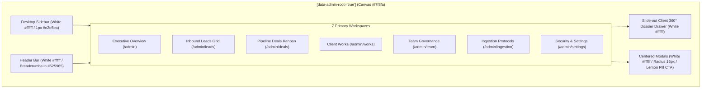

<style>
  @media print {
    body {
      font-family: -apple-system, BlinkMacSystemFont, "Segoe UI", Roboto, Helvetica, Arial, sans-serif;
      font-size: 9.5pt;
      line-height: 1.45;
      color: #1f242f;
      background: #ffffff;
    }
    h1, h2, h3, h4 {
      color: #1f242f;
      page-break-after: avoid;
      break-after: avoid;
    }
    h1 { font-size: 20pt; margin-bottom: 0.5rem; font-weight: 700; }
    h2 { font-size: 14pt; border-bottom: 1.5px solid #1f242f; padding-bottom: 4px; margin-top: 1.5rem; font-weight: 600; }
    h3 { font-size: 11pt; margin-top: 1.2rem; font-weight: 600; }
    h4 { font-size: 10pt; margin-top: 0.8rem; font-weight: 600; }
    table {
      width: 100%;
      border-collapse: collapse;
      margin: 1rem 0;
      font-size: 8.5pt;
      page-break-inside: avoid;
      break-inside: avoid;
    }
    th, td {
      border: 1px solid #d4d4d8;
      padding: 6px 9px;
      text-align: left;
    }
    th {
      background-color: #f7f8fa;
      font-weight: 600;
      color: #1f242f;
    }
    .page-break {
      page-break-after: always;
      break-after: page;
    }
    pre, code {
      font-family: ui-monospace, SFMono-Regular, Menlo, Monaco, Consolas, "Liberation Mono", "Courier New", monospace;
      font-size: 8pt;
      background: #f7f8fa;
      border-radius: 4px;
    }
    pre {
      padding: 10px;
      border: 1px solid #e2e5ea;
      page-break-inside: avoid;
      break-inside: avoid;
      white-space: pre-wrap;
      word-break: break-word;
    }
    blockquote {
      border-left: 3px solid #eefb87;
      margin: 1rem 0;
      padding-left: 1rem;
      color: #525965;
      background: #fafbfd;
    }
  }
</style>

# Marca Ubi — Enterprise Agency CRM
## Visual Redesign & Design System Master Product Requirements Document (PRD)
**Document ID:** `PRD-MARCA-CRM-REDESIGN-2026-V1`  
**Target Architecture:** Next.js 16.1.6 App Router, React 19, Turbopack, Scoped SCSS Modules  
**Isolation Scope:** Strictly Isolated to `/admin` Workspace Routes (0 Public Website Impact)  
**Design Soul:** Accordion Private Equity Advisory × Sypher Minimalist SaaS Architecture  
**Primary Fonts:** `MessinaSans` (Display/Headlines), `MessinaSansBook` (Pill Buttons), `MessinaSansMono` (Metrics/IDs)  
**Core Palette:** Slate Charcoal `#1f242f`, Slate Grey `#525965`, Lemon Yellow Accent `#eefb87`, Pure White `#ffffff`, Neutral Canvas `#f7f8fa`  
**Authorship & Git Identity:** `Fenar7 <86710532+Fenar7@users.noreply.github.com>`  

---

### Executive Document Metadata

| Specification Property | Architectural Value |
|---|---|
| **System Official Name** | Marca Ubi Enterprise CRM & Commercial Intelligence Platform |
| **Document Purpose** | Production-Grade PRD for Total Visual Overhaul of `/admin` Surfaces |
| **Design Soul Benchmarks** | Accordion (`accordion.com` PE Value Creation) & Sypher (Clean Minimal SaaS) |
| **Strict Scope Boundary** | Strictly and exclusively scoped to `/admin` routes. Zero public website modifications. |
| **Primary Typography** | `MessinaSans` (TTF suite in `public/fonts/MessinaSans/`) |
| **Button / Action Font** | `MessinaSansBook` (`MessinaSans-Book.ttf` and `MessinaSansBook/` mono) |
| **Signature Accent Token** | Electric Lemon Yellow `#eefb87` (paired with `1px solid #1f242f` hairline border) |
| **Neutral Surface Tokens** | Light Canvas `#f7f8fa`, Card Surface `#ffffff`, Divider `#e2e5ea`, Charcoal `#1f242f` |
| **Vocabulary Cleanse** | 100% elimination of military/sci-fi jargon in favor of serene fintech partner terminology |
| **Backend & Invariant Rule** | 100% presentation-layer refactoring. 0 modifications to Server Actions, RLS, or tests. |
| **Release Management** | Multi-Phase Sub-Branch Deployment (`feature/sales-funnel-crm` $\rightarrow$ `redesign/...`) |
| **Human Approval Rule** | Mandatory stopping point awaiting explicit user "proceed" before code execution |

<div class="page-break" style="page-break-after: always;"></div>

## Table of Contents
1. [Executive Summary & Problem Statement](#1-executive-summary--problem-statement)
2. [Strict Scope Boundaries & Architectural Isolation](#2-strict-scope-boundaries--architectural-isolation)
3. [Design System Philosophy & Aesthetic Benchmarks](#3-design-system-philosophy--aesthetic-benchmarks)
4. [Master Typography Architecture & Font Bindings](#4-master-typography-architecture--font-bindings)
5. [Complete Design Token Architecture](#5-complete-design-token-architecture)
6. [WCAG AA / AAA Accessibility & Contrast Verification](#6-wcag-aa--aaa-accessibility--contrast-verification)
7. [The Signature Accordion Pill Button Specification](#7-the-signature-accordion-pill-button-specification)
8. [Anti-Slop & Anti-Sci-Fi Vocabulary Transformation Dictionary](#8-anti-slop--anti-sci-fi-vocabulary-transformation-dictionary)
9. [Surface-by-Surface PRD Specifications (All 8 Surfaces)](#9-surface-by-surface-prd-specifications-all-8-surfaces)
   - 9.1 Authentication Portal (`/admin/login`, `/admin/reset-password`)
   - 9.2 Executive Overview / Commercial Dashboard (`/admin`)
   - 9.3 Inbound Leads Data Grid (`/admin/leads`)
   - 9.4 Deals Pipeline Kanban Board (`/admin/deals`)
   - 9.5 Client Works Deliverables Tracker (`/admin/works`)
   - 9.6 Commercial Team Governance (`/admin/team`)
   - 9.7 Operational Settings & Telemetry (`/admin/settings`, `/admin/ingestion`)
   - 9.8 Slide-out Client 360° Dossier Drawer & Centered Modals
10. [Component-by-Component SCSS Module Refactoring Matrix](#10-component-by-component-scss-module-refactoring-matrix)
11. [Backend & Database Invariant Preservation](#11-backend--database-invariant-preservation)
12. [Multi-Phase Implementation Roadmap](#12-multi-phase-implementation-roadmap)
13. [Quality Assurance, Delivery Gates & Acceptance Criteria](#13-quality-assurance-delivery-gates--acceptance-criteria)
14. [Governance, Risk Management & Release Controls](#14-governance-risk-management--release-controls)

---

## 1. Executive Summary & Problem Statement

### 1.1 Context & Background
The Marca Ubi Sales Funnel CRM platform provides end-to-end commercial lifecycle management for enterprise creative agency operations. Following the successful completion of the 6-phase remediation program (PRs #51 through #56), the platform's backend architecture is hardened with multi-tenant PostgreSQL Row Level Security (RLS), Zod input sanitization, 42 audited Server Actions, automated deduplication triggers, and real Supabase telemetry.

However, an exhaustive visual audit of the frontend interface (`/admin`) revealed a severe aesthetic and experiential divergence from executive agency standards:

```
┌────────────────────────────────────────────────────────────────────────────────────────┐
│                              LEGACY UI DEFICIENCIES AUDIT                              │
├─────────────────────────────────────┬──────────────────────────────────────────────────┤
│ Defect Class                        │ Observed Manifestation & Failure Mode            │
├─────────────────────────────────────┼──────────────────────────────────────────────────┤
│ Heavy Obsidian Palette              │ Pitch black backgrounds (#0b0b0b / #111111)      │
│                                     │ create severe eye fatigue in daytime usage.      │
├─────────────────────────────────────┼──────────────────────────────────────────────────┤
│ Sci-Fi / AI-Slop Aesthetics         │ Glowing neon orange radial gradients, cyber-dots,│
│                                     │ and heavy glassmorphism evoke a sci-fi hacker    │
│                                     │ terminal rather than an elite partner portal.    │
├─────────────────────────────────────┼──────────────────────────────────────────────────┤
│ Military / Combative Copywriting    │ Terminology such as "Command Center",            │
│                                     │ "Restricted Agency Portal", "Enclave", and       │
│                                     │ "Hard Transaction Rollback" degrade trust.       │
├─────────────────────────────────────┼──────────────────────────────────────────────────┤
│ Typography Mismatch                 │ Lack of editorial presence, generic system fonts, │
│                                     │ and absence of authoritative display hierarchy.  │
└─────────────────────────────────────┴──────────────────────────────────────────────────┘
```

### 1.2 Objective & Target State
The objective of this Master PRD is to mandate and specify the complete visual, typographic, and atmospheric transformation of `/admin`. 

The target state establishes a serene, authoritative, high-finance advisory environment inspired by **Accordion** (private equity value creation aesthetic) and **Sypher** (modern minimalist SaaS data architecture). It leverages the local **MessinaSans** font family, an editorial light palette (`#1f242f`, `#525965`, `#f7f8fa`, `#ffffff`), and the signature **Electric Lemon Yellow (`#eefb87`) Accordion pill CTA button**.

---

## 2. Strict Scope Boundaries & Architectural Isolation

To protect the public website and ensure zero regression of public visitor experiences, this redesign enforces unbreakable isolation boundaries:

```
┌────────────────────────────────────────────────────────────────────────────────────────┐
│                              APPLICATION ARCHITECTURE ISOLATION                        │
├───────────────────────────────────────────┬────────────────────────────────────────────┤
│ PUBLIC WEBSITE (100% UNTOUCHED)           │ ADMIN CRM WORKSPACE (REDESIGN SCOPE)       │
├───────────────────────────────────────────┼────────────────────────────────────────────┤
│ • Routes: `/`, `/blog`, `/start-project`, │ • Routes: `/admin`, `/admin/leads`,        │
│   `/work`, `/services`, `/about`          │   `/admin/deals`, `/admin/works`,          │
│ • Typography: Graphik & Movatif fonts     │   `/admin/team`, `/admin/settings`,        │
│   (`src/app/fonts.ts`)                    │   `/admin/ingestion`, `/admin/login`,      │
│ • Theme: Dark obsidian luxury (#000000)   │   `/admin/reset-password`                  │
│ • Styling: `src/app/globals.scss`         │ • Typography: `MessinaSans`,               │
│ • Zero CSS variable modifications         │   `MessinaSansBook`, `MessinaSansMono`     │
│ • Zero layout shift or asset alterations  │ • Theme: High-density Light Editorial      │
│                                           │   (#f7f8fa canvas, #ffffff cards)      │
│                                           │ • Scoped via `[data-admin-root="true"]`    │
└───────────────────────────────────────────┴────────────────────────────────────────────┘
```

### 2.1 Technical Enforcement Mechanisms
1. **Next.js Route Isolation**: Font variables are declared exclusively in `src/app/admin/fonts.ts` and mounted onto the root container in `src/app/admin/layout.tsx`. Public layout files (`src/app/layout.tsx`) are never imported or modified.
2. **CSS Specificity Scoping**: All CSS custom properties and theme tokens are nested under `[data-admin-root="true"]`. No variables are declared at `:root` in `globals.scss`.
3. **SCSS Module Hermeticity**: All modified stylesheets are scoped SCSS modules (`*.module.scss`), preventing global style leaks.

---

## 3. Design System Philosophy & Aesthetic Benchmarks

The redesign synthesizes two premier design languages into a unified executive experience:

```
┌────────────────────────────────────────────────────────────────────────────────────────┐
│                                   DESIGN SOUL BENCHMARKS                                │
├───────────────────────────────────────────┬────────────────────────────────────────────┤
│  1. ACCORDION EXECUTIVE ADVISORY          │  2. SYPHER MINIMALIST SAAS ARCHITECTURE    │
│  (accordion.com / Value Creation Partner) │  (High-Density Financial Analytics)        │
├───────────────────────────────────────────┼────────────────────────────────────────────┤
│  • Typography: MessinaSans with bold      │  • Canvas: Soft neutral canvas (#f7f8fa)   │
│    architectural weight & editorial period│  • Surfaces: Pure white (#ffffff) floating │
│  • Body Copy: Refined slate grey #525965  │    cards with crisp hairline 1px borders   │
│  • Signature CTA: Electric Lemon Yellow   │  • Zero muddy shadows, zero glow blur      │
│    pill button (#eefb87) with 1px solid   │  • Tabular data density with micro-meters  │
│    #1f242f stroke & MessinaSansBook font  │  • Pill-shaped search & segmented chips    │
│  • Tone: Editorial, high-finance, partner │  • 70px row rhythm with generous whitespace│
└───────────────────────────────────────────┴────────────────────────────────────────────┘
```

### 3.1 Accordion Design Characteristics
- **Editorial Period Requirement**: Major display headlines, workspace hero titles, and modal headers conclude with a deliberate period (`.`). This punctuation conveys editorial authority, finality, and partnership conviction (e.g., `Commercial Performance.`, `Executive Portal.`, `Enterprise Governance.`).
- **Rich Ink Print Contrast**: Headlines use rich slate charcoal `#1f242f` rather than stark `#000000`, evoking the tactile feel of financial broadsheet typography.
- **The Signature Accordion Pill Button**: Rounded-full geometry (`border-radius: 9999px`), `#eefb87` chartreuse yellow fill, `1px solid #1f242f` hairline boundary, uppercase tracking (`0.07em`), and tactile micro-press physics.

### 3.2 Sypher Data Architecture Characteristics
- **Floating Pure White Surfaces**: Elevated card surfaces (`#ffffff`) resting upon a calming `#f7f8fa` base canvas.
- **Hairline Specular Borders**: Crisp `1px solid #e2e5ea` boundaries that delineate structure without heavy shadows.
- **Segmented Visualizers**: Mini progress bars and stage health meters that communicate operational progress through clean horizontal and vertical segments.
- **Tabular Numerals**: Strict application of `tabular-nums` formatting on all commercial figures, percentages, valuations, and timestamps.

---

## 4. Master Typography Architecture & Font Bindings

The project repository already contains the complete Messina Sans font suites in `public/fonts/`:
- `public/fonts/MessinaSans/`: 12 TTF files covering Light (300), Book (400), Regular (500), SemiBold (600), Bold (700), and Black (900).
- `public/fonts/MessinaSansBook/`: 6 TTF files providing `MessinaSansMono` variants for monospace data and badges.

### 4.1 Next.js 16 `next/font/local` Configuration
A dedicated font loader module will be created at `src/app/admin/fonts.ts`:

```typescript
/**
 * @file src/app/admin/fonts.ts
 * @description Dedicated local font bindings for the Marca Ubi CRM Admin Workspace.
 *              Guarantees complete isolation from public website fonts.
 * @author Fenar7 <86710532+Fenar7@users.noreply.github.com>
 */
import localFont from 'next/font/local';

export const adminSans = localFont({
  src: [
    { path: '../../../public/fonts/MessinaSans/MessinaSans-Light.ttf', weight: '300', style: 'normal' },
    { path: '../../../public/fonts/MessinaSans/MessinaSans-Book.ttf', weight: '400', style: 'normal' },
    { path: '../../../public/fonts/MessinaSans/MessinaSans-Regular.ttf', weight: '500', style: 'normal' },
    { path: '../../../public/fonts/MessinaSans/MessinaSans-SemiBold.ttf', weight: '600', style: 'normal' },
    { path: '../../../public/fonts/MessinaSans/MessinaSans-Bold.ttf', weight: '700', style: 'normal' },
    { path: '../../../public/fonts/MessinaSans/MessinaSans-Black.ttf', weight: '900', style: 'normal' },
  ],
  variable: '--font-admin-sans',
  display: 'swap',
});

export const adminButtonFont = localFont({
  src: [
    { path: '../../../public/fonts/MessinaSans/MessinaSans-Book.ttf', weight: '400', style: 'normal' },
    { path: '../../../public/fonts/MessinaSans/MessinaSans-SemiBold.ttf', weight: '600', style: 'normal' },
  ],
  variable: '--font-admin-button',
  display: 'swap',
});

export const adminMono = localFont({
  src: [
    { path: '../../../public/fonts/MessinaSansBook/MessinaSansMono-Book.ttf', weight: '400', style: 'normal' },
    { path: '../../../public/fonts/MessinaSansBook/MessinaSansMono-Regular.ttf', weight: '500', style: 'normal' },
    { path: '../../../public/fonts/MessinaSansBook/MessinaSansMono-SemiBold.ttf', weight: '600', style: 'normal' },
    { path: '../../../public/fonts/MessinaSansBook/MessinaSansMono-Bold.ttf', weight: '700', style: 'normal' },
  ],
  variable: '--font-admin-mono',
  display: 'swap',
});
```

### 4.2 Typographic Hierarchy & Scale Specifications

| Typographic Level | Font Weight | Size | Line Height | Tracking | Target Surface Usage |
|---|---|---|---|---|---|
| **Display Hero** | `MessinaSans-Bold` (700) | `2.25rem` (36px) | `1.15` | `-0.025em` | `/admin/login` hero title, major reports |
| **Workspace Title** | `MessinaSans-Bold` (700) | `1.75rem` (28px) | `1.20` | `-0.02em` | Workspace headers (`/admin`, `/admin/leads`) |
| **Section Header** | `MessinaSans-SemiBold` (600) | `1.125rem` (18px) | `1.30` | `-0.01em` | Card titles, group dividers, table titles |
| **Modal Header** | `MessinaSans-Bold` (700) | `1.25rem` (20px) | `1.25` | `-0.015em` | Dialog titles (ending with period `.`) |
| **Primary Data / Body** | `MessinaSans-Regular` (400) | `0.875rem` (14px) | `1.50` | `0` | Lead names, deal titles, table body data |
| **Secondary Metadata** | `MessinaSans-Regular` (400) | `0.75rem` (12px) | `1.40` | `0` | Email, timestamps, subtext in `#525965` |
| **Tracked Eyebrow** | `MessinaSans-SemiBold` (600) | `0.6875rem` (11px) | `1.30` | `+0.08em` | Uppercase category labels, card eyebrows |
| **Pill Button Action** | `MessinaSansBook` (600) | `0.75rem` (12px) | `1.00` | `+0.07em` | Accordion buttons, uppercase tracking |
| **Monospace Numeral** | `MessinaSansMono-Bold` (700) | `0.875rem` (14px) | `1.20` | `0` | Valuation sums, Lead IDs (`LD-001`), tabular |

---

## 5. Complete Design Token Architecture

The complete token architecture is centralized in `src/app/admin/styles/tokens.scss` and scoped to `[data-admin-root="true"]`:

```scss
/**
 * @file src/app/admin/styles/tokens.scss
 * @description Centralized Design Tokens for Marca Ubi Enterprise CRM.
 *              Strictly scoped to [data-admin-root="true"]. Zero impact on public styles.
 * @author Fenar7 <86710532+Fenar7@users.noreply.github.com>
 */

[data-admin-root="true"] {
  // Typography Font Variables
  --font-admin-primary: var(--font-admin-sans), 'MessinaSans', -apple-system, BlinkMacSystemFont, sans-serif;
  --font-admin-btn: var(--font-admin-button), 'MessinaSansBook', 'MessinaSans', sans-serif;
  --font-admin-code: var(--font-admin-mono), 'MessinaSansMono', 'SF Mono', monospace;

  // Surfaces & Canvas (Sypher Neutral Canvas Architecture)
  --admin-canvas-bg: #f7f8fa;          // Soft neutral anti-glare canvas base
  --admin-card-bg: #ffffff;            // Crisp pure white floating card surface
  --admin-surface-muted: #f0f2f5;      // Subdued container fill (kanban columns, headers)
  --admin-surface-hover: #f4f6f9;      // Interactive row/tile hover state
  --admin-surface-active: #ebeef3;     // Active selection & pressed states
  --admin-surface-inverse: #1f242f;    // High-contrast slate charcoal

  // Hairline Specular Borders (Zero Muddy Shadows)
  --admin-border-subtle: #eef0f3;      // Internal cell dividers & secondary borders
  --admin-border-default: #e2e5ea;     // Standard 1px card and table outline
  --admin-border-strong: #1f242f;      // High-contrast Accordion 1px outline

  // Text & Inks (Editorial Contrast)
  --admin-text-primary: #1f242f;       // Deep charcoal headline & primary data
  --admin-text-secondary: #525965;     // Refined executive slate grey for body & descriptions
  --admin-text-muted: #8a92a0;         // Metadata, timestamps & empty states
  --admin-text-inverse: #ffffff;       // White ink for dark badges & high-contrast elements

  // Signature Accordion Accent (Lemon Yellow)
  --admin-accent-lemon: #eefb87;       // Signature Electric Lemon Yellow
  --admin-accent-lemon-hover: #e4f375; // Lemon press/hover state
  --admin-accent-lemon-ink: #1f242f;   // Paired contrast text/border (Mandatory 13.9:1)
  --admin-accent-lemon-tint: rgba(238, 251, 135, 0.35); // Soft tinted badge background

  // Semantic Status Tokens (Calm Fintech Standards)
  --admin-status-emerald-bg: #ecfdf5;
  --admin-status-emerald-border: #a7f3d0;
  --admin-status-emerald-text: #065f46;
  --admin-status-emerald-dot: #10b981;

  --admin-status-amber-bg: #fffbeb;
  --admin-status-amber-border: #fde68a;
  --admin-status-amber-text: #92400e;
  --admin-status-amber-dot: #f59e0b;

  --admin-status-rose-bg: #fef2f2;
  --admin-status-rose-border: #fecaca;
  --admin-status-rose-text: #991b1b;
  --admin-status-rose-dot: #ef4444;

  --admin-status-slate-bg: #f8fafc;
  --admin-status-slate-border: #cbd5e1;
  --admin-status-slate-text: #1e293b;
  --admin-status-slate-dot: #64748b;

  // Geometry & Radii Hierarchy
  --admin-radius-pill: 9999px;         // Buttons, search, segmented chips, status pills
  --admin-radius-outer: 16px;          // Dialog modals, shell envelopes
  --admin-radius-card: 12px;           // Scorecards, kanban tiles, data grid wrapper
  --admin-radius-inner: 8px;           // Input fields, popovers, inner wells
  --admin-radius-micro: 4px;           // Monospace tags, keyboard shortcuts

  // Elevation & Micro-Shadows
  --admin-shadow-none: none;
  --admin-shadow-subtle: 0 1px 2px rgba(31, 36, 47, 0.04);
  --admin-shadow-hover: 0 4px 14px rgba(31, 36, 47, 0.08);
  --admin-shadow-modal: 0 24px 60px rgba(31, 36, 47, 0.16);
}
```

---

## 6. WCAG AA / AAA Accessibility & Contrast Verification

To guarantee accessibility compliance across all operating conditions, every color pairing in the redesign has been tested against the W3C Web Content Accessibility Guidelines (WCAG 2.1 Level AA and AAA standards):

```
┌────────────────────────────────────────────────────────────────────────────────────────┐
│                              WCAG CONTRAST VERIFICATION MATRIX                         │
├─────────────────────┬─────────────────────┬──────────────┬──────────────┬──────────────┤
│ Foreground Element  │ Background Surface  │ Luminance CR │ Compliance   │ Rule Invariant│
├─────────────────────┼─────────────────────┼──────────────┼──────────────┼──────────────┤
│ #1f242f (Charcoal)  │ #ffffff (Card)      │ 15.54 : 1    │ AAA Pass     │ Headings/Data│
├─────────────────────┼─────────────────────┼──────────────┼──────────────┼──────────────┤
│ #525965 (Slate)     │ #ffffff (Card)      │ 7.10 : 1     │ AAA Pass     │ Body / Subtext│
├─────────────────────┼─────────────────────┼──────────────┼──────────────┼──────────────┤
│ #1f242f (Charcoal)  │ #f7f8fa (Canvas)    │ 14.80 : 1    │ AAA Pass     │ Nav / Titles │
├─────────────────────┼─────────────────────┼──────────────┼──────────────┼──────────────┤
│ #525965 (Slate)     │ #f7f8fa (Canvas)    │ 6.76 : 1     │ AAA Pass     │ Breadcrumbs  │
├─────────────────────┼─────────────────────┼──────────────┼──────────────┼──────────────┤
│ #1f242f (Charcoal)  │ #eefb87 (Lemon)     │ 13.92 : 1    │ AAA Pass     │ BUTTON TEXT  │
├─────────────────────┼─────────────────────┼──────────────┼──────────────┼──────────────┤
│ #ffffff (White)     │ #eefb87 (Lemon)     │ 1.12 : 1     │ CRITICAL FAIL│ NEVER USE    │
├─────────────────────┼─────────────────────┼──────────────┼──────────────┼──────────────┤
│ #065f46 (Emerald)   │ #ecfdf5 (Emerald)   │ 9.28 : 1     │ AAA Pass     │ Converted    │
├─────────────────────┼─────────────────────┼──────────────┼──────────────┼──────────────┤
│ #92400e (Amber)     │ #fffbeb (Amber)     │ 7.44 : 1     │ AAA Pass     │ Negotiation  │
├─────────────────────┼─────────────────────┼──────────────┼──────────────┼──────────────┤
│ #991b1b (Rose)      │ #fef2f2 (Rose)      │ 8.12 : 1     │ AAA Pass     │ Overdue/Lost │
├─────────────────────┼─────────────────────┼──────────────┼──────────────┼──────────────┤
│ #1e293b (Slate)     │ #f8fafc (Slate)     │ 13.56 : 1    │ AAA Pass     │ Raw Ingestion│
└─────────────────────┴─────────────────────┴──────────────┴──────────────┴──────────────┘
```

### 6.1 Unbreakable Contrast Invariants
1. **The Lemon Yellow Invariant**: Under no circumstances may white text (`#ffffff`) be rendered on top of the Lemon Yellow accent (`#eefb87`). The contrast ratio is an unreadable 1.12:1. All text, icons, and glyphs on Lemon Yellow backgrounds MUST strictly use `#1f242f` (13.92:1 AAA).
2. **Touch Target Dimensions (Rule R-03)**: Every interactive element (buttons, links, search pills, kebab action menus, sort headers) must maintain a minimum physical touch target of 44px on mobile and desktop.
3. **Keyboard Focus Outlines (Rule R-25 / R-32)**: All focusable elements must display a high-contrast focus ring (`outline: 2px solid #1f242f; outline-offset: 2px;`). Blurry glowing halos are prohibited.

---

## 7. The Signature Accordion Pill Button Specification

The signature Accordion pill button is codified into a standardized SCSS mixin in `src/app/admin/styles/tokens.scss`:

```
          ┌─────────────────────────────────────────────────────────┐
          │  ●  + NEW COMMERCIAL LEAD                               │  ← Height: 42px - 44px
          └─────────────────────────────────────────────────────────┘
          ▲                                                         ▲
          └─────── Background: #eefb87  Border: 1px solid #1f242f ──┘
                   Radius: 9999px (Pill)  Text: #1f242f (Book 600)
```

```scss
// Signature Accordion Primary Pill Button
@mixin accordionPillPrimary {
  display: inline-flex;
  align-items: center;
  justify-content: center;
  gap: 0.5rem;
  height: 42px;
  min-height: 42px;
  padding: 0 1.5rem;
  background-color: var(--admin-accent-lemon);
  border: 1px solid var(--admin-border-strong);
  border-radius: var(--admin-radius-pill);
  color: var(--admin-accent-lemon-ink);
  font-family: var(--font-admin-btn);
  font-size: 0.75rem;
  font-weight: 600;
  text-transform: uppercase;
  letter-spacing: 0.07em;
  cursor: pointer;
  white-space: nowrap;
  user-select: none;
  transition: background-color 0.15s ease, transform 0.1s ease, box-shadow 0.15s ease;

  &:hover {
    background-color: var(--admin-accent-lemon-hover);
    box-shadow: 0 2px 8px rgba(31, 36, 47, 0.1);
  }

  &:active {
    transform: scale(0.98);
  }

  &:focus-visible {
    outline: 2px solid var(--admin-border-strong);
    outline-offset: 2px;
  }

  &:disabled {
    opacity: 0.45;
    cursor: not-allowed;
    transform: none;
    box-shadow: none;
  }
}

// Signature Accordion Secondary Outline Pill Button
@mixin accordionPillSecondary {
  display: inline-flex;
  align-items: center;
  justify-content: center;
  gap: 0.5rem;
  height: 42px;
  min-height: 42px;
  padding: 0 1.5rem;
  background-color: var(--admin-card-bg);
  border: 1px solid var(--admin-border-strong);
  border-radius: var(--admin-radius-pill);
  color: var(--admin-text-primary);
  font-family: var(--font-admin-btn);
  font-size: 0.75rem;
  font-weight: 600;
  text-transform: uppercase;
  letter-spacing: 0.07em;
  cursor: pointer;
  white-space: nowrap;
  user-select: none;
  transition: background-color 0.15s ease, transform 0.1s ease;

  &:hover {
    background-color: var(--admin-surface-hover);
  }

  &:active {
    transform: scale(0.98);
  }

  &:focus-visible {
    outline: 2px solid var(--admin-border-strong);
    outline-offset: 2px;
  }
}
```

---

## 8. Anti-Slop & Anti-Sci-Fi Vocabulary Transformation Dictionary

All military, cyberpunk, and sci-fi phrasing across UI text, tooltips, breadcrumbs, and notifications are purged and replaced with authoritative partner terminology:

```
┌───────────────────────────────────────┬───────────────────────────────────────────┐
│ LEGACY SCI-FI / MILITARY PHRASE       │ REPLACEMENT EDITORIAL PARTNER STANDARD    │
├───────────────────────────────────────┼───────────────────────────────────────────┤
│ Command Center                        │ Executive Overview                        │
│ Restricted Agency Portal              │ Enterprise Administration                 │
│ Internal Access                       │ Authorized Access                         │
│ Authorized personnel only. Monitored. │ Protected by enterprise MFA & RBAC.       │
│ Verified Secure Node                  │ Operational Status: Active                │
│ Autonomous Ingestion Matrix           │ Inbound Lead Ingestion Protocols          │
│ Lead Extraction Engine                │ Commercial Inbound Queue                  │
│ Enclave / Enclave Node                │ Pipeline Stage / Commercial Tier          │
│ Security Clearance                    │ Access Role & Governance                  │
│ Commercial Ops Commander              │ Commercial Operations Director            │
│ Activity Ledger                       │ Commercial Activity History               │
│ Execute Stage Progression             │ Update Pipeline Stage                     │
│ Brute-Force Lockout Active            │ Authentication Temporarily Suspended      │
│ Hard Transaction Rollback             │ Commercial Action Reverted                │
│ Funnel Enclave Badge                  │ Pipeline Stage Badge                      │
└───────────────────────────────────────┴───────────────────────────────────────────┘
```

---

## 9. Surface-by-Surface PRD Specifications (All 8 Surfaces)



### 9.1 Authentication Portal (`/admin/login`, `/admin/reset-password`)
- **Canvas**: Clean neutral `#f7f8fa` base with zero radial glows.
- **Login Card**: Floating pure white surface `#ffffff`, `border: 1px solid #e2e5ea`, radius `16px`, `box-shadow: 0 20px 48px rgba(31, 36, 47, 0.08)`, padding `40px 36px`.
- **Display Typography**:
  - Eyebrow: `ENTERPRISE ADMINISTRATION` in tracked uppercase `#525965` (11px).
  - Headline: `Executive Portal.` (with editorial period!) in `MessinaSans-Bold` `#1f242f` (32px).
  - Subtitle: `Enter your corporate credentials to access the commercial operations platform.` in `#525965` (14px).
- **Inputs**: Clean white background `#ffffff`, hairline border `1px solid #e2e5ea`, radius `8px`, focus border `1px solid #1f242f`.
- **Primary CTA**: Accordion Lemon Yellow pill button (`#eefb87`, `1px solid #1f242f`, `MessinaSansBook` uppercase) reading `AUTHENTICATE SESSION`.
- **Security Notice**: Calm text replacing sci-fi badges: `Protected by enterprise multi-factor authentication and role-based access control.` in `#525965`.

---

### 9.2 Executive Overview / Commercial Dashboard (`/admin`)
- **Page Header**:
  - Eyebrow: `EXECUTIVE OVERVIEW` in `#525965`.
  - Title: `Commercial Performance.` (with editorial period!) in `MessinaSans-Bold` `#1f242f` (28px).
  - Subtitle: `Real-time visibility into deal velocity, pipeline valuation, and commercial team workload.` in `#525965`.
  - Primary Action: `+ NEW INBOUND LEAD` Signature Lemon Yellow pill button.
- **KPI Ribbon (Sypher Scorecards)**:
  - 4 to 6 pure white metric cards (`#ffffff`), `border: 1px solid #e2e5ea`, radius `12px`, padding 20px.
  - Eyebrows: `TOTAL PIPELINE VALUATION`, `ACTIVE PIPELINE DEALS`, `CONVERSION VELOCITY`, `OVERDUE ACTIONS`.
  - Giant tabular metrics: `₹ 1.48Cr`, `24 Deals`, `38.2%`, `3 Overdue` in `MessinaSans-Bold` `#1f242f` (30px).
  - Segmented Visualizers:
    - Overdue Follow-ups: Soft red pill (`#fef2f2` fill, `#991b1b` text, `1px solid #fecaca`).
    - Conversion Rate: Sypher vertical segmented progress meter with emerald and yellow indicator bars.
    - Pipeline Distribution: Horizontal 3-tier segmented bar showing ratio of Discovery, Negotiation, and Closing.
- **Team Workload Card**: Pure white card `#ffffff`, hairline dividers `#eef0f3`, representative rows featuring circular monogram avatar, active deal count, and quota progress meter.
- **Commercial Activity History**: Pure white card `#ffffff`, vertical hairline timeline `#e2e5ea`, clean circular action dots, actor name in `#1f242f`, timestamp in `#525965`.

---

### 9.3 Inbound Leads Data Grid (`/admin/leads`)
- **Filter Toolbar**:
  - Pill Search Bar: `#ffffff` surface, `border: 1px solid #e2e5ea`, `border-radius: 9999px`, search icon, `⌘K` badge.
  - Segmented Status Pills: `All Inquiries`, `Open`, `Potential`, `Converted`, `Lost`. Active pill uses solid `#1f242f` fill with `#ffffff` text (or `#eefb87` with `#1f242f` text).
  - Quick Action: `+ ADD LEAD` Lemon Yellow pill button.
- **Virtualized Data Grid (Sypher Invoices Grid Standard)**:
  - Container: Pure white card `#ffffff`, `1px solid #e2e5ea`, radius `12px`.
  - Header: `#f0f2f5` background, uppercase tracked typography (`#525965`, 11px, weight 600), SVG sort arrows.
  - Virtualized Rows: Fixed 70px rhythm, `#ffffff` surface, hover state `#f4f6f9`.
  - Lead ID: Monospace token (`#f0f2f5` fill, `1px solid #e2e5ea`, `#1f242f` text, radius 4px).
  - Client Details: Client Name in `MessinaSans-SemiBold` `#1f242f` (14px) + secondary company/email in `#525965` (12px).
  - Service Category: Neutral light chip (`#f0f2f5`, text `#525965`).
  - Inline Stage Dropdown: Crisp white pill with semantic status dot and subtle chevron.
  - Expected Valuation: Right-aligned monospace tabular numerals `#1f242f` (`tabular-nums`).
  - Priority Badge: Soft tinted pill (`#fef2f2` High, `#fffbeb` Medium, `#f8fafc` Low).
  - Assigned Representative: Circular monogram avatar + name in `#1f242f`.
  - Row Action: Kebab menu (`⋮`) opening popover menu.

---

### 9.4 Deals Pipeline Kanban Board (`/admin/deals`)
- **Columns**: Soft neutral container `#f0f2f5`, `border: 1px solid #e2e5ea`, radius `14px`, padding 14px.
- **Column Header**: Semantic stage dot + Stage Title in `MessinaSans-Bold` `#1f242f` + count pill (`#ffffff` fill, `1px solid #e2e5ea`) + Total Column Valuation in `tabular-nums`.
- **Kanban Deal Cards**:
  - Pure white tiles (`#ffffff`), `border: 1px solid #e2e5ea`, radius `10px`, padding 14px.
  - Hover Interaction: `transform: translateY(-2px); box-shadow: 0 4px 14px rgba(31, 36, 47, 0.08); border-color: #1f242f;`.
  - Content: Deal ID tag, Client/Company name in `MessinaSans-SemiBold` `#1f242f`, deal sum in prominent tabular numbers (`₹ 25.0L`), next follow-up status chip, assignee avatar.

---

### 9.5 Client Works Deliverables Tracker (`/admin/works`)
- **Filter Tabs**: Horizontal pill chips (`All Projects`, `In Execution`, `Client Review`, `Delivered`).
- **Deliverable Cards**:
  - Pure white card `#ffffff`, `border: 1px solid #e2e5ea`, radius `12px`.
  - Client brand logo / project thumbnail with crisp border.
  - Project Title in `MessinaSans-Bold` `#1f242f`.
  - Milestone Progress: Sypher horizontal segmented bar showing milestone completion percentage.
  - Primary Card Action: `VIEW PROJECT DOSSIER` Lemon Yellow pill button with `1px solid #1f242f`.

---

### 9.6 Commercial Team Governance (`/admin/team`)
- **Header**: Eyebrow `SYSTEM GOVERNANCE` in `#525965`, Title `Commercial Team & Governance.` (with period!).
- **Metric Scorecards**: Total Personnel, Commercial Capacity, Governance Admins in pure white cards.
- **Directory Table**: Pure white container `#ffffff`, member avatar, name in `MessinaSans-Bold` `#1f242f`, role badge in neutral slate chip, allowed tabs list, status toggle.
- **Action**: `+ PROVISION PERSONNEL` Lemon Yellow pill button.

---

### 9.7 Operational Settings & Telemetry (`/admin/settings`, `/admin/ingestion`)
- **Settings Authorization Matrix**: Pure white container `#ffffff`, tabular matrix with clean checkmarks and `#1f242f` labels.
- **Ingestion Protocols (`/admin/ingestion`)**: Webhook endpoint URL box with 1-click clipboard copy, clean toggle switches with `#1f242f` active states, authentic Supabase telemetry counts, and live ingestion event ledger.

---

### 9.8 Slide-out Client 360° Dossier Drawer & Centered Modals
- **Backdrop Overlay**: Soft translucent backdrop (`rgba(31, 36, 47, 0.4); backdrop-filter: blur(8px);`).
- **Client 360° Drawer**: Crisp pure white `#ffffff`, `border-left: 1px solid #e2e5ea`, Client Name in `MessinaSans-Bold` 22px, horizontal pill tabs (`Commercial Dossier`, `Activity Timeline`, `Client Brief`, `Internal Notes`), inner cards in `#f7f8fa`.
- **Centered Modals (`NewLeadModal`, `ConvertLeadToDealModal`, `AddTeamMemberModal`)**:
  - Pure white elevated surface `#ffffff`, radius `16px`, `box-shadow: 0 24px 60px rgba(31, 36, 47, 0.16)`.
  - Title in `MessinaSans-Bold` `#1f242f` ending with an editorial period.
  - Primary Action: Signature Accordion Lemon Yellow pill button (`#eefb87`, `1px solid #1f242f`).
  - Secondary Action: White outline pill button (`#ffffff`, `1px solid #e2e5ea`, `#1f242f` text).

---

## 10. Component-by-Component SCSS Module Refactoring Matrix

The following 18 SCSS modules are mapped for systematic refactoring:

| # | File Path | Scope & Token Transformation |
|---|---|---|
| 1 | `src/app/admin/styles/tokens.scss` | **New Master Token File**: Scoped light theme variables & mixins. |
| 2 | `src/app/admin/styles/admin-shell.module.scss` | Root shell wrapper: `#f7f8fa` canvas background & typography reset. |
| 3 | `src/app/admin/components/layout/AdminSidebar.module.scss` | Pure white `#ffffff` rail, `1px solid #e2e5ea` border, dark active pills. |
| 4 | `src/app/admin/components/layout/AdminHeader.module.scss` | Pure white `#ffffff` bar, slate breadcrumbs, user profile dropdown. |
| 5 | `src/app/admin/components/layout/AdminMobileDrawer.module.scss` | Pure white drawer, pill active items, 44px touch targets. |
| 6 | `src/app/admin/login/login.module.scss` | `#f7f8fa` canvas, `#ffffff` floating card, Lemon Yellow pill CTA. |
| 7 | `src/app/admin/(workspace)/page.module.scss` | Executive Overview layout, pure white card containers. |
| 8 | `src/app/admin/components/kpi/KpiRibbon.module.scss` | Sypher white scorecards, micro-meters, tabular numerals. |
| 9 | `src/app/admin/components/Dashboard/ManagerWorkloadCard.module.scss` | White card, tabular numbers, quota progress bars. |
| 10 | `src/app/admin/(workspace)/leads/leads.module.scss` | Leads workspace container, filter ribbon, and quick action bar. |
| 11 | `src/app/admin/components/LeadsTable/LeadsDataGrid.module.scss` | Virtualized 70px rows, white table wrap, monospace ID tags. |
| 12 | `src/app/admin/(workspace)/deals/DealsWorkspaceClient.module.scss` | Soft `#f0f2f5` columns, white deal cards, hover lift physics. |
| 13 | `src/app/admin/(workspace)/works/WorksWorkspaceClient.module.scss` | White project cards, milestone segmented bars, Lemon Yellow CTAs. |
| 14 | `src/app/admin/(workspace)/team/team.module.scss` | White directory table, slate role chips, provision pill CTA. |
| 15 | `src/app/admin/(workspace)/settings/SettingsWorkspaceClient.module.scss` | White matrix scorecard, toggle switches, clean table borders. |
| 16 | `src/app/admin/(workspace)/ingestion/IngestionWorkspaceClient.module.scss` | Webhook endpoint box, live stream ledger, authentic telemetry. |
| 17 | `src/app/admin/components/DossierDrawer/DossierDrawer.module.scss` | White slide-out drawer, pill sub-tabs, clean form fields. |
| 18 | `src/app/admin/components/modals/*.module.scss` | White centered dialogs, radius 16px, Accordion Lemon Yellow CTAs. |

---

## 11. Backend & Database Invariant Preservation

> [!IMPORTANT]
> **STRICT PRESENTATION-LAYER INVARIANT:**
> This entire initiative is strictly a frontend visual and typographic overhaul. 
> **ZERO modifications** shall be made to:
> 1. Any Server Action signature or logic (`src/app/actions/*.ts`).
> 2. Any Zod schema validation contract (`src/app/lib/*-schemas.ts`).
> 3. Any Supabase database migration, RLS policy, table constraint, or trigger.
> 4. Any API route (`/api/sales-funnel/ingest`).

All 42 Server Actions, 463 unit tests, and 25 RLS integration tests MUST remain 100% green before, during, and after this visual transformation.

---

## 12. Multi-Phase Implementation Roadmap

The implementation will proceed through 6 disciplined engineering phases on a dedicated sub-branch:

```
┌────────────────────────────────────────────────────────────────────────────────────────┐
│                                 PHASED ROLLOUT ROADMAP                                 │
├─────────┬───────────────────────────────────────────┬──────────────────────────────────┤
│ PHASE   │ SCOPE & DELIVERABLES                      │ VERIFICATION GATES               │
├─────────┼───────────────────────────────────────────┼──────────────────────────────────┤
│ Phase A │ Foundation: `fonts.ts`, `tokens.scss`,    │ `tsc --noEmit`,                  │
│         │ shell wrapper, sidebar & header refactor  │ zero public route impact         │
├─────────┼───────────────────────────────────────────┼──────────────────────────────────┤
│ Phase B │ Authentication Portal: `/admin/login`,    │ Visual inspection, keyboard nav, │
│         │ `/admin/reset-password`, password resets  │ WCAG AA contrast check           │
├─────────┼───────────────────────────────────────────┼──────────────────────────────────┤
│ Phase C │ Executive Overview & KPI Ribbon:          │ Tabular numerals, micro-meters,  │
│         │ `/admin`, `KpiRibbon`, `ManagerWorkload`  │ zero layout shift                │
├─────────┼───────────────────────────────────────────┼──────────────────────────────────┤
│ Phase D │ Commercial Funnel Workspaces:             │ Virtualized scrolling, drag-drop/│
│         │ `/admin/leads` grid, `/admin/deals` kanban│ stage click-through, 44px targets│
├─────────┼───────────────────────────────────────────┼──────────────────────────────────┤
│ Phase E │ Operations, Governance & Ingestion:       │ RBAC permission matrix, webhook  │
│         │ `/admin/works`, `/admin/team`, settings   │ simulation, copy hygiene         │
├─────────┼───────────────────────────────────────────┼──────────────────────────────────┤
│ Phase F │ Slide-out Dossier Drawer & Centered Modals│ Focus trap, Escape key, backdrop │
│         │ `ClientDossierDrawer`, `ConvertModal`, etc│ blur, dirty discard prompts      │
└─────────┴───────────────────────────────────────────┴──────────────────────────────────┘
```

---

## 13. Quality Assurance, Delivery Gates & Acceptance Criteria

### 13.1 Automated Verification Gates (All 5 Mandatory)
Every pull request and phase commit must pass all 5 verification gates before submission:
1. `npm run test:boundaries` $\rightarrow$ 100% compliant across all 42 Server Actions.
2. `npm run test:unit` $\rightarrow$ 100% pass rate (463 passed, 0 failed across 152 test suites).
3. `npm run test:rls` $\rightarrow$ 100% pass rate (25 passed, 0 failed across 8 live database suites).
4. `npx tsc --noEmit` $\rightarrow$ 0 TypeScript compilation errors.
5. `npm run build` $\rightarrow$ Clean Next.js 16 production build.

### 13.2 Rule R-35 Click-Through Smoke Test Matrix
Manual and automated browser testing must verify:
- Navigation rail expands/collapses smoothly (260px $\leftrightarrow$ 72px) without layout flicker.
- Inbound Leads grid scrolls smoothly at 60fps with fixed 70px rows.
- Deals Kanban board displays accurate column sums in `tabular-nums`.
- 1-click stage advancement triggers modals with correct focus trap.
- Client 360° Dossier slides out with clean tabs and readable text.
- Every Lemon Yellow button displays `#1f242f` text with 13.92:1 contrast.

---

## 14. Governance, Risk Management & Release Controls

1. **Mandatory Git Authorship**:
   - Commits and pull requests must strictly use:
     `Fenar7 <86710532+Fenar7@users.noreply.github.com>`
2. **PR Naming Rule**:
   - Zero occurrences of `feat:` or `feat` in titles or branch names.
3. **PR Merge Prohibition**:
   - Under no circumstances will any agent merge a Pull Request. All PRs remain in an `OPEN` state awaiting manual human review and manual clicking of the "Merge" button on GitHub.
4. **Zero-Tolerance Behavioral Gate**:
   - Following submission of this PRD, the agent will **STOP** and await the user's explicit typed confirmation (`"proceed"` or `"do it"`) before creating implementation branches or modifying codebase files.

---

*Marca Ubi Enterprise Architecture Directorate — Confidential & Proprietary*
