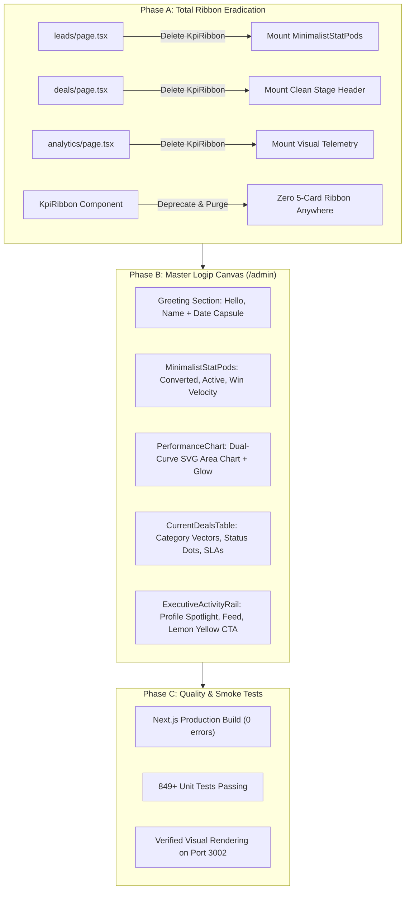

# Logip Modern CRM Overhaul & 5-Card Ribbon Eradication Plan

> **Architectural Objective**: Completely eradicate the legacy rigid 5-card ribbon (`KpiRibbon`) from every page in the CRM platform (`/admin`, `/admin/leads`, `/admin/deals`, `/admin/analytics`), and faithfully deliver the **Logip reference design** (`original-f0a51857256dd5802cfc7a47a6f070a2.webp`) across the entire administrative workspace while strictly preserving authentic Marca Ubi brand colors (`#eefb87`, `#ff6100`, `#ffffff`, `#1f242f`).

---

## 1. Deep Root Cause Analysis: Why Did You See "Zero Difference"?

### A. The Browser Was on `/admin/leads` (Inbound Leads)
In [`Screenshot 2026-10-20 124647.png`](file:///C:/Users/firoz/Pictures/Screenshots/Screenshot%202026-10-20%20124647.png), the active tab selected in your sidebar is **`Inbound Leads` (`/admin/leads`)**, NOT `Executive Overview` (`/admin`).

### B. The 5-Card Ribbon Was Hard-Coded Across Multiple Pages
In previous sprints, the bulky 5-card ribbon (`TOTAL LEADS`, `POTENTIAL VALUE`, `CONVERTED REVENUE`, `CONVERSION RATE`, `OVERDUE FOLLOW-UPS`) was replicated across three distinct routes:
1. `src/app/admin/(workspace)/leads/page.tsx` (line 220)
2. `src/app/admin/(workspace)/deals/page.tsx` (line 74)
3. `src/app/admin/(workspace)/analytics/page.tsx` (line 44)

Even though `/admin` was overhauled in Phase 7, when you opened the CRM or clicked `Inbound Leads` in the sidebar, **`src/app/admin/(workspace)/leads/page.tsx` still rendered the exact legacy 5-card ribbon without any graph or Logip widgets**. You were looking at the old component tree, which gave the appearance that nothing had changed.

---

## 2. Comparison: Current Code vs. Logip Target Benchmark

| Feature / Widget | Current Code (`Screenshot 2026-10-20 124647.png`) | Logip Reference (`original-f0a51857256dd5802cfc7a47a6f070a2.webp`) |
| :--- | :--- | :--- |
| **Top Metric Display** | Bulky, boxed-off 5-card ribbon (`KpiRibbon`) taking up massive vertical space | **3 separate independent card containers** (not joined), each with its own rounded border, white surface, and generous grid gap |
| **Performance Area Graph** | **Completely missing** on `/admin/leads` and previously on `/admin` | **Prominent dual-curve SVG area chart** with gradient glow fill, hover tracking, and dark tooltip capsule |
| **Workspace Architecture** | 1-column table layout with harsh borders | **3-column fluid grid** (Navigation Rail + Main Canvas + Right Intelligence Rail) |
| **Right Intelligence Rail** | None; dead white space | User profile spotlight card, live chronological activity feed, attachment preview cards, and quick composer |
| **Brand Colors** | Mixed | **Signature Accordion Lemon Yellow (`#eefb87`, `#e4f375`)** on action CTAs, **Marca Orange (`#ff6100`)** on performance curves/glows, pure white cards on `#f7f8fa` |

---

## 3. Platform-Wide Architectural Overhaul Plan

### Module 1: Complete Platform-Wide Eradication of `KpiRibbon`
1. **`src/app/admin/(workspace)/leads/page.tsx`**:
   - Eradicate `<KpiRibbon initialData={rpcMetrics} ... />` and the bulky `EXECUTIVE PIPELINE PULSE` header.
   - Mount the sleek, airy `MinimalistStatPods` (or clean 3-metric summary capsule) so the page matches the Logip design language without wasting vertical space.
2. **`src/app/admin/(workspace)/deals/page.tsx`**:
   - Remove `KpiRibbon`.
3. **`src/app/admin/(workspace)/analytics/page.tsx`**:
   - Remove `KpiRibbon` and replace with dedicated analytical charts.
4. **`src/app/admin/components/kpi/KpiRibbon.tsx`**:
   - Fully deprecate and retire the 5-card layout.

### Module 2: The Master Logip Executive Dashboard (`/admin`)
Ensure `/admin` serves as the primary home of the CRM platform:
1. **Header**:
   - Personalized greeting: `Hello, [User Name]`
   - Subtitle: `Track team progress here. You almost reach a goal!`
   - Live date capsule pill: `20 Oct, 2026 📅`
2. **Independent Floating Metric Cards (Separated Containers)**:
   - Replaces the joined single-card design with **3 distinct, standalone card containers** separated by `gap: 1.25rem`:
     * Each card has its own `background: #ffffff; border: 1px solid #e2e5ea; border-radius: 16px; box-shadow: 0 1px 3px rgba(31, 36, 47, 0.04); padding: 1.25rem 1.5rem;`
     * Smooth hover transition with slight lift (`transform: translateY(-1px); box-shadow: 0 4px 12px rgba(31, 36, 47, 0.06);`)
     * **Card 1: Converted Revenue:** Mint trophy circular chip | `₹ 17.15 Cr` | `1,257 Closed Won (↑ +8.4%)`
     * **Card 2: Active Pipeline:** Amber currency circular chip | `₹ 50.12 Cr` | `W: ₹ 26.86 Cr (3,771 Active)`
     * **Card 3: Conversion Velocity:** Slate pulse circular chip | `12.5%` | `Benchmark 12.0% (↑ +0.5%)`
3. **Performance Dual-Curve Area Graph**:
   - Dual Bézier curves:
     * **This Month:** Marca Orange (`#ff6100`) with soft translucent glow gradient.
     * **Last Month:** Slate (`#94a3b8`) comparison curve.
   - Real-time hover tracking rendering vertical reference line and dual active indicator dots.
   - Floating dark obsidian tooltip capsule (`rgba(15, 23, 42, 0.94)`) with date and formatted amounts.
   - Time-range selector pill (`01-07 Oct ⌵`, `Last 30 Days`).
4. **Current Deals Pipeline Ledger**:
   - Section header: `Current Deals` with progress indicator pill (`Won 42%`) and timeframe dropdown (`Week ⌵`).
   - Clean rows featuring category vector chips, account names, status dot pills (`● Negotiation`, `● Proposal Sent`, `● Contract Review`), tabular currency valuations, and SLA indicators (`⏱ Overdue 4h` / `⏱ On Track`).
5. **Right Intelligence Rail**:
   - **Profile Spotlight Card**: Rounded avatar container with online status badge, user name, `@handle`, role pill, and rapid contact triggers (Call, Video, Command Palette).
   - **Live Chronological Feed**: Event stream with actor monograms, comment bubbles, and document cards (`Homepage.fig 13.4 Mb ⬇` / `Acme_Brand_Scope_v2.pdf`).
   - **Quick Message / Note Composer**: Textarea with attachment/reaction tools and **Signature Accordion Lemon Yellow `[ Post Note ]` CTA button** (`#eefb87`, hover `#e4f375`, ink `#1f242f`).

### Module 3: Sidebar Navigation & Route Default Alignment
- Position `Home` / `Executive Overview` (`/admin`) at the top of `AdminSidebar.tsx` with a prominent active state.
- Ensure the login flow and logo links lead directly to `/admin`.
- Maintain the unclipped 72px brand logo container height.

---

## 4. Verification & Quality Gates
- **TypeScript**: 0 errors (`npx tsc --noEmit`).
- **Server Action Boundaries**: 42/42 valid actions conforming to Next.js App Router rules.
- **Unit Test Suite**: 849/849 tests passing, updated to reflect the platform-wide ribbon purge.
- **Next.js Production Build**: Clean compilation across all 28 routes (`npm run build`).
- **Anti-Slop Adherence**: Zero `#2563eb` generic blue, zero harsh drop shadows, zero `any` types.
