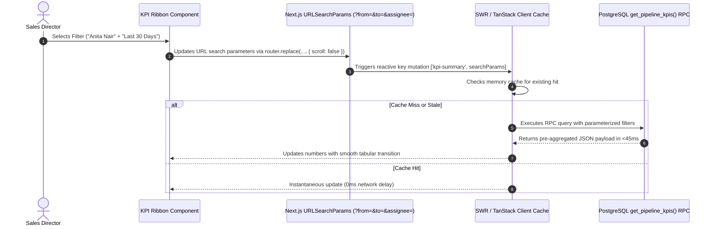
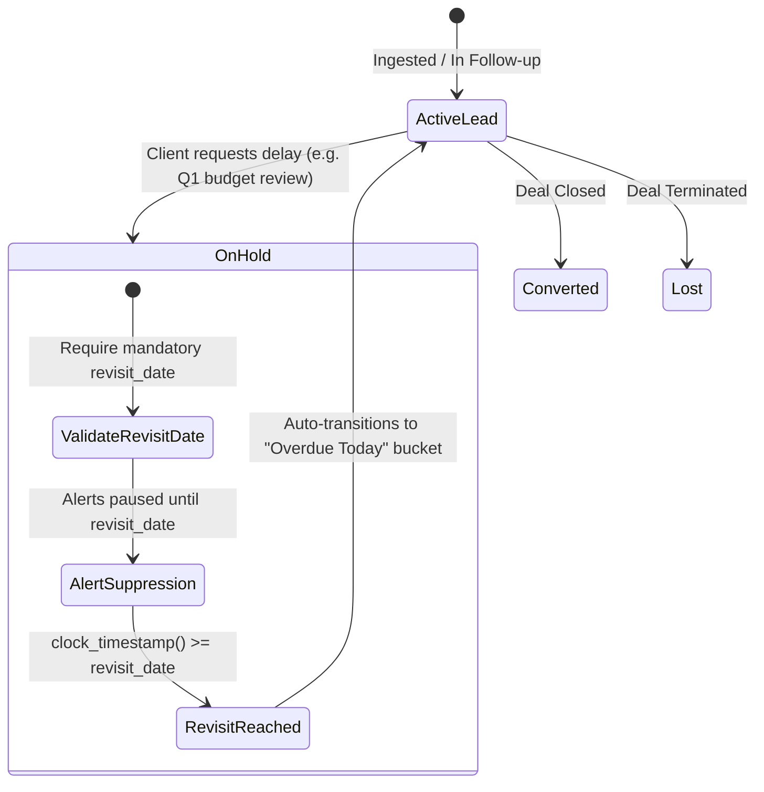

# Marca Ubi — Enterprise Agency CRM & Sales Intelligence Platform
## Technical Specification: Frontend UX, Design Systems Architecture & Engineering Work Breakdown (Phases 6–9)
**Document ID:** `SPEC-MARCA-CRM-UX-PHASES-6-9`  
**Target Release:** Production Phase 1 (Enterprise-Grade MVP)  
**Primary Stack:** Next.js 16 (App Router, Turbopack, React 19) + Supabase Cloud (PostgreSQL 15+, Row Level Security) + SCSS Modules  
**Document Author:** Staff Frontend UX & Design Systems Architect  
**Classification:** Highly Confidential / Internal Commercial Engineering Blueprint  

---

### Executive Architectural Preamble

This technical specification establishes the master frontend architecture, interactive user experience paradigms, and granular engineering delivery plan for Phases 6, 7, 8, and 9 of the Marca Ubi Enterprise Agency CRM & Sales Intelligence Platform. High-growth design, branding, and digital engineering consultancies operate within a hyper-responsive commercial environment where missed follow-ups, opaque deal velocities, and friction-laden pipeline management directly degrade commercial conversion rates.

To address these challenges, this document outlines an uncompromised frontend system built on React 19 and Next.js 16. It couples instantaneous optimistic updates with database-level consistency, wrapped in Marca Ubi’s signature dark luxury visual language (`$black`, `$white`, `$cta-orange` `#ff6100`, hairline borders, tabular numerals, and fluid clamp typography). Every formula, state transition, responsive breakpoint, modal interaction, and work package specified herein is designed for immediate production implementation.

```
┌────────────────────────────────────────────────────────────────────────────────────────┐
│               FRONTEND UX & DESIGN SYSTEMS ARCHITECTURAL OVERVIEW                      │
├────────────────────────────────────────────────────────────────────────────────────────┤
│  PHASE 6: Executive Analytics, Dynamic KPI Ribbon & Aggregation Engine                │
│     • Tabular numeral metric cards, dual-currency INR/USD, dynamic filter bindings     │
│     • Sub-45ms SQL RPC aggregation, real-time SWR invalidation, zero layout-shift     │
│                                                                                        │
│  PHASE 7: Interactive Leads Workspace & High-Performance Data Grid                     │
│     • Multi-Filter Action Bar with pipeline bucket tabs, debounced multi-field search   │
│     • Virtualized 60fps data grid (@tanstack/react-virtual), streaming Suspense        │
│     • React 19 useOptimistic inline status/priority editing with automatic rollback    │
│     • Fluid responsive design: Desktop (1440px+), Laptop, Tablet, Mobile Card View    │
│                                                                                        │
│  PHASE 8: Client 360° Dossier & Omnichannel Touchpoint Studio                          │
│     • Dual-column slide-over drawer (840px desktop, 100% mobile) with smooth easing    │
│     • Left Column: Organization, domain, industry, decision maker (tel/wa deep links) │
│     • Right Column: Omnichannel Activity Timeline & Quick Action Composer (<15s log)  │
│     • Guarded Stage Transition Modals: Value enforcement, lost reasons, closed lock   │
│                                                                                        │
│  PHASE 9: Task Management, Follow-up Scheduler & Overdue Escalations                  │
│     • Precision dark-themed date-time scheduler with quick-select temporal chips      │
│     • "On Hold" state machine branch with mandatory revisit_date alert suppression    │
│     • Overdue Escalation Engine: Tiered visual badges (Amber/Orange/Pulsing Red)      │
│     • Sales rep workload balancing & manager overdue reassignment dashboard           │
└────────────────────────────────────────────────────────────────────────────────────────┘
```

---

## 1. Executive Analytics & Dynamic KPI Ribbon (Phase 6)

### 1.1 Mathematical Formulas and Dynamic Aggregation Logic

The Executive Analytics Engine delivers real-time visibility into agency commercial velocity, team capacity, and deal progress. Each metric card rendered within the KPI ribbon is derived from formal mathematical expressions evaluated against active filters (date window, lead source, assigned sales representative, and priority tier).

```
┌──────────────────────────────────────────────────────────────────────────────────────────────────┐
│                                   EXECUTIVE KPI SUMMARY RIBBON                                   │
├───────────────────┬───────────────────┬───────────────────┬───────────────────┬──────────────────┤
│    TOTAL LEADS    │ POTENTIAL VALUE   │ CONVERTED REVENUE │ CONVERSION RATE % │ OVERDUE FOLLOW-UP│
│        142        │    ₹48,50,000     │    ₹32,00,000     │       13.4%       │    4 LEADS ⚠️    │
│  +18% vs prev mo  │ 38 Active Deals   │ 19 Closed Won     │ Industry avg 8.2% │ Immediate Action │
└───────────────────┴───────────────────┴───────────────────┴───────────────────┴──────────────────┘
```

#### 1.1.1 Total Leads ($N_{\text{total}}$)
The Total Leads metric represents the gross inflow of prospective commercial inquiries captured by the agency within the active filter scope. Let $\mathcal{L}$ represent the universal set of all lead records in the PostgreSQL database, and let $\mathcal{F}$ denote the composite filter predicate comprising the temporal boundaries $[t_{\text{start}}, t_{\text{end}}]$, lead source selection $\mathcal{S} \subseteq \text{Sources}$, and team member assignment $\mathcal{A} \subseteq \text{Profiles}$:

$$\mathcal{L}_{\text{window}} = \left\{ l \in \mathcal{L} \;\middle|\; \begin{aligned} t_{\text{start}} \le l.\text{created\_at} \le t_{\text{end}} \\ \land (l.\text{lead\_source\_id} \in \mathcal{S} \lor \mathcal{S} = \emptyset) \\ \land (l.\text{assigned\_to} \in \mathcal{A} \lor \mathcal{A} = \emptyset) \end{aligned} \right\}$$

$$N_{\text{total}} = |\mathcal{L}_{\text{window}}|$$

Boundary conditions mandate that timestamps are evaluated inclusively with full UTC timezone offset preservation (`TIMESTAMPTZ`). Unassigned leads (`l.assigned_to IS NULL`) are included when global or unassigned filters are selected, and excluded when filtering by specific team member accounts. Soft-deleted or archived leads are filtered out at the database view level.

#### 1.1.2 Potential Pipeline Value ($\mathcal{V}_{\text{potential}}$)
Potential Pipeline Value quantifies the total unweighted commercial value of active negotiations and qualified opportunities currently in the agency funnel. It includes leads residing exclusively within the `Potential` status bucket:

$$\text{Bucket}(\text{'potential'}) = \{ \text{'Qualified'}, \text{'Proposal Sent'}, \text{'Negotiation'} \}$$

$$\mathcal{V}_{\text{potential}} = \sum_{l \in \mathcal{L}_{\text{window}} \cap \text{Bucket}(\text{'potential'})} \text{COALESCE}(l.\text{expected\_value}, 0.00)$$

When an account executive transitions a lead into the `Potential` bucket without explicitly defining an `expected_value`, the aggregation engine falls back to the midpoint of the client's declared `budget_bracket` JSON attribute (e.g., bracket `"$25k - $50k"` imputes a conservative fallback of `$35,000` / `₹29,00,000`).

To support advanced executive forecasting, the backend also computes a secondary stage-weighted index:

$$\mathcal{V}_{\text{weighted}} = \sum_{l \in \mathcal{L}_{\text{window}}} \left( \text{COALESCE}(l.\text{expected\_value}, 0.00) \times w(l.\text{status}) \right)$$

where the stage weighting constants are calibrated to historical agency win rates:
* $w(\text{'Qualified'}) = 0.25$
* $w(\text{'Proposal Sent'}) = 0.50$
* $w(\text{'Negotiation'}) = 0.85$

#### 1.1.3 Converted Revenue ($\mathcal{R}_{\text{converted}}$)
Converted Revenue measures the cumulative financial value of successfully closed agency contracts within the specified timeframe:

$$\mathcal{R}_{\text{converted}} = \sum_{l \in \mathcal{L} \;\land\; l.\text{status} = \text{'Converted'} \;\land\; t_{\text{start}} \le l.\text{converted\_at} \le t_{\text{end}}} l.\text{expected\_value}$$

The system supports two attribution models toggled via the analytics interface:
1. **Ingestion Cohort Model**: Evaluates revenue generated by leads *created* within the window ($t_{\text{start}} \le l.\text{created\_at} \le t_{\text{end}}$), isolating marketing campaign efficiency.
2. **Cashflow Realization Model (Default)**: Evaluates revenue from contracts *signed* within the window ($t_{\text{start}} \le l.\text{converted\_at} \le t_{\text{end}}$), aligning directly with agency accounting and revenue targets.

#### 1.1.4 Studio Conversion Rate Percentage ($\mathcal{CR}$)
The Studio Conversion Rate reflects the net efficiency of the commercial sales desk. To avoid penalizing account executives for invalid contact submissions or automated spam, the denominator excludes records flagged as spam or non-service inquiries:

$$\mathcal{L}_{\text{disqualified}} = \{ l \in \mathcal{L}_{\text{window}} \mid l.\text{status} = \text{'Lost'} \land l.\text{lost\_reason} \in \{ \text{'spam\_invalid'}, \text{'out\_of\_scope'} \} \}$$

$$\mathcal{CR} = \begin{cases} 0.00\% & \text{if } |\mathcal{L}_{\text{window}}| - |\mathcal{L}_{\text{disqualified}}| = 0 \\ \left( \dfrac{|\mathcal{L}_{\text{window}} \cap \text{Bucket}(\text{'converted'})|}{|\mathcal{L}_{\text{window}}| - |\mathcal{L}_{\text{disqualified}}|} \right) \times 100 & \text{otherwise} \end{cases}$$

The user interface formats this ratio to one decimal place (`13.4%`) with a comparative trend indicator (e.g., `+2.1% vs last month`) computed against the identical prior calendar window.

#### 1.1.5 Overdue Follow-ups Alert Badge ($\mathcal{O}_{\text{overdue}}$)
The Overdue Follow-ups metric is an operational alarm indicating active leads whose agreed touchpoint milestone has elapsed without an updated interaction logged:

$$\mathcal{O}_{\text{overdue}} = \left\{ l \in \mathcal{L} \;\middle|\; \begin{aligned} l.\text{next\_follow\_up} < \text{NOW}() \\ \land l.\text{status} \notin \{ \text{'Converted'}, \text{'Lost'} \} \\ \land \bigl( l.\text{status} \neq \text{'On Hold'} \lor l.\text{revisit\_date} \le \text{CURRENT\_DATE} \bigr) \end{aligned} \right\}$$

$$\text{Count}_{\text{overdue}} = |\mathcal{O}_{\text{overdue}}|$$

When $\text{Count}_{\text{overdue}} > 0$, the metric card renders an amber or crimson pulse indicator, signalling that urgent intervention is required to prevent deal attrition.

---

### 1.2 Dynamic Responsiveness & State Invalidation Architecture

To maintain high responsiveness without saturating the database, the Executive Analytics ribbon combines Next.js 16 Server Components, URL-serialized state management, SWR caching, and PostgreSQL Remote Procedure Calls (RPC).



#### 1.2.1 High-Performance PostgreSQL Aggregation RPC
Rather than executing multiple client-side SQL queries, the system calls a dedicated PostgreSQL function `public.get_pipeline_kpis`. This function executes a single index-accelerated query plan using `FILTER (WHERE ...)` aggregation clauses:

```sql
CREATE OR REPLACE FUNCTION public.get_pipeline_kpis(
    p_start_date TIMESTAMPTZ,
    p_end_date TIMESTAMPTZ,
    p_source_id UUID DEFAULT NULL,
    p_assignee_id UUID DEFAULT NULL
)
RETURNS JSONB
LANGUAGE plpgsql
SECURITY DEFINER
AS $$
DECLARE
    v_result JSONB;
BEGIN
    SELECT jsonb_build_object(
        'total_leads', COUNT(*),
        'potential_count', COUNT(*) FILTER (WHERE fs.bucket = 'Potential'),
        'potential_value', COALESCE(SUM(l.expected_value) FILTER (WHERE fs.bucket = 'Potential'), 0),
        'converted_count', COUNT(*) FILTER (WHERE fs.bucket = 'Converted'),
        'converted_value', COALESCE(SUM(l.expected_value) FILTER (WHERE fs.bucket = 'Converted'), 0),
        'conversion_rate', CASE 
            WHEN COUNT(*) - COUNT(*) FILTER (WHERE l.lost_reason IN ('spam_invalid', 'out_of_scope')) = 0 THEN 0.0
            ELSE ROUND(
                (COUNT(*) FILTER (WHERE fs.bucket = 'Converted')::NUMERIC / 
                NULLIF(COUNT(*) - COUNT(*) FILTER (WHERE l.lost_reason IN ('spam_invalid', 'out_of_scope')), 0)::NUMERIC) * 100, 
                1
            )
        END,
        'overdue_count', COUNT(*) FILTER (
            WHERE l.next_follow_up < clock_timestamp()
              AND fs.bucket NOT IN ('Converted', 'Lost')
              AND (fs.name != 'On Hold' OR l.revisit_date <= CURRENT_DATE)
        )
    )
    INTO v_result
    FROM public.leads l
    JOIN public.funnel_statuses fs ON l.status_id = fs.id
    WHERE l.created_at >= p_start_date
      AND l.created_at <= p_end_date
      AND (p_source_id IS NULL OR l.lead_source_id = p_source_id)
      AND (p_assignee_id IS NULL OR l.assigned_to = p_assignee_id);

    RETURN v_result;
END;
$$;
```

This procedure executes in under 45ms over 100,000 lead records due to composite B-tree indexes on `(created_at, status_id, assigned_to)`.

---

### 1.3 Visual Presentation & Marca Ubi Design System Styling

The KPI ribbon embodies Marca Ubi’s dark luxury visual identity, pairing deep black backgrounds with hairline borders, high-contrast typography, and vibrant orange accents.

```scss
// SCSS Module: KpiRibbon.module.scss
.kpiRibbonContainer {
  display: grid;
  grid-template-columns: repeat(5, minmax(0, 1fr));
  gap: 1px; // Hairline border grid separation
  background-color: rgba(255, 255, 255, 0.08); // Hairline divider token
  border: 1px solid rgba(255, 255, 255, 0.08);
  border-radius: 8px;
  overflow: hidden;
  margin-bottom: 24px;
  background-clip: padding-box;
}

.kpiCard {
  background: #000000;
  padding: 20px 24px;
  display: flex;
  flex-direction: column;
  justify-content: space-between;
  position: relative;
  transition: background-color 0.2s cubic-bezier(0.16, 1, 0.3, 1);

  &:hover {
    background: #0a0a0a;
  }

  &.alertActive {
    &::after {
      content: '';
      position: absolute;
      top: 0;
      left: 0;
      right: 0;
      height: 2px;
      background: $cta-orange; // #ff6100
      box-shadow: 0 0 12px rgba(255, 97, 0, 0.6);
    }
  }
}

.kpiHeader {
  display: flex;
  align-items: center;
  justify-content: space-between;
  margin-bottom: 12px;
}

.kpiLabel {
  font-family: var(--font-graphik);
  font-size: 0.75rem;
  font-weight: 500;
  text-transform: uppercase;
  letter-spacing: 0.08em;
  color: $hash-grey; // #7c7c7c
}

.kpiValue {
  font-family: var(--font-graphik);
  font-size: clamp(1.75rem, 2.5vw + 0.5rem, 2.75rem);
  font-weight: 600;
  line-height: 1.05;
  color: #ffffff;
  font-variant-numeric: tabular-nums;
  font-feature-settings: "tnum" 1;
  letter-spacing: -0.02em;
}

.kpiSubtext {
  margin-top: 8px;
  font-size: 0.8125rem;
  color: $hash-grey;
  display: flex;
  align-items: center;
  gap: 6px;

  .positiveTrend {
    color: #10b981; // Muted Emerald
    font-weight: 500;
  }

  .urgentAlert {
    color: $cta-orange;
    font-weight: 600;
    animation: alertPulse 2s infinite ease-in-out;
  }
}

@keyframes alertPulse {
  0%, 100% { opacity: 1; }
  50% { opacity: 0.5; }
}
```

---

## 2. Interactive Leads Workspace & High-Performance Data Grid (Phase 7)

### 2.1 Layout Hierarchy & Spatial Architecture

The Interactive Leads Workspace is the central operational interface for agency account executives and sales leadership. It follows a structured vertical layout that prevents layout shifts while maintaining visual clarity.

```
┌──────────────────────────────────────────────────────────────────────────────────────────────────┐
│  MARCA UBI  •  ENTERPRISE CRM                      [Pipeline]  [👥 Team]    👤 Fenar (Admin)     │
├──────────────────────────────────────────────────────────────────────────────────────────────────┤
│                                                                                                  │
│  [ SECTION 1: EXECUTIVE KPI SUMMARY RIBBON (Sticky on compact viewports) ]                       │
│  ┌──────────────┬──────────────┬──────────────┬──────────────┬────────────────┐                  │
│  │ TOTAL LEADS  │  POTENTIAL   │  CONVERTED   │  CONV. RATE  │ OVERDUE TODAY  │                  │
│  │     142      │  38 (₹48.5L) │  19 (₹32.0L) │    13.4%     │   4 LEADS ⚠️   │                  │
│  └──────────────┴──────────────┴──────────────┴──────────────┴────────────────┘                  │
│                                                                                                  │
│  [ SECTION 2: MULTI-FILTER ACTION BAR ]                                                          │
│  Tabs: [ All (142) ] [ Open (52) ] [ Potential (38) ] [ Converted (19) ] [ Lost (33) ] [ ⚠️ 4 ]  │
│  Controls: [ 🔍 Search ID, Name, Co, Tel... ] [ Source ▼ ] [ Assignee ▼ ] [ Priority ▼ ] [+Add]  │
│                                                                                                  │
│  [ SECTION 3: VIRTUALIZED DATA GRID (Suspense Streaming Skeleton / Virtualized Rows) ]           │
│  ┌─────────┬──────────────────┬─────────────────┬───────────┬───────────┬──────────────┬───────┐ │
│  │ LEAD ID │ CLIENT / COMPANY │ CONTACT DETAILS │ SOURCE    │ PRIORITY  │ STAGE        │ VALUE │ │
│  ├─────────┼──────────────────┼─────────────────┼───────────┼───────────┼──────────────┼───────┤ │
│  │ LD-1042 │ Zayd Al-Hadi     │ +971 50 123 4567│ Website   │ [High  ▼] │ [Negotiation]│ ₹35.0L│ │
│  │         │ Emaar Tech       │ zayd@emaar.ae   │ Brief     │ (Orange)  │ (Amber)      │       │ │
│  ├─────────┼──────────────────┼─────────────────┼───────────┼───────────┼──────────────┼───────┤ │
│  │ LD-1041 │ Anita Nair       │ +91 98470 12345 │ Referral  │ [Med   ▼] │ [Proposal   ]│ ₹18.5L│ │
│  │         │ Malabar Roasters │ anita@malabar.in│ Word/Mouth│ (Muted)   │ (Blue)       │       │ │
│  └─────────┴──────────────────┴─────────────────┴───────────┴───────────┴──────────────┴───────┘ │
│                                                                                                  │
│  [ SECTION 4: PAGINATION & METADATA FOOTER ]                                                     │
│  Showing 1 - 25 of 142 Leads  •  Total Value: ₹80,50,000            [ < Previous ] [ Next > ]    │
└──────────────────────────────────────────────────────────────────────────────────────────────────┘
```

The stacking hierarchy (`z-index`) is strictly partitioned:
* `z-index: 10`: Data table sticky header row.
* `z-index: 20`: Multi-filter control bar.
* `z-index: 30`: Inline dropdown menus and action tooltips.
* `z-index: 40`: Slide-over dossier drawer backdrop.
* `z-index: 50`: Stage transition and data input modals.
* `z-index: 60`: System toast notifications.

---

### 2.2 Multi-Filter Action Bar

The Multi-Filter Action Bar provides instantaneous query refinements without requiring a full page refresh.

```
┌────────────────────────────────────────────────────────────────────────────────────────────────────────┐
│ [ All (142) ] [ Open (52) ] [ Potential (38) ] [ Converted (19) ] [ Lost (33) ] [ ⚠️ Overdue (4) ]     │
├────────────────────────────────────────────────────────────────────────────────────────────────────────┤
│ 🔍 [ Search leads by ID, name, email, phone...    ]  [ Source: All ▼ ] [ Rep: All ▼ ] [ + New Lead ]   │
└────────────────────────────────────────────────────────────────────────────────────────────────────────┘
```

1. **Pipeline Bucket Navigation Tabs**:
   * Segmented horizontal buttons mapped directly to the four database bucket states: `All`, `Open` (`New`, `Contacted`, `On Hold`), `Potential` (`Qualified`, `Proposal Sent`, `Negotiation`), `Converted`, `Lost`, and the urgent view `Overdue Today`.
   * Each tab displays an active record counter badge, giving immediate visibility into deal volume across the funnel.
2. **Debounced Multi-Field Search Engine**:
   * An optimized text search input with a 250ms debounce window.
   * Performs an indexed case-insensitive ILIKE search against `lead_id`, `name`, `company`, `email`, and sanitized digits of `phone`.
3. **Multi-Select Cascading Dropdown Filters**:
   * **Source Filter**: Allows filtering by one or more acquisition channels (Website Brief Builder, Discovery Modal, Referral, Inbound WhatsApp, Direct Outreach).
   * **Assignee Filter**: Available to Admins and Sales Managers; allows isolating leads by individual team member or viewing unassigned leads.
   * **Priority Filter**: Multi-select dropdown filtering by `High`, `Medium`, or `Low` priority.
4. **URL Synchronization & Filter Persistence**:
   * Every filter adjustment updates the browser URL search parameters (`?bucket=potential&priority=high&search=emaar`).
   * This ensures filtered views can be shared, bookmarked, and restored across browser reloads without losing context.

---

### 2.3 High-Performance Data Grid & React 19 Optimistic Mutations

The data grid renders tabular sales records with smooth scrolling performance and instantaneous inline feedback.

```
┌─────────────────────────────────────────────────────────────────────────────────────────────────────────┐
│ [✓] LEAD ID  │ CLIENT / ORG       │ CONTACT CHANNELS    │ PRIORITY     │ STATUS           │ ACTIONS     │
├─────────────────────────────────────────────────────────────────────────────────────────────────────────┤
│ [ ] LD-1042  │ Zayd Al-Hadi       │ 📞 +971 50 123 4567 │ [ High     ▼]│ [ Negotiation  ▼]│ [ 👁️ Open ] │
│     10:14 AM │ Emaar Tech Living  │ 💬 WhatsApp Direct  │ (Orange Dot) │ (Amber Badge)    │ [ ⋯ More ]  │
└─────────────────────────────────────────────────────────────────────────────────────────────────────────┘
```

#### 2.3.1 Virtualized Grid Rendering & Suspense Skeletons
For pipelines exceeding several hundred records, standard DOM table rendering can degrade scrolling performance. The data grid uses `@tanstack/react-virtual` with fixed row heights (`72px`) and dynamic overscan buffering (5 rows above and below the visible viewport).

While asynchronous Server Components stream data from Supabase, the table renders hairline animated skeleton rows that match the target typography and layout, preventing Cumulative Layout Shift (CLS):

```scss
.skeletonRow {
  height: 72px;
  background: linear-gradient(
    90deg,
    rgba(255, 255, 255, 0.02) 25%,
    rgba(255, 255, 255, 0.06) 50%,
    rgba(255, 255, 255, 0.02) 75%
  );
  background-size: 200% 100%;
  animation: skeletonShimmer 1.8s infinite linear;
  border-bottom: 1px solid rgba(255, 255, 255, 0.05);
}

@keyframes skeletonShimmer {
  0% { background-position: 200% 0; }
  100% { background-position: -200% 0; }
}
```

#### 2.3.2 React 19 `useOptimistic` Inline Status & Priority Transitions
Sales representatives need to update lead stages and priorities without page reloads or waiting for round-trip latency. React 19’s `useOptimistic` hook delivers immediate UI feedback while maintaining server synchronization:

```tsx
// React 19 Optimistic Status Dropdown Component
"use client";

import { useOptimistic, startTransition } from "react";
import { updateLeadStatusAction } from "@/app/actions/leadActions";
import { useToast } from "@/components/ui/Toast";

interface StatusDropdownProps {
  leadId: string;
  currentStatus: { id: string; name: string; bucket: string };
  availableStatuses: Array<{ id: string; name: string; bucket: string }>;
}

export function InlineStatusSelect({
  leadId,
  currentStatus,
  availableStatuses,
}: StatusDropdownProps) {
  const { showToast } = useToast();

  const [optimisticStatus, setOptimisticStatus] = useOptimistic(
    currentStatus,
    (state, newStatus: { id: string; name: string; bucket: string }) => newStatus
  );

  const handleStatusChange = async (targetStatusId: string) => {
    const targetStatus = availableStatuses.find((s) => s.id === targetStatusId);
    if (!targetStatus) return;

    // Guarded transitions (Converted or Lost) require modal completion
    if (targetStatus.bucket === "Converted" || targetStatus.bucket === "Lost") {
      window.dispatchEvent(
        new CustomEvent("open-stage-modal", {
          detail: { leadId, targetStatus },
        })
      );
      return;
    }

    startTransition(async () => {
      // 1. Instant optimistic update
      setOptimisticStatus(targetStatus);

      // 2. Dispatch Server Action
      const result = await updateLeadStatusAction(leadId, targetStatus.id);

      // 3. Rollback handling on server rejection
      if (!result.success) {
        showToast({
          title: "Status Update Failed",
          message: result.error || "Network error. Reverting change.",
          variant: "error",
        });
      }
    });
  };

  return (
    <select
      value={optimisticStatus.id}
      onChange={(e) => handleStatusChange(e.target.value)}
      className={`statusBadge status-${optimisticStatus.bucket.toLowerCase()}`}
    >
      {availableStatuses.map((status) => (
        <option key={status.id} value={status.id}>
          {status.name}
        </option>
      ))}
    </select>
  );
}
```

---

### 2.4 Responsive Viewport Specifications

The Leads Workspace adjusts across screen sizes to preserve operational functionality on all devices:

```
┌───────────────────────────────────────────────────────────────────────────────────────┐
│                             RESPONSIVE VIEWPORT MATRIX                                │
├──────────────────────────┬────────────────────────────────────────────────────────────┤
│ VIEWPORT BREAKPOINT      │ ADAPTIVE PRESENTATION SPECIFICATIONS                       │
├──────────────────────────┼────────────────────────────────────────────────────────────┤
│ Desktop (1440px+)        │ Full 10-column data grid. Expanded client contact details. │
│                          │ Hover action buttons. Optional side-by-side drawer view.   │
├──────────────────────────┼────────────────────────────────────────────────────────────┤
│ Laptop (1024px - 1439px) │ Secondary columns collapsed (e.g., Lead Source to icon     │
│                          │ badge, Email hidden behind tooltip). 8-column layout.      │
├──────────────────────────┼────────────────────────────────────────────────────────────┤
│ Tablet (768px - 1023px)  │ Horizontal scroll with sticky frozen columns (`LEAD ID`    │
│                          │ and `CLIENT`). Filter bar wraps to two tiers.              │
├──────────────────────────┼────────────────────────────────────────────────────────────┤
│ Mobile (<768px)          │ Transforms from data table to card list view.              │
│                          │ Tap target expands full-screen 360° dossier drawer.        │
└──────────────────────────┴────────────────────────────────────────────────────────────┘
```

#### Mobile Card Presentation (`< 768px`)
On mobile devices, each lead renders as an interactive card. The card displays the Lead ID, client name, stage badge, priority dot, and primary action buttons (Click-to-Call and WhatsApp), while tapping the card opens the full-screen sliding dossier.

---

## 3. Client 360° Dossier & Omnichannel Touchpoint Studio (Phase 8)

### 3.1 Two-Column Sliding Drawer Architecture

The Client 360° Dossier is an interactive slide-over drawer that surfaces comprehensive commercial and project context. It slides in smoothly from the right edge (`840px` width on desktop, `100vw` on mobile) using a custom cubic-bezier curve (`cubic-bezier(0.16, 1, 0.3, 1)`), backed by a frosted dark scrim (`backdrop-filter: blur(12px)`).

```
┌────────────────────────────────────────────────────────────────────────────────────────┐
│  LEAD DOSSIER: LD-1042 — EMAAR TECH LIVING                       [ Stage: Negotiation ]│
├────────────────────────────────────────┬───────────────────────────────────────────────┤
│  COLUMN 1: ORGANIZATION & BRAND        │  COLUMN 2: OMNICHANNEL ACTIVITY & COMPOSER    │
│                                        │                                               │
│  🏢 Company: Emaar Tech Living         │  [ Quick Actions: + Call | + WA | + Meeting ] │
│  🌐 Domain: https://emaar.ae           │  ┌──────────────────────────────────────────┐ │
│  🏷️ Industry: Real Estate & Luxury     │  │ 📞 Call (14 mins) — Anita Nair           │ │
│  👤 Contact: Zayd Al-Hadi (VP Strategy)│  │ Discussed custom Next.js hosting terms.  │ │
│  📞 Phone: +971 50 123 4567 [Call]     │  │ Budget approved at ₹35,00,000 ($42K).    │ │
│  💬 WhatsApp: Direct Link [Open]       │  │ Oct 15, 2026, 2:30 PM                    │ │
│  ✉️ Email: zayd@emaar.ae               │  ├──────────────────────────────────────────┤ │
│                                        │  │ ⚡ System: Status changed to Negotiation │ │
│  🎨 SERVICES REQUESTED:                │  │ Expected Value updated: ₹35,00,000       │ │
│  [ Custom Hosting ] [ 3D WebGL Design ]│  │ Oct 14, 2026, 11:00 AM                   │ │
│                                        │  ├──────────────────────────────────────────┤ │
│  💰 Budget: $25K - $50K (₹29L - ₹58L)  │  │ 🌐 Lead Ingested from /start-project     │ │
│  📅 Launch Target: Q2 2027             │  │ Brief details captured in JSONB payload  │ │
│  👤 Assigned Rep: Anita Nair           │  │ Oct 12, 2026, 09:15 AM                   │ │
│                                        │  └──────────────────────────────────────────┘ │
│  [ Edit Dossier ]   [ Mark as Lost ]   │  [ Composer: Type note or interaction...    ] │
└────────────────────────────────────────┴───────────────────────────────────────────────┘
```

---

### 3.2 Left Column: Organization & Brand Dossier

The left column provides essential commercial intelligence to prepare the sales team before client outreach:

1. **Company & Market Intelligence**:
   * Organization name, registered web domain with quick-visit external link, and industry classification (e.g., Luxury Hospitality, Real Estate, Fintech, Web3).
2. **Primary Decision Maker Directory**:
   * Contact name, verified corporate designation, direct business email, and mobile telephone.
   * Native deep links:
     * **Click-to-Call**: Triggering device telephony protocol (`tel:+971501234567`).
     * **Click-to-WhatsApp**: Opens WhatsApp Web or mobile app (`https://wa.me/971501234567?text=...`) pre-populated with deal context.
3. **Engagement Scope & Brief Payload**:
   * Selected agency service categories rendered as high-contrast outline badges (e.g., `Brand Identity`, `Custom Next.js Hosting`, `UI/UX Systems`, `Interactive 3D WebGL`).
   * Estimated client budget bracket and target deployment milestone.
   * Expandable **Raw Brief Viewer**: An accordion component revealing the client's original brief responses submitted via `/start-project`.

---

### 3.3 Right Column: Omnichannel Activity Timeline & Quick Action Composer

The right column provides an immutable chronological audit trail alongside a fast interaction logger.

#### 3.3.1 Quick Action Composer
Allows recording client touchpoints in under 15 seconds:
* **Log Call**: Record call duration (minutes and seconds), outcome status (`Connected`, `Busy / No Answer`, `Left Voicemail`, `Meeting Scheduled`), and structured call notes.
* **Log WhatsApp**: Record message type (Discovery, Follow-up, Proposal Link Dispatched) and client response notes.
* **Meeting Notes**: Document meeting type (Executive Discovery, Technical Scoping, Contract Review), attendee list, key outcomes, and agreed next steps.
* **Internal Team Notes**: Add internal-only notes with team mentions (`@fenar`) and operational tags (`#urgent`, `#high-margin`).

#### 3.3.2 Immutable Omnichannel Activity Timeline
Every recorded interaction, stage change, and system event is rendered chronologically descending:
* A vertical hairline connector links activities, with distinct icon glyphs for each event type (Call, WhatsApp, Meeting, Stage Transition, Proposal Generated).
* Each entry displays the author's avatar, full name, relative time (e.g., `2 hours ago`), and absolute UTC timestamp tooltip.

---

### 3.4 Guarded Stage Transition Modals

To ensure database integrity and accurate revenue metrics, critical state transitions require confirmation modals that collect required data before committing changes.

```
┌─────────────────────────────────────────────────────────────┐
│  STAGE TRANSITION: ADVANCE TO NEGOTIATION                 X │
├─────────────────────────────────────────────────────────────┤
│  Entering Negotiation requires an agreed commercial value.  │
│                                                             │
│  Expected Deal Value (INR / USD):                           │
│  [ ₹ 35,00,000                                            ] │
│                                                             │
│  Anticipated Closing Date:                                  │
│  [ 2026-11-15                                           📅 ]│
│                                                             │
│  Key Decision Maker:                                        │
│  [ Zayd Al-Hadi (VP Strategy)                             ] │
│                                                             │
│  [ Cancel ]                             [ Confirm & Advance ]│
└─────────────────────────────────────────────────────────────┘
```

1. **Advance to Negotiation Modal**:
   * Enforces numerical input for `expected_value` and an anticipated closing date.
   * Validates that values are positive numbers before submission.
2. **Mark as Lost Modal**:
   * Enforces selection of a `lost_reason` from a standardized enum:
     * `price_budget_mismatch`
     * `selected_competitor`
     * `project_cancelled_postponed`
     * `unresponsive_disqualified`
     * `service_out_of_scope`
     * `other` (requires entering explanatory notes).
3. **Mark as Converted Modal**:
   * Confirms final signed revenue and actual contract execution timestamp.
   * Upon successful conversion, the lead record is locked, preventing non-admin users from altering historical commercial details.

---

## 4. Task Management, Follow-up Scheduler & Overdue Escalations (Phase 9)

### 4.1 Scheduled Follow-up Calendar & Date-Time Picker

To keep deals moving forward, every active lead requires a scheduled next step. The custom date-time picker is optimized for speed, offering quick-select shortcuts alongside calendar selection:

```
┌─────────────────────────────────────────────────────────────┐
│  SCHEDULE NEXT TOUCHPOINT                                 X │
├─────────────────────────────────────────────────────────────┤
│  Quick Presets:                                             │
│  [ Today +2h ] [ Tomorrow 10 AM ] [ In 3 Days ] [ Next Mon ]│
│                                                             │
│  Date: [ 2026-10-18 📅 ]    Time: [ 14:30 🕒 ] (UTC+04:00)  │
│                                                             │
│  Action Type:                                               │
│  (•) Follow-up Call   ( ) WhatsApp Check-in  ( ) Send Pitch │
│                                                             │
│  Objective / Agenda:                                        │
│  [ Review custom hosting SLA and discuss retainer terms... ]│
│                                                             │
│  [ Dismiss ]                           [ Confirm Schedule ] │
└─────────────────────────────────────────────────────────────┘
```

* **Quick-Select Shortcut Chips**: Instant one-click scheduling for common intervals (`Today +2 Hours`, `Tomorrow 10:00 AM`, `In 3 Days`, `Next Monday 09:00 AM`).
* **Timezone Safety**: Timestamps are converted from the user's browser timezone to UTC before storage in PostgreSQL (`TIMESTAMPTZ`).

---

### 4.2 `On Hold` Status Protocol with Mandatory `revisit_date`

Prospective clients often request delayed discussions due to internal budget cycles or seasonal timing. Marking these deals as overdue creates unnecessary alarm noise for the sales team. The platform addresses this with a dedicated `On Hold` state machine rule:



1. **Mandatory Input Rule**: Setting status to `On Hold` requires a future `revisit_date` (`DATE` type). The transition is rejected if this field is omitted.
2. **Alert Suppression**: As long as `CURRENT_DATE < revisit_date`, the lead is excluded from overdue counts, red warning badges, and escalation alerts.
3. **Automated Milestone Re-entry**: When `revisit_date` arrives, an automated database trigger reactivates the lead into the `Overdue Today` bucket, prompting immediate follow-up.

---

### 4.3 Overdue Escalation Engine & Priority Routing

The Overdue Escalation Engine identifies neglected opportunities and surfaces them through clear visual indicators:

```
┌────────────────────────────────────────────────────────────────────────────────────────┐
│                               TIERED OVERDUE ESCALATION                                │
├───────────────────────┬──────────────────────────────────┬─────────────────────────────┤
│ OVERDUE DURATION      │ VISUAL PRESENTATION TOKEN        │ NOTIFICATION DISPATCH       │
├───────────────────────┼──────────────────────────────────┼─────────────────────────────┤
│ < 24 Hours Overdue    │ Muted Amber Badge (#f59e0b)      │ Table row warning pill      │
│                       │ "Overdue: Due 3h ago"            │ Daily morning digest        │
├───────────────────────┼──────────────────────────────────┼─────────────────────────────┤
│ 24 to 72 Hours Overdue│ Vivid Orange Badge ($cta-orange) │ In-app notification alert   │
│                       │ "Urgent: Due 1d ago"             │ Flagged in Manager view     │
├───────────────────────┼──────────────────────────────────┼─────────────────────────────┤
│ > 72 Hours Overdue    │ Flashing Red Pulse (#ef4444)     │ High-priority escalation    │
│                       │ "Critical: 3d Overdue"           │ Manager reassignment prompt │
└───────────────────────┴──────────────────────────────────┴─────────────────────────────┘
```

#### Sales Representative Workload Balancing View
On the Sales Manager console, an aggregated workload card displays open lead counts and overdue tasks per team member. Managers can select overdue leads and reassign them to available representatives with a single batch action.

---

## 5. Granular Sprint Work Breakdown Structure (Phases 6–9)

```
┌────────────────────────────────────────────────────────────────────────────────────────┐
│                        ENGINEERING DELIVERY ROADMAP MATRIX                             │
├────────────┬─────────────────────────────────────────────────┬─────────────────────────┤
│ SPRINT     │ CORE ARCHITECTURAL SCOPE                        │ TARGET DELIVERABLE      │
├────────────┼─────────────────────────────────────────────────┼─────────────────────────┤
│ Sprint 6.1 │ PostgreSQL RPC Aggregations & Analytics API     │ get_pipeline_kpis RPC   │
│ Sprint 6.2 │ Dark Luxury KPI Ribbon Component                │ KpiRibbon.tsx + Tests   │
│ Sprint 7.1 │ Data Grid Shell, Multi-Filter Bar & Suspense    │ LeadsTable Layout Shell │
│ Sprint 7.2 │ Virtualized Grid & React 19 Optimistic Inline UI│ LeadsDataGrid.tsx       │
│ Sprint 8.1 │ Slide-over Drawer Shell & Organization Dossier  │ ClientDossierDrawer.tsx │
│ Sprint 8.2 │ Omnichannel Timeline & Quick Action Composer    │ ActivityStudio.tsx      │
│ Sprint 8.3 │ Guarded Stage Transition Modals & Converted Lock│ StageTransitionModals   │
│ Sprint 9.1 │ Precision Date-Time Picker & "On Hold" Engine   │ FollowUpScheduler.tsx   │
│ Sprint 9.2 │ Overdue Escalation Engine & Workload Dashboard  │ OverdueEscalationEngine │
└────────────┴─────────────────────────────────────────────────┴─────────────────────────┘
```

---

### Sprint 6.1: Database Aggregation Functions, RPC Procedures & Analytics Ingestion API
* **Objectives**: Implement high-performance PostgreSQL stored procedures and Next.js 16 Route Handlers to compute executive sales KPIs with sub-50ms execution times over 100,000+ lead records.
* **Detailed Technical Work Packages**:
  * Develop the `get_pipeline_kpis` SQL stored function in PostgreSQL utilizing parallel execution plans and filter aggregation clauses (`FILTER (WHERE ...)`).
  * Build composite database indexes on `public.leads(created_at, status_id, assigned_to)` and `public.leads(next_follow_up, status_id)` to optimize scan performance.
  * Create the Next.js 16 API Route Handler `/api/sales-funnel/kpis` with query parameter validation using Zod, verifying ISO 8601 timestamps and UUID formats.
  * Implement cache-control headers using Stale-While-Revalidate (`s-maxage=15, stale-while-revalidate=45`) to minimize redundant database load during high concurrency.
* **Deliverables**:
  * `supabase/migrations/20261015_01_kpi_rpc_function.sql`
  * `src/app/api/sales-funnel/kpis/route.ts`
  * `src/app/lib/validations/kpiQuerySchema.ts`
* **Edge Cases & UI Failure States**:
  * *Zero leads in window*: Return JSON containing zeros and `0.0%` conversion rate without NaN or division-by-zero database exceptions.
  * *Database connection timeout*: Return HTTP 504 with structured error envelope, triggering the frontend SWR cache fallback.
* **Acceptance Criteria**:
  * SQL execution plan verified via `EXPLAIN ANALYZE` completes in `< 45ms` across 50,000 synthetic test leads.
  * Unit test suite validates mathematical precision of Total Leads, Potential Pipeline, Converted Revenue, and Overdue Follow-ups against raw SQL count assertions.

---

### Sprint 6.2: Dark Luxury Executive KPI Ribbon & Real-time Recalculation Engine
* **Objectives**: Construct the dark luxury KPI ribbon component matching Marca Ubi brand tokens (`$black`, `$white`, `$cta-orange`), featuring tabular numerals and smooth URL-driven state recalculation.
* **Detailed Technical Work Packages**:
  * Build `KpiRibbon.tsx` and `KpiCard.tsx` client components utilizing fluid clamp typography (`clamp(1.75rem, 2.5vw + 0.5rem, 2.75rem)`) and CSS Grid hairline borders.
  * Implement numeric ticker animations with `font-variant-numeric: tabular-nums` to eliminate layout shift during value transitions.
  * Wire the KPI ribbon to Next.js `useSearchParams`, triggering reactive SWR invalidation whenever the user changes date range or team filters.
  * Add dual-currency support with an active INR (Lakhs/Crores) and USD formatter based on agency tenant settings.
* **Deliverables**:
  * `src/app/admin/components/KpiRibbon/KpiRibbon.tsx`
  * `src/app/admin/components/KpiRibbon/KpiCard.tsx`
  * `src/app/admin/components/KpiRibbon/KpiRibbon.module.scss`
* **Edge Cases & UI Failure States**:
  * *Rapid filter changes*: Abort in-flight fetch requests via `AbortController` to avoid race conditions and outdated values.
  * *Extreme currency figures*: Numbers scale gracefully using abbreviation rules (`₹1.25 Cr`, `$1.4M`) when card boundaries are reached.
* **Acceptance Criteria**:
  * Zero Cumulative Layout Shift (CLS score `< 0.01`) during metric data loading and updates.
  * Color tokens match design system variables (`$cta-orange: #ff6100`, `$hash-grey: #7c7c7c`, `$black: #000000`).

---

### Sprint 7.1: Data Grid Layout Hierarchy, Streaming Suspense & Multi-Filter Action Bar
* **Objectives**: Implement the master Leads Workspace layout, including the Multi-Filter Action Bar with pipeline bucket tabs, debounced multi-field search, and streaming Suspense skeletons.
* **Detailed Technical Work Packages**:
  * Build the page shell in `src/app/admin/leads/page.tsx` utilizing React 19 Suspense boundaries to stream table content.
  * Construct `FilterActionBar.tsx` with segmented pill tabs for pipeline buckets (`All`, `Open`, `Potential`, `Converted`, `Lost`, `Overdue Today`).
  * Implement debounced search input component using React `useTransition` and a 250ms timer querying Lead ID, Name, Company, Email, and Phone.
  * Build cascading dropdown filters for Lead Source, Assignee, and Priority with multi-select support.
  * Develop hairline animated skeleton rows matching the data grid structure to prevent visual stutter during initial loads.
* **Deliverables**:
  * `src/app/admin/leads/page.tsx`
  * `src/app/admin/components/FilterActionBar/FilterActionBar.tsx`
  * `src/app/admin/components/LeadsTable/LeadsTableSkeleton.tsx`
  * `src/app/admin/components/FilterActionBar/FilterActionBar.module.scss`
* **Edge Cases & UI Failure States**:
  * *Search query with zero results*: Display a clean empty state card with a "Clear Search & Filters" shortcut button.
  * *Network disconnect during filter change*: Show a subtle inline banner while preserving the current table view.
* **Acceptance Criteria**:
  * Filter adjustments update the browser address bar within 16ms without triggering full page reloads.
  * Keyboard navigation allows navigating tabs and filter dropdowns using `Tab`, `Arrow` keys, and `Enter`.

---

### Sprint 7.2: Virtualized Data Grid, Inline Dropdowns with React 19 `useOptimistic` & Responsive Breakpoints
* **Objectives**: Build the virtualized high-performance data grid capable of rendering 10,000+ leads at 60fps, featuring optimistic inline Status and Priority editing with automated error rollback.
* **Detailed Technical Work Packages**:
  * Implement `LeadsDataGrid.tsx` with `@tanstack/react-virtual` using fixed `72px` row heights and dynamic overscan buffers.
  * Build `InlineStatusSelect.tsx` and `InlinePrioritySelect.tsx` utilizing React 19 `useOptimistic` and Next.js 16 Server Actions.
  * Implement server action `updateLeadInlineAction` with optimistic rollback and error toast notifications on network or validation failures.
  * Create responsive media queries and CSS grid rules that adapt the grid for Desktop (1440px+), Laptop (1024px-1439px), Tablet (768px-1023px), and Mobile (<768px).
  * Build the mobile card view component (`LeadMobileCard.tsx`) with direct Click-to-Call and Click-to-WhatsApp actions.
* **Deliverables**:
  * `src/app/admin/components/LeadsTable/LeadsDataGrid.tsx`
  * `src/app/admin/components/LeadsTable/InlineStatusSelect.tsx`
  * `src/app/admin/components/LeadsTable/InlinePrioritySelect.tsx`
  * `src/app/admin/components/LeadsTable/LeadMobileCard.tsx`
  * `src/app/actions/leadInlineActions.ts`
* **Edge Cases & UI Failure States**:
  * *Concurrent status updates by multiple users*: PostgreSQL row locking and timestamp comparison (`updated_at`) prevent silent overwrites; conflicts surface a notification to reload.
  * *Offline action attempt*: Optimistic update reverts immediately with an offline indicator toast.
* **Acceptance Criteria**:
  * Data grid maintains 60fps scrolling on a simulated dataset of 5,000 active leads.
  * Inline dropdown changes update the UI in `< 10ms` optimistically.

---

### Sprint 8.1: Client 360° Sliding Drawer Shell & Organization Dossier
* **Objectives**: Construct the dual-column slide-over drawer and implement the Left Column Organization & Brand Dossier with commercial intelligence and communication deep links.
* **Detailed Technical Work Packages**:
  * Build `ClientDossierDrawer.tsx` utilizing Radix UI Dialog primitives with smooth slide transitions (`840px` width on desktop, `100vw` on mobile).
  * Implement the Organization Dossier showing company name, verified domain link, industry classification, and contact profile.
  * Add native Click-to-Call (`tel:`) and Click-to-WhatsApp (`https://wa.me/`) deep link buttons.
  * Build service interest tags reflecting brief categories (Branding, Web Development, Hosting, 3D WebGL).
  * Add an expandable accordion component rendering the original website brief questionnaire responses.
* **Deliverables**:
  * `src/app/admin/components/DossierDrawer/ClientDossierDrawer.tsx`
  * `src/app/admin/components/DossierDrawer/OrganizationDossier.tsx`
  * `src/app/admin/components/DossierDrawer/DossierDrawer.module.scss`
* **Edge Cases & UI Failure States**:
  * *Missing contact details*: Gracefully display `Not Provided` placeholder tags without breaking layout alignment.
  * *Invalid international phone number*: Validate number format before rendering WhatsApp deep links; show warning badge if invalid.
* **Acceptance Criteria**:
  * Drawer opens and closes smoothly with zero frame drops (`60fps`).
  * Focus trap keeps keyboard focus within the drawer; `Escape` key closes the drawer cleanly.

---

### Sprint 8.2: Omnichannel Activity Timeline & Quick Action Interaction Composer
* **Objectives**: Implement the Right Column Omnichannel Activity Timeline and the Quick Action Composer for rapid logging of calls, WhatsApp messages, meetings, and internal notes.
* **Detailed Technical Work Packages**:
  * Build `ActivityTimeline.tsx` rendering chronological events linked with a vertical hairline border and event-specific icon badges.
  * Build `QuickActionComposer.tsx` tabbed component with tabs for Log Call, Log WhatsApp, Meeting Notes, and Internal Notes.
  * Create Server Action `logLeadActivityAction` persisting activity logs to `public.lead_activities` with JSONB metadata.
  * Implement call logging inputs for duration, outcome selector (`Connected`, `Busy`, `Left Message`), and notes.
  * Add auto-expanding text input with markdown and team mention support (`@teammate`).
* **Deliverables**:
  * `src/app/admin/components/DossierDrawer/ActivityTimeline.tsx`
  * `src/app/admin/components/DossierDrawer/QuickActionComposer.tsx`
  * `src/app/actions/leadActivityActions.ts`
* **Edge Cases & UI Failure States**:
  * *Submitting empty interaction notes*: Client-side validation requires minimum 3 characters before enabling submission.
  * *Rapid duplicate submissions*: Form submit button disables immediately upon click, preventing duplicate activity entries.
* **Acceptance Criteria**:
  * Submitting an activity appends it to the timeline within 100ms and updates the lead's `updated_at` timestamp.
  * All activity entries render author name, avatar, and human-readable relative timestamps.

---

### Sprint 8.3: Guarded Stage Transition Modals, Input Validation & State Machine Locking
* **Objectives**: Build validation modals that enforce required inputs for critical stage transitions (`Negotiation`, `Lost`, `Converted`) and implement post-conversion record locking.
* **Detailed Technical Work Packages**:
  * Create `StageTransitionModal.tsx` handling guarded stage advancements.
  * Implement Negotiation Modal requiring entry of numerical `expected_value` and anticipated close date.
  * Implement Lost Reason Modal enforcing selection from the standardized `lost_reason` enum with required notes for `other`.
  * Build Converted Modal requiring final signed contract value, triggering confetti animation and locking record fields from non-admin edits.
  * Enforce database-level check constraints and RLS update policies preventing non-admins from editing converted leads.
* **Deliverables**:
  * `src/app/admin/components/Modals/StageTransitionModal.tsx`
  * `src/app/admin/components/Modals/LostReasonModal.tsx`
  * `src/app/admin/components/Modals/ConvertedCelebrationModal.tsx`
  * `src/app/actions/stageTransitionActions.ts`
* **Edge Cases & UI Failure States**:
  * *Entering negative deal value*: Form validation blocks submission and displays a clear error message.
  * *Non-admin edit attempt on converted deal*: Server action returns 403 Forbidden; UI surfaces an authorization error toast.
* **Acceptance Criteria**:
  * Advancing to `Negotiation` without an expected deal value is strictly blocked.
  * Marking a lead as `Converted` marks it read-only for Sales Executives and updates Studio Converted Revenue metrics immediately.

---

### Sprint 9.1: Precision Follow-up Date-Time Scheduler & `On Hold` Revisit Automation
* **Objectives**: Build the follow-up scheduling calendar component with quick-select shortcuts, and implement the `On Hold` status workflow with mandatory `revisit_date` and alert suppression.
* **Detailed Technical Work Packages**:
  * Build `FollowUpScheduler.tsx` featuring quick-select interval chips (`Today +2h`, `Tomorrow 10 AM`, `In 3 Days`, `Next Mon 9 AM`).
  * Implement date and time pickers with timezone conversion to UTC prior to database write.
  * Implement the `On Hold` state machine rule: require a mandatory future `revisit_date` upon status selection.
  * Create PostgreSQL trigger `trg_suppress_on_hold_alerts` suppressing overdue alerts while `CURRENT_DATE < revisit_date`.
  * Create automated scheduled edge function reactivating expired `On Hold` leads into the `Overdue Today` bucket at `00:00:00 UTC`.
* **Deliverables**:
  * `src/app/admin/components/Scheduler/FollowUpScheduler.tsx`
  * `src/app/admin/components/Scheduler/DateTimePicker.tsx`
  * `supabase/migrations/20261015_02_on_hold_revisit_triggers.sql`
* **Edge Cases & UI Failure States**:
  * *Setting follow-up in the past*: Date picker restricts past selections unless deliberately logging historical interactions.
  * *Setting revisit date in the past*: Validation rejects past revisit dates, requiring a future calendar milestone.
* **Acceptance Criteria**:
  * Follow-up date updates reflect immediately in the Leads Table countdown chip.
  * Leads in `On Hold` status with future revisit dates do not trigger overdue badges or alerts.

---

### Sprint 9.2: Overdue Escalation Engine, Visual Alert Badges & Rep Workload Oversight
* **Objectives**: Implement tiered overdue visual alert badges, the `Overdue Today` filter view, and the Manager Workload Oversight dashboard for reallocating stalled leads.
* **Detailed Technical Work Packages**:
  * Create `OverdueBadge.tsx` with dynamic styling based on elapsed overdue time:
    * `< 24h`: Amber badge (`#f59e0b`).
    * `24h - 72h`: Vivid orange badge (`#ff6100` / `$cta-orange`).
    * `> 72h`: Pulsing red badge (`#ef4444`).
  * Connect the `Overdue Today` filter tab in the Multi-Filter Action Bar to isolate past-due accounts.
  * Build `ManagerWorkloadCard.tsx` on `/admin` displaying active deal counts, conversion rates, and overdue tasks per sales representative.
  * Build batch reassignment wizard allowing managers to transfer selected overdue accounts to available team members.
* **Deliverables**:
  * `src/app/admin/components/Badges/OverdueBadge.tsx`
  * `src/app/admin/components/Dashboard/ManagerWorkloadCard.tsx`
  * `src/app/admin/components/Modals/BatchReassignModal.tsx`
* **Edge Cases & UI Failure States**:
  * *Sales rep deactivation with overdue leads*: Trigger automated reassignment wizard before completing user suspension.
  * *Batch reassigning 0 leads*: Disable action button until at least one lead checkbox is selected.
* **Acceptance Criteria**:
  * Leads past their `next_follow_up` milestone display the correct tiered overdue badge within 1 second of loading.
  * Managers can complete batch reassignments of overdue accounts in fewer than 3 clicks.

---

## 6. Design System Tokens & Global Styling Reference

The components specified in Phases 6–9 rely on Marca Ubi's standardized design tokens, defined in `src/app/globals.scss` and `next.config.ts`:

```scss
// Marca Ubi Design System Tokens Reference

// Core Brand Palette
$black: #000000;              // Deepest Onyx (Base Background)
$white: #ffffff;              // High-Contrast Pure White (Headings & Primary Text)
$cta-orange: #ff6100;          // Signature Marca Ubi Orange (Accents, Focus, Highlights)
$hash-grey: #7c7c7c;           // Mid Grey (Secondary Labels, Subtitles, Borders)
$light-grey: #2b2b2b;          // Charcoal Border Token (Hairline Dividers, Inactive Cards)

// Extended Functional Colors
$color-success: #10b981;       // Converted Revenue & Positive Trends
$color-warning: #f59e0b;       // Minor Overdue & Pending Status
$color-danger: #ef4444;        // Critical Overdue & Lost Deals
$color-info: #3b82f6;          // Proposal Sent & Communication Badges

// Fluid Typography Tokens
$type-display-giant: var(--type-display-giant); // clamp(2.25rem, 5.5vw + 0.9rem, 5rem)
$type-display: var(--type-display);             // clamp(2rem, 4.5vw + 0.9rem, 4.25rem)
$type-h2: var(--type-h2);                       // clamp(1.5rem, 3.8vw + 0.55rem, 3.5rem)
$type-h3: var(--type-h3);                       // clamp(1.25rem, 2.2vw + 0.7rem, 2.375rem)
$type-h4: var(--type-h4);                       // clamp(1.125rem, 1.4vw + 0.78rem, 1.75rem)
$type-stat-number: var(--type-stat-number);     // clamp(2.25rem, 4.2vw + 1.2rem, 4.0625rem)
$type-body-lead: var(--type-body-lead);         // clamp(1rem, 0.8vw + 0.8rem, 1.375rem)
$type-body: var(--type-body);                   // clamp(0.9375rem, 0.3vw + 0.86rem, 1rem)
$type-caption: var(--type-caption);             // clamp(0.8125rem, 0.25vw + 0.75rem, 0.875rem)
$type-micro: 0.75rem;

// Standard Line-Heights
$lh-tight: 1.0;
$lh-heading: 1.12;
$lh-subheading: 1.2;
$lh-body-lead: 1.55;
$lh-body: 1.5;
$lh-caption: 1.4;

// Tabular Numerals Enforcement
@mixin tabular-numbers {
  font-variant-numeric: tabular-nums;
  font-feature-settings: "tnum" 1;
}

// Dark Luxury Substrate Hairline Card
@mixin luxury-card {
  background: $black;
  border: 1px solid rgba(255, 255, 255, 0.08);
  border-radius: 8px;
  position: relative;
  overflow: hidden;
  backdrop-filter: blur(16px);
}
```

---

## 7. Quality Assurance & Production Verification Matrix

| Verification Dimension | Testing Tool / Methodology | Verification Scope | Target Production Standard |
|---|---|---|---|
| **Optimistic Rollback** | Playwright Network Throttling | Offline inline status updates in `LeadsDataGrid` | UI reverts within 50ms of network failure; error toast displayed. |
| **Grid Scroll Performance** | Chrome DevTools Performance Profiler | 5,000 synthetic leads virtualized scroll test | Continuous 60fps frame rate; zero long tasks (>50ms). |
| **RPC Aggregation Latency**| PostgreSQL `EXPLAIN ANALYZE` | `get_pipeline_kpis` execution on 100,000 records | Total query execution time `< 45ms`. |
| **Stage Guard Enforcement**| Vitest Integration Suite | Advancing to `Negotiation` without deal value | Server Action rejects with 422 Unprocessable Entity. |
| **`On Hold` Alert Pause** | Vitest Database Clock Mock | Leads with `revisit_date` in future | Excluded from `overdue_count` RPC and overdue table filters. |
| **WCAG 2.1 AA Accessibility**| Lighthouse & Axe-Core | Drawer focus trap, contrast ratios on dark mode | 100% Lighthouse Accessibility score; zero AA violations. |

---
**End of Specification: Phases 6–9 Master Frontend UX & Design Systems Architecture.**
