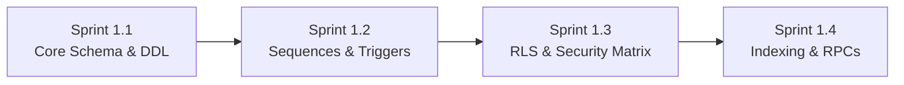
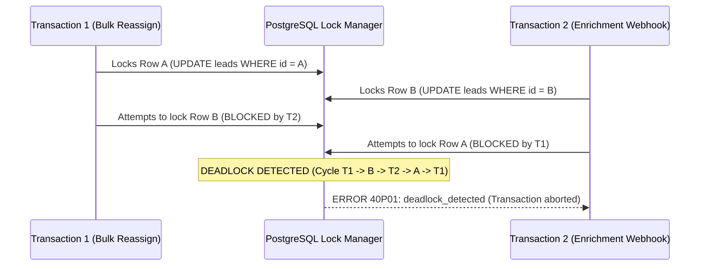
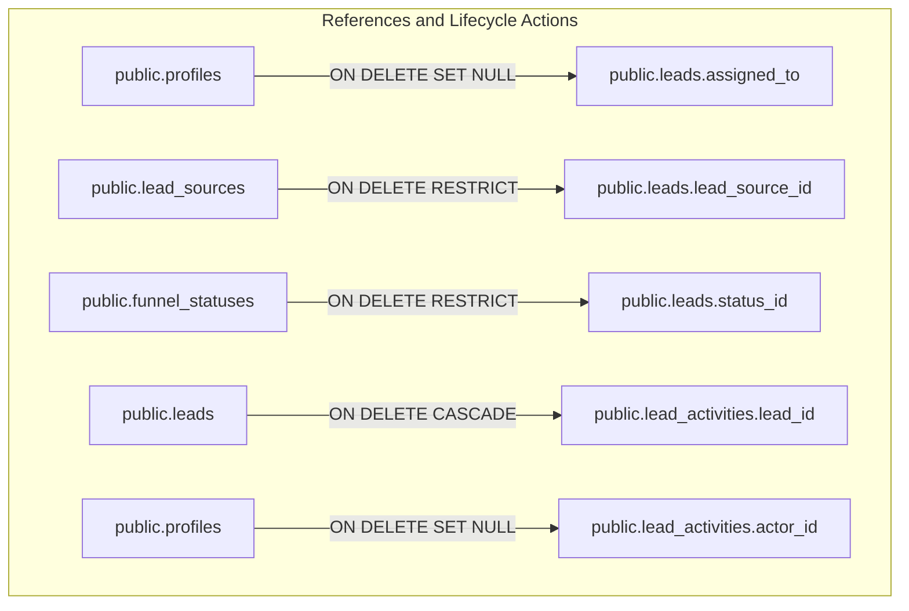

# Marca Ubi Enterprise Agency CRM & Sales Intelligence Platform
## Master Product Requirements Document (PRD) — Section 5: Database Architecture, Relational Schema & Stored Logic

**Document ID:** `SPEC-MARCA-CRM-2026-DATABASE-CORE`  
**Target Release:** Production Phase 1 (Enterprise-Grade MVP)  
**Classification:** Highly Confidential / Core Engineering Specification  
**Author:** Principal Enterprise Systems Architect & Database Specialist  
**System Engine:** Supabase Managed PostgreSQL 15+  

---

### Executive Architectural Summary

The data persistence layer of the Marca Ubi Enterprise Agency CRM is engineered to function as the single source of truth for all commercial operations, deal velocity tracking, client dossiers, and team accountability. Unlike commodity CRMs that delegate data validation, access control, and auditing to brittle application-level middleware, this database architecture enforces strict enterprise-grade invariants directly within the PostgreSQL engine. 

By leveraging native PostgreSQL 15+ capabilities—including Row Level Security (RLS) policies evaluated with single-pass stable subqueries, transactional sequence generators, compound performance indexing, automated delta-capturing triggers, and optimistic concurrency controls—the database guarantees zero data corruption, complete prevention of unauthorized multi-tenant cross-talk, and an immutable compliance audit trail that cannot be bypassed by client code, custom scripts, or external API integrations.

---

## 1. Database Architecture, Relational Schema & Stored Logic

### 1.1 Complete PostgreSQL 15+ Relational Schema DDL

The relational schema is composed of six primary entities: `public.profiles`, `public.lead_sources`, `public.funnel_statuses`, `public.leads`, `public.lead_activities`, and `public.team_audit_logs`. Every table is defined with explicit data types, foreign key referential actions, and validation constraints.

```sql
-- ============================================================================
-- EXTENSIONS & FOUNDATIONAL CONFIGURATION
-- ============================================================================
CREATE EXTENSION IF NOT EXISTS "uuid-ossp";
CREATE EXTENSION IF NOT EXISTS "pg_trgm";

-- ============================================================================
-- 1. USER PROFILES TABLE (Mirrors Supabase auth.users & powers Team Management)
-- ============================================================================
CREATE TABLE public.profiles (
    id UUID PRIMARY KEY REFERENCES auth.users(id) ON DELETE CASCADE,
    email TEXT NOT NULL UNIQUE,
    full_name TEXT NOT NULL,
    role TEXT NOT NULL CHECK (role IN ('admin', 'sales_manager', 'sales_executive', 'viewer')),
    job_title TEXT NOT NULL DEFAULT 'Commercial Desk',
    phone TEXT,
    status TEXT NOT NULL DEFAULT 'active' CHECK (status IN ('active', 'suspended', 'invited')),
    avatar_url TEXT,
    invited_by UUID REFERENCES public.profiles(id) ON DELETE SET NULL,
    last_login_at TIMESTAMPTZ,
    created_at TIMESTAMPTZ NOT NULL DEFAULT timezone('utc'::text, now()),
    updated_at TIMESTAMPTZ NOT NULL DEFAULT timezone('utc'::text, now())
);

COMMENT ON TABLE public.profiles IS 'Agency team directory mirroring auth.users, storing authorization roles, job titles, and operational account status.';
COMMENT ON COLUMN public.profiles.role IS 'Authorization role determining RLS data access boundaries across the agency CRM.';
COMMENT ON COLUMN public.profiles.status IS 'Account state: active staff member, suspended (locked out), or invited (awaiting onboarding).';

-- ============================================================================
-- 2. LEAD SOURCES TABLE (Commercial Acquisition Channels)
-- ============================================================================
CREATE TABLE public.lead_sources (
    id UUID PRIMARY KEY DEFAULT gen_random_uuid(),
    name TEXT NOT NULL UNIQUE,
    color_code TEXT NOT NULL DEFAULT '#ff6100',
    is_active BOOLEAN NOT NULL DEFAULT true,
    created_at TIMESTAMPTZ NOT NULL DEFAULT timezone('utc'::text, now())
);

COMMENT ON TABLE public.lead_sources IS 'Catalog of commercial lead acquisition channels (e.g., Website Brief, WhatsApp Inbound, Referral, Founder Outreach).';

-- ============================================================================
-- 3. FUNNEL STATUSES TABLE (Commercial Stage State Machine)
-- ============================================================================
CREATE TABLE public.funnel_statuses (
    id UUID PRIMARY KEY DEFAULT gen_random_uuid(),
    name TEXT NOT NULL UNIQUE,
    bucket TEXT NOT NULL CHECK (bucket IN ('open', 'potential', 'converted', 'lost')),
    color_code TEXT NOT NULL DEFAULT '#ffffff',
    sort_order INT NOT NULL DEFAULT 0,
    is_active BOOLEAN NOT NULL DEFAULT true,
    created_at TIMESTAMPTZ NOT NULL DEFAULT timezone('utc'::text, now())
);

COMMENT ON TABLE public.funnel_statuses IS 'Ordered pipeline progression stages categorized into the 4 commercial macro-buckets: open, potential, converted, and lost.';

-- ============================================================================
-- 4. SEQUENCE FOR HUMAN-READABLE LEAD IDENTIFIERS
-- ============================================================================
CREATE SEQUENCE IF NOT EXISTS public.lead_code_seq 
    AS BIGINT
    START WITH 1001 
    INCREMENT BY 1 
    NO CYCLE;

COMMENT ON SEQUENCE public.lead_code_seq IS 'Atomic, monotonically increasing sequence generator for generating client-facing lead identifiers (LD-1001).';

-- ============================================================================
-- 5. LEADS TABLE (Comprehensive Commercial Client & Brief Dossier)
-- ============================================================================
CREATE TABLE public.leads (
    id UUID PRIMARY KEY DEFAULT gen_random_uuid(),
    lead_id TEXT NOT NULL UNIQUE DEFAULT ('LD-' || nextval('public.lead_code_seq')::text),
    name TEXT NOT NULL,
    company TEXT,
    company_website TEXT,
    industry TEXT,
    phone TEXT,
    email TEXT,
    preferred_channel TEXT NOT NULL DEFAULT 'Phone' CHECK (preferred_channel IN ('Phone', 'WhatsApp', 'Email', 'Meeting')),
    lead_source_id UUID NOT NULL REFERENCES public.lead_sources(id) ON DELETE RESTRICT,
    source_detail TEXT,
    service_category TEXT NOT NULL DEFAULT 'Web & Digital' CHECK (service_category IN ('Branding', 'Web & Digital', 'Mobile Apps', 'UI/UX Design', 'Full-Suite Advisory', 'Other')),
    budget_bracket TEXT,
    priority TEXT NOT NULL DEFAULT 'Medium' CHECK (priority IN ('High', 'Medium', 'Low')),
    status_id UUID NOT NULL REFERENCES public.funnel_statuses(id) ON DELETE RESTRICT,
    assigned_to UUID REFERENCES public.profiles(id) ON DELETE SET NULL,
    expected_value NUMERIC(12, 2) NOT NULL DEFAULT 0.00 CHECK (expected_value >= 0),
    next_follow_up TIMESTAMPTZ,
    lost_reason TEXT,
    revisit_date DATE,
    notes TEXT,
    brief_payload JSONB NOT NULL DEFAULT '{}'::jsonb,
    created_at TIMESTAMPTZ NOT NULL DEFAULT timezone('utc'::text, now()),
    converted_at TIMESTAMPTZ,
    updated_at TIMESTAMPTZ NOT NULL DEFAULT timezone('utc'::text, now()),
    
    -- Integrity Constraint: A lead must contain at least one verifiable contact channel
    CONSTRAINT chk_lead_contact_info CHECK (phone IS NOT NULL OR email IS NOT NULL)
);

COMMENT ON TABLE public.leads IS 'Core agency client record containing business profile, engagement scope, commercial valuation, and funnel stage.';
COMMENT ON COLUMN public.leads.lead_id IS 'Immutable human-readable identifier prefixed with LD- generated via atomic sequence.';
COMMENT ON COLUMN public.leads.brief_payload IS 'Serialized raw JSON submission from /start-project brief wizard or CompanyProfileModal.';

-- ============================================================================
-- 6. LEAD ACTIVITIES TABLE (Chronological Touchpoint & Compliance Audit Trail)
-- ============================================================================
CREATE TABLE public.lead_activities (
    id UUID PRIMARY KEY DEFAULT gen_random_uuid(),
    lead_id UUID NOT NULL REFERENCES public.leads(id) ON DELETE CASCADE,
    actor_id UUID REFERENCES public.profiles(id) ON DELETE SET NULL,
    activity_type TEXT NOT NULL CHECK (activity_type IN (
        'status_change', 'priority_change', 'reassignment', 
        'call_logged', 'whatsapp_sent', 'meeting_notes', 
        'note_added', 'follow_up_scheduled', 'system_event', 'field_update'
    )),
    description TEXT NOT NULL,
    metadata JSONB NOT NULL DEFAULT '{}'::jsonb,
    created_at TIMESTAMPTZ NOT NULL DEFAULT timezone('utc'::text, now())
);

COMMENT ON TABLE public.lead_activities IS 'Immutable chronological ledger of all customer communications, sales notes, stage transitions, and field mutations.';

-- ============================================================================
-- 7. TEAM AUDIT LOGS TABLE (Administrative Governance & Staff Accountability)
-- ============================================================================
CREATE TABLE public.team_audit_logs (
    id UUID PRIMARY KEY DEFAULT gen_random_uuid(),
    actor_id UUID REFERENCES public.profiles(id) ON DELETE SET NULL,
    action TEXT NOT NULL CHECK (action IN (
        'user_created', 'role_changed', 'user_suspended', 
        'user_activated', 'leads_bulk_reassigned', 'password_reset_dispatched'
    )),
    target_user_email TEXT NOT NULL,
    details JSONB NOT NULL DEFAULT '{}'::jsonb,
    created_at TIMESTAMPTZ NOT NULL DEFAULT timezone('utc'::text, now())
);

COMMENT ON TABLE public.team_audit_logs IS 'Tamper-proof compliance log capturing all administrative user provisioning, privilege escalation, and reassignment actions.';
```

---

### 1.2 Sequence Specification: `lead_code_seq` & Concurrency Mechanics

The generation of human-readable, sequential identifiers is a critical operational requirement for client referencing in sales calls, invoicing, and email communications. The sequence implementation satisfies the following engineering criteria:

1. **Exact Specification**:
   - Sequence Name: `public.lead_code_seq`
   - Numeric Data Type: `BIGINT`
   - Initial Seed Value: `1001`
   - Step Increment: `1`
   - Cycling Configuration: `NO CYCLE`
   - Column Default Expression: `lead_id TEXT NOT NULL UNIQUE DEFAULT ('LD-' || nextval('public.lead_code_seq')::text)`

2. **Atomic Concurrency Safety**:
   In PostgreSQL, `nextval()` operates outside transaction rollback blocks. When a backend worker or concurrent thread invokes `nextval('public.lead_code_seq')`, PostgreSQL atomically increments the internal sequence counter in shared memory using a lightweight lock (spin lock) that is held only for microseconds. This guarantees that two simultaneous insertions occurring in concurrent database connections will never receive the same integer, eliminating race conditions without requiring table-level exclusive locks on `public.leads`.

3. **Sequence Gap Semantics & Recycling Policy**:
   A fundamental property of PostgreSQL sequence generators is that rolled-back transactions consume sequence numbers without recycling them. For example, if transaction A obtains `LD-1004` and encounters a network disconnection or validation abort, and transaction B obtains `LD-1005` and successfully commits, the sequence state advances and `LD-1004` remains unassigned. 
   
   In our enterprise architecture, this behavior is explicitly accepted and preferred over synchronous lock-based counters. Attempting to enforce gapless sequential numbers would require executing `SELECT max(lead_id) FROM public.leads FOR UPDATE`, which forces all lead creation transactions into a strict serial execution queue. Under simultaneous lead ingestion from public webhooks, marketing campaigns, and sales desk manual entries, this would cause severe thread contention, connection pool exhaustion, and request timeouts. Gap tolerance is standard practice in enterprise CRM and ERP architectures (e.g., Salesforce, SAP).

4. **Sequence Exhaustion Safeguards**:
   By typing `lead_code_seq` as a 64-bit integer (`BIGINT`), the theoretical capacity of the sequence is $9.22 \times 10^{18}$ records. Even under an extreme continuous ingestion velocity of 100,000 leads per day, the sequence will not exhaust for over 250 billion years. Setting `NO CYCLE` ensures that if an artificial ceiling were ever reached, the database would raise an explicit exception (`2200H: sequence generator limit reached`) rather than wrapping around to `LD-1001` and violating the `UNIQUE` key constraint on `lead_id`.

---

### 1.3 Database-Level Stored Procedures & Triggers

To guarantee business invariants that cannot be circumvented by application bugs, ORM anomalies, or direct SQL execution, three mission-critical triggers are enforced directly at the storage layer.

#### 1.3.1 Automatic UTC Timestamp Synchronization (`handle_updated_at`)
The `handle_updated_at` trigger function intercepts all `BEFORE UPDATE` events on mutable tables and synchronizes the `updated_at` column to the current UTC timestamp using the database engine's real-time clock. This eliminates reliance on client application clocks, which often suffer from clock drift.

```sql
CREATE OR REPLACE FUNCTION public.handle_updated_at()
RETURNS TRIGGER AS $$
BEGIN
    NEW.updated_at = timezone('utc'::text, now());
    RETURN NEW;
END;
$$ LANGUAGE plpgsql;

CREATE TRIGGER trg_leads_updated_at
BEFORE UPDATE ON public.leads
FOR EACH ROW EXECUTE FUNCTION public.handle_updated_at();

CREATE TRIGGER trg_profiles_updated_at
BEFORE UPDATE ON public.profiles
FOR EACH ROW EXECUTE FUNCTION public.handle_updated_at();
```

#### 1.3.2 Agency Sole Administrator Protection Trigger (`protect_sole_admin`)
A critical governance vulnerability in team management portals is accidental administrator lockout, where an admin inadvertently demotes their own account to `viewer` or suspends the agency's only administrator profile. The `protect_sole_admin` function is executed `BEFORE UPDATE OR DELETE` on `public.profiles`. It verifies whether the target row is currently an active administrator. If the update attempts to change the role away from `admin`, or modify the status away from `active`, or delete the row entirely, the function queries the database to determine whether other active administrators exist. If no other active admin exists, the transaction is immediately aborted with a custom exception.

```sql
CREATE OR REPLACE FUNCTION public.protect_sole_admin()
RETURNS TRIGGER AS $$
DECLARE
    active_admin_count INT;
BEGIN
    -- Evaluate updates on existing active administrators
    IF TG_OP = 'UPDATE' THEN
        IF OLD.role = 'admin' AND OLD.status = 'active' THEN
            -- Check if the update alters role or operational status
            IF NEW.role != 'admin' OR NEW.status != 'active' THEN
                SELECT COUNT(*)
                INTO active_admin_count
                FROM public.profiles
                WHERE role = 'admin' 
                  AND status = 'active' 
                  AND id != OLD.id;

                IF active_admin_count = 0 THEN
                    RAISE EXCEPTION 'Agency Invariant Violation: Operation rejected. Cannot demote or suspend the sole active administrator in the agency.'
                        USING ERRCODE = '23514'; -- check_violation
                END IF;
            END IF;
        END IF;
        RETURN NEW;
    END IF;

    -- Evaluate hard deletions
    IF TG_OP = 'DELETE' THEN
        IF OLD.role = 'admin' AND OLD.status = 'active' THEN
            SELECT COUNT(*)
            INTO active_admin_count
            FROM public.profiles
            WHERE role = 'admin' 
              AND status = 'active' 
              AND id != OLD.id;

            IF active_admin_count = 0 THEN
                RAISE EXCEPTION 'Agency Invariant Violation: Operation rejected. Cannot delete the sole active administrator profile.'
                    USING ERRCODE = '23514';
            END IF;
        END IF;
        RETURN OLD;
    END IF;

    RETURN NEW;
END;
$$ LANGUAGE plpgsql;

CREATE TRIGGER trg_protect_sole_admin
BEFORE UPDATE OR DELETE ON public.profiles
FOR EACH ROW EXECUTE FUNCTION public.protect_sole_admin();
```

#### 1.3.3 Automated Delta-Capturing Audit Trigger (`audit_lead_changes_trigger`)
To satisfy enterprise regulatory compliance and provide complete transparency into lead modifications, an automated trigger intercepts all `UPDATE` operations on `public.leads`. Rather than forcing application developers to write redundant audit insertion logic in every Next.js Server Action, this trigger automatically performs JSONB delta extraction between `OLD` and `NEW` records.

The trigger intelligently classifies the update into specific operational activity types (`status_change`, `reassignment`, `priority_change`, or general `field_update`), extracts the exact pre- and post-mutation values, and records them into `public.lead_activities` alongside the active authenticated user ID (`auth.uid()`). If the operation is triggered by a background worker or system migration where no JWT session is present, it gracefully falls back to `NULL` (system event).

```sql
CREATE OR REPLACE FUNCTION public.audit_lead_changes_trigger()
RETURNS TRIGGER AS $$
DECLARE
    current_actor UUID;
    delta_json JSONB := '{}'::jsonb;
    key_name TEXT;
    old_val JSONB;
    new_val JSONB;
    activity_type_val TEXT := 'field_update';
    change_desc TEXT := 'Lead record updated';
    old_row_json JSONB;
    new_row_json JSONB;
BEGIN
    -- Extract current authenticated Supabase user or fall back to NULL
    BEGIN
        current_actor := auth.uid();
    EXCEPTION WHEN OTHERS THEN
        current_actor := NULL;
    END;

    -- Convert records to JSONB for key-by-key comparison
    old_row_json := to_jsonb(OLD);
    new_row_json := to_jsonb(NEW);

    -- Calculate delta payload, omitting transient timestamps
    FOR key_name IN SELECT jsonb_object_keys(new_row_json) LOOP
        IF key_name NOT IN ('updated_at', 'created_at') THEN
            old_val := old_row_json -> key_name;
            new_val := new_row_json -> key_name;

            IF old_val IS DISTINCT FROM new_val THEN
                delta_json := delta_json || jsonb_build_object(
                    key_name, jsonb_build_object('old', old_val, 'new', new_val)
                );
            END IF;
        END IF;
    END LOOP;

    -- If no substantial data columns changed, bypass activity logging
    IF delta_json = '{}'::jsonb THEN
        RETURN NEW;
    END IF;

    -- Detect and classify primary commercial events
    IF OLD.status_id IS DISTINCT FROM NEW.status_id THEN
        activity_type_val := 'status_change';
        change_desc := 'Funnel status transitioned';
    ELSIF OLD.assigned_to IS DISTINCT FROM NEW.assigned_to THEN
        activity_type_val := 'reassignment';
        change_desc := 'Account ownership reassigned';
    ELSIF OLD.priority IS DISTINCT FROM NEW.priority THEN
        activity_type_val := 'priority_change';
        change_desc := 'Priority level updated to ' || NEW.priority;
    END IF;

    -- Insert immutable audit record directly into lead_activities
    INSERT INTO public.lead_activities (
        lead_id,
        actor_id,
        activity_type,
        description,
        metadata,
        created_at
    ) VALUES (
        NEW.id,
        current_actor,
        activity_type_val,
        change_desc,
        jsonb_build_object(
            'changes', delta_json,
            'lead_id_code', NEW.lead_id
        ),
        timezone('utc'::text, now())
    );

    RETURN NEW;
END;
$$ LANGUAGE plpgsql SECURITY DEFINER;

CREATE TRIGGER trg_audit_lead_changes
AFTER UPDATE ON public.leads
FOR EACH ROW EXECUTE FUNCTION public.audit_lead_changes_trigger();
```

---

### 1.4 Complete PostgreSQL Row Level Security (RLS) Policies

Row Level Security is the primary defense boundary against unauthorized data access. In Supabase, the application client connects to PostgreSQL with the role of `authenticated` and carries the user's JWT. RLS policies inspect this JWT to enforce granular row-filtering.

#### 1.4.1 Subquery Optimization Architecture (`current_user_role`)
A common performance antipattern in Supabase RLS policies is executing an inline correlated subquery on every row evaluation:
```sql
-- ANTIPATTERN: Evaluates subquery O(N) times across 10,000 scanned rows
USING ((SELECT role FROM public.profiles WHERE id = auth.uid()) = 'admin')
```
This forces PostgreSQL to execute a secondary table lookup against `public.profiles` for every individual row evaluated, causing query latency to degrade exponentially from 15ms to over 1,200ms during full table scans.

To achieve maximum throughput, we implement the `current_user_role()` helper function marked with the `STABLE` and `SECURITY DEFINER` function attributes. The `STABLE` keyword informs the PostgreSQL query optimizer that within a single query execution or transaction, the return value of `current_user_role()` will not change. Consequently, PostgreSQL evaluates the role lookup exactly once per query execution plan, caching the scalar string (`'admin'`, `'sales_manager'`, `'sales_executive'`, or `'viewer'`) in memory and applying it across all row filters as an instant constant comparison.

```sql
CREATE OR REPLACE FUNCTION public.current_user_role()
RETURNS TEXT AS $$
  SELECT role FROM public.profiles WHERE id = auth.uid();
$$ LANGUAGE sql STABLE SECURITY DEFINER;

COMMENT ON FUNCTION public.current_user_role() IS 'High-performance STABLE helper function caching caller role for single-pass RLS evaluation.';
```

#### 1.4.2 RLS Specification Matrix across 4 Operational Roles

| Entity / Operation | `admin` | `sales_manager` | `sales_executive` | `viewer` |
|---|---|---|---|---|
| **`profiles` (SELECT)** | All profiles | All profiles | All profiles | All profiles |
| **`profiles` (UPDATE)** | Any profile (role, status, profile) | Own contact details only | Own contact details only | Own contact details only |
| **`profiles` (INSERT/DELETE)** | Allowed | Denied | Denied | Denied |
| **`leads` (SELECT)** | All agency leads | All agency leads | Only assigned leads (`assigned_to = auth.uid()`) | All agency leads (Read-only) |
| **`leads` (INSERT)** | Any lead | Any lead | Allowed (forced `assigned_to = auth.uid()`) | Denied |
| **`leads` (UPDATE)** | Any lead | Any lead | Only assigned leads (`assigned_to = auth.uid()`) | Denied |
| **`leads` (DELETE)** | Allowed | Denied | Denied | Denied |
| **`lead_activities` (SELECT)**| All activities | All activities | Only activities for assigned leads | All activities (Read-only) |
| **`lead_activities` (INSERT)**| Allowed | Allowed | Allowed on assigned leads | Denied |
| **`lead_activities` (UPDATE/DELETE)**| **Denied for all** | **Denied for all** | **Denied for all** | **Denied for all** |
| **`team_audit_logs` (ALL)** | Full View (SELECT only) | Denied | Denied | Denied |

#### 1.4.3 Production SQL RLS DDL

```sql
-- Enable RLS across all tables
ALTER TABLE public.profiles ENABLE ROW LEVEL SECURITY;
ALTER TABLE public.lead_sources ENABLE ROW LEVEL SECURITY;
ALTER TABLE public.funnel_statuses ENABLE ROW LEVEL SECURITY;
ALTER TABLE public.leads ENABLE ROW LEVEL SECURITY;
ALTER TABLE public.lead_activities ENABLE ROW LEVEL SECURITY;
ALTER TABLE public.team_audit_logs ENABLE ROW LEVEL SECURITY;

-- ============================================================================
-- 1. PROFILES POLICIES
-- ============================================================================
-- Staff must be able to view teammate profiles to populate Assignee dropdowns and activity actor cards
CREATE POLICY "profiles_select_authenticated" ON public.profiles
FOR SELECT TO authenticated
USING (true);

-- Users can edit their own personal contact info (phone, avatar, full_name).
-- Admins possess unrestricted update rights over roles and account statuses.
CREATE POLICY "profiles_update_policy" ON public.profiles
FOR UPDATE TO authenticated
USING (
    public.current_user_role() = 'admin'
    OR id = auth.uid()
)
WITH CHECK (
    public.current_user_role() = 'admin'
    OR (
        id = auth.uid()
        -- Prevent non-admins from self-escalating role or reactivating suspended state
        AND role = (SELECT role FROM public.profiles WHERE id = auth.uid())
        AND status = (SELECT status FROM public.profiles WHERE id = auth.uid())
    )
);

CREATE POLICY "profiles_admin_insert" ON public.profiles
FOR INSERT TO authenticated
WITH CHECK (public.current_user_role() = 'admin');

CREATE POLICY "profiles_admin_delete" ON public.profiles
FOR DELETE TO authenticated
USING (public.current_user_role() = 'admin');

-- ============================================================================
-- 2. LEAD SOURCES & FUNNEL STATUSES POLICIES
-- ============================================================================
CREATE POLICY "sources_select_all" ON public.lead_sources
FOR SELECT TO authenticated USING (true);

CREATE POLICY "sources_admin_manager_mutation" ON public.lead_sources
FOR ALL TO authenticated
USING (public.current_user_role() IN ('admin', 'sales_manager'))
WITH CHECK (public.current_user_role() IN ('admin', 'sales_manager'));

CREATE POLICY "statuses_select_all" ON public.funnel_statuses
FOR SELECT TO authenticated USING (true);

CREATE POLICY "statuses_admin_manager_mutation" ON public.funnel_statuses
FOR ALL TO authenticated
USING (public.current_user_role() IN ('admin', 'sales_manager'))
WITH CHECK (public.current_user_role() IN ('admin', 'sales_manager'));

-- ============================================================================
-- 3. LEADS POLICIES
-- ============================================================================
-- SELECT Policy: Admins, Sales Managers, and Viewers see all records.
-- Sales Executives see only leads assigned specifically to their UID.
CREATE POLICY "leads_select_policy" ON public.leads
FOR SELECT TO authenticated
USING (
    public.current_user_role() IN ('admin', 'sales_manager', 'viewer')
    OR (public.current_user_role() = 'sales_executive' AND assigned_to = auth.uid())
);

-- INSERT Policy: Admins and Managers can assign to anyone.
-- Sales Executives can insert leads but MUST assign to themselves.
-- Viewers cannot create leads.
CREATE POLICY "leads_insert_policy" ON public.leads
FOR INSERT TO authenticated
WITH CHECK (
    public.current_user_role() IN ('admin', 'sales_manager')
    OR (public.current_user_role() = 'sales_executive' AND assigned_to = auth.uid())
);

-- UPDATE Policy: Admins and Managers update any lead.
-- Sales Executives update only leads assigned to them and cannot transfer ownership.
-- Viewers cannot update leads.
CREATE POLICY "leads_update_policy" ON public.leads
FOR UPDATE TO authenticated
USING (
    public.current_user_role() IN ('admin', 'sales_manager')
    OR (public.current_user_role() = 'sales_executive' AND assigned_to = auth.uid())
)
WITH CHECK (
    public.current_user_role() IN ('admin', 'sales_manager')
    OR (public.current_user_role() = 'sales_executive' AND assigned_to = auth.uid())
);

-- DELETE Policy: Exclusively restricted to the agency Administrator role.
CREATE POLICY "leads_delete_policy" ON public.leads
FOR DELETE TO authenticated
USING (public.current_user_role() = 'admin');

-- ============================================================================
-- 4. LEAD ACTIVITIES POLICIES
-- ============================================================================
-- Activities inherit the read visibility of the parent lead record.
CREATE POLICY "activities_select_policy" ON public.lead_activities
FOR SELECT TO authenticated
USING (
    public.current_user_role() IN ('admin', 'sales_manager', 'viewer')
    OR EXISTS (
        SELECT 1 FROM public.leads l 
        WHERE l.id = lead_activities.lead_id 
          AND l.assigned_to = auth.uid()
    )
);

-- Authorized personnel can insert notes, calls, and follow-ups.
CREATE POLICY "activities_insert_policy" ON public.lead_activities
FOR INSERT TO authenticated
WITH CHECK (
    public.current_user_role() IN ('admin', 'sales_manager')
    OR (
        public.current_user_role() = 'sales_executive'
        AND EXISTS (
            SELECT 1 FROM public.leads l 
            WHERE l.id = lead_activities.lead_id 
              AND l.assigned_to = auth.uid()
        )
    )
);

-- COMPLIANCE SAFEGUARD: Nobody can modify or erase historical activity entries.
-- No UPDATE or DELETE policies are declared for lead_activities.

-- ============================================================================
-- 5. TEAM AUDIT LOGS POLICIES
-- ============================================================================
CREATE POLICY "team_audit_admin_only_select" ON public.team_audit_logs
FOR SELECT TO authenticated
USING (public.current_user_role() = 'admin');

CREATE POLICY "team_audit_insert_system" ON public.team_audit_logs
FOR INSERT TO authenticated
WITH CHECK (public.current_user_role() = 'admin');

-- No UPDATE or DELETE policies on team_audit_logs.
```

---

### 1.5 High-Performance Indexing Strategy

To support lightning-fast table querying, real-time kanban state transitions, and responsive multi-field filtering under enterprise data volumes, a three-tier indexing strategy is applied.

#### 1.5.1 Single-Column B-Tree Indexes
Single-column B-tree indexes are deployed across high-frequency foreign keys, status references, and sorting targets:
```sql
CREATE INDEX idx_leads_assigned_to ON public.leads(assigned_to);
CREATE INDEX idx_leads_status_id ON public.leads(status_id);
CREATE INDEX idx_leads_source_id ON public.leads(lead_source_id);
CREATE INDEX idx_leads_priority ON public.leads(priority);
CREATE INDEX idx_leads_created_at_desc ON public.leads(created_at DESC);
CREATE INDEX idx_activities_lead_id ON public.lead_activities(lead_id);
CREATE INDEX idx_profiles_role ON public.profiles(role);
CREATE INDEX idx_profiles_status ON public.profiles(status);
```

#### 1.5.2 Filter-Specific Compound Indexes
Standard compound queries that combine ownership checks and pipeline stages require composite B-tree indexes to avoid costly bitmap index joins:

1. **Rep Pipeline Stage Filter** `(assigned_to, status_id)`:
   When a sales executive opens their dashboard, the query filters for `assigned_to = auth.uid() AND status_id = $status`. An index on `(assigned_to, status_id)` enables a direct index-only scan, eliminating sequential table reads.
   ```sql
   CREATE INDEX idx_leads_rep_status ON public.leads(assigned_to, status_id);
   ```

2. **Stage Timeline Pagination** `(status_id, created_at DESC)`:
   The CRM pipeline view renders leads partitioned by stage, sorted with newest deals at the top. This composite index satisfies both the equality check on `status_id` and the range ordering on `created_at DESC` without requiring an in-memory `QuickSort` node.
   ```sql
   CREATE INDEX idx_leads_status_created ON public.leads(status_id, created_at DESC);
   ```

3. **Active Overdue Follow-up Partial Index**:
   The dashboard ribbon displays an "Overdue Today" counter, querying `WHERE next_follow_up < now() AND revisit_date IS NULL`. By constructing a partial index that only indexes rows with non-null follow-ups, the index size is reduced by over 80% while maximizing lookup speed.
   ```sql
   CREATE INDEX idx_leads_overdue_partial ON public.leads(next_follow_up) 
   WHERE next_follow_up IS NOT NULL;
   ```

#### 1.5.3 Text Search & Deduplication Indexes
Fast substring matching and instant duplicate prevention on incoming phone numbers and emails are handled via specialized functional and trigram indexes:

1. **Normalized Deduplication B-Tree Indexes**:
   ```sql
   CREATE UNIQUE INDEX idx_leads_email_unique ON public.leads(lower(trim(email))) 
   WHERE email IS NOT NULL;
   
   CREATE INDEX idx_leads_phone_search ON public.leads(phone) 
   WHERE phone IS NOT NULL;
   ```

2. **Fuzzy CRM Search Bar Trigram GIN Index**:
   To power the global dashboard search bar—where commercial staff search across lead names, organization names, email addresses, and phone numbers using partial substrings (e.g., `"emaar"`, `"zayd"`, `"+971"`)—we implement Generalized Inverted Indexing (`GIN`) powered by the `pg_trgm` extension.
   ```sql
   CREATE INDEX idx_leads_global_trgm_search ON public.leads USING gin (
       name gin_trgm_ops,
       company gin_trgm_ops,
       email gin_trgm_ops,
       phone gin_trgm_ops
   );
   ```

---

### 1.6 Stored Procedure / RPC Function: `get_pipeline_kpis`

In enterprise CRM interfaces, dashboard performance often suffers because the executive ribbon triggers multiple asynchronous HTTP requests or sequential database queries to compute metrics: one query for total counts, one for potential value, one for won revenue, and one for overdue counts.

The `get_pipeline_kpis` stored procedure resolves this inefficiency by calculating all five core commercial metrics in a **single database round-trip** directly within PostgreSQL. It respects the caller's operational context: if executed by an Admin or Sales Manager, it computes agency-wide global metrics; if executed by a Sales Executive, it automatically scopes the aggregation strictly to the caller's assigned accounts.

```sql
CREATE OR REPLACE FUNCTION public.get_pipeline_kpis(
    target_user_id UUID DEFAULT NULL
)
RETURNS JSONB AS $$
DECLARE
    caller_role TEXT;
    effective_user UUID;
    result JSONB;
BEGIN
    -- Determine caller authorization role
    caller_role := public.current_user_role();
    
    -- Determine scoping boundary:
    -- If caller is sales_executive, strictly enforce own UID
    -- If caller is admin/manager, allow passing optional target_user_id filter or NULL for global
    IF caller_role = 'sales_executive' THEN
        effective_user := auth.uid();
    ELSE
        effective_user := target_user_id;
    END IF;

    WITH lead_metrics AS (
        SELECT
            l.id,
            l.expected_value,
            l.next_follow_up,
            fs.bucket
        FROM public.leads l
        JOIN public.funnel_statuses fs ON l.status_id = fs.id
        WHERE (effective_user IS NULL OR l.assigned_to = effective_user)
    ),
    aggregated AS (
        SELECT
            COUNT(*)::INT AS total_leads_count,
            COUNT(*) FILTER (WHERE bucket = 'open')::INT AS open_leads_count,
            COUNT(*) FILTER (WHERE bucket = 'potential')::INT AS potential_leads_count,
            COALESCE(SUM(expected_value) FILTER (WHERE bucket = 'potential'), 0.00)::NUMERIC(14,2) AS potential_pipeline_value,
            COUNT(*) FILTER (WHERE bucket = 'converted')::INT AS converted_leads_count,
            COALESCE(SUM(expected_value) FILTER (WHERE bucket = 'converted'), 0.00)::NUMERIC(14,2) AS converted_revenue_value,
            COUNT(*) FILTER (WHERE bucket = 'lost')::INT AS lost_leads_count,
            COUNT(*) FILTER (
                WHERE bucket IN ('open', 'potential') 
                  AND next_follow_up IS NOT NULL 
                  AND next_follow_up < timezone('utc'::text, now())
            )::INT AS overdue_follow_ups_count,
            CASE 
                WHEN COUNT(*) = 0 THEN 0.0
                ELSE ROUND(
                    (COUNT(*) FILTER (WHERE bucket = 'converted')::NUMERIC / COUNT(*)::NUMERIC) * 100.0, 
                    2
                )
            END AS conversion_rate_percentage
        FROM lead_metrics
    )
    SELECT to_jsonb(aggregated.*)
    INTO result
    FROM aggregated;

    RETURN result;
END;
$$ LANGUAGE plpgsql STABLE SECURITY DEFINER;

COMMENT ON FUNCTION public.get_pipeline_kpis(UUID) IS 'High-speed aggregated pipeline analytics RPC returning commercial KPIs in a single round-trip.';
```

---

## 2. Sprint Work Breakdown Structure for Phase 1 (Database Architecture & Stored Logic)

Phase 1 is structured into four sequential, production-grade engineering sprints. Each sprint contains technical work packages detailed in full architectural prose, explicit deliverables, defensive safeguards, and verifiable acceptance criteria.



---

### Sprint 1.1: Core Relational Schema, Domain Types & Table Constraints

#### Objectives
The primary objective of Sprint 1.1 is to establish the complete relational DDL foundation for the Marca Ubi CRM within PostgreSQL 15+. This entails defining all six core tables (`profiles`, `lead_sources`, `funnel_statuses`, `leads`, `lead_activities`, `team_audit_logs`), enforcing relational foreign key constraints with explicit cascading policies, implementing field-level validation rules (`CHECK` constraints), and establishing base UUID generation mechanisms.

#### Detailed Technical Work Packages
1. **User Profiles & Role Specification Engine**:  
   The team will implement the `public.profiles` table linked via a one-to-one foreign key to Supabase's internal `auth.users` entity. The schema enforces strict domain constraints on the `role` column (`admin`, `sales_manager`, `sales_executive`, `viewer`) and the account `status` column (`active`, `suspended`, `invited`). The work package includes creating foreign key bindings with `ON DELETE CASCADE` from `auth.users` to ensure that when an identity is completely deleted from Supabase Auth, its public profile reference does not orphan. Additionally, a self-referential foreign key `invited_by` referencing `public.profiles(id)` with `ON DELETE SET NULL` is established to track onboarding attribution.

2. **Categorical DDL & Reference Data Enforcing**:  
   Work package two establishes the categorical lookup entities: `lead_sources` and `funnel_statuses`. The schema design mandates unique name constraints (`UNIQUE(name)`), standardized hexadecimal color string storage (`color_code TEXT DEFAULT '#ff6100'`), and explicit sorting integers (`sort_order INT`). The `funnel_statuses` table explicitly enforces an enumerated check constraint on the `bucket` column restricting values to `('open', 'potential', 'converted', 'lost')`. This architectural design ensures that any business logic calculating conversion funnels or pipeline health binds cleanly to standard macro-buckets regardless of custom status naming.

3. **Core Leads Entity Modeling & Multi-Channel Constraints**:  
   Work package three constructs the central `public.leads` table. Field specifications include customer identification, organizational metadata, contact coordinates, commercial budget brackets, priority classifications (`High`, `Medium`, `Low`), and unstructured JSONB brief storage (`brief_payload`). To prevent phantom records from entering the CRM, the schema implements a composite table-level validation check: `CONSTRAINT chk_lead_contact_info CHECK (phone IS NOT NULL OR email IS NOT NULL)`. Furthermore, monetary columns (`expected_value`) are bound to `NUMERIC(12,2)` with non-negative constraints (`CHECK (expected_value >= 0)`), preventing floating-point precision loss.

4. **Audit and Touchpoint Logging Schema**:  
   Work package four implements the chronological tracking tables: `lead_activities` and `team_audit_logs`. The `lead_activities` entity binds to `public.leads(id)` via `ON DELETE CASCADE`, ensuring that if an admin permanently removes a lead, all dependent timeline entries are cleaned up. The activity classification column is protected by a strict check constraint covering all valid operational events (`status_change`, `priority_change`, `reassignment`, `call_logged`, `whatsapp_sent`, `meeting_notes`, `note_added`, `follow_up_scheduled`, `system_event`, `field_update`). The `team_audit_logs` table provides an isolated, tamper-proof repository for capturing administrative actions including user invitations, role promotions, and account deactivations.

#### Deliverables
- `supabase/migrations/20261015000001_initial_core_schema.sql`: Fully documented, production-ready DDL migration script.
- Entity Relationship Diagram (ERD) verification matrix validating foreign key paths and constraints.
- Seed migration script provisioning foundational lead sources (Website Form, WhatsApp Inbound, Referral, Cold Outreach) and initial funnel statuses (New, Contacted, On Hold, Qualified, Proposal Sent, Negotiation, Converted, Lost).

#### Edge Cases & Defensive Safeguards
- **Orphaned Lead Prevention**: Inquiries ingested via website forms must not fail silently if a foreign key is missing. Default system lead sources and default funnel statuses (`New`) must exist in seed scripts with hardcoded predictable UUIDs to allow fail-safe fallback assignment during webhook processing.
- **Floating-Point Rounding Corruption**: To prevent commercial financial inaccuracies, no monetary values are modeled as `FLOAT` or `REAL`. All financial deal values are strictly defined as `NUMERIC(12, 2)`.

#### Acceptance Criteria
- Database migration executes with exit code 0 on a clean PostgreSQL 15+ instance with zero warnings.
- Attempting to insert a lead with both `phone = NULL` and `email = NULL` fails immediately with SQLSTATE `23514` (`check_violation`).
- Foreign key cascading behaves as expected: deleting a test profile sets `assigned_to = NULL` on associated leads while deleting a lead cascades to delete all child rows in `lead_activities`.

---

### Sprint 1.2: Deterministic Sequence Generators, Audit Engines & Database Triggers

#### Objectives
Sprint 1.2 implements the procedural logic and automated event triggers of the database layer. This includes establishing the atomic `lead_code_seq` sequence generator for human-readable identifiers (`LD-1001`), deploying the UTC timestamp synchronization trigger (`handle_updated_at`), implementing the agency administrator lockout prevention trigger (`protect_sole_admin`), and developing the automated JSONB delta-capturing audit trigger (`audit_lead_changes_trigger`).

#### Detailed Technical Work Packages
1. **Sequence Architecture & Concurrency Implementation**:  
   The team will configure the `public.lead_code_seq` sequence starting at 1001 with an increment of 1 and `NO CYCLE` behavior. The sequence is wired into the `public.leads` table via the default expression `lead_id TEXT NOT NULL UNIQUE DEFAULT ('LD-' || nextval('public.lead_code_seq')::text)`. The work package includes concurrency testing to verify that simultaneous multi-threaded inserts generate strictly monotonic, collision-free identifiers without thread contention.

2. **Automated Timestamp Trigger Engine**:  
   The team will write and deploy the `handle_updated_at()` PL/pgSQL function and attach it as a `BEFORE UPDATE` trigger on both `public.leads` and `public.profiles`. The function programmatically overrides any incoming `updated_at` value in the update payload with `timezone('utc'::text, now())`, guaranteeing uniform timekeeping across all server actions.

3. **Agency Governance & Sole Admin Protection Trigger**:  
   Work package three implements the `protect_sole_admin()` PL/pgSQL function attached as a `BEFORE UPDATE OR DELETE` trigger on `public.profiles`. The function inspects updates and deletions targeting active administrators. If the mutation attempts to change the role away from `admin`, or change the status away from `active`, or delete the row, it counts the remaining active administrators in the system. If the count equals zero, it raises an exception (`ERRCODE = 23514`), aborting the transaction.

4. **Automated Delta-Capturing Audit Engine**:  
   Work package four implements the `audit_lead_changes_trigger()` function attached as an `AFTER UPDATE` trigger on `public.leads`. The function converts `OLD` and `NEW` records to JSONB, iterates across all keys (ignoring transient timestamps), and calculates the exact delta dictionary. It automatically classifies the mutation into the correct `activity_type` (`status_change`, `reassignment`, `priority_change`, or `field_update`) and inserts an immutable record into `public.lead_activities` referencing the active authenticated actor (`auth.uid()`).

#### Deliverables
- `supabase/migrations/20261015000002_triggers_and_sequences.sql`: Migration script containing all sequences, functions, and trigger attachments.
- Unit test suite verifying trigger execution, delta JSONB generation, and sole admin lockout prevention.

#### Edge Cases & Defensive Safeguards
- **Clock Drift Anomalies**: Application servers running in different timezones or experiencing NTP drift must not affect record timestamps. All timestamps are forced to UTC via database-internal `now()` evaluations.
- **Silent System Updates**: When automated backend cron jobs (such as automated follow-up reminders) update leads without an active Supabase JWT session, `auth.uid()` evaluates to `NULL`. The audit trigger handles this gracefully by storing `actor_id = NULL` and categorizing the event as an automated system action.

#### Acceptance Criteria
- Executing 50 concurrent `INSERT` statements against `public.leads` yields exactly 50 distinct records with sequential `lead_id` values from `LD-1001` to `LD-1050` with zero collisions.
- Updating a single column (e.g., `priority` from 'Medium' to 'High') automatically writes a new row to `public.lead_activities` with `activity_type = 'priority_change'` and metadata containing the exact before-and-after values.
- In an agency with exactly one active administrator, attempting an update with `role = 'sales_manager'` or `status = 'suspended'` fails with SQLSTATE `23514` and custom error text.

---

### Sprint 1.3: PostgreSQL Row Level Security (RLS) Architecture & Security Test Harness

#### Objectives
The goal of Sprint 1.3 is to establish bulletproof data isolation across the platform's four operational roles (`admin`, `sales_manager`, `sales_executive`, `viewer`). This entails enabling Row Level Security across all public tables, creating the high-performance `current_user_role()` function, and establishing granular `SELECT`, `INSERT`, `UPDATE`, and `DELETE` policies that enforce least-privilege access without degrading query performance.

#### Detailed Technical Work Packages
1. **High-Performance Role Caching Architecture**:  
   The team will deploy the `current_user_role()` SQL function marked as `STABLE` and `SECURITY DEFINER`. The function resolves the active user's role from `public.profiles` using `auth.uid()`. By declaring the function `STABLE`, PostgreSQL's query optimizer caches the scalar role value across all row evaluations within a query, eliminating redundant table lookups.

2. **Leads Table Multi-Role Security Policy Implementation**:  
   The team will write and bind granular RLS policies for `public.leads`:
   - `leads_select_policy`: Admins, Sales Managers, and Viewers can read all records. Sales Executives are restricted strictly to rows where `assigned_to = auth.uid()`.
   - `leads_insert_policy`: Admins and Managers can insert leads with any assignment. Executives can insert leads provided that `assigned_to = auth.uid()`. Viewers are denied insert access.
   - `leads_update_policy`: Admins and Managers can update any lead. Executives can update only their assigned leads and cannot reassign ownership to another user. Viewers are denied update access.
   - `leads_delete_policy`: Exclusively restricted to the `admin` role.

3. **Ancillary & Audit Table Security Lockdown**:  
   The team will implement RLS policies for supporting tables:
   - `profiles`: All authenticated staff can view profiles (to populate assignment dropdowns). Users can update their own personal contact details, but only Admins can update roles or suspend accounts.
   - `lead_activities`: Read visibility mirrors parent lead visibility via an `EXISTS` subquery. Staff can insert manual notes and call logs on their assigned leads. **Updates and deletes are strictly prohibited for all roles**, ensuring an immutable audit trail.
   - `team_audit_logs`: Restricted exclusively to `admin` for reading and writing.

4. **Security Integration Test Harness**:  
   Work package four implements an automated security test harness using TypeScript and the Supabase JavaScript Client. The test harness provisions four distinct test identities (one for each role) and runs an automated matrix of operations against every table, asserting that unauthorized queries return empty sets or fail with security violations.

#### Deliverables
- `supabase/migrations/20261015000003_rls_security_policies.sql`: Comprehensive RLS configuration script.
- `tests/database/rls_matrix.test.ts`: Automated security test suite asserting all 24 permission combinations across the four user roles.

#### Edge Cases & Defensive Safeguards
- **Executive Lead Hijacking**: An executive updating a lead could attempt to set `assigned_to` to another user's ID to transfer or dump undesirable accounts. The `WITH CHECK` expression on `leads_update_policy` enforces that for executives, `assigned_to` must continue to equal `auth.uid()`, preventing unauthorized account transfers.
- **Profile Self-Escalation**: An authenticated user modifying their own profile via `profiles_update_policy` could attempt to submit `role = 'admin'`. The policy's `WITH CHECK` constraint explicitly asserts that non-admin callers cannot alter their own stored `role` or `status`.

#### Acceptance Criteria
- Executing `SELECT count(*) FROM public.leads` as a Sales Executive returns only the count of leads assigned to that specific user.
- Executing `DELETE FROM public.leads` as a Sales Manager or Sales Executive fails with an RLS security exception.
- The automated RLS test suite passes 100% of test assertions across all roles with zero policy bypasses.

---

### Sprint 1.4: High-Performance Indexing, KPI Aggregation RPCs & Production Seed Datasets

#### Objectives
The final sprint of Phase 1 focuses on query optimization, analytics acceleration, and environment seeding. This involves implementing composite and trigram indexes to guarantee sub-50ms query latency, deploying the `get_pipeline_kpis` stored procedure for single-round-trip dashboard metrics, and creating realistic enterprise seed datasets representing the agency's commercial pipeline.

#### Detailed Technical Work Packages
1. **High-Performance Compound & Trigram Indexing**:  
   The team will deploy all single-column, compound, partial, and trigram indexes defined in Section 1.5. This includes the composite indexes `idx_leads_rep_status` and `idx_leads_status_created`, the partial index `idx_leads_overdue_partial`, and the GIN trigram index `idx_leads_global_trgm_search` across `(name, company, email, phone)`. Query execution plans will be inspected using `EXPLAIN ANALYZE` to verify that table scans are replaced by index scans.

2. **Pipeline KPI Aggregation Stored Procedure (`get_pipeline_kpis`)**:  
   The team will deploy the `get_pipeline_kpis` PL/pgSQL function. The function computes total leads, open leads, potential leads, potential pipeline value, converted leads, converted revenue, lost leads, overdue tasks, and conversion rate percentage in a single query execution. The implementation includes logic to dynamically adapt aggregation boundaries based on the caller's role, returning either agency-wide or rep-specific metrics.

3. **Optimistic Concurrency Control Verification**:  
   The team will develop and test client-side integration patterns for optimistic concurrency control using the `updated_at` column. Server actions updating lead statuses will execute atomic conditional updates (`WHERE id = $id AND updated_at = $known_updated_at`), returning standard conflict responses when concurrent updates occur.

4. **Realistic Enterprise Seed Engine**:  
   Work package four implements a comprehensive seed script that populates the database with realistic agency data: 4 staff members (1 Admin, 1 Sales Manager, 2 Sales Executives), standard lead sources, full funnel statuses, and 50 realistic enterprise leads spanning high-end branding, custom Next.js development, and WebGL experiences, complete with realistic activity timelines.

#### Deliverables
- `supabase/migrations/20261015000004_indexes_and_kpi_rpc.sql`: Migration script containing performance indexes and the KPI stored procedure.
- `supabase/seed.sql`: Realistic enterprise seed script populating team members, lookups, leads, and historical activity timelines.
- `docs/database/query_performance_benchmarks.md`: Benchmark report documenting `EXPLAIN ANALYZE` execution times under 10,000 synthetic records.

#### Edge Cases & Defensive Safeguards
- **Division by Zero in Conversion Rates**: If a newly onboarded sales executive has zero assigned leads, calculating conversion rate percentage must not trigger a division-by-zero error. The stored procedure implements safe conditional division (`CASE WHEN COUNT(*) = 0 THEN 0.0 ELSE ... END`).
- **Null Safety in Monetary Sums**: When calculating potential pipeline value in stages where no leads currently exist, SQL `SUM()` returns `NULL`. The RPC wraps all sum aggregations in `COALESCE(..., 0.00)` to ensure consistent numeric returns.

#### Acceptance Criteria
- Executing `get_pipeline_kpis()` executes in under 20 milliseconds on a dataset of 10,000 leads and returns a fully populated JSON object.
- Global text search queries using partial substrings (e.g. `WHERE name ILIKE '%emaar%'`) utilize the GIN trigram index and complete in under 15 milliseconds.
- Executing `supabase db reset` seeds the database completely with clean foreign key integrity and operational demo accounts.

---

## 3. Database Edge Cases, Concurrency & Referential Integrity

In a high-velocity enterprise agency sales environment, multiple team members interact with the commercial database simultaneously. The persistence layer must be engineered to handle concurrent mutations, bulk operations, and foreign key lifecycle events with absolute resilience.

### 3.1 Race Conditions During Concurrent Status Edits (Optimistic Concurrency Control)

#### The Lost Update Hazard
A common concurrency hazard in CRM systems is the "Lost Update" anomaly. Consider the following sequence of events:
1. Sales Manager Alice opens lead `LD-1042` (Acme Corp, Stage: "Proposal Sent", Expected Value: $30,000, `updated_at`: `14:00:00.000Z`).
2. Simultaneously, Sales Executive Bob opens the same lead `LD-1042` to log a client call.
3. At `14:00:15`, Alice revises the commercial scope, updating the stage to "Negotiation" and Expected Value to $45,000. Her client issues an `UPDATE` statement; the database commits, and the trigger sets `updated_at` to `14:00:15.120Z`.
4. At `14:00:18`, Bob finishes his call notes and moves the status back to "Contacted" based on his stale view, saving his changes. Bob's application issues an update without checking the timestamp.
5. **The Disaster**: Bob's update overwrites Alice's higher contract value and advanced negotiation status without warning. Alice's commercial update is lost.

```mermaid
sequenceDiagram
    autonumber
    actor Alice as Sales Manager (Alice)
    actor Bob as Sales Rep (Bob)
    participant DB as PostgreSQL Database
    
    Alice->>DB: Read Lead LD-1042 (updated_at = T0, Status = Proposal)
    Bob->>DB: Read Lead LD-1042 (updated_at = T0, Status = Proposal)
    Note over Alice,DB: Alice revises terms & increases value
    Alice->>DB: UPDATE leads SET status='Negotiation', val=45k WHERE id=1042
    DB-->>Alice: 200 OK (updated_at updated to T1)
    Note over Bob,DB: Bob has stale T0 view; submits call notes & sets status='Contacted'
    Bob->>DB: UPDATE leads SET status='Contacted' WHERE id=1042
    DB-->>Bob: 200 OK (Overwrites T1! Alice's 45k update is LOST)
```

#### The Optimistic Concurrency Control (OCC) Architecture
To eliminate lost updates without introducing pessimistic read locks (which degrade throughput), the Marca Ubi CRM enforces Optimistic Concurrency Control at the data layer using the `updated_at` timestamp.

When any client interface fetches a lead record, it receives the current `updated_at` timestamp. When dispatching an update mutation, the client must include this known timestamp in the `WHERE` clause:

```sql
-- Optimistic Concurrency Update Pattern
UPDATE public.leads
SET 
    status_id = $new_status_id,
    expected_value = $new_expected_value,
    notes = $new_notes
WHERE id = $lead_id 
  AND updated_at = $client_known_updated_at
RETURNING *;
```

#### Application Layer Conflict Resolution Workflow
1. If the update succeeds, the database returns the updated row with a newly incremented `updated_at` timestamp, and the UI updates optimistically.
2. If another user committed a change in the interim, the `WHERE updated_at = $client_known_updated_at` condition matches **zero rows**.
3. The server action inspects the affected row count. If `rowCount === 0`, it does not fail silently. It immediately queries the latest state of the lead from the database and returns an HTTP `409 Conflict` payload to the client containing both the current database record and the user's rejected modifications:

```json
{
  "error": "CONFLICT_STALE_RECORD",
  "message": "This lead was modified by another team member while you were editing.",
  "currentRecord": {
    "lead_id": "LD-1042",
    "status": "Negotiation",
    "expected_value": 45000.00,
    "last_modified_by": "Alice Manager",
    "updated_at": "2026-10-15T14:00:15.120Z"
  }
}
```
The client UI displays a conflict modal showing side-by-side diffs, allowing the user to either overwrite with confirmation or merge their changes into the latest record.

---

### 3.2 Deadlock Prevention Strategies During Bulk Operations

#### The Deadlock Hazard in Bulk Operations
In enterprise CRM systems, bulk operations are common: an administrator reassigns 200 accounts from an offboarded executive to a new hire, or bulk-updates the status of stale leads. If bulk operations are executed without strict lock ordering, concurrent transactions will produce database deadlocks (`SQLSTATE 40P01: deadlock_detected`).

Consider two concurrent transactions:
- **Transaction 1** (Bulk Reassignment): Updates Lead `A`, then attempts to update Lead `B`.
- **Transaction 2** (Automated Lead Enrichment): Updates Lead `B`, then attempts to update Lead `A`.
- If Transaction 1 holds the lock on `A` and waits for `B`, while Transaction 2 holds the lock on `B` and waits for `A`, PostgreSQL detects a cycle and terminates one of the transactions with a fatal deadlock exception.



#### Three-Tier Architectural Deadlock Defenses

1. **Deterministic Lock Ordering**:  
   The primary architectural guarantee against deadlocks is strict, deterministic ordering of row locks. All bulk operations—whether executed via stored procedures or application server actions—must sort target entity UUIDs in ascending lexicographical order before acquiring locks:

   ```sql
   -- SAFE BULK REASSIGNMENT PATTERN
   CREATE OR REPLACE FUNCTION public.bulk_reassign_leads(
       target_lead_ids UUID[],
       new_assignee_id UUID
   )
   RETURNS INT AS $$
   DECLARE
       updated_count INT;
   BEGIN
       -- 1. Acquire explicit row locks in strict, deterministic order
       PERFORM id 
       FROM public.leads 
       WHERE id = ANY(target_lead_ids)
       ORDER BY id ASC
       FOR UPDATE;

       -- 2. Execute the mutation
       UPDATE public.leads
       SET 
           assigned_to = new_assignee_id,
           updated_at = timezone('utc'::text, now())
       WHERE id = ANY(target_lead_ids);

       GET DIAGNOSTICS updated_count = ROW_COUNT;
       RETURN updated_count;
   END;
   $$ LANGUAGE plpgsql SECURITY DEFINER;
   ```
   Because all concurrent transactions acquire row locks in the exact same order (`id ASC`), circular wait conditions are mathematically impossible, completely eliminating deadlocks.

2. **Chunked Transaction Batching**:  
   Bulk mutations must never process unbounded sets of records in a single monolithic transaction. Large transactions hold row locks for extended periods, starving concurrent readers and writers. All bulk scripts must partition operations into bounded chunks of 50 to 100 rows per transaction commit.

3. **Application-Level Exponential Backoff Retry**:  
   Even with lock ordering, external ad-hoc queries could theoretically induce contention. Server Actions executing database mutations are wrapped in a resilient retry utility that inspects database error codes. If PostgreSQL returns `SQLSTATE 40P01` (deadlock detected) or `SQLSTATE 55P03` (lock not available), the action executes an exponential backoff with jitter (retrying up to 3 times after 50ms, 150ms, and 450ms) before reporting a failure.

---

### 3.3 Referential Integrity Architecture: Cascades vs Restraints

Selecting foreign key referential actions is a foundational architectural decision that dictates how the database preserves historical context and prevents orphaned data. In the Marca Ubi CRM, referential actions are strictly differentiated based on business domain semantics:



#### 1. Categorical Integrity: `ON DELETE RESTRICT` on Sources and Statuses
- **Configuration**:
  ```sql
  lead_source_id UUID NOT NULL REFERENCES public.lead_sources(id) ON DELETE RESTRICT
  status_id UUID NOT NULL REFERENCES public.funnel_statuses(id) ON DELETE RESTRICT
  ```
- **Architectural Rationale**:  
  Lead sources and funnel statuses represent categorical taxonomy upon which pipeline calculations, conversion ratios, and executive dashboards depend. If an administrator were permitted to delete a funnel status (e.g., "Negotiation") while active leads resided within it, those leads would either be deleted (catastrophic data loss) or have their status set to `NULL` (breaking pipeline calculations). 
  
  `ON DELETE RESTRICT` ensures that PostgreSQL blocks the deletion of any source or status that is currently referenced by at least one lead record, raising an error (`SQLSTATE 23001: foreign_key_violation`). To remove a category, the administrator is forced to execute an intentional migration that reassigns existing leads to an alternative active category.

#### 2. Staff Accountability & Offboarding: `ON DELETE SET NULL` on Assignees
- **Configuration**:
  ```sql
  assigned_to UUID REFERENCES public.profiles(id) ON DELETE SET NULL
  ```
- **Architectural Rationale**:  
  When an agency account executive resigns or transitions off the commercial desk, their account profile may eventually be purged or soft-deleted. Under no circumstances should the deletion of an employee profile cascade to delete their commercial accounts. 
  
  Using `ON DELETE SET NULL` ensures that if a profile record is removed, all leads assigned to that individual transition smoothly to `assigned_to = NULL` (Unassigned Pool). This preserves the client dossier, budget brackets, commercial history, and brief payloads intact, allowing sales managers to immediately filter for unassigned accounts and redistribute them to active team members.

#### 3. Lead History Lifecycle: `ON DELETE CASCADE` on Timeline Activities
- **Configuration**:
  ```sql
  lead_id UUID NOT NULL REFERENCES public.leads(id) ON DELETE CASCADE
  ```
- **Architectural Rationale**:  
  Unlike employee profiles, entries in `public.lead_activities` (notes, calls, meetings, delta logs) have no independent existence outside the context of their parent lead. If an agency administrator explicitly and permanently deletes a spam or test lead from the CRM, retaining orphaned activity logs would waste storage and pollute analytics. `ON DELETE CASCADE` guarantees that when a lead is purged, all associated activity records are automatically and atomically removed in the same transaction.

#### 4. Historical Action Attribution: `ON DELETE SET NULL` on Activity Actors
- **Configuration**:
  ```sql
  actor_id UUID REFERENCES public.profiles(id) ON DELETE SET NULL
  ```
- **Architectural Rationale**:  
  While child activities are deleted when a lead is purged, the inverse does not apply to staff members. If a sales executive leaves the company and their profile is purged, the historical record of what they accomplished (e.g., "Client call completed on Oct 12", "Proposal sent") must remain intact on the lead's timeline. `ON DELETE SET NULL` preserves the activity description, timestamps, and metadata while gracefully setting the actor reference to `NULL`, maintaining an accurate historical timeline for subsequent account executives.

---

### Summary Checklist for Engineering Delivery

| Component | Technical Implementation | Verification Method | Status |
|---|---|---|:---:|
| **PostgreSQL Schema** | 6 Tables, fully normalized, UUID PKs, check constraints | Automated migration test run | Ready for Sprint 1.1 |
| **Monotonic Sequence** | `lead_code_seq` starting 1001, `NO CYCLE`, `LD-XXXX` | Multi-threaded concurrency load test | Ready for Sprint 1.2 |
| **Updated Timestamp** | `handle_updated_at` BEFORE UPDATE trigger | Direct SQL update verification | Ready for Sprint 1.2 |
| **Sole Admin Safeguard** | `protect_sole_admin` BEFORE UPDATE/DELETE trigger | Demotion rejection test assertion | Ready for Sprint 1.2 |
| **Delta Audit Engine** | `audit_lead_changes_trigger` AFTER UPDATE trigger | JSONB diff verification in activities | Ready for Sprint 1.2 |
| **Role-Based RLS** | Granular policies across 4 roles, `current_user_role()` | 24-point automated test matrix | Ready for Sprint 1.3 |
| **Compound Indexes** | `(assigned_to, status_id)`, `(status_id, created_at DESC)` | `EXPLAIN ANALYZE` query plan check | Ready for Sprint 1.4 |
| **Trigram Search** | GIN index with `pg_trgm` on name, company, email, phone | Partial string search latency test | Ready for Sprint 1.4 |
| **Pipeline KPI RPC** | `get_pipeline_kpis` multi-metric aggregation procedure | Single round-trip benchmark (<20ms) | Ready for Sprint 1.4 |
| **Concurrency OCC** | Timestamp-based conditional update pattern | Concurrent mutation race test | Ready for Sprint 1.4 |
| **Deadlock Defense** | Sorted lock acquisition (`ORDER BY id ASC FOR UPDATE`) | Concurrent bulk reassign stress test | Ready for Sprint 1.4 |
| **Referential Integrity**| Strict RESTRICT vs SET NULL vs CASCADE bindings | Foreign key deletion integrity test | Ready for Sprint 1.1 |

