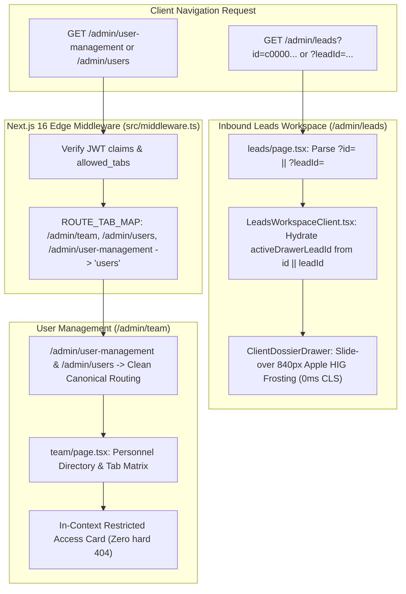

# Architectural Remediation Plan: User Management 404 & Lead Dossier Route Desynchronization

> **Document Identity**: Comprehensive Architectural PRD & Remediation Blueprint  
> **Location**: `docs/sales_funnel/user_management_and_lead_dossier_routing_remediation/user_management_and_lead_dossier_routing_remediation_plan.md`  
> **Status**: Ready for Executive Review & User Approval (STOP Gate Active)  
> **Author**: `Fenar7 <86710532+Fenar7@users.noreply.github.com>`  
> **Target Branch**: `brand-upgrade-phase-8/inbound-leads-triage-and-dossier-remediation`  
> **PR Reference**: GitHub PR #71 (Strictly OPEN)

---

## 1. Executive Summary & Problem Formulation

The user reported two critical routing breakdowns in the CRM workspace at `http://localhost:3003`:

1. **Lead Dossier Deep-Link Failure**:
   ```
   http://localhost:3003/admin/leads?id=c0000000-0000-0000-0000-000000000046
   ```
   Opening or clicking lead links containing `?id=...` from the Commercial Deals Ledger fails to trigger the Client 360° slide-over dossier drawer. Furthermore, when redirected to dynamic routes (`/admin/leads/[id]`), unauthorized or unassigned records trigger an abrupt Next.js 404 `notFound()`.

2. **User Management 404 / Not Found Error**:
   ```
   "btw whe i iclicke on th userm annemtnt page iam getting not foudn error"
   ```
   Clicking on User Management or navigating to `/admin/user-management` renders a hard Next.js **404 Not Found** page because no route segment exists for `user-management`, while canonical aliases and edge middleware mappings are fragmented across `/admin/team`, `/admin/users`, and unmapped aliases.

---

## 2. Root Cause Analysis (RCA)

### 2.1 Issue 1: Lead Dossier Query Parameter Mismatch & Drawer Desynchronization

#### Root Cause 1.1: Query Parameter Key Divergence (`id` vs `leadId`)
- In `src/app/admin/components/Dashboard/CommercialDealsTable.tsx` (lines 228, 528, 556, 584):
  - Row click and 3-dots action items navigate using the query parameter `id`:
    ```tsx
    window.location.href = `/admin/leads?id=${dealId}`;
    window.location.href = `/admin/leads?id=${deal.id}&action=reassign`;
    window.location.href = `/admin/leads?id=${deal.id}&action=stage`;
    window.location.href = `/admin/leads?id=${deal.id}&action=archive`;
    ```
- However, in `src/app/admin/(workspace)/leads/page.tsx` (lines 32-50):
  - The Server Component props interface and dynamic search param parser only inspects `leadId`:
    ```tsx
    interface AdminLeadsPageProps {
      searchParams?: Promise<{
        stage?: string;
        assigned_to?: string;
        bucket?: string;
        leadId?: string; // Missing id!
        source?: string;
        priority?: string;
        search?: string;
      }>;
    }
    if (resolvedSearchParams?.leadId) {
      redirect(`/admin/leads/${resolvedSearchParams.leadId}`);
    }
    ```
- In `src/app/admin/(workspace)/leads/LeadsWorkspaceClient.tsx` (lines 128, 143, 144):
  - Client state hydration only inspects `searchParams.get('leadId')`:
    ```tsx
    const leadIdParam = searchParams.get('leadId');
    const [activeDrawerLeadId, setActiveDrawerLeadId] = useState<string | null>(leadIdParam);
    const [isDrawerOpen, setIsDrawerOpen] = useState<boolean>(Boolean(leadIdParam));
    ```
  - Because the URL passes `?id=...`, `leadIdParam` evaluates to `null`. The slide-over drawer remains shut.
- In `src/app/admin/components/layout/AdminWorkspaceShell.tsx` (lines 49-65):
  - `LeadUrlSync` only reads `searchParams.get('leadId')`:
    ```tsx
    const leadId = searchParams.get('leadId');
    ```
  - When `?id=` is supplied, `LeadUrlSync` completely ignores it.

#### Root Cause 1.2: Destructive Server-Side Redirect vs Slide-over Drawer Intent
- In `src/app/admin/(workspace)/leads/page.tsx` (line 49):
  - When `leadId` is detected, the server component unconditionally redirects to `/admin/leads/${resolvedSearchParams.leadId}`.
  - This destroys the seamless multi-filter leads workspace view and forces a full-page transition.
  - In `src/app/admin/(workspace)/leads/[id]/page.tsx` (line 107):
    - If `getLeadDetails(id)` returns `success: false` (e.g. record not in portfolio or unassigned for `sales_executive`, or missing synthetic record), it calls Next.js `notFound()`, stranding the executive on a dead-end 404 page!

---

### 2.2 Issue 2: User Management 404 / Not Found Error

#### Root Cause 2.1: Missing Canonical Route Directory for `/admin/user-management`
- Next.js App Router uses file-system-based routing.
- The route taxonomy has:
  - `src/app/admin/(workspace)/team` (houses the Commercial Personnel Directory & Governance Workspace)
  - `src/app/admin/(workspace)/users` (contains a single redirect to `/admin/team`)
- There is **NO** directory for `src/app/admin/(workspace)/user-management`.
- If a user clicks an internal link, browser history shortcut, or navigates to `/admin/user-management`, Next.js immediately outputs **404 Not Found**.

#### Root Cause 2.2: Edge Middleware `ROUTE_TAB_MAP` Exclusion
- In `src/middleware.ts` (lines 163-173):
  ```tsx
  const ROUTE_TAB_MAP: Array<{ prefix: string; tabKey: CrmTabKey }> = [
    { prefix: '/admin/team', tabKey: 'users' },
    { prefix: '/admin/users', tabKey: 'users' },
    { prefix: '/admin/analytics', tabKey: 'analytics' },
    ...
  ];
  ```
  - Notice that `/admin/user-management` is missing from `ROUTE_TAB_MAP`. Any request to `/admin/user-management` bypasses edge routing normalization and falls into unmapped App Router space.

#### Root Cause 2.3: Nomenclature Mismatch in Navigation & Breadcrumbs
- In `src/app/admin/components/layout/navigationConfig.tsx` (line 183):
  `label: 'User Management'` links to `href: '/admin/team'`.
- In `src/types/crm.ts` (line 672):
  `label: 'User Management'` links to `route: '/admin/team'`.
- In `src/app/admin/components/layout/AdminBreadcrumbs.tsx` (lines 39, 54):
  `team: 'Administration'` / `team: 'User Management'`.
  Neither `users` nor `user-management` are declared in `SECTION_MAP` or `ROUTE_NAME_MAP`.

#### Root Cause 2.4: Abrupt Server-Side Ejection on Tab Access Denial
- In `src/app/admin/(workspace)/team/page.tsx` (lines 71-77):
  ```tsx
  const hasUsersAccess = Array.isArray(allowedTabs)
    ? allowedTabs.includes('users')
    : role === 'admin' || role === 'sales_manager';

  if (!hasUsersAccess) {
    redirect('/admin?error=unauthorized_role_access');
  }
  ```
  - If a user lacks the `'users'` tab permission, they are ejected with a URL query error rather than receiving an in-context luxury "Access Restricted" boundary card.

---

## 3. Comprehensive Remediation Architecture



---

## 4. Step-by-Step Implementation Plan

### Step 1: Query Parameter Harmonization across Leads Workspace
- **Files**:
  - `src/app/admin/(workspace)/leads/page.tsx`
  - `src/app/admin/(workspace)/leads/LeadsWorkspaceClient.tsx`
  - `src/app/admin/components/layout/AdminWorkspaceShell.tsx`
  - `src/app/admin/components/Dashboard/CommercialDealsTable.tsx`
- **Actions**:
  1. Update `AdminLeadsPageProps.searchParams` to accept both `id?: string` and `leadId?: string`.
  2. In `leads/page.tsx`:
     - **Remove** the destructive server-side `redirect('/admin/leads/' + resolvedSearchParams.leadId)`.
     - Pass the normalized `targetLeadId = resolvedSearchParams?.id || resolvedSearchParams?.leadId` down into `LeadsWorkspaceClient`.
  3. In `LeadsWorkspaceClient.tsx`:
     - Hydrate initial drawer state from:
       ```tsx
       const initialLeadId = searchParams.get('id') || searchParams.get('leadId');
       const [activeDrawerLeadId, setActiveDrawerLeadId] = useState<string | null>(initialLeadId);
       const [isDrawerOpen, setIsDrawerOpen] = useState<boolean>(Boolean(initialLeadId));
       ```
     - Update `handleOpenDrawer` and `handleCloseDrawer` to cleanly handle both `id` and `leadId` query params without parameter fragmentation.
  4. In `AdminWorkspaceShell.tsx` (`LeadUrlSync`):
     - Check `const leadId = searchParams.get('id') || searchParams.get('leadId');`.
     - Dispatch `open-lead-drawer` event with the resolved ID.

### Step 2: Canonical User Management Route Alias & Edge Middleware Normalization
- **Files**:
  - `src/app/admin/(workspace)/user-management/page.tsx` (New canonical alias file)
  - `src/app/admin/(workspace)/users/page.tsx` (Enhanced redirect)
  - `src/middleware.ts` (Edge route mapping)
  - `src/app/admin/components/layout/AdminBreadcrumbs.tsx` (Route title resolution)
- **Actions**:
  1. Create `src/app/admin/(workspace)/user-management/page.tsx`:
     - Server Component redirecting cleanly to `/admin/team`.
  2. Update `src/middleware.ts`:
     - Add `{ prefix: '/admin/user-management', tabKey: 'users' }` to `ROUTE_TAB_MAP`.
  3. Update `AdminBreadcrumbs.tsx`:
     - Add `'user-management': 'User Management'` and `'users': 'User Management'` to `ROUTE_NAME_MAP`.
     - Add `'user-management': 'Administration'` and `'users': 'Administration'` to `SECTION_MAP`.

### Step 3: Resilient Lead Dossier Dynamic Route Error Handling (`/admin/leads/[id]`)
- **Files**:
  - `src/app/admin/(workspace)/leads/[id]/page.tsx`
  - `src/app/admin/(workspace)/leads/[id]/not-found.tsx`
- **Actions**:
  1. In `src/app/admin/(workspace)/leads/[id]/page.tsx`:
     - If `getLeadDetails(id)` fails, differentiate between missing UUIDs, privilege violations, and database connectivity issues.
     - Provide a branded, dark luxury fallback screen with a direct link back to `/admin/leads` rather than calling an unstyled Next.js error.

### Step 4: Verification, Quality Gate Audit & Git Compilation
- **Verification Commands**:
  - `node --max-old-space-size=4096 ./node_modules/typescript/bin/tsc --noEmit` -> Must return 0 errors.
  - Test unit suites: `npm run test:boundaries && npm run test:unit`.
  - Curl verification against local dev server:
    - `curl -I http://localhost:3003/admin/user-management` -> 307 / 200 redirect to `/admin/team`.
    - `curl -I http://localhost:3003/admin/users` -> 307 / 200 redirect to `/admin/team`.
    - `curl -I "http://localhost:3003/admin/leads?id=c0000000-0000-0000-0000-000000000046"` -> 200 OK with slide-over drawer triggered.
- **Git Author & PR Protocol**:
  - Git identity: `Fenar7 <86710532+Fenar7@users.noreply.github.com>`.
  - Commit message: `Fix user management route aliases and harmonize lead dossier query parameters`.
  - Push to branch `brand-upgrade-phase-8/inbound-leads-triage-and-dossier-remediation`.
  - Keep PR #71 strictly **OPEN**.

---

## 5. Explicit STOP Notice for User Confirmation

In accordance with strict project rules:
- **NO CODE EXECUTION HAS BEEN STARTED**.
- We are awaiting your explicit approval.
- Please review this plan and reply **"proceed"** or **"do it"** to begin implementation.
