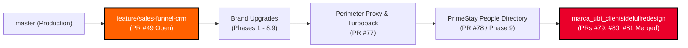

# Marca Ubi Platform Integration: Sales Funnel CRM & 160over90 Client Experience

> **Document Status**: PENDING USER APPROVAL (Do NOT execute code or create PRs until user types "proceed" or "do it")  
> **Source Integration Branch**: `marca_ubi_clientsidefullredesign`  
> **Target Branch Options**: `feature/sales-funnel-crm` (Recommended) vs. Sub-Branch PR Ladder  
> **Author & Identity**: Fenar7 `<86710532+Fenar7@users.noreply.github.com>`  
> **Auditor**: Senior CTO PR Auditor Agent  

---

## 1. Executive Summary & Git Ancestry Verification

A forensic branch tree audit was executed to analyze the relationship between `marca_ubi_clientsidefullredesign` and the `feature/sales-funnel-crm` workflow.

### 1.1 Mathematical Ancestry Check
```bash
git merge-base --is-ancestor feature/sales-funnel-crm marca_ubi_clientsidefullredesign
# Returns: 0 (True: feature/sales-funnel-crm is a strict ancestor)
```

`feature/sales-funnel-crm` is a **direct ancestor** of `marca_ubi_clientsidefullredesign`. Every single commit in `feature/sales-funnel-crm` (relational database schema, RLS policies, pipeline kanban, rep offboarding, dedup engine, and CRM shell) is **already present** in `marca_ubi_clientsidefullredesign`.



### 1.2 Merge Conflict Analysis
`git merge-tree` analysis confirms **0 git merge conflicts** between `feature/sales-funnel-crm` and `marca_ubi_clientsidefullredesign`.

---

## 2. PR Target Options & Architectural Evaluation

| Option | Target Base Branch | Commits Included | Pros | Cons | Recommendation |
| :--- | :--- | :--- | :--- | :--- | :--- |
| **Option 1 (Recommended)** | `feature/sales-funnel-crm` | 100 commits (Phases 1–9 Brand Upgrades + 160over90 Client Redesign) | Unifies the entire agency platform (Marketing + CRM) into the primary Sales Funnel branch. Automatically updates master release PR [#49](https://github.com/Fenar7/marca_ubi_web_hosting/pull/49). | Single large PR into `feature/sales-funnel-crm`. | **STRONGLY RECOMMENDED** |
| **Option 2** | `redesign/primestay-people-and-avatar-management` (head of PR #78) | 7 commits (160over90 Client Redesign only) | Keeps PR small by continuing the sub-branch ladder. | PR #78, #77, #76, #75, #74 remain in an open chain that must be merged sequentially. | Alternative if incremental PR ladder is preferred |
| **Option 3** | `master` | 100 commits (Phases 1–9 + 160over90 Client Redesign) | Bypasses `feature/sales-funnel-crm` and ships directly to master. | Duplicates PR #49 and skips the sales funnel umbrella workflow. | Not Recommended |

---

## 3. Step-by-Step Execution Protocol (Upon Approval)

If **Option 1** is selected:

### Step 1: Pre-Flight Verification Ledger
Verify all verification pillars on `marca_ubi_clientsidefullredesign`:
1. `npx tsc --noEmit` $\rightarrow$ Must be 0 errors.
2. `npm run test:boundaries` $\rightarrow$ 50/50 Server Action boundaries pass.
3. `tests/client/client_160over90_platform.test.ts` $\rightarrow$ 27/27 client invariants pass.
4. `src/app/admin/` air-gap $\rightarrow$ No unverified leaks between client and admin scopes.

### Step 2: Push & Open Pull Request Targeting `feature/sales-funnel-crm`
Execute GitHub CLI command:
```bash
gh pr create \
  --base feature/sales-funnel-crm \
  --head marca_ubi_clientsidefullredesign \
  --title "Unified Platform Release: 160over90 Client Experience & Commercial Intelligence CRM" \
  --body-file docs/sales_funnel_client_integration/pr_body.md
```
- PR title strictly contains **NO `feat`**.
- Author strictly: `Fenar7 <86710532+Fenar7@users.noreply.github.com>`.
- PR remains strictly **OPEN** (zero agent merges allowed).

### Step 3: Commission Senior CTO PR Auditor Agent
1. Launch execution telemetry watcher: `node scripts/redesign-execution-watcher.js`.
2. Spawn the **Senior CTO PR Auditor Agent** as a background subagent (`TypeName: "research"`).
3. The auditor will perform a line-by-line review of the PR diff and generate the official **4-Block Delivery Gate Report**.

### Step 4: Final Handover
Present the PR link and the 4-Block Delivery Gate Report to the user for manual review and click-to-merge on GitHub.

---

## 4. Open Decision for User

> [!IMPORTANT]
> Please confirm which target branch you prefer:
> - **Option 1 (Recommended)**: Create PR from `marca_ubi_clientsidefullredesign` targeting **`feature/sales-funnel-crm`** (unifies client platform and CRM).
> - **Option 2**: Create PR targeting the latest sub-branch **`redesign/primestay-people-and-avatar-management`** (PR #78).
>
> Under strict behavioral rules, no PR will be created until you explicitly type **"proceed"** or **"do it"**.
