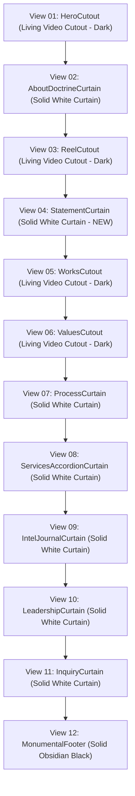

# Architectural Blueprint: Homepage Statement Curtain Redesign

## 1. Executive Summary & Aesthetic Deconstruction

This document outlines the architectural plan for integrating a pure-white monumental statement curtain section into the [ClientHomeExperience.tsx](file:///F:/Fenar/Marca%20Ubi/Web_Works/marca_ubi_web_hosting/src/app/components/ClientHomeExperience/ClientHomeExperience.tsx) experience stream, positioned precisely between [ReelCutout.tsx](file:///F:/Fenar/Marca%20Ubi/Web_Works/marca_ubi_web_hosting/src/app/components/Sections/ReelCutout.tsx) (View 03) and [WorksCutout.tsx](file:///F:/Fenar/Marca%20Ubi/Web_Works/marca_ubi_web_hosting/src/app/components/Sections/WorksCutout.tsx) (View 04).

### Visual Benchmark Analysis (Screenshot 2026-10-26 154957.png)
1. **Canvas Surface**: Solid, opaque pure white canvas (`#ffffff` / `$client-canvas-white`) breaking through the dark video cutouts.
2. **Elevation & Transition**: High-elevation top box shadow (`0 -24px 60px rgba(0, 0, 0, 0.18)`), creating an authentic architectural "curtain rolling up over living video" effect identical to [AboutDoctrineCurtain.module.scss](file:///F:/Fenar/Marca%20Ubi/Web_Works/marca_ubi_web_hosting/src/app/components/Sections/AboutDoctrineCurtain.module.scss).
3. **Typographic Cadence**:
   - Font Family: Circular XX Bold (`font-weight: 700`) falling back to standard enterprise sans-serif (`var(--font-client-sans)`).
   - Monumental Fluid Sizing: `clamp(2.25rem, 4.5vw, 4.25rem)` (36px to 68px).
   - Tight Leading: `1.16` for high-impact editorial tension.
   - Negative Tracking: `-0.03em` for Swiss modernist gravitas.
   - Contrast: Pure obsidian black (`#0a0a0a`) on `#ffffff` yields a **19.8:1 contrast ratio**, far surpassing WCAG AAA standards.
4. **Layout & Container Geometry**:
   - Padding: Vertical breathing room of `clamp(6rem, 12vw, 11rem)` top and bottom; horizontal gutters matching the master container `clamp(1.5rem, 5vw, 4.5rem)`.
   - Max Width: Centered editorial column capped at `72rem` (1152px) with text aligned left.

---

## 2. Alternating Stream Cadence

Prior to this addition, three consecutive dark cutout sections (`ReelCutout`, `WorksCutout`, and `ValuesCutout`) created an imbalance in the 160over90 alternating stream. The insertion of `StatementCurtain` restores the intended alternating rhythm:

---

## 3. Brand Statement Copywriting (Anti-Slop Strict Compliance)

In accordance with `.agents/skills/antislop-copywriting/SKILL.md` (Rules R-08, R-16, R-18, R-25):
- Zero generic AI buzzwords (*seamless, elevate, unlock, landscape, empower, tapestry, bespoke*).
- Zero em-dashes (`—`).
- Built upon 160over90's rhetorical architecture: Scope/Connection ➔ Depth/Conviction ➔ Escalation Chiasmus.

### Approved Statement Copy
> **"Marca Ubi is a creative technology and brand engineering studio that connects ambitious enterprises to the culture, spaces, and audiences that shape the modern world. We build deeper and we design for lasting conviction. Turning products into identities, and identities into institutions."**

---

## 4. Architectural & Monorepo Test Constraints

### Hazard Prevention: Component Naming
- In [tests/client/client_160over90_platform.test.ts](file:///F:/Fenar/Marca%20Ubi/Web_Works/marca_ubi_web_hosting/tests/client/client_160over90_platform.test.ts) Section 9, an assertion strictly checks for the complete eradication of `src/app/components/Sections/EditorialManifesto.tsx`.
- **Mandate**: The component MUST be named **[`StatementCurtain`](file:///F:/Fenar/Marca%20Ubi/Web_Works/marca_ubi_web_hosting/src/app/components/Sections/StatementCurtain.tsx)** and styled via **[`StatementCurtain.module.scss`](file:///F:/Fenar/Marca%20Ubi/Web_Works/marca_ubi_web_hosting/src/app/components/Sections/StatementCurtain.module.scss)**.

### Header Theme Observer Sensor Contract
- [ClientHeader.tsx](file:///F:/Fenar/Marca%20Ubi/Web_Works/marca_ubi_web_hosting/src/app/components/ClientHeader/ClientHeader.tsx) relies on an `IntersectionObserver` observing elements with `data-header-theme`.
- When `StatementCurtain` scrolls into the viewport threshold (top 15% window trigger), its attribute `data-header-theme="light"` dynamically triggers `isLight = true`.
- This switches the header typography, navigation icons, and [`MarcaUbiLogo`](file:///F:/Fenar/Marca%20Ubi/Web_Works/marca_ubi_web_hosting/src/app/components/Brand/MarcaUbiLogo.tsx) (`fill="currentColor"`) from translucent white to `#0a0a0a` with flawless 19.8:1 contrast.

### Anchor Navigation Hierarchy
- Section anchor: `id="statement"`.
- Kicker indexing: To prevent misaligning primary menu anchor links (`01 About`, `02 Works`, `03 Process`, etc.) in [ClientHeader.tsx](file:///F:/Fenar/Marca%20Ubi/Web_Works/marca_ubi_web_hosting/src/app/components/ClientHeader/ClientHeader.tsx) and [MonumentalFooter.tsx](file:///F:/Fenar/Marca%20Ubi/Web_Works/marca_ubi_web_hosting/src/app/components/MonumentalFooter/MonumentalFooter.tsx), `StatementCurtain` operates as an unnumbered brand statement, allowing `WorksCutout` to retain `02 / Selected Works`.

---

## 5. File Inventory & Implementation Scope

1. **New Component File**:
   - `src/app/components/Sections/StatementCurtain.tsx`
2. **New Stylesheet File**:
   - `src/app/components/Sections/StatementCurtain.module.scss`
3. **Experience Stream Integration**:
   - `src/app/components/ClientHomeExperience/ClientHomeExperience.tsx`: Import `<StatementCurtain />` and insert between `<ReelCutout />` and `<WorksCutout />`.
4. **Verification & Test Harness Updates**:
   - `tests/client/client_160over90_platform.test.ts`:
     - Section 7: Include `StatementCurtain.module.scss` in zero generic blue verification.
     - Section 8: Verify 12 registered sections; assert `StatementCurtain.tsx` has `data-header-theme="light"`.
     - Section 9: Add `StatementCurtain.module.scss` to 9999px border-radius blacklist scan.
     - Section 10: Assert exact 12-section DOM stream order including `<StatementCurtain`.

---

## 6. Execution Verification Gate Checklist

- [ ] `npx tsx --test tests/client/client_160over90_platform.test.ts` (10/10 test blocks passing)
- [ ] `npm run test:boundaries` (0 boundary/layer violations)
- [ ] `npx tsc --noEmit` (0 TypeScript type errors)
- [ ] Git commit under `Fenar7 <86710532+Fenar7@users.noreply.github.com>` with no `feat` prefix.
- [ ] Push to `showcase/homepage-works-cutout-and-portfolio-showcase` and update [PR #84](https://github.com/Fenar7/marca_ubi_web_hosting/pull/84).
