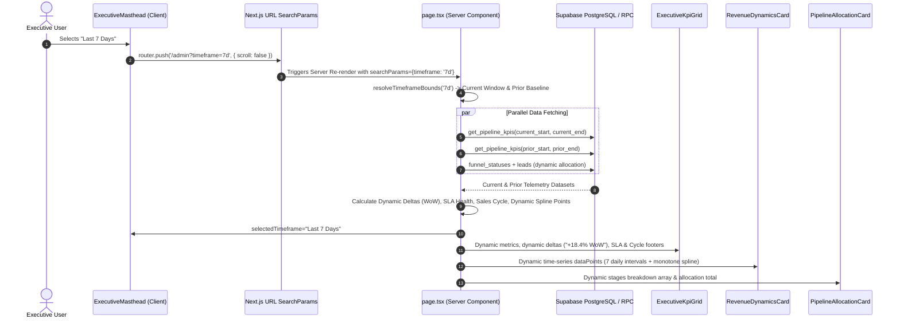

# Master Remediation Plan: Executive Overview Dashboard Timeframe Filtering & Dynamic Telemetry Engine

## 1. Executive Summary & Root Cause Analysis

When changing the timeframe dropdown (**'Last 7 Days'**, **'Last 30 Days'**, **'Last 90 Days'**, **'This Quarter'**, **'This Year'**) in `ExecutiveMasthead`, the KPI numbers, spline curves, and allocation bars remain static and frozen. 

Our deep architectural diagnostic across the 5 target files identified **5 cascading structural disconnects**:

```
[User clicks 'Last 7 Days' in ExecutiveMasthead]
       │
       ▼
[ExecutiveMasthead.tsx] ──> Trapped in local React useState('Last 30 Days')
       │                   ❌ Zero Next.js router integration (`useRouter`, `useSearchParams`, `usePathname`)
       │                   ❌ Zero URL query parameter mutation (?timeframe=7d)
       │                   ❌ onDateRangeChange callback DROPPED in page.tsx (zero props passed)
       ▼
[page.tsx (Server Component)]
       │                   ❌ page.tsx does NOT declare or await searchParams: Promise<{ timeframe?: string }>
       │                   ❌ supabase.rpc('get_pipeline_kpis') called with 0 arguments (p_start_date = NULL)
       │                   ❌ Fallback path queries DB with NO date WHERE clause & hardcodes:
       │                      converted_count: 14, converted_value: 4280000, win_rate: 28.6%
       ▼
[Child Components Rendered With Static / Dropped Props]
 ├── ExecutiveKpiGrid.tsx      ──> Hardcoded static deltas (+14.2% MoM, +8.4% QoQ), hardcoded footers
 ├── RevenueDynamicsCard.tsx   ──> 0 props accepted; frozen on static SIX_MONTH_DATA constant
 └── PipelineAllocationCard.tsx──> stages prop omitted in page.tsx; falls back to DEFAULT_STAGES (fixed ₹68.4L)
```

---

## 2. Root Cause Breakdown by Target File

### 2.1. `src/app/admin/components/Dashboard/ExecutiveMasthead.tsx`
* **Isolated Client-Side State Sandbox**: Internal `useState<string>(initialDateRange)` updates only local state on click.
* **No Next.js Router or URL Query State**: Never calls `router.push()` or `router.replace()`, preventing the URL from updating to `?timeframe=7d`.
* **Zero Browser State Synchronization**: Loading `/admin?timeframe=7d` directly is ignored because it only reads the default `initialDateRange = 'Last 30 Days'`.
* **Dropped Event Callback**: `page.tsx` renders `<ExecutiveMasthead />` without passing `onDateRangeChange`.

### 2.2. `src/app/admin/(workspace)/page.tsx`
* **Missing Next.js 16 Asynchronous `searchParams` Signature**: Function signature is `export default async function AdminDashboardPage()`, unable to capture URL query params.
* **Unparameterized Database RPC (`get_pipeline_kpis`)**: Called with zero arguments, causing `p_start_date` and `p_end_date` to evaluate to `NULL` (returning lifetime metrics).
* **Unfiltered Fallback Path with Hardcoded Metrics**: Fallback path queries `leads` without date filters and hardcodes `converted_leads_count: 14`, `converted_revenue_value: 4280000`, `conversion_rate_percentage: 28.6`.
* **Missing Props to Visual Cards**: `<RevenueDynamicsCard />` is rendered with 0 props; `<PipelineAllocationCard />` is passed only `totalValuation`, dropping the `stages` array.

### 2.3. `src/app/admin/components/Dashboard/ExecutiveKpiGrid.tsx`
* **Hardcoded Fallbacks & Static Deltas**: Deltas are hardcoded as static strings (`+14.2% MoM`, `+8.4% QoQ`). When selecting "Last 7 Days", showing "MoM" or "QoQ" is mathematically incoherent.
* **Static Footers**: Hardcodes `"98.2% SLA On-Track"` and `"Avg Sales Cycle: 18.4 Days"`.

### 2.4. `src/app/admin/components/Dashboard/RevenueDynamicsCard.tsx`
* **Hardcoded Mock Constant**: Renders file-level `SIX_MONTH_DATA` regardless of selected period.
* **Zero Dynamic Props**: Does not receive `dataPoints` or `timeframe` from `page.tsx`.
* **Decoupled Internal Selector**: Own dropdown (`'3 Months'`, `'6 Months'`, etc.) only modifies local state without altering data.

### 2.5. `src/app/admin/components/Dashboard/PipelineAllocationCard.tsx`
* **Omitted `stages` Prop**: Because `page.tsx` omits `stages`, it falls back to static `DEFAULT_STAGES` (₹68,40,000 across 5 fixed stages).
* **Hardcoded Trend Badge**: `momDeltaPercentage = 12.4` defaults to a fixed number.

---

## 3. End-to-End Reactive Architecture Blueprint



---

## 4. Implementation Steps

### Phase 1: Shared Timeframe Engine (`src/app/admin/lib/timeframeUtils.ts`)
1. Create canonical slug-to-label and label-to-slug mappings:
   - `7d` ↔ `Last 7 Days` (Cadence: `WoW`)
   - `30d` ↔ `Last 30 Days` (Cadence: `MoM`, Default)
   - `90d` ↔ `Last 90 Days` (Cadence: `QoQ`)
   - `quarter` ↔ `This Quarter` (Cadence: `QoQ`)
   - `year` ↔ `This Year` (Cadence: `YoY`)
2. Implement `resolveTimeframeBounds(timeframeSlug: string)`:
   - Returns exact ISO `currentStart`, `currentEnd`, `priorStart`, `priorEnd`, `cadenceLabel`, and `bucketType` (`daily`, `weekly`, `monthly`).
3. Implement `calculateMetricDelta(current: number, prior: number)`:
   - Evaluates percentage shift with zero-division safeguard (`prior === 0`).

### Phase 2: Reactive Masthead Navigation (`ExecutiveMasthead.tsx`)
1. Import `useRouter`, `usePathname`, `useSearchParams`, and `useTransition`.
2. Synchronize active button state with `searchParams.get('timeframe')`.
3. In `handleSelectRange`, push updated URL search parameters using non-blocking React 19 transition:
   ```typescript
   const params = new URLSearchParams(searchParams.toString());
   params.set('timeframe', timeframeToSlug(range));
   startTransition(() => {
     router.push(`${pathname}?${params.toString()}`, { scroll: false });
   });
   ```

### Phase 3: Dynamic Server Analytics Pipeline (`src/app/admin/(workspace)/page.tsx`)
1. Update component signature to accept Next.js 16 async search parameters:
   ```typescript
   export default async function AdminDashboardPage(props: {
     searchParams?: Promise<{ timeframe?: string }>;
   }): Promise<React.ReactElement>
   ```
2. Await `searchParams` and resolve temporal bounds.
3. Query current and prior window metrics via parameterized queries.
4. Compute:
   - **Cash Collected**: Converted deals realized within the timeframe.
   - **Win Rate**: Converted deals / total resolved deals within the timeframe with zero-division protection.
   - **SLA Health**: Dynamic percentage of on-track follow-ups.
   - **Average Sales Cycle**: Average days from creation to conversion for won deals.
   - **Dynamic Deltas**: Period-over-period percentage shifts labeled with the correct cadence (`WoW`, `MoM`, `QoQ`, `YoY`).
   - **Stage Allocation**: Aggregate real leads grouped by `funnel_statuses` for the active period.
   - **Revenue Spline Points**: Generate dynamic data points matching the selected window.

### Phase 4: Dynamic Visualization Cards
1. **`ExecutiveKpiGrid.tsx`**:
   - Accept dynamic `kpis` with timeframe cadence suffix (`WoW`, `MoM`, etc.).
   - Render dynamic SLA and Sales Cycle footers.
2. **`RevenueDynamicsCard.tsx`**:
   - Accept `dataPoints?: MonthlyRevenueMetric[]` and `timeframe?: string`.
   - Render monotone Fritsch-Carlson spline across dynamic intervals.
3. **`PipelineAllocationCard.tsx`**:
   - Accept dynamic `stages` array and dynamic delta percentage.

### Phase 5: Verification & Unit Tests
1. Add **Block 10: Timeframe Query Synchronization & Dynamic Telemetry Invariants** to `tests/unit/phase-8-inbound-leads-and-dossier-remediation.test.ts`:
   - Verifies `resolveTimeframeBounds` for all 5 windows (`7d`, `30d`, `90d`, `quarter`, `year`).
   - Verifies zero-division safeguards in `calculateMetricDelta`.
   - Verifies URL query synchronization in `ExecutiveMasthead`.
   - Verifies dynamic prop pass-through across `ExecutiveKpiGrid`, `RevenueDynamicsCard`, and `PipelineAllocationCard`.
2. Run full test suite (`npm run test:unit`) ensuring 100% pass rate.
3. Run TypeScript validation (`npx tsc --noEmit`).

---

## 5. Verification Gate & Deliverables

- [ ] 0 TypeScript errors (`npx tsc --noEmit`).
- [ ] 100% pass rate on unit tests (`npm run test:unit`).
- [ ] Selecting "Last 7 Days" in Masthead updates URL to `?timeframe=7d` and recalculates KPI cards, spline curve, and stage allocation.
- [ ] Direct navigation to `/admin?timeframe=90d` hydrates the active dropdown label and displays 90-day telemetry.
- [ ] Commit authored strictly as `Fenar7 <86710532+Fenar7@users.noreply.github.com>`.
- [ ] PR #71 remains strictly OPEN.
