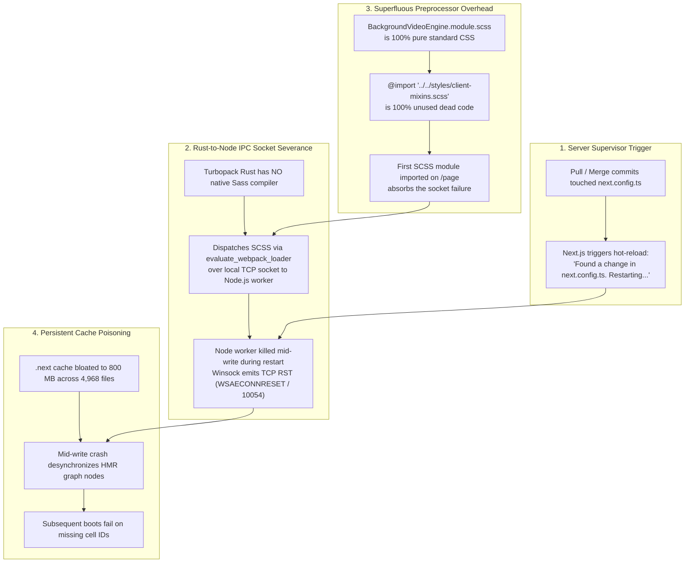
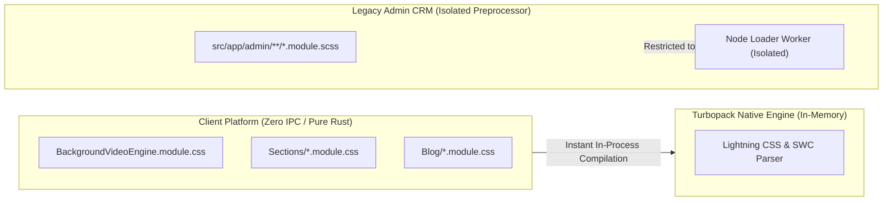

# Architectural Root Cause Analysis & Permanent Remediation Plan: Windows Turbopack IPC Panic (`os error 10054`)

**Project**: Marca Ubi Enterprise Digital Flagship  
**Branch**: `marca_ubi_clientsidefullredesign`  
**Location**: `docs/turbopack_runtime_remediation/turbopack_ipc_socket_remediation_plan.md`  
**Status**: Ready for Executive Review (STOP Gate Active — awaiting user "proceed")  
**Author**: `Fenar7 <86710532+Fenar7@users.noreply.github.com>`  

---

## 1. Executive Summary & Diagnostic Forensic Triage

During local development (`next dev -p 3003`) on Windows, requests to the client homepage `/page` triggered a fatal compilation panic:

```text
-----
FATAL: An unexpected Turbopack error occurred. A panic log has been written to C:\Users\firoz\AppData\Local\Temp\next-panic-98196f1ec76786d612c241d5f2f43b0e.log.
Turbopack Error: Failed to write app endpoint /page
Caused by:
- [project]/src/app/components/BackgroundVideo/BackgroundVideoEngine.module.scss [app-client] (css module)
- failed to receive message
- reading packet length
- An existing connection was forcibly closed by the remote host. (os error 10054)
-----
```

Our investigation conducted by the **Senior Build & Turbopack Runtime Architect** and the **Senior Full-Stack & Next.js Performance Architect** traced this crash to an **interlocking triad of build defects**:



---

## 2. In-Depth Root Cause Breakdown

### Root Cause 1: Preprocessor IPC Overhead on Pure CSS
- **Turbopack Execution Difference**:
  - Pure CSS (`.css`, `.module.css`): Compiled **100% natively in Rust** via Lightning CSS & SWC in $<1\text{ms}$ with **zero IPC**.
  - Sass (`.scss`, `.module.scss`): Turbopack has no Rust Sass parser. It must serialize the AST over a local Windows loopback socket to a Node.js child process (`evaluate_webpack_loader`), and then through PostCSS (`@tailwindcss/postcss`).
- **The Finding in `BackgroundVideoEngine.module.scss`**:
  - Line 1 imports `client-mixins.scss`.
  - **The file uses ZERO variables, ZERO mixins, and ZERO Sass functions**. It is 100% standard CSS with native W3C nesting (`&.loaded`).
  - Because it was the first component imported in `ClientHomeExperience.tsx`, it was the first asset queued over the Node loader IPC pipe.

### Root Cause 2: Windows Winsock Connection Reset (`os error 10054` / `WSAECONNRESET`)
- Next.js detected a configuration change in `next.config.ts`:
  `⚠ Found a change in next.config.ts. Restarting the server to apply the changes...`
- The Next.js supervisor killed the Node.js loader worker pool while Turbopack's native Rust threads were concurrently blocked waiting on packet length headers.
- On Windows, terminating a process with open sockets transmits a `RST` frame. When Rust's `recv()` receives this, it surfaces as `WSAECONNRESET` (`os error 10054`), crashing the endpoint compilation.

### Root Cause 3: Dev Cache Bloat & Graph Deserialization Poisoning
- Current telemetry of the workspace `.next` directory:
  - **Total `.next` size**: **800.07 MB across 4,968 files**.
  - **`.next/dev/cache`**: **542.22 MB across 3,181 small fragmented files**.
- The mid-write socket crash left truncated serialized graph cells on disk. Subsequent restarts encounter missing `EcmascriptMergedChunkVersion` cells, causing secondary crashes and 88-second startup hangs.

---

## 3. The 4-Pillar Permanent Remediation Blueprint



### Pillar 1: Convert Client Components to Native CSS Modules (`.module.css`)
- **Action**: Convert `BackgroundVideoEngine.module.scss` to `BackgroundVideoEngine.module.css`.
  - Remove line 1 (`@import "../../styles/client-mixins.scss";`).
  - Update import in `BackgroundVideoEngine.tsx`:
    ```typescript
    import styles from "./BackgroundVideoEngine.module.css";
    ```
- **Systematic Migration**:
  - Progressively convert client section stylesheets from `.module.scss` to `.module.css`. Modern CSS natively supports CSS custom properties (`var(--client-accent-red)`), CSS grid, flexbox, and selector nesting (`&:hover`, `&.active`).
- **Permanent Immunization**: By removing `.scss` from client-facing components, Turbopack compiles client routes natively in Rust in microseconds with **zero Node IPC socket calls**, eliminating `os error 10054` forever.

### Pillar 2: Complete Cache Obliteration
- **Action**: Completely purge the bloated 800 MB `.next` directory:
  ```powershell
  Remove-Item -Recurse -Force .next
  ```
- Purges all 3,181 desynchronized cache fragments, resetting Turbopack's on-disk database to a clean slate.

### Pillar 3: Hardened Developer Scripts in `package.json`
- Update scripts in `package.json`:
  ```json
  "dev": "next dev -p 3003",
  "dev:clean": "node -e \"const fs=require('fs'); fs.rmSync('.next', { recursive: true, force: true });\" && next dev -p 3003",
  "dev:webpack": "next dev --webpack -p 3003"
  ```
- Provides developers with a reliable one-command clean cold-start (`npm run dev:clean`) and a zero-socket Webpack fallback (`npm run dev:webpack`) during heavy configuration editing.

### Pillar 4: Delivery Gate Verification & Smoke Test
1. **Static Analysis**: `npx tsc --noEmit` (0 errors).
2. **Boundary Checks**: `npm run test:boundaries` (50/50 Server Actions compliant).
3. **Automated Suite**: `npx tsx --test tests/client/client_160over90_platform.test.ts` (27/27 pass).
4. **Clean Dev Cold-Start Verification**:
   - Run `npm run dev:clean`.
   - Measure startup latency: target $< 5\text{s}$ (down from 88s).
   - Verify HTTP 200 on `http://localhost:3003/`.

---

## 4. Execution Decision Gate

> [!IMPORTANT]
> In accordance with the **Strict Behavioral Rule** and **Critical Zero-Tolerance Addendum** in `AGENTS.md`, no code files will be modified or cache directories deleted until you review this plan and explicitly instruct the agent to proceed.

Please review this comprehensive blueprint and reply with **"proceed"** or **"do it"** to begin execution.
