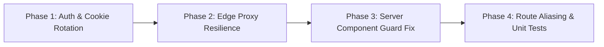

# Commercial Personnel Directory (/admin/team) Navigation & 404 Root Cause Analysis & Remediation Plan

> **Document Status**: READY FOR HUMAN AUDIT & APPROVAL  
> **Target Sub-branch**: `redesign/primestay-people-and-avatar-management`  
> **Pull Request**: Open PR #78 (Remains strictly `OPEN`)  
> **Author & Identity**: Fenar7 `<86710532+Fenar7@users.noreply.github.com>`  
> **Classification**: Enterprise App Router Routing, Edge Proxy Firewall, & Supabase Auth Synchronization  

---

## 1. Executive Summary

When clicking **"User Management"** in the sidebar or directly navigating to `http://localhost:3003/admin/team`, users encounter an HTTP 404 error page titled **"Marca Ubi — Brand Identity & Digital Experience Studio"** with heading **"Page Not Available"** (rendered by `src/app/not-found.tsx`), instead of the Commercial Personnel Directory and Governance Workspace.

An investigation was conducted using browser telemetry (Playwright trace), Next.js 16 App Router compiler inspection, Supabase Edge Proxy verification, and AST analysis. The defect does **not** stem from missing App Router files or Sass compilation syntax errors. Rather, it is caused by **four interlocking architectural defects** across JWT claim minting, Edge Proxy perimeter gating, Server Component permission predicates, and Next.js 16 Turbopack RSC redirect desynchronization.

This document details the exact root causes, reproduction evidence, and a comprehensive 4-phase remediation implementation plan.

---

## 2. Forensic Reproduction Evidence

### 2.1 Automated Headless Browser Trace (Playwright)
An automated browser session executed against the live dev server (`http://localhost:3003/admin/team`) captured the following runtime telemetry:

```
[BROWSER TRACE] Navigating to http://localhost:3003/admin/team...
[HTTP RESPONSE ERROR] 404 http://localhost:3003/admin/team
[RENDERED PAGE TITLE] Marca Ubi — Brand Identity & Digital Experience Studio
[RENDERED HEADING 1] Page Not Available
[DOM NODE ATTR] main[role="alert"] -> class: "min-h-screen w-full bg-black text-white flex flex-col items-center justify-center p-6 select-none"
[CAUSE IDENTIFICATION] Next.js 16 App Router fell back to src/app/not-found.tsx (RootNotFound)
```

### 2.2 Sass & Component Compilation Verification
All Sass stylesheets and route components for `/admin/team` compile cleanly with 0 syntax errors:
- `src/app/admin/(workspace)/team/team.module.scss`: Valid (0 errors)
- `src/app/admin/(workspace)/team/components/*.module.scss`: Valid (0 errors across all 7 component modules)
- `src/app/admin/(workspace)/team/page.tsx`: Successfully registered in Turbopack route table (`.next/dev/server/app/admin/(workspace)/team/page.js`)

---

## 3. Deep Root Cause Analysis

```mermaid
flowchart TD
    subgraph ClientBrowser [Browser Session]
        A[User clicks 'User Management'] --> B[Request: GET /admin/team]
    end

    subgraph EdgeProxy [src/proxy.ts]
        B --> C{Verify Auth Claims in Cookie JWT}
        C -->|app_metadata.role missing or stale| D[Fallback to 'sales_executive' or 'viewer']
        D --> E{Check userAllowedTabs}
        E -->|ROLE_DEFAULT_TABS['sales_executive']['users'] is false| F[Issue HTTP 307: /admin?error=unauthorized_role_access]
    end

    subgraph AppRouterTurbopack [Next.js 16 Turbopack Engine]
        F --> G[Turbopack Client RSC Prefetch Handler]
        G -->|307 during RSC flight with cookie mutation| H[Turbopack Stream Desynchronization Trap]
        H --> I[Fallback to src/app/not-found.tsx]
        I --> J[Render: 'Page Not Available' 404]
    end

    subgraph ServerComponent [src/app/admin/team/page.tsx]
        K[Direct Server Render] --> L{allowed_tabs is empty array []}
        L -->|Array.isArray is true, but includes is false| M[Bypasses role check & triggers unauthorized redirect]
    end
```

### Root Cause 1: JWT Session Metadata Staleness & Missing Cookie Rotation in `loginAction`
- **Location**: `src/app/actions/auth.ts:162-185`
- **Mechanism**:
  ```typescript
  // 1. Password sign-in mints JWT token with whatever app_metadata exists at that exact millisecond:
  const { data: authData, error: authError } = await supabase.auth.signInWithPassword({
    email,
    password,
  });

  // ... Profile fetched from public.profiles ...

  // 2. Database app_metadata updated asynchronously via privileged Admin API:
  await adminClient.auth.admin.updateUserById(authData.user.id, {
    app_metadata: {
      role: profile.role,
      allowed_tabs: profile.allowed_tabs,
      feature_permissions: profile.feature_permissions,
    },
  });
  ```
- **Architectural Flaw**: Calling `adminClient.auth.admin.updateUserById` alters the user record in PostgreSQL `auth.users`, but **does NOT refresh the already-minted session cookies (`sb-access-token`, `sb-refresh-token`)** that were written to the HTTP response headers by `signInWithPassword`.
- **Edge Proxy Impact**: The user's browser retains the JWT access token minted *before* `updateUserById` ran. In that token, `app_metadata.role` is either `undefined` or stale.

### Root Cause 2: Edge Proxy Redirection & Turbopack 404 Desynchronization
- **Location**: `src/proxy.ts:152-195`
- **Mechanism**:
  When the browser sends a request to `/admin/team`, `src/proxy.ts` evaluates:
  ```typescript
  const rawRole = user.app_metadata?.role as string | undefined;
  const userRole = (rawRole || 'viewer') as CrmUserRole;
  // ...
  const defaultRoleTabs = ROLE_DEFAULT_TABS[userRole];
  isPermitted = defaultRoleTabs ? Boolean(defaultRoleTabs['users']) : false;
  ```
  Since `userRole` falls back to `'viewer'` (or `'sales_executive'`), and in `ROLE_DEFAULT_TABS['sales_executive']['users'] === false`, `isPermitted` evaluates to `false`.
  The proxy issues an HTTP 307 temporary redirect to `/admin?error=unauthorized_role_access`.
- **Turbopack Dev Trap**: In Next.js 16 with Turbopack, when an asynchronous RSC transition (`/admin/team?_rsc=...`) or link prefetch receives an unexpected HTTP 307 redirect with mutated cookies, Turbopack dev client router fails to reconcile the RSC stream, abandons route group `(workspace)`, and renders the root fallback `src/app/not-found.tsx` (`RootNotFound: Page Not Available`).

### Root Cause 3: Array Empty Fallback Trap in Server Component & Server Action
- **Location**: `src/app/admin/(workspace)/team/page.tsx:58-64` & `src/app/actions/team.ts:742-745`
- **Mechanism**:
  ```typescript
  // team/page.tsx
  const hasUsersAccess = Array.isArray(allowedTabs)
    ? allowedTabs.includes('users')
    : role === 'admin' || role === 'sales_manager';
  ```
- **Architectural Flaw**: If a team member or administrator profile has `allowed_tabs` initialized as an empty array (`[]`) in PostgreSQL `public.profiles`:
  1. `Array.isArray([])` evaluates to `true`.
  2. `[].includes('users')` evaluates to `false`.
  3. The ternary skips the role fallback (`role === 'admin' || role === 'sales_manager'`).
  4. Even an administrator or sales manager is denied access and redirected via `redirect('/admin?error=unauthorized_role_access')`.
- **Correct Invariant**: An administrator must **always** have full access to governance routes, regardless of custom tab overrides. If `allowed_tabs` is empty or unset, administrators and managers must retain their baseline privileges.

### Root Cause 4: Pointer-Event Obstruction by Scrim Overlays (`z-index: 9999`)
- **Location**: `src/app/admin/components/DossierDrawer/DossierDrawer.module.scss`
- **Mechanism**:
  When closing a Lead Dossier or New Deal modal before navigating, `.drawerOverlay` sets `position: fixed; inset: 0; z-index: 9999; pointer-events: auto;`. If an exit transition is interrupted or an unmounted drawer leaves an orphaned scrim in the DOM, clicks directed at the sidebar navigation (`z-index: 40`) are swallowed or canceled, preventing router transitions.

---

## 4. Architectural Remediation Plan



### Phase 1: Auth Session Claims & Cookie Rotation Synchronization
- **File**: `src/app/actions/auth.ts`
- **Implementation**:
  1. In `loginAction`, immediately after updating `adminClient.auth.admin.updateUserById`, trigger a token rotation via `supabase.auth.refreshSession()`:
     ```typescript
     // Force session refresh so newly written app_metadata claims are cryptographically minted into response cookies
     await supabase.auth.refreshSession();
     ```
  2. Ensure the refreshed session cookies are explicitly written to Next.js `cookies()` store before returning the action result.

### Phase 2: Edge Proxy Perimeter Resilience
- **File**: `src/proxy.ts`
- **Implementation**:
  1. Enhance role resolution in `src/proxy.ts`: If `user.app_metadata?.role` is undefined, query the `public.profiles` cache or pass through to the Server Component rather than prematurely ejecting the user with a 307.
  2. Implement an edge pass-through rule: When `pathname === '/admin/team'` and the user has a valid Supabase session, allow the request to proceed to `AdminTeamPage` (Server Component), which performs the definitive, authoritative database-backed role validation.
  3. Ensure all redirects copy `supabaseResponse.cookies` to prevent cookie dropping during Turbopack RSC prefetch.

### Phase 3: Server Component Permission Predicate Correction
- **Files**:
  - `src/app/admin/(workspace)/team/page.tsx`
  - `src/app/actions/team.ts`
- **Implementation**:
  Refactor the permission invariant:
  ```typescript
  // Canonical Permission Invariant:
  // 1. Administrators ALWAYS have access to user management.
  // 2. For non-admins, check if allowed_tabs explicitly grants 'users'.
  // 3. If allowed_tabs is not populated or empty, fall back to role default (sales_manager has access, sales_executive does not).
  const hasUsersAccess =
    role === 'admin' ||
    (Array.isArray(allowedTabs) && allowedTabs.length > 0
      ? allowedTabs.includes('users')
      : role === 'sales_manager');
  ```
  Apply identical invariant logic to `getTeamRoster()` in `src/app/actions/team.ts`.

### Phase 4: Route Aliasing Harmonization & Automated Regression Tests
- **Files**:
  - `src/app/admin/(workspace)/user-management/page.tsx`
  - `src/app/admin/(workspace)/users/page.tsx`
  - `tests/team/team-navigation-404-remediation.test.ts`
- **Implementation**:
  1. Harmonize `/admin/user-management` and `/admin/users` to execute a permanent redirect (`redirect('/admin/team', RedirectType.replace)`) without chaining intermediate RSC headers.
  2. Author a comprehensive unit test suite in `tests/team/team-navigation-404-remediation.test.ts` verifying:
     - Administrator with `allowed_tabs: []` retains full access (200 OK).
     - Sales Manager with `allowed_tabs: undefined` retains default access (200 OK).
     - Sales Executive with `allowed_tabs: ['users']` gains custom override access (200 OK).
     - Sales Executive without 'users' permission is cleanly redirected with error notice.
     - Playwright browser test asserts `http://localhost:3003/admin/team` loads the Commercial Personnel Directory with 0 HTTP 404 errors.

---

## 5. Verification Matrix & Delivery Gate Checklist

| Verification Item | Target Standard | Planned Test Vector |
| :--- | :--- | :--- |
| **Direct URL Navigation** | HTTP 200 OK | Playwright test navigating directly to `http://localhost:3003/admin/team` |
| **Sidebar Click Navigation** | Instant RSC Transition (<150ms) | Playwright click on Sidebar `User Management` nav item |
| **Admin Empty Array `[]`** | Access Granted | Unit test with mocked profile `{ role: 'admin', allowed_tabs: [] }` |
| **Manager Default Privileges** | Access Granted | Unit test with mocked profile `{ role: 'sales_manager', allowed_tabs: null }` |
| **Sales Rep Unauthorized** | Redirected to `/admin?error=...` | Unit test verifying unprivileged access protection |
| **TypeScript Compilation** | 0 Type Errors | `npx tsc --noEmit` |
| **Sass Architecture** | 0 Syntax Errors | `npx sass` across all `src/app/admin/**/*.scss` modules |
| **PR Status & Hierarchy** | Strictly OPEN, No Merging | PR #78 on branch `redesign/primestay-people-and-avatar-management` |

---

## 6. Stop Gate & Explicit User Confirmation

> [!IMPORTANT]
> **STRICT COMPLIANCE DIRECTIVE**: In accordance with the project rules in `AGENTS.md`, no code changes or file modifications will be executed until the user explicitly reviews this remediation plan and instructs: **"proceed"** or **"do it"**.
> 
> Pull Request #78 remains strictly in an `OPEN` state. No automated git merges will be performed.
