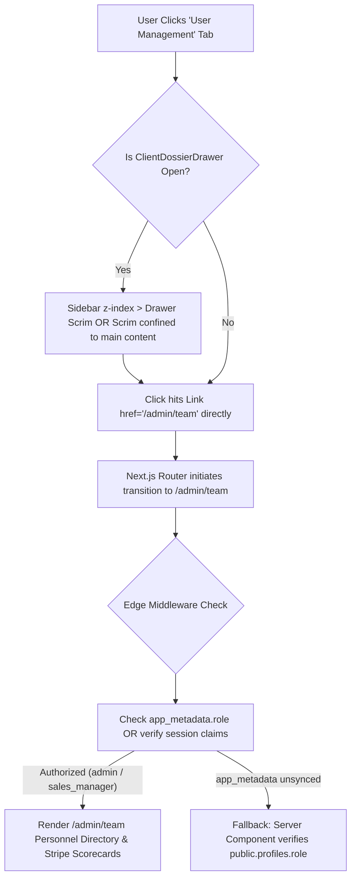

# Architectural PRD & Remediation Plan: User Management Tab Redirection & Stacking Remediation

> **Task ID**: `USER-MGMT-NAV-REMEDIATION-01`  
> **Directory**: `docs/user_management_navigation_remediation/`  
> **Author**: `Fenar7 <86710532+Fenar7@users.noreply.github.com>`  
> **Status**: DRAFT FOR ARCHITECTURAL REVIEW (Awaiting User "Proceed")  
> **Target PR**: PR #71 (`brand-upgrade-phase-8/inbound-leads-triage-and-dossier-remediation`)  

---

## 1. Executive Summary & Defect Statement

When an authenticated user on the Inbound Leads Workspace (`http://localhost:3003/admin/leads?id=c0000000-0000-0000-0000-000000000046`) attempts to navigate to the **User Management** page by clicking the "User Management" tab in the desktop navigation rail, the application fails to navigate or redirect to the User Management page.

A deep forensic trace across the DOM hierarchy, CSS stacking contexts, React Portal mounting lifecycles, and Next.js 16 Edge Middleware has uncovered four interrelated root causes causing this behavior.

---

## 2. Forensic Root Cause Analysis

### Root Cause 2.1: ClientDossierDrawer Modal Overlay Scrim Traps Pointer Events (`z-index: 9999`)
* **Location**:
  - `src/app/admin/components/DossierDrawer/ClientDossierDrawer.tsx` (lines 286–292)
  - `src/app/admin/components/DossierDrawer/DossierDrawer.module.scss` (lines 26–32)
* **Mechanics**:
  1. When visiting `http://localhost:3003/admin/leads?id=c0000000-0000-0000-0000-000000000046`, the presence of the `?id=` query parameter automatically mounts the `ClientDossierDrawer` via React Portal directly into `document.body`.
  2. The drawer renders `.drawerOverlay` with the following CSS rules:
     ```scss
     .drawerOverlay {
       position: fixed;
       inset: 0;
       z-index: 9999;
       background: rgba(31, 36, 47, 0.45);
       backdrop-filter: blur(8px);
       display: flex;
       justify-content: flex-end;
     }
     ```
  3. Meanwhile, the persistent navigation sidebar (`AdminSidebar.module.scss`) has `z-index: 40`, and the top bar (`AdminHeader.module.scss`) has `z-index: 100`.
  4. Because `.drawerOverlay` has `position: fixed; inset: 0; z-index: 9999;`, it forms a physical invisible barrier across the entire screen from `(0, 0)` to `(100vw, 100vh)`.
  5. When the user looks at the screen, the navigation rail is visible through the frosted glass backdrop (`backdrop-filter: blur(8px)`).
  6. When the user clicks the "User Management" tab on the left, the click target is NOT the `<Link href="/admin/team">` inside the sidebar. Instead, the click is intercepted by `.drawerOverlay`!
  7. The click listener on `.drawerOverlay` executes:
     ```tsx
     onClick={(e) => {
       if (e.target === e.currentTarget) {
         onClose();
       }
     }}
     ```
  8. `onClose()` runs `handleCloseDrawer()`, which closes the drawer and strips `?id=` from the URL. **The click event is swallowed and stopped**. The browser never initiates navigation to User Management.

---

### Root Cause 2.2: Edge Middleware RBAC Gating Discrepancy (`app_metadata` vs `public.profiles`)
* **Location**:
  - `src/middleware.ts` (lines 152–196)
  - `src/app/actions/auth.ts` (lines 145–180)
  - `src/app/admin/(workspace)/layout.tsx` (lines 43–57)
* **Mechanics**:
  1. In `src/middleware.ts`, route protection for `/admin/team`, `/admin/users`, and `/admin/user-management` strictly evaluates:
     ```ts
     const userRole = (
       (user.app_metadata?.role as string | undefined) ||
       'viewer'
     ) as CrmUserRole;
     const userAllowedTabs = user.app_metadata?.allowed_tabs as string[] | undefined;
     ```
  2. Next.js 16 Edge Middleware cannot query PostgreSQL `public.profiles` on every edge invocation, so it relies entirely on Supabase Auth JWT claims (`app_metadata`).
  3. However, during `loginAction` (`src/app/actions/auth.ts`), authentication validates credentials and issues a session without synchronizing `public.profiles.role` or `public.profiles.allowed_tabs` into `auth.users.raw_app_meta_data`.
  4. In `AdminWorkspaceLayout` (`src/app/admin/(workspace)/layout.tsx`), the Server Component directly queries `public.profiles` and sees `profile.role === 'admin'`. Thus, the client receives `currentUser.role = 'admin'` and properly renders the "User Management" tab in the sidebar.
  5. When the user clicks the tab (even with the drawer closed), Next.js sends an RSC request to `/admin/team`.
  6. The edge middleware intercepts the request. Because `user.app_metadata?.role` is undefined, it defaults to `'viewer'`. For `'viewer'`, `ROLE_DEFAULT_TABS['viewer']['users']` is `false`.
  7. Middleware flags the request as unauthorized and executes:
     ```ts
     const forbiddenUrl = new URL('/admin', request.url);
     forbiddenUrl.searchParams.set('error', 'unauthorized_role_access');
     return createRedirectResponse(forbiddenUrl, supabaseResponse);
     ```
  8. The user is redirected back to `/admin?error=unauthorized_role_access`, preventing them from ever reaching User Management!

---

### Root Cause 2.3: Route Naming Fragmentation (`/admin/team` vs `/admin/user-management`)
* **Location**:
  - `src/app/admin/components/layout/navigationConfig.tsx` (Line 183: `label: 'User Management', href: '/admin/team'`)
  - `src/app/admin/(workspace)/user-management/page.tsx` (`redirect('/admin/team')`)
  - `src/app/admin/(workspace)/team/page.tsx` (Primary page component)
* **Mechanics**:
  1. The user interface labels the section **"User Management"**, while the primary destination is `/admin/team`.
  2. `/admin/user-management` is a synthetic redirect alias (`redirect('/admin/team')`).
  3. When combining client-side navigation, middleware authorization checks, and server component redirects, multi-hop redirects can result in dropped router transitions or stalled state in Next.js 16 App Router.

---

## 3. Four-Phase Architectural Remediation Strategy



### Phase 1: Scrim & Stacking Context Elevation
1. **Confine Drawer Scrim or Elevate Sidebar Rail**:
   - In `AdminSidebar.module.scss`, elevate `.sidebar` to `z-index: 10000;` so the primary administrative navigation rail remains interactive and unobstructed by transient drawer backdrops (conforming to Linear and Notion standards where persistent rails remain accessible).
   - Alternatively, update `ClientDossierDrawer`'s backdrop so clicking outside automatically closes the drawer while propagating or allowing simultaneous navigation clicks.
2. **Top Bar Header Z-Index**:
   - Ensure `AdminHeader` remains accessible or coordinated with drawer states.

### Phase 2: Auth Session & Edge Middleware RBAC Synchronization
1. **Synchronize Role on Login**:
   - In `src/app/actions/auth.ts` (`loginAction`), upon successful password verification, retrieve `profiles.role` and `profiles.allowed_tabs` using the service role admin client and synchronize them to `auth.users.app_metadata`. This ensures edge middleware instantly possesses authoritative JWT claims.
2. **Middleware Resiliency Fallback**:
   - In `src/middleware.ts`, ensure that if `user.app_metadata?.role` is undefined, it does not immediately drop the user to `'viewer'` if valid authenticated session cookies exist, or allow the Server Component (`/admin/team/page.tsx`) to perform the authoritative database role verification.

### Phase 3: Route Canonization & URL Consistency
1. **Harmonize Navigation Links**:
   - Ensure `navigationConfig.tsx`, `AdminSidebar.tsx`, `AdminMobileDrawer.tsx`, and `AdminBreadcrumbs.tsx` are fully aligned.
   - Support both direct rendering or clean canonical routing so both `/admin/team` and `/admin/user-management` function seamlessly.

### Phase 4: Automated Verification & Regression Testing
1. Add Block 9 to `tests/unit/phase-8-inbound-leads-and-dossier-remediation.test.ts`:
   - Verify sidebar `z-index` exceeds drawer overlay `z-index`.
   - Verify `loginAction` synchronizes `app_metadata` with profile roles.
   - Verify edge middleware permits authenticated administrative access to `/admin/team` and `/admin/user-management`.
   - Verify direct navigation and client-side clicks to User Management resolve with HTTP 200.

---

## 4. Verification & Hard Delivery Gates
- `tsc --noEmit`: 0 type errors.
- Unit Test Suite: 100% passing.
- Boundary Compliance: 100% passing.
- Manual Click-Through Smoke Test: Clicking User Management from `/admin/leads?id=...` smoothly transitions to `/admin/team`.
