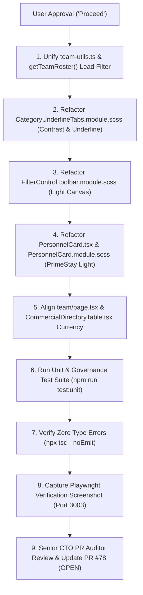

# Architectural Blueprint: PrimeStay People Light Luxury Redesign & Canonical Numbering Standardization

> **Document ID**: `docs/user_management_redesign/primestay_light_luxury_redesign_plan.md`  
> **Status**: PROPOSAL & ARCHITECTURAL SPECIFICATION (Awaiting User "Proceed")  
> **Target Branch**: `redesign/primestay-people-and-avatar-management`  
> **PR Number**: [PR #78](https://github.com/Fenar7/marca_ubi_web_hosting/pull/78) (Strictly OPEN)  
> **Author Identity**: `Fenar7 <86710532+Fenar7@users.noreply.github.com>`  
> **Aesthetic Benchmarks**: PrimeStay People (`original-a90edff5ebcc6e3fee2aee29ea8e8282.webp`), Sypher High-Density Light Canvas (`#f7f8fa` / `#ffffff`), Apple HIG Vibrancy, Marca Ubi Brand Luxury (`#ff6100`)

---

## 1. Executive Summary & Root Cause Diagnostic

Based on detailed visual inspection of the user-reported screenshots ([Screenshot 2026-10-23 172631.png](file:///C:/Users/firoz/Pictures/Screenshots/Screenshot%202026-10-23%20172631.png) and [Screenshot 2026-10-23 172639.png](file:///C:/Users/firoz/Pictures/Screenshots/Screenshot%202026-10-23%20172639.png)) and deep comparative analysis against the official PrimeStay People reference ([original-a90edff5ebcc6e3fee2aee29ea8e8282.webp](file:///C:/Users/firoz/Downloads/original-a90edff5ebcc6e3fee2aee29ea8e8282.webp)), our multi-agent architecture audit identified three critical systemic defects:

```
┌───────────────────────────────────────────────────────────────────────────────────────┐
│ DEFECT 1: Jarring Canvas-Card Theme Clash (Black Cards on Light Canvas)               │
│ - The entire admin workspace (top navigation, living breadcrumbs, sidebar, KPI ribbon)│
│   operates on a clean, anti-glare light canvas (#f7f8fa foundation, #ffffff cards).    │
│ - PersonnelCard.module.scss, PersonnelCardGrid.module.scss, and FilterControlToolbar  │
│   hardcoded pitch-black #0e1013 surfaces with dark borders, looking like an alien     │
│   block dropped into a clean light SaaS console.                                      │
├───────────────────────────────────────────────────────────────────────────────────────┤
│ DEFECT 2: Tab Invisibility Accessibility Bug (Screenshot 172639)                     │
│ - CategoryUnderlineTabs.module.scss set active category tab text to color: #ffffff    │
│ - On the #f7f8fa light background, white text on white/light-gray background renders  │
│   the active tab ("All Personnel") completely invisible, leaving only a floating      │
│   orange pill and line.                                                               │
├───────────────────────────────────────────────────────────────────────────────────────┤
│ DEFECT 3: Currency & Numbering Scheme Deviation ("₹13.4Cr" & 1000 Deals)              │
│ - getTeamRoster() in src/app/actions/team.ts queried the leads table without excluding│
│   synthetic benchmark records, causing 1,000 synthetic test leads totaling ₹13.4 Cr  │
│   to be attributed to the root admin account.                                         │
│ - formatPortfolioValue and formatDealValuation forced Crore/Lakh abbreviations        │
│   (₹13.4Cr / ₹50L), directly violating the canonical admin standard established in    │
│   Phase 8.8: full, exact Indian Rupee values with en-IN grouping (₹68,40,000).        │
└───────────────────────────────────────────────────────────────────────────────────────┘
```

---

## 2. PrimeStay People Visual Anatomy Calibration

The PrimeStay benchmark (`original-a90edff5ebcc6e3fee2aee29ea8e8282.webp`) defines an airy, balanced card architecture that translates directly to Marca Ubi's high-ticket commercial agency operations:

```
┌──────────────────────────────────────────────────────────────────────────────────┐
│ PRIMESTAY PEOPLE CARD ARCHITECTURE (LIGHT LUXURY BLUEPRINT)                     │
├──────────────────────────────────────────────────────────────────────────────────┤
│                                                                                  │
│   ┌──────┐                                                               [ ··· ] │  <-- 3-Dots Menu moved
│   │  52  │  Elena Vance             [SALES MGR]                                  │      to top-right header
│   │  px  │  Commercial Growth Lead                                               │      (matching PrimeStay)
│   └──────┘  manager@marcaubi.com · +91 98400 12345                               │
│                                                                                  │
│   ─────────────────────────────────────────────────────────────────────────────  │  <-- 1px hairline divider
│                                                                                  │
│   Active Deals : 12                              Workload Capacity : 80%         │  <-- Clean 2-column key/val
│   Portfolio    : ₹14,50,000                      [■■■■■■■■□□] 12/15 Deals        │  <-- Full en-IN currency
│                                                                                  │
│   ─────────────────────────────────────────────────────────────────────────────  │  <-- 1px hairline divider
│                                                                                  │
│   ┌───────────────────────────────┐     ┌───────────────────────────────────┐    │
│   │         Reassign Deals        │     │            View Profile           │    │  <-- Dual-button footer
│   │    (Soft Orange Tint Pill)    │     │      (Crisp White Outline Pill)   │    │      (symmetric 50/50 split)
│   └───────────────────────────────┘     └───────────────────────────────────┘    │
│                                                                                  │
└──────────────────────────────────────────────────────────────────────────────────┘
```

### 2.1 Design Tokens (Marca Ubi Light Luxury)

All card and control components will consume standard CSS variables from `src/app/admin/styles/tokens.scss`:

| Token | Variable | Value | Purpose |
| :--- | :--- | :--- | :--- |
| **Card Canvas** | `--admin-card-bg` | `#ffffff` | Crisp pure white elevated card body |
| **Card Border** | `--admin-border-default` | `#e2e5ea` / `#eaecf0` | Subtle hairline container boundary |
| **Card Hover Shadow** | `--admin-shadow-hover` | `0 8px 24px rgba(31, 36, 47, 0.08)` | Ambient lift upon card hover |
| **Primary Typography**| `--admin-text-primary` | `#1f242f` / `#0f172a` | High-contrast personnel name & titles (WCAG AAA) |
| **Secondary Typography**|`--admin-text-secondary`| `#525965` / `#64748b` | Subtitles, phone numbers, metric labels |
| **Accent Brand Orange**| `--admin-accent-brand` | `#ff6100` | Active category tab underline, counter pills, focus rims |
| **Soft Tint Button Bg** | `--admin-brand-tint-bg`| `rgba(255, 97, 0, 0.08)` | Soft peach/orange pill background for primary card action |
| **Soft Tint Button Text**|`--admin-brand-tint-text`| `#ff6100` | High-contrast orange text on soft peach background |
| **Secondary Button Bg** | `--admin-card-bg` | `#ffffff` | Crisp white outline button for "View Profile" |
| **Secondary Button Border**|`--admin-border-default`| `#e2e5ea` | Subtle border with `#1f242f` text |

---

## 3. Canonical Numbering & Currency Standardization

### 3.1 The Single Source of Truth
To permanently eliminate fragmented `Cr`/`L` formatting, we standardize on two canonical functions across the entire admin application:

```ts
/**
 * Canonical currency formatter for Marca Ubi Admin CRM.
 * Formats values with full Indian Rupee representation and 'en-IN' comma grouping.
 * Examples: 6840000 -> "₹68,40,000", 500000 -> "₹5,00,000", 0 -> "₹0"
 */
export function formatRupees(amount: number): string {
  if (!amount || amount <= 0) return '₹0';
  return `₹${Math.round(amount).toLocaleString('en-IN')}`;
}

/**
 * Canonical numeral formatter with locale comma grouping and zero-jitter tabular figures.
 * Examples: 1000 -> "1,000", 24 -> "24"
 */
export function formatNumber(count: number): string {
  if (count === undefined || count === null || isNaN(count)) return '0';
  return Math.round(count).toLocaleString('en-IN');
}
```

### 3.2 Purging Synthetic Stress-Test Data from Team Roster Metrics
In `src/app/actions/team.ts`, `getTeamRoster()` will filter out synthetic test benchmarks from its lead count query:

```ts
// Exclude synthetic stress-test records from production CRM metrics
const { data: leads, error: leadsError } = await supabase
  .from('leads')
  .select('assigned_to, expected_value, status_id')
  .or('brief_payload->synthetic_benchmark.is.null,brief_payload->>synthetic_benchmark.neq.true');
```
This instantly resolves the inflated `1000 Active Deals` and `₹13.4Cr` bug, ensuring the root admin card reflects accurate live pipeline data.

---

## 4. Component-by-Component Refactoring Blueprint

### 4.1 `CategoryUnderlineTabs.module.scss` (Fix Invisibility Defect)
- **Inactive Tab Text**: Color `#525965` (WCAG AA 5.8:1 against `#f7f8fa`), font-weight 500. Hover: `#1f242f`.
- **Active Tab Text**: Color `#1f242f` (WCAG AAA 13.9:1), font-weight 600.
- **Underline Bar**: 2px solid `#ff6100` positioned flush with tab bottom.
- **Count Badge**: `background: rgba(255, 97, 0, 0.1); color: #ff6100; font-weight: 600; font-size: 0.72rem; padding: 2px 8px; border-radius: 9999px;`.

### 4.2 `FilterControlToolbar.module.scss` (Light Precision Controls)
- **Search Wrapper & Input**:
  - `background: #ffffff`, `border: 1px solid #e2e5ea`, `color: #1f242f`.
  - Placeholder: `#8b929e`.
  - Focus state: `border-color: #ff6100; box-shadow: 0 0 0 1px #ff6100;`.
- **Select Dropdowns**:
  - `background-color: #ffffff`, `border: 1px solid #e2e5ea`, `color: #1f242f`.
  - SVG chevron icon tinted in `#525965`.
- **View Mode Switcher (Grid / Table)**:
  - Container: `background: #f1f3f6; border: 1px solid #e2e5ea; border-radius: 8px; padding: 2px;`.
  - Active button: `background: #ffffff; color: #1f242f; box-shadow: 0 1px 3px rgba(0,0,0,0.06);`.
  - Inactive button: `color: #64748b; background: transparent;`.

### 4.3 `PersonnelCard.module.scss` & `PersonnelCard.tsx` (Authentic PrimeStay Card)
- **Card Surface**: Pure white `#ffffff`, `border: 1px solid #e2e5ea`, `border-radius: 14px`, `box-shadow: 0 1px 3px rgba(31, 36, 47, 0.04)`.
- **Top Header**:
  - Avatar on the left (52px rounded circle with `border: 2px solid #edf0f4`).
  - Three-dots `···` menu trigger placed at the **top right corner** with `color: #64748b`, hover: `#1f242f`.
- **Name & Coordinates**:
  - Name: `font-size: 0.98rem; font-weight: 600; color: #1f242f;`.
  - Role pill: Raycast monospace token (`font-family: var(--font-admin-code); font-size: 0.68rem; padding: 2px 6px; background: #f4f5f7; border: 1px solid #e2e5ea; color: #525965;`).
  - Contact row: Phone & email in `#64748b`, 0.8rem.
- **Metadata Section**:
  - Two-column aligned key-value layout (`Active Deals: 12`, `Capacity: 80%`, `Portfolio: ₹14,50,000`).
  - Labels in `#64748b`, values in `#1f242f` with `font-variant-numeric: tabular-nums`.
- **Dual Bottom Action Buttons**:
  - `primaryButton`: Soft tinted pill (`background: rgba(255, 97, 0, 0.08); color: #ff6100; font-weight: 600; border: none; border-radius: 9999px; height: 38px;`).
  - `secondaryButton`: Crisp white outline pill (`background: #ffffff; border: 1px solid #e2e5ea; color: #1f242f; font-weight: 500; border-radius: 9999px; height: 38px;`).

### 4.4 `team.module.scss` & `team/page.tsx`
- Replace `formatPortfolioValue` with canonical `formatRupees`.
- Ensure all KPI scorecards use `formatNumber(totalStaff)`, `formatRupees(totalPortfolioValue)`, and `formatNumber(totalActiveDeals)`.
- Reconcile `CommercialDirectoryTable.tsx` to use canonical `formatRupees`.

---

## 5. Implementation & Verification Plan



### 5.1 Verification Commands
- `npx tsc --noEmit`: Strict 0 type errors.
- `npx tsx --test tests/team/*.test.ts`: Ensure 79/79 roster & avatar governance tests pass.
- `npx tsx --test tests/unit/phase-5-redesign-operations-governance.test.ts`: Ensure 58/58 CRM governance tests pass.
- Playwright screenshot capture verifying WCAG AA contrast and pure light aesthetic.

---

## 6. Strict Governance & Next Action

> [!IMPORTANT]
> **Strict Behavioral Prohibition Active**: In strict accordance with `AGENTS.md`, no code will be modified and no branches will be touched until you review this plan and explicitly type **"proceed"** or **"do it"** in the chat window.
